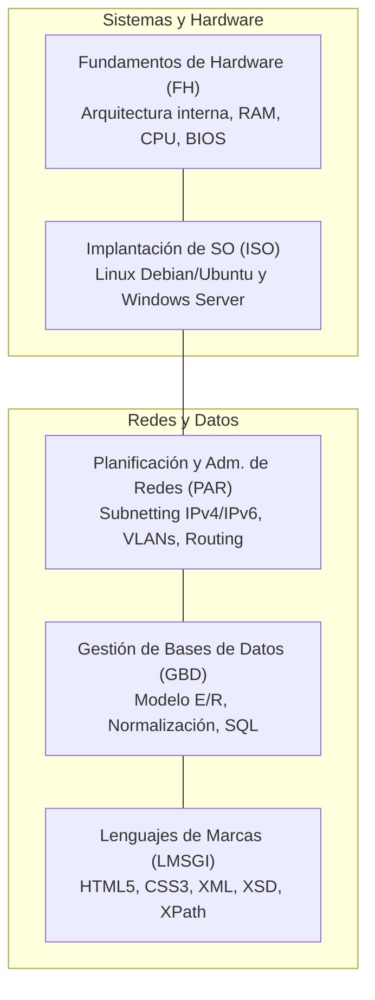

  <h1>📖 1º Curso — Fundamentos de ASIR</h1>
  
El primer curso del ciclo sienta las bases técnicas indispensables para cualquier administrador de sistemas y redes: sistemas operativos cliente y servidor, conmutación y enrutamiento, modelado y consultas de bases de datos, hardware interno y lenguajes estructurados.

## 🗺️ Mapa de Contenidos de 1º Curso

---

## 📚 Módulos Troncales de 1º Curso

<table class="syllabus-table">
  <thead>
    <tr>
      <th>Módulo</th>
      <th>Código</th>
      <th>Contenidos y Competencias Principales</th>
      <th>Área Técnica</th>
      <th>Acceso</th>
    </tr>
  </thead>
  <tbody>
    <tr>
      <td><strong>Implantación de Sistemas Operativos</strong></td>
      <td>ISO</td>
      <td>Instalación de distribuciones Linux (Debian/Ubuntu) y Windows Server, sistemas de archivos, particionado LVM/GPT, gestión de usuarios, permisos y procesos.</td>
      <td>Sistemas</td>
      <td><a class="module-link" href="iso.md">Ver apuntes :octicons-arrow-right-16:</a></td>
    </tr>
    <tr>
      <td><strong>Planificación y Administración de Redes</strong></td>
      <td>PAR</td>
      <td>Subnetting VLSM IPv4 e IPv6, modelo OSI y TCP/IP, cableado estructurado, conmutación en switches, configuración de VLANs y enrutamiento estático/dinámico.</td>
      <td>Redes</td>
      <td><a class="module-link" href="redes.md">Ver apuntes :octicons-arrow-right-16:</a></td>
    </tr>
    <tr>
      <td><strong>Gestión de Bases de Datos</strong></td>
      <td>GBD</td>
      <td>Modelado conceptual Entidad-Relación, reglas de normalización (1FN a 3FN), álgebra relacional, DDL y DML en lenguaje SQL relacional (MySQL/MariaDB).</td>
      <td>Bases de Datos</td>
      <td><a class="module-link" href="bbdd.md">Ver apuntes :octicons-arrow-right-16:</a></td>
    </tr>
    <tr>
      <td><strong>Fundamentos de Hardware</strong></td>
      <td>FH</td>
      <td>Arquitectura de computadores von Neumann, buses, microprocesadores multinúcleo, tecnologías de memoria RAM, fuentes de alimentación y firmware BIOS/UEFI.</td>
      <td>Hardware</td>
      <td><a class="module-link" href="hardware.md">Ver apuntes :octicons-arrow-right-16:</a></td>
    </tr>
    <tr>
      <td><strong>Lenguajes de Marcas y Sistemas de Gestión</strong></td>
      <td>LMSGI</td>
      <td>Estructura y semántica HTML5, hojas de estilo CSS3, almacenamiento estructurado con XML, validación mediante DTD y XML Schema (XSD), y consultas XPath.</td>
      <td>Web & Marcas</td>
      <td><a class="module-link" href="marcas.md">Ver apuntes :octicons-arrow-right-16:</a></td>
    </tr>
  </tbody>
</table>

---

## 💡 Orientaciones para el Estudiante de 1º

1. **Prioriza PAR e ISO**: Son las dos asignaturas con mayor carga horaria y sientan las bases directas para Servicios de Red (SRI) y Administración de SO (ASO) de segundo.
2. **Domina el Subnetting**: La división en subredes IPv4 mediante máscaras de longitud variable (VLSM) es una destreza obligatoria que se exige tanto en PAR como en los módulos avanzados de segundo.
3. **Practica SQL desde el primer día**: El modelado relacional y las consultas SQL de GBD son la base imprescindible para el módulo de ASGBD en segundo curso.
