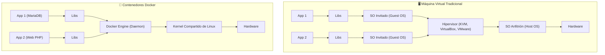
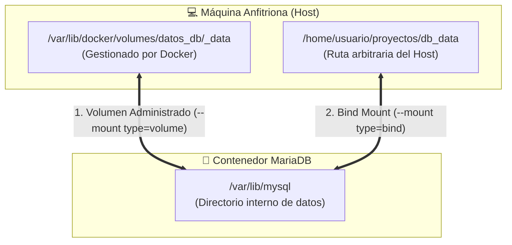

# 1. Docker y Contenedores para Sistemas Gestores de BBDD

En los entornos modernos de administración de bases de datos (**ASGBD**), la virtualización ligera basada en contenedores (**Docker**) se ha convertido en el estándar para aprovisionar, aislar, replicar y orquestar servidores como **MariaDB**, **MySQL**, **PostgreSQL** y **Oracle Database**.

> [!NOTE] **Fuente y Contexto**
> Esta guía sintetiza el temario oficial del curso de Docker para desarrollo y administración de sistemas (*por Juan Diego Pérez Jiménez - pekechis*).

---

## 1. Arquitectura y Fundamentos de Docker

### ¿Qué es Docker?
Docker es una plataforma de código abierto que permite empaquetar aplicaciones junto con todas sus dependencias, librerías y configuraciones en unidades estandarizadas llamadas **contenedores**.



| Característica | Máquina Virtual (VM) | Contenedor Docker |
|---|---|---|
| **Aislamiento** | A nivel de hardware completo. | A nivel de procesos del sistema operativo (*Namespaces* y *Cgroups*). |
| **Sistema Operativo** | Cada VM incluye su propio kernel y SO invitado completo. | Comparte el kernel del sistema anfitrión. |
| **Arranque** | Minutos (arranque de BIOS y SO). | **Milisegundos / Segundos** (inicio de proceso). |
| **Uso de Recursos** | Alto consumo de RAM y disco reservado. | Mínimo y bajo demanda. |

### Componentes clave
- **Docker Engine (`dockerd`):** Demonio en segundo plano que gestiona contenedores, imágenes, volúmenes y redes.
- **Docker CLI (`docker`):** Herramienta de línea de comandos para interactuar con la API del demonio.
- **Docker Hub:** Registro público oficial en la nube donde desarrolladores y empresas alojan imágenes oficiales (ej. `mariadb`, `postgres`, `phpmyadmin`).

---

## 2. Ciclo de Vida y Gestión de Contenedores

### Ejecución de Contenedores: Sintaxis y Flags

```bash
docker run [FLAGS] IMAGEN [COMANDO]
```

#### Flags indispensables:
- `-d` (*detached*): Ejecuta el contenedor en segundo plano liberando el terminal.
- `-it` (*interactive + tty*): Abre una sesión interactiva con un pseudo-terminal.
- `--name <nombre>`: Asigna un nombre amigable e identificador al contenedor.
- `-p <puerto_host>:<puerto_contenedor>`: Redirecciona el puerto del anfitrión al puerto interno del contenedor.
- `-e <VARIABLE>=<valor>`: Define variables de entorno dentro del contenedor.
- `--rm`: Elimina el contenedor automáticamente al detenerse.

### Despliegue de un Servidor de Base de Datos MariaDB

```bash
docker run -d \
  --name servidor-mariadb \
  -p 3306:3306 \
  -e MYSQL_ROOT_PASSWORD=secreto \
  -e MYSQL_DATABASE=empresa_db \
  -e MYSQL_USER=admin_db \
  -e MYSQL_PASSWORD=adminpass \
  mariadb:11.2
```

### Comandos de gestión rutinaria:

```bash
# Listar contenedores en ejecución
docker ps

# Listar todos los contenedores (incluyendo parados)
docker ps -a

# Conectarse a la terminal de un contenedor en caliente
docker exec -it servidor-mariadb bash

# Entrar directamente al cliente de base de datos dentro del contenedor
docker exec -it servidor-mariadb mariadb -u root -psecreto empresa_db

# Ver registros y logs en tiempo real
docker logs -f servidor-mariadb

# Inspeccionar metadatos detallados (IP, montajes, variables)
docker inspect servidor-mariadb

# Parar, arrancar y eliminar
docker stop servidor-mariadb
docker start servidor-mariadb
docker rm -f servidor-mariadb
```

---

## 3. Gestión de Imágenes

Una **imagen** es una plantilla inmutable de solo lectura compuesta por capas superpuestas que contiene el código, las herramientas y las librerías necesarias.

```bash
# Descargar una imagen oficial desde Docker Hub
docker pull postgres:16-alpine

# Listar imágenes almacenadas localmente
docker images

# Ver el historial de capas de una imagen
docker history mariadb:latest

# Asignar una nueva etiqueta a una imagen
docker tag mariadb:latest mi-usuario/mariadb-custom:v1.0

# Eliminar una imagen local
docker rmi postgres:16-alpine
```

---

## 4. Persistencia en Docker: Volúmenes y Bind Mounts para SGBD

Por defecto, los datos dentro de un contenedor se escriben en una **capa de escritura efímera**. Si el contenedor se destruye, **todos los datos de la base de datos se pierden**. En ASGBD es obligatorio desacoplar los datos mediante almacenamiento persistente.



### 1. Volúmenes Administrados (*Named Volumes*)
Son gestionados exclusivamente por Docker en `/var/lib/docker/volumes/`. Es el método **recomendado en producción** para motores de bases de datos por su rendimiento y seguridad.

```bash
# Crear un volumen específico para la base de datos
docker volume create vol_mariadb_datos

# Listar e inspeccionar volúmenes
docker volume ls
docker volume inspect vol_mariadb_datos

# Levantar MariaDB vinculando el volumen
docker run -d \
  --name bd-produccion \
  -p 3306:3306 \
  -v vol_mariadb_datos:/var/lib/mysql \
  -e MYSQL_ROOT_PASSWORD=rootpassword \
  mariadb:11.2
```

### 2. Bind Mounts
Vinculan una carpeta existente en el host con una ruta interna del contenedor. Ideal en desarrollo para inyectar scripts de inicialización SQL (`/docker-entrypoint-initdb.d/`):

```bash
# Cualquier script .sql en ./init_scripts se ejecutará automáticamente en el primer arranque
docker run -d \
  --name bd-desarrollo \
  -p 3306:3306 \
  -v $(pwd)/init_scripts:/docker-entrypoint-initdb.d:ro \
  -v vol_datos:/var/lib/mysql \
  -e MYSQL_ROOT_PASSWORD=rootpassword \
  mariadb:11.2
```

---

## 5. Redes en Docker

Docker permite aislar contenedores o comunicarlos de forma segura a través de redes virtuales.

### Drivers de Red:
1. **Bridge (por defecto):** Crea un puente de red virtual privado (`docker0`) en el host.
2. **Host:** Elimina el aislamiento de red; el contenedor comparte directamente la pila de red e interfaces del host.
3. **None:** Contenedor completamente aislado sin interfaz de red externa (solo loopback `127.0.0.1`).
4. **Overlay:** Para comunicación cifrada entre contenedores en múltiples hosts (Docker Swarm o Kubernetes).

### Redes Bridge Personalizadas y Resolución DNS Interna

> [!IMPORTANT] **Regla fundamental de redes Docker**
> En la red `bridge` por defecto de Docker, los contenedores **no** pueden resolverse mutuamente por su nombre. En una red personalizada creada por el usuario, Docker activa un **servidor DNS interno integrado** que permite que una aplicación web se conecte a su base de datos usando directamente el nombre del contenedor (ej. `host: "servidor-db"`).

```bash
# 1. Crear una red bridge personalizada
docker network create --driver bridge red-aplicacion

# 2. Arrancar la base de datos dentro de dicha red
docker run -d \
  --name servidor-db \
  --network red-aplicacion \
  -e MYSQL_ROOT_PASSWORD=secreto \
  mariadb:11.2

# 3. Arrancar una herramienta de administración web (Adminer) en la misma red
docker run -d \
  --name adminer-web \
  --network red-aplicacion \
  -p 8080:8080 \
  adminer
```
*En Adminer (accediendo a `http://localhost:8080`), en el campo "Servidor" basta con escribir `servidor-db`.*

---

## 6. Construcción de Imágenes Propias: `Dockerfile`

Un `Dockerfile` es un guion declarativo de instrucciones para generar una imagen personalizada de base de datos reproducible.

### Directivas clave:
- `FROM`: Define la imagen base.
- `WORKDIR`: Establece el directorio de trabajo.
- `COPY` / `ADD`: Copia archivos locales al contenedor.
- `ENV`: Configura variables de entorno persistentes.
- `EXPOSE`: Documenta los puertos de escucha.
- `RUN`: Ejecuta comandos durante la fase de compilación (*build*).
- `CMD` vs `ENTRYPOINT`: `ENTRYPOINT` fija el binario principal ejecutable; `CMD` proporciona los argumentos por defecto.

### Ejemplo: Imagen personalizada de MariaDB con esquema precargado

```dockerfile
FROM mariadb:11.2

LABEL maintainer="alumno@asir.local"
LABEL description="Servidor MariaDB corporativo con esquema de empleados precargado"

# Variables de entorno por defecto
ENV MYSQL_DATABASE=corporativo
ENV MYSQL_ROOT_PASSWORD=rootpass

# Copiar scripts SQL a la carpeta de inicialización automática
COPY ./schema.sql /docker-entrypoint-initdb.d/01-schema.sql
COPY ./datos_iniciales.sql /docker-entrypoint-initdb.d/02-data.sql

EXPOSE 3306
```

```bash
# Compilar la imagen
docker build -t mi-mariadb-corp:1.0 .

# Ejecutar el contenedor generado
docker run -d --name db-corp -p 3306:3306 mi-mariadb-corp:1.0
```

---

## 7. Aplicaciones Multicapa con Docker Compose

**Docker Compose** es la herramienta estándar para definir y ejecutar aplicaciones multi-contenedor complejas mediante un archivo YAML (`docker-compose.yml`).

### Arquitectura típica: Aplicación Web + Base de Datos Persistente + phpMyAdmin

```yaml
version: '3.8'

services:
  basedatos:
    image: mariadb:11.2
    container_name: asgbd-mariadb
    restart: always
    environment:
      MYSQL_ROOT_PASSWORD: rootpassword
      MYSQL_DATABASE: universidad
      MYSQL_USER: alumno
      MYSQL_PASSWORD: aluminopassword
    volumes:
      - db_datos:/var/lib/mysql
      - ./init.sql:/docker-entrypoint-initdb.d/init.sql:ro
    networks:
      - red-interna

  gestor_web:
    image: phpmyadmin/phpmyadmin
    container_name: asgbd-phpmyadmin
    restart: always
    ports:
      - "8085:80"
    environment:
      PMA_HOST: basedatos
      PMA_PORT: 3306
    depends_on:
      - basedatos
    networks:
      - red-interna

volumes:
  db_datos:
    driver: local

networks:
  red-interna:
    driver: bridge
```

### Comandos de Docker Compose:
```bash
# Levantar todos los servicios en segundo plano y crear volúmenes/redes
docker compose up -d

# Ver estado de los contenedores del stack
docker compose ps

# Visualizar logs continuos de la base de datos
docker compose logs -f basedatos

# Detener y destruir los contenedores preservando los volúmenes
docker compose down

# Detener y destruir contenedores Y volúmenes de datos
docker compose down -v
```

---

## 8. Seguridad en Contenedores

1. **Principio de menor privilegio:** Evitar ejecutar motores como usuario `root`. Utilizar la directiva `USER` o banderas `--user`.
2. **Escaneo de vulnerabilidades:** Analizar imágenes con herramientas como **Trivy** o **Docker Scout** antes de pasarlas a producción:
   ```bash
   trivy image mariadb:11.2
   ```
3. **Sistemas de ficheros de solo lectura:** Prevenir modificaciones maliciosas en el contenedor montando el sistema raíz como solo lectura con `--read-only` y asignando volúmenes solo a rutas indispensables:
   ```bash
   docker run -d --read-only -v vol_datos:/var/lib/mysql mariadb:11.2
   ```
4. **Límites de recursos (Hardware Quotas):** Evitar que un ataque o consulta ineficiente sature la CPU o memoria del servidor:
   ```bash
   docker run -d --memory="2g" --cpus="2.0" mariadb:11.2
   ```

---

## 9. CI/CD con Jenkins y Docker

En entornos DevOps para bases de datos:
- Jenkins ejecuta pipelines donde levanta un contenedor efímero de base de datos (por ejemplo, MariaDB o PostgreSQL).
- Aplica las migraciones de esquema SQL y pruebas unitarias automáticas sobre dicho contenedor.
- Si todas las pruebas tienen éxito, destruye el entorno efímero y publica la versión probada en producción.
