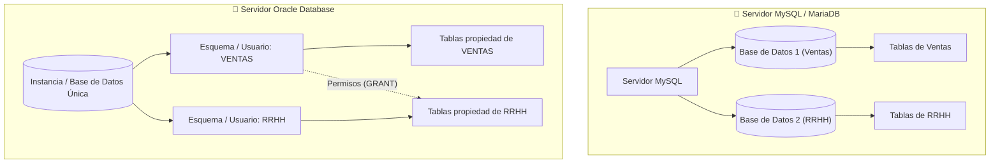

# 2. Diseño Físico, DDL y Restricciones en Oracle Database

El diseño físico de bases de datos traduce el modelo lógico en estructuras de almacenamiento concretas utilizando el **Lenguaje de Definición de Datos (DDL - Data Definition Language)**. En Oracle Database, el diseño físico contempla esquemas de usuario, tipos de datos nativos, funciones escalares de sistema, restricciones de integridad (*constraints*), vistas del diccionario de datos y sinónimos.

> [!NOTE] **Fuente y Autoría**
> Contenidos basados en el material de *Diseño Físico de Bases de Datos en Oracle* de **Raúl Ruiz Padilla** (IES Gonzalo Nazareno, Consejería de Educación).

---

## 1. Arquitectura de Esquemas: MySQL vs. Oracle

Existe una diferencia conceptual crítica en cómo organizan la información ambos motores:



| Aspecto | MySQL / MariaDB | Oracle Database |
|---|---|---|
| **Estructura** | Pueden existir múltiples bases de datos independientes dentro del mismo servidor (`CREATE DATABASE`, `USE`). | Existe **UNA única base de datos empresarial** que contiene toda la información corporativa. |
| **Pertenencia** | Las tablas pertenecen a una base de datos. | Las tablas **pertenecen a usuarios concretos**. El conjunto de objetos de un usuario se denomina **Esquema (*Schema*)**. |
| **Seguridad** | Usuarios globales acceden a varias bases de datos. | Cada usuario administra sus propios objetos y puede conceder permisos a otros esquemas mediante `GRANT`. |
| **Regla de oro** | Se opera tras seleccionar la base de datos con `USE`. | **NUNCA se deben crear tablas de aplicación bajo el usuario administrativo `SYSTEM`**. |

### Clasificación de Sentencias SQL
- **DDL (*Data Definition Language*):** Define y modifica la estructura de la base de datos (`CREATE`, `ALTER`, `DROP`, `TRUNCATE`, `RENAME`).
- **DML (*Data Manipulation Language*):** Consulta y manipula los datos de las tablas (`SELECT`, `INSERT`, `UPDATE`, `DELETE`).
- **DCL (*Data Control Language*):** Concede o revoca permisos y privilegios a usuarios (`GRANT`, `REVOKE`).
- **TCL (*Transaction Control Language*):** Gestiona la consistencia de las transacciones atómicas (`COMMIT`, `ROLLBACK`, `SAVEPOINT`).

---

## 2. Tipos de Datos Nativos en Oracle

| Tipo de Dato | Descripción y Capacidad Máxima |
|---|---|
| **`VARCHAR2(n)`** | Cadenas de caracteres de longitud variable (máximo **4000 bytes**). Es el tipo estándar para textos cortos. |
| **`CHAR(n)`** | Cadenas de longitud fija (máximo **2000 bytes**). Si el texto es más corto, se rellena con espacios en blanco. |
| **`NUMBER(p, s)`** | Números de precisión variable. $p$ es la precisión total (1 a 38 dígitos) y $s$ es la escala de decimales. |
| **`DATE`** | Almacena fechas y horas completas: siglo, año, mes, día, hora, minutos y segundos. |
| **`LONG`** | Cadenas de longitud variable de hasta **2 GB** (tipo heredado; se recomienda migrar a `CLOB`). |
| **`RAW(n)`** | Cadenas de bytes sin interpretar (máximo **2000 bytes**). |
| **`BLOB` / `CLOB`** | Grandes objetos binarios (*Binary LOB*, imágenes, PDF) y de caracteres (*Character LOB*, texto masivo) de más de **2 GB**. |
| **`ROWID`** | Identificador físico único en formato hexadecimal que apunta a la dirección exacta del bloque de disco donde reside la fila. |

---

## 3. Operadores y Funciones Escalares en Oracle

Oracle incluye la tabla especial **`DUAL`** (una sola fila y columna) para evaluar cálculos y funciones del sistema sin necesidad de consultar una tabla de datos de usuario:

```sql
SELECT SYSDATE FROM DUAL;
SELECT 25 * 4 FROM DUAL;
```

### 1. Funciones Numéricas y Aritméticas
- **`ABS(n)`:** Valor absoluto. `ABS(-10)` $\rightarrow$ `10`.
- **`CEIL(n)` / `FLOOR(n)`:** Redondeo hacia el entero superior e inferior respectivamente. `CEIL(20.3)` $\rightarrow$ `21`, `FLOOR(20.3)` $\rightarrow$ `20`.
- **`MOD(m, n)`:** Resto de la división entera de $m$ entre $n$. `MOD(11, 4)` $\rightarrow$ `3`.
- **`POWER(m, exp)`:** Potencia. `POWER(2, 4)` $\rightarrow$ `16`.
- **`ROUND(n [, m])`:** Redondea $n$ a $m$ decimales. `ROUND(1.567, 2)` $\rightarrow$ `1.57`.
- **`TRUNC(n [, m])`:** Trunca $n$ eliminando decimales sin redondear. `TRUNC(1.567, 2)` $\rightarrow$ `1.56`.
- **`SQRT(n)`:** Raíz cuadrada de $n$. `SQRT(25)` $\rightarrow$ `5`.
- **`SIGN(n)`:** Retorna `-1` si es negativo, `0` si es cero, o `1` si es positivo.

---

### 2. Funciones de Cadenas de Caracteres
- **`LOWER(cad)` / `UPPER(cad)`:** Conversión a minúsculas o mayúsculas.
- **`INITCAP(cad)`:** Convierte a formato de título (primera letra de cada palabra en mayúscula):  
  `INITCAP('oracle y sql')` $\rightarrow$ `'Oracle Y Sql'`.
- **`CONCAT(c1, c2)`:** Concatena dos cadenas (también mediante el operador pipe doble `c1 || c2`).
- **`SUBSTR(cad, inicio [, longitud])`:** Extrae una subcadena a partir de una posición.  
  `SUBSTR('ORACLE', 1, 3)` $\rightarrow$ `'ORA'`.
- **`LENGTH(cad)`:** Devuelve el número de caracteres de la cadena.
- **`INSTR(cad, subcad [, inicio [, ocurrencia]])`:** Busca la posición donde aparece una subcadena.
- **`LPAD(cad, n [, relleno])` / `RPAD(...)`:** Rellena a la izquierda o derecha con caracteres hasta alcanzar longitud $n$.
- **`LTRIM(cad)` / `RTRIM(cad)`:** Elimina espacios o caracteres sobrantes a la izquierda o derecha.
- **`REPLACE(cad, busqueda, sustitucion)`:** Reemplaza caracteres en la cadena:  
  `REPLACE('BLANCO Y NEGRO', 'O', 'AS')` $\rightarrow$ `'BLANCAS Y NEGRAS'`.

---

### 3. Funciones de Manejo de Fechas
- **`SYSDATE`:** Retorna la fecha y hora actual del servidor.
- **`ADD_MONTHS(fecha, n)`:** Añade $n$ meses a una fecha: `ADD_MONTHS(SYSDATE, 12)` (un año después).
- **`LAST_DAY(fecha)`:** Retorna el último día del mes de la fecha indicada.
- **`MONTHS_BETWEEN(f1, f2)`:** Diferencia en meses entre dos fechas:  
  `MONTHS_BETWEEN(SYSDATE, hiredate) / 12` (cálculo de años de antigüedad).
- **`NEXT_DAY(fecha, 'DÍA')`:** Retorna la fecha del próximo día de la semana indicado (`NEXT_DAY(SYSDATE, 'VIERNES')`).

---

### 4. Funciones de Conversión y Parámetros NLS
Permiten transformar tipos entre `CHAR`, `NUMBER` y `DATE` controlando formatos locales (*National Language Support - NLS*):

```sql
-- Conversión de fecha a texto con máscara de formato
SELECT TO_CHAR(SYSDATE, 'DD "de" Month "de" YYYY, HH24:MI:SS') FROM DUAL;

-- Formateo numérico con separador de miles (G) y decimal (D)
SELECT TO_CHAR(12345.67, '999G999D99') FROM DUAL;

-- Conversión de cadena a tipo DATE
SELECT TO_DATE('15/10/2026', 'DD/MM/YYYY') FROM DUAL;

-- Modificación de formato de sesión NLS
ALTER SESSION SET NLS_DATE_FORMAT = 'DD/MM/YYYY HH24:MI:SS';
```

---

## 4. Creación Básica de Tablas (`CREATE TABLE`)

### Reglas de Nomenclatura:
1. Máximo 30 caracteres de longitud.
2. Debe comenzar obligatoriamente por una letra.
3. Solo puede contener letras (A-Z), números (0-9) y los caracteres especiales `_`, `$`, `#`.
4. No puede ser una palabra reservada del motor de Oracle.
5. Los nombres de columna deben ser claros y autodescriptivos.

```sql
CREATE TABLE alumnos (
    num_matri NUMBER(6),
    nombre    VARCHAR2(25),
    fecha_nac DATE,
    direccion VARCHAR2(50)
);
```

### Consultas al Diccionario de Datos sobre Tablas:
- **`USER_TABLES` (sinónimo `CAT`):** Lista las tablas propiedad del usuario conectado.
- **`ALL_TABLES`:** Tablas sobre las que el usuario tiene permisos de lectura/escritura.
- **`DBA_TABLES`:** Todas las tablas de la instancia (requiere rol DBA).
- **`DESCRIBE nombre_tabla` (`DESC`):** Comando interactivo en terminal para ver la estructura de columnas y tipos.

---

## 5. Restricciones de Integridad (*Constraints*)

Las restricciones son reglas lógicas aplicadas a las columnas que garantizan la **integridad de los datos** y la **integridad referencial** de forma automática en el motor.

> [!IMPORTANT] **Convenciones de nombres para restricciones**
> Siempre se debe asignar un nombre explícito a cada restricción para poder gestionarla, activarla o desactivarla en el futuro. No pueden existir dos restricciones con el mismo nombre en un mismo esquema:
> - `pk_nombretabla` para Claves Primarias.
> - `fk_tabla_origen_destino` para Claves Ajenas.
> - `ck_nombretabla_columna` para Verificaciones Check.
> - `uq_nombretabla_columna` para Restricciones Unique.

### Tipos de Restricciones en Oracle:

| Código | Restricción | Definición y Comportamiento |
|---|---|---|
| **`P`** | **`PRIMARY KEY`** | Identifica unívocamente cada fila. Es **única y no nula**. Crea automáticamente un índice B-Tree único. Solo puede existir una por tabla. |
| **`R`** | **`FOREIGN KEY`** | Clave ajena. Obliga a que el valor exista previamente en la clave primaria de la tabla referenciada (`REFERENCES`). Admite `ON DELETE CASCADE`. |
| **`C`** | **`CHECK`** | Valida que los datos cumplan una condición lógica (`CHECK (edad >= 18)`). No puede contener subconsultas ni pseudocolumnas dinámicas (`SYSDATE`, `USER`). |
| **-** | **`NOT NULL`** | Obliga a que la columna tenga un valor informado en cada inserción. Se define a nivel de columna (internamente Oracle lo cataloga como tipo `C`). |
| **`U`** | **`UNIQUE`** | Impide valores duplicados en la columna. Crea un índice automático, pero **admite valores `NULL`**. |
| **-** | **`DEFAULT`** | Asigna un valor predeterminado si el `INSERT` no lo especifica (`DEFAULT SYSDATE`). No lleva nombre porque no puede violarse. |

---

### Sintaxis: Nivel de Columna vs. Nivel de Tabla

=== "A nivel de Columna (Inline)"
    Se define en la misma línea de declaración del campo. Solo es válida si la restricción afecta a una única columna:
    ```sql
    CREATE TABLE empleados (
        num_emp       NUMBER(4)    CONSTRAINT pk_emp PRIMARY KEY,
        nombre        VARCHAR2(25) CONSTRAINT uq_emp_nombre UNIQUE,
        edad          NUMBER(2)    CONSTRAINT ck_emp_edad CHECK (edad BETWEEN 18 AND 65),
        cod_provincia NUMBER(2)    CONSTRAINT fk_emp_prov REFERENCES provincias(cod_prov) ON DELETE CASCADE,
        salario       NUMBER(7,2)  DEFAULT 1000 NOT NULL
    );
    ```

=== "A nivel de Tabla (Out-of-line)"
    Se declara al final de todas las columnas. **Es obligatoria cuando la clave primaria o foránea está compuesta por varias columnas**:
    ```sql
    CREATE TABLE pedidos_lineas (
        pedido_id  NUMBER(6),
        linea_num  NUMBER(3),
        producto   VARCHAR2(30),
        cantidad   NUMBER(4),
        -- Clave primaria compuesta por dos columnas
        CONSTRAINT pk_pedidos_lineas PRIMARY KEY (pedido_id, linea_num),
        -- Clave ajena que apunta a pedidos
        CONSTRAINT fk_lineas_pedido FOREIGN KEY (pedido_id) 
            REFERENCES pedidos(pedido_id) ON DELETE CASCADE,
        CONSTRAINT ck_lineas_cantidad CHECK (cantidad > 0)
    );
    ```

---

### Consultas al Diccionario de Datos sobre Restricciones

```sql
-- 1. Consultar las restricciones del usuario actual
SELECT constraint_name, constraint_type, table_name, status
FROM user_constraints;

-- 2. Consultar sobre qué columnas recae cada restricción
SELECT constraint_name, table_name, column_name, position
FROM user_cons_columns
WHERE table_name = 'EMPLEADOS';
```

---

## 6. Modificación de Tablas (`ALTER TABLE`)

Permite alterar la estructura de una tabla existente sin destruir sus datos.

### 1. Gestión de Columnas
```sql
-- Añadir una columna nueva
ALTER TABLE empleados ADD (email VARCHAR2(100));

-- Añadir una columna NOT NULL en una tabla con datos existentes (Protocolo seguro):
-- 1. Añadir sin restricción NOT NULL
ALTER TABLE empleados ADD (categoria VARCHAR2(20));
-- 2. Rellenar los valores en todas las filas existentes
UPDATE empleados SET categoria = 'JUNIOR';
-- 3. Aplicar la restricción NOT NULL
ALTER TABLE empleados MODIFY (categoria NOT NULL);

-- Modificar tamaño o tipo de columna
-- (Aumentar longitud siempre es posible; disminuir exige que ningún dato exceda el nuevo límite)
ALTER TABLE empleados MODIFY (nombre VARCHAR2(40));

-- Eliminar una columna (no se pueden eliminar claves primarias activas sin cascada)
ALTER TABLE empleados DROP COLUMN email;
```

### 2. Gestión de Restricciones
```sql
-- Añadir una nueva restricción a posteriori
ALTER TABLE empleados 
ADD CONSTRAINT ck_emp_salario CHECK (salario >= 950);

-- Eliminar una restricción existente
ALTER TABLE empleados 
DROP CONSTRAINT ck_emp_salario;

-- Desactivar temporalmente una restricción (ideal para migraciones e importaciones masivas)
ALTER TABLE empleados DISABLE CONSTRAINT fk_emp_prov;
ALTER TABLE empleados DISABLE ALL CONSTRAINTS;

-- Reactivar la restricción
ALTER TABLE empleados ENABLE CONSTRAINT fk_emp_prov;
```

---

## 7. Borrado de Tablas: `DROP TABLE` vs. `TRUNCATE TABLE`

| Característica | `DROP TABLE` | `TRUNCATE TABLE` | `DELETE FROM` |
|---|---|---|---|
| **Tipo de Sentencia** | DDL | DDL | DML |
| **Efecto** | Elimina los datos **y la definición de la tabla**. | **Vacía todos los registros**, conservando la estructura de la tabla. | Elimina filas una a una. |
| **Rendimiento** | Instantáneo. | **Extremadamente rápido** (desasigna bloques de almacenamiento). | Lento en tablas grandes. |
| **Transaccional / Rollback** | ❌ **No admite `ROLLBACK`**. | ❌ **No admite `ROLLBACK`**. | ✅ **Sí admite `ROLLBACK`**. |
| **Disparadores (Triggers)** | No activa triggers. | No activa disparadores `DELETE`. | Activa triggers `BEFORE/AFTER DELETE`. |
| **Integridad referencial** | Requiere `CASCADE CONSTRAINTS` si tiene tablas hijas. | No se puede truncar si su clave primaria está referenciada por una FK activa (hay que desactivarla primero). | Comprueba fila por fila. |

```sql
-- Borrado completo con cascada de restricciones
DROP TABLE departamentos CASCADE CONSTRAINTS;

-- Vaciado ultra rápido liberando espacio de almacenamiento
TRUNCATE TABLE registros_logs DROP STORAGE;
```

---

## 8. Creación y Uso de Sinónimos (`SYNONYM`)

Un **sinónimo** es un alias permanente asignado a un objeto de la base de datos (tabla, vista, procedimiento) que simplifica su acceso y oculta su ubicación física o propietario real:

- **Sinónimo Privado:** Solo accesible por el usuario propietario dentro de su esquema.
- **Sinónimo Público (`PUBLIC`):** Accesible por todos los usuarios autorizados de la base de datos.

```sql
-- Evita tener que escribir SCOTT.EMP cada vez que se consulte la tabla
CREATE PUBLIC SYNONYM empleados FOR scott.emp;

-- Ahora cualquier usuario con permisos puede consultar directamente:
SELECT * FROM empleados;

-- Borrar el sinónimo público
DROP PUBLIC SYNONYM empleados;
```
