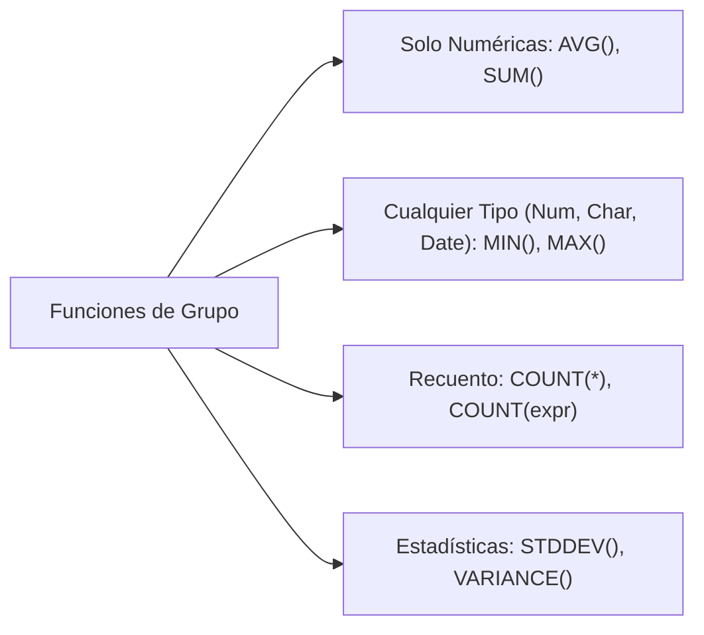
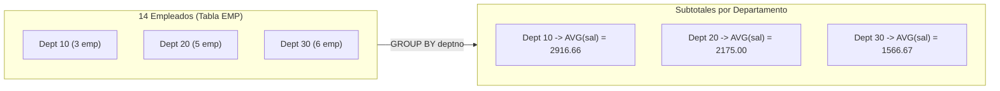
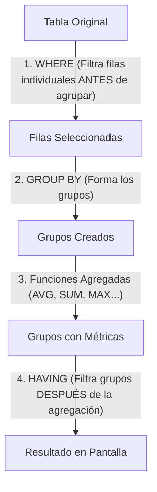

# 3. Funciones de Grupo y Agrupamiento (GROUP BY / HAVING)

Las **funciones de grupo o de agregación** operan sobre conjuntos de filas para calcular un único valor representativo por conjunto (totales, medias, máximos o recuentos).

---

## 1. Catálogo de Funciones de Agregación



| Función | Descripción | Tipos de datos admitidos |
|---|---|---|
| **`AVG([DISTINCT] n)`** | Calcula la media aritmética de los valores. Ignora los valores nulos. | Exclusivamente numéricos. |
| **`SUM([DISTINCT] n)`** | Obtiene la sumatoria total de los valores del grupo. | Exclusivamente numéricos. |
| **`MIN([DISTINCT] expr)`** | Devuelve el valor mínimo (alfabético, cronológico o numérico). | Cualquier tipo (`NUMBER`, `VARCHAR2`, `DATE`). |
| **`MAX([DISTINCT] expr)`** | Devuelve el valor máximo (alfabético, cronológico o numérico). | Cualquier tipo (`NUMBER`, `VARCHAR2`, `DATE`). |
| **`COUNT(*)`** | Devuelve el número total de registros de la tabla o grupo (incluyendo nulos y duplicados). | Todas las filas. |
| **`COUNT(expr)`** | Devuelve el número de registros donde la expresión **no es nula** (`IS NOT NULL`). | Cualquier tipo. |
| **`STDDEV(x)`** | Calcula la desviación típica de la muestra. | Exclusivamente numéricos. |
| **`VARIANCE(x)`** | Calcula la varianza estadística de la muestra. | Exclusivamente numéricos. |

```sql
-- Consultas resumen a nivel de toda la tabla
SELECT AVG(sal), MAX(sal), MIN(sal), SUM(sal)
FROM emp
WHERE job LIKE 'SALES%';

-- MIN y MAX aplicados sobre tipos DATE (fechas de contratación)
SELECT MIN(hiredate) AS "Primer Contratado", MAX(hiredate) AS "Último Contratado"
FROM emp;
```

---

## 2. Tratamiento de Valores Nulos (`NULL`)

> [!WARNING] **Comportamiento por defecto con valores NULL**
> **Todas las funciones de grupo ignoran automáticamente los valores nulos** de las columnas evaluadas (con la única excepción de `COUNT(*)`).

### Ejemplo práctico:
En una empresa con 14 empleados, solo 4 cobran comisión (`comm`):
- `COUNT(*)` devuelve **14** (total de filas).
- `COUNT(comm)` devuelve **4** (solo filas con comisión informada).
- `AVG(comm)` sumará las 4 comisiones y dividirá entre **4** (resultado: $550$).

### ¿Cómo forzar el cálculo incluyendo los nulos como 0?
Se emplean funciones de sustitución de nulos para tratar la ausencia de dato como valor neutro ($0$):

=== "Oracle Database (NVL)"
    ```sql
    -- NVL(comm, 0) sustituye NULL por 0 antes de calcular la media, dividiendo entre 14
    SELECT AVG(NVL(comm, 0)) AS "Media Real Plantilla"
    FROM emp;
    -- Resultado: 157.14
    ```

=== "MySQL / MariaDB (IFNULL / COALESCE)"
    ```sql
    SELECT AVG(IFNULL(comm, 0)) AS "Media Real Plantilla"
    FROM emp;

    -- O estándar ANSI:
    SELECT AVG(COALESCE(comm, 0)) AS "Media Real Plantilla"
    FROM emp;
    ```

---

## 3. Creación de Grupos: Cláusula `GROUP BY`

Mientras que las consultas resumen calculan un único total general, la cláusula **`GROUP BY`** segmenta los registros en grupos homogéneos para calcular subtotales independientes por categoría.



### 🚨 La Regla de Oro de `GROUP BY`
> **Cualquier columna o expresión que figure en la lista de selección (`SELECT`) y que NO sea una función agregada, TIENE que estar declarada obligatoriamente en la cláusula `GROUP BY`.**

```sql
-- ❌ CONSULTA INVÁLIDA: Provoca error ORA-00937 (not a single-group group function)
SELECT deptno, COUNT(ename)
FROM emp;

-- ✅ CONSULTA CORRECTA:
SELECT deptno, COUNT(ename), AVG(sal)
FROM emp
GROUP BY deptno;
```

*(Nota: La columna utilizada en el `GROUP BY` no tiene por qué aparecer obligatoriamente en el `SELECT`, aunque es una buena práctica para identificar cada fila resultante).*

### Agrupación por Múltiples Columnas
Es posible anidar niveles de agrupación separando las columnas por comas:

```sql
-- Calcula la masa salarial para cada oficio dentro de cada departamento
SELECT deptno, job, SUM(sal)
FROM emp
GROUP BY deptno, job
ORDER BY deptno, job;
```

---

## 4. Filtrado de Grupos: Cláusula `HAVING` vs. `WHERE`

Existe una distinción esencial entre filtrar filas individuales y filtrar grupos calculados:



| Cláusula | Momento de evaluación | ¿Admite funciones de grupo? | Propósito |
|---|---|---|---|
| **`WHERE`** | **Antes** de agrupar las filas. | ❌ **PROHIBIDO** (`ORA-00934`) | Excluir registros que no deben intervenir en el cálculo. |
| **`HAVING`** | **Después** de formar los grupos y calcular agregados. | ✅ **SÍ** | Excluir grupos enteros según el resultado de su función agregada. |

```sql
-- ❌ ERROR: ORA-00934: group function is not allowed here
SELECT deptno, AVG(sal)
FROM emp
WHERE AVG(sal) > 2000
GROUP BY deptno;

-- ✅ CORRECTO:
SELECT deptno, AVG(sal)
FROM emp
GROUP BY deptno
HAVING AVG(sal) > 2000;
```

### Consulta Completa de Síntesis:
```sql
SELECT job, SUM(sal) AS "Gasto Salarial"
FROM emp
WHERE job NOT LIKE 'SALES%'       -- 1. Excluye comerciales antes de agrupar
GROUP BY job                      -- 2. Agrupa por oficio
HAVING SUM(sal) > 5000            -- 3. Solo oficios con coste total > 5000
ORDER BY SUM(sal) DESC;           -- 4. Ordena el resultado final
```

---

## 5. Anidamiento de Funciones de Grupo

En motores como **Oracle Database**, se permite anidar dos funciones de grupo para responder preguntas complejas sin subconsultas intermedias:

```sql
-- Calcula la media de salarios por departamento, y luego extrae la media más alta:
SELECT MAX(AVG(sal)) AS "Media Departamental Más Alta"
FROM emp
GROUP BY deptno;
```
