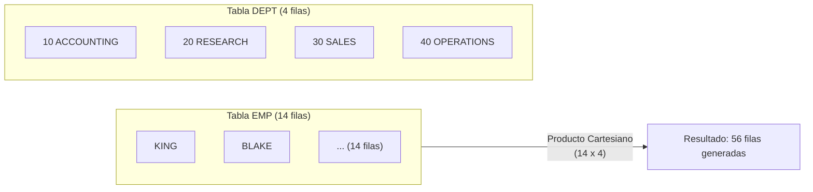
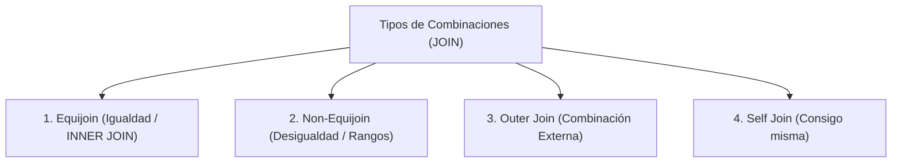
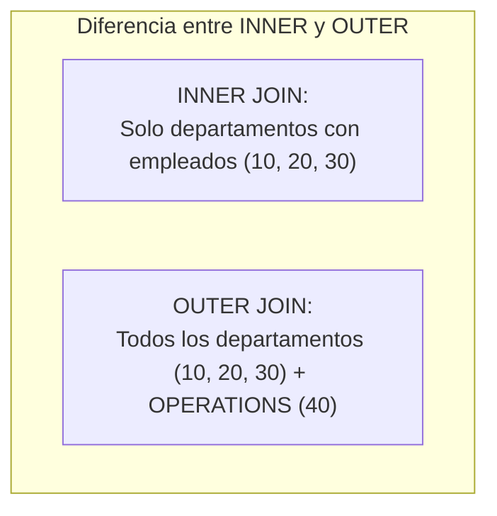
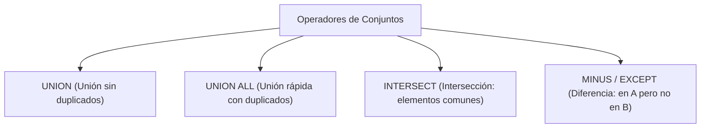

# 2. Consultas Multitabla y Combinaciones (JOINs)

En los sistemas gestores de bases de datos relacionales (**SGBD**), la información se normaliza en múltiples tablas para evitar redundancias e inconsistencias. Las **combinaciones (*JOINs*)** permiten recomponer y relacionar estos datos en una única consulta.

---

## 1. Fundamentos y el Producto Cartesiano

Una consulta multitabla especifica dos o más orígenes de datos tras la cláusula `FROM`:

```sql
SELECT columna1, columna2, ...
FROM tabla1, tabla2
WHERE condicion_de_combinacion;
```

### ⚠️ El Producto Cartesiano
Se produce un **producto cartesiano** cuando:
1. Se omite por completo la condición de combinación en la cláusula `WHERE` (o cláusula `ON`).
2. Se define una condición de combinación inválida o rota.
3. El motor combina **todas y cada una de las filas de la primera tabla con todas las filas de la segunda tabla** ($N \times M$).



> [!CAUTION] **Riesgo en bases de datos de producción**
> Si se omite la condición de join entre una tabla de 10.000 clientes y una de 100.000 pedidos, la base de datos intentará generar un conjunto de $1.000.000.000$ (mil millones) de filas temporales, colapsando la memoria RAM y bloqueando el servidor.

> [!IMPORTANT] **Regla nemotécnica del número de condiciones de JOIN**
> Para combinar $N$ tablas sin generar productos cartesianos parciales, se necesitan como mínimo **$N - 1$ condiciones de combinación**:
>
> $$\text{Nº mínimo de condiciones de join} = N - 1$$
>
> Por ejemplo, si una consulta lista 4 tablas en su cláusula `FROM`, requerirá al menos 3 condiciones de enlace independientes en el `WHERE` o en las cláusulas `ON`.

---

## 2. Nombres Ambiguos y Alias de Tabla

Cuando varias tablas comparten nombres de columna idénticos (por ejemplo, `deptno`), es obligatorio **calificar el nombre** anteponiendo el nombre o alias de la tabla:

```sql
-- Calificación con nombre completo de tabla
SELECT emp.empno, emp.ename, emp.deptno, dept.dname, dept.loc
FROM emp, dept
WHERE emp.deptno = dept.deptno;

-- Uso de alias de tabla (más limpio, legible y eficiente)
SELECT e.empno, e.ename, e.deptno, d.dname, d.loc
FROM emp e, dept d
WHERE e.deptno = d.deptno;
```

---

## 3. Clasificación de Tipos de JOIN



---

### 1. Equijoin (Combinación Interna por Igualdad)
Une filas que comparten el mismo valor exacto en las columnas vinculadas (típicamente clave primaria $\leftrightarrow$ clave foránea).

=== "Sintaxis Tradicional (WHERE)"
    ```sql
    SELECT e.empno, e.ename, e.deptno, d.dname, d.loc
    FROM emp e, dept d
    WHERE e.deptno = d.deptno
      AND d.loc = 'CHICAGO';
    ```

=== "Sintaxis ANSI / ISO 92 (INNER JOIN)"
    ```sql
    SELECT e.empno, e.ename, e.deptno, d.dname, d.loc
    FROM emp e
    INNER JOIN dept d ON e.deptno = d.deptno
    WHERE d.loc = 'CHICAGO';
    ```

=== "Natural Join"
    ```sql
    -- Combina automáticamente por las columnas con idéntico nombre y tipo (aparecen una sola vez)
    SELECT empno, ename, deptno, dname, loc
    FROM emp
    NATURAL JOIN dept;
    ```

#### Combinando más de dos tablas
Para relacionar $N$ tablas, se requieren como mínimo $N - 1$ condiciones de combinación:

```sql
-- Relación de tres tablas: CUSTOMER (clientes) -> ORD (pedidos) -> ITEM (líneas de pedido)
SELECT c.name, o.ordid, i.itemid
FROM customer c, ord o, item i
WHERE c.custid = o.custid
  AND o.ordid = i.ordid;
```

---

### 2. Non-Equijoin (Combinaciones por Desigualdad / Rangos)
Ocurre cuando la condición de enlace no utiliza un operador de igualdad (`=`), sino operadores de comparación relacional o de intervalo como `BETWEEN ... AND ...`, `<`, `>`, etc.

**Ejemplo clásico:** Asignar el grado salarial (`grade`) de la tabla `SALGRADE` al sueldo (`sal`) de un empleado de la tabla `EMP`:

```sql
SELECT e.ename, e.sal, s.grade
FROM emp e, salgrade s
WHERE e.sal BETWEEN s.losal AND s.hisal;
```

| `ENAME` | `SAL` | `GRADE` | Rango evaluado (`LOSAL` - `HISAL`) |
|---|---|---|---|
| `SMITH` | 800 | **1** | $700 - 1200$ |
| `ADAMS` | 1100 | **1** | $700 - 1200$ |
| `MARTIN`| 1250 | **2** | $1201 - 1400$ |
| `BLAKE` | 2850 | **4** | $2001 - 3000$ |
| `KING`  | 5000 | **5** | $3001 - 9999$ |

---

### 3. Outer Joins (Combinaciones Externas)
En un `INNER JOIN`, si un registro de una tabla no tiene correspondencia en la otra, **se descarta del resultado**.  
Un **`OUTER JOIN`** permite recuperar todas las filas de una tabla, rellenando con valores `NULL` las columnas de la tabla que carece de correspondencia.

*Caso real:* Mostrar todos los departamentos, incluidos aquellos que no tienen empleados asignados (como el departamento `40 OPERATIONS`).



=== "Sintaxis Clásica Oracle (+)"
    En Oracle clásico, el operador `(+)` se coloca **del lado de la tabla con deficiencia de información** (la que aportará los valores nulos):
    ```sql
    -- e.deptno(+) indica que si falta el empleado para ese departamento, se rellena con NULL
    SELECT e.ename, d.deptno, d.dname
    FROM emp e, dept d
    WHERE e.deptno(+) = d.deptno
    ORDER BY d.deptno;
    ```

=== "Sintaxis ANSI / ISO (LEFT / RIGHT JOIN)"
    Estándar en MySQL, MariaDB, PostgreSQL y Oracle moderno:
    ```sql
    -- LEFT JOIN: Conserva todos los registros de la tabla izquierda
    SELECT d.dname, d.deptno, e.ename
    FROM dept d
    LEFT JOIN emp e ON d.deptno = e.deptno;

    -- RIGHT JOIN: Conserva todos los registros de la tabla derecha
    SELECT e.ename, d.deptno, d.dname
    FROM emp e
    RIGHT JOIN dept d ON e.deptno = d.deptno;
    ```

> [!WARNING] **La trampa clásica de recuento en combinaciones externas: `COUNT(*)` vs `COUNT(columna)`**
> Supongamos que queremos mostrar todos los departamentos junto al número de empleados que trabajan en ellos, asegurándonos de que aparezcan los departamentos vacíos (como el departamento 40 `OPERATIONS`):
> 
> ```sql
> -- ✅ CONSULTA CORRECTA:
> SELECT d.deptno, d.dname, COUNT(e.empno) AS num_empleados
> FROM emp e, dept d
> WHERE e.deptno(+) = d.deptno
> GROUP BY d.deptno, d.dname;
> ```
> * Para el departamento 40, `COUNT(e.empno)` devolverá **`0`**, ya que las funciones agregadas sobre una columna específica ignoran los valores nulos generados.
> * Si erróneamente se utilizase **`COUNT(*)`**, devolvería **`1`**, porque el *outer join* sintetiza una fila en memoria con valores en blanco para el departamento sin empleados, y `COUNT(*)` contabiliza filas físicas independientemente de si sus campos son nulos.
> * Si además en el `SELECT` se proyectase `e.deptno` en vez de `d.deptno`, el código de departamento para `OPERATIONS` aparecería como **`NULL`**.

---

### 4. Self Join (Combinación de una Tabla Consigo Misma)
Se aplica cuando una tabla contiene una **relación reflexiva o jerárquica** consigo misma (una fila depende de otra fila de la misma tabla).

**Ejemplo:** En la tabla `EMP`, cada empleado tiene un identificador de su superior jerárquico en la columna `mgr` (*manager*), el cual coincide con el `empno` del jefe en esa misma tabla:

```sql
SELECT worker.ename || ' trabaja para ' || manager.ename AS "Estructura de Mando"
FROM emp worker, emp manager
WHERE worker.mgr = manager.empno;
```

| Empleado (`worker.ename`) | Jefe directo (`manager.ename`) |
|---|---|
| `BLAKE` | `KING` |
| `CLARK` | `KING` |
| `JONES` | `KING` |
| `MARTIN`| `BLAKE` |
| `ALLEN` | `BLAKE` |

---

## 4. Anidación de Joins y Orden de Evaluación

Cuando se combinan múltiples tablas utilizando tanto `INNER JOIN` como `OUTER JOIN`:
- Las expresiones que solo contienen `INNER JOIN` son asociativas y conmutativas.
- Las expresiones que mezclan `INNER` y `OUTER JOIN` requieren atención al orden de evaluación (el uso de paréntesis puede ser determinante para el resultado):

```sql
-- Mezcla de INNER y OUTER JOIN con 3 tablas
SELECT *
FROM t1
LEFT JOIN (t2 JOIN t3 ON t2.b = t3.b)
  ON t1.a = t2.a;
```

---

## 5. Operadores de Conjuntos en SQL (Set Operators)

Los operadores de conjuntos combinan el conjunto de resultados de dos o más sentencias `SELECT` independientes en una única salida unificada.



### 1. `UNION` y `UNION ALL`
- **`UNION`:** Combina los resultados de ambas consultas y **elimina las filas duplicadas** (aplica una ordenación interna para desduplicar).
- **`UNION ALL`:** Concatena los resultados manteniendo todas las filas, **incluyendo duplicados**. Es mucho más eficiente al no requerir ordenación previa.

```sql
-- Listar todos los nombres de alumnos y nuevos alumnos sin duplicados:
SELECT nombre FROM alum
UNION
SELECT nombre FROM nuevos;

-- Concatenación completa conservando duplicados:
SELECT nombre FROM alum
UNION ALL
SELECT nombre FROM nuevos;
```

---

### 2. `INTERSECT` (Intersección)
Devuelve únicamente aquellas filas que existen **simultáneamente en ambas consultas**:

```sql
SELECT nombre FROM alum
INTERSECT
SELECT nombre FROM antiguos;

-- Es equivalente funcionalmente a una subconsulta con IN:
SELECT nombre FROM alum
WHERE nombre IN (SELECT nombre FROM antiguos);
```

---

### 3. `MINUS` (Diferencia de Conjuntos)
*(En motores como MySQL 8.0.31+ o PostgreSQL se denomina `EXCEPT`)*  
Devuelve las filas que están presentes en la **primera consulta pero NO figuran en la segunda**:

```sql
-- Alumnos matriculados que no son antiguos alumnos:
SELECT nombre, localidad FROM alum
MINUS
SELECT nombre, localidad FROM antiguos;

-- Es equivalente funcionalmente a una subconsulta con NOT IN:
SELECT nombre, localidad FROM alum
WHERE (nombre, localidad) NOT IN (SELECT nombre, localidad FROM antiguos);
```

---

### 📋 Reglas Estrictas para el Uso de Operadores de Conjuntos:
1. **Mismo número de columnas:** Ambas consultas `SELECT` deben proyectar exactamente la misma cantidad de columnas.
2. **Tipos de datos compatibles:** Las columnas emparejadas de izquierda a derecha deben pertenecer al mismo grupo de tipos de datos (la longitud o precisión puede variar).
3. **Nombres de columna en el resultado:** Los nombres y alias de las cabeceras resultantes los determina exclusivamente la **primera consulta `SELECT`**.
4. **Cláusula `ORDER BY` única:** Solo puede figurar una cláusula `ORDER BY` en toda la sentencia y debe colocarse obligatoriamente al final de la última consulta.

