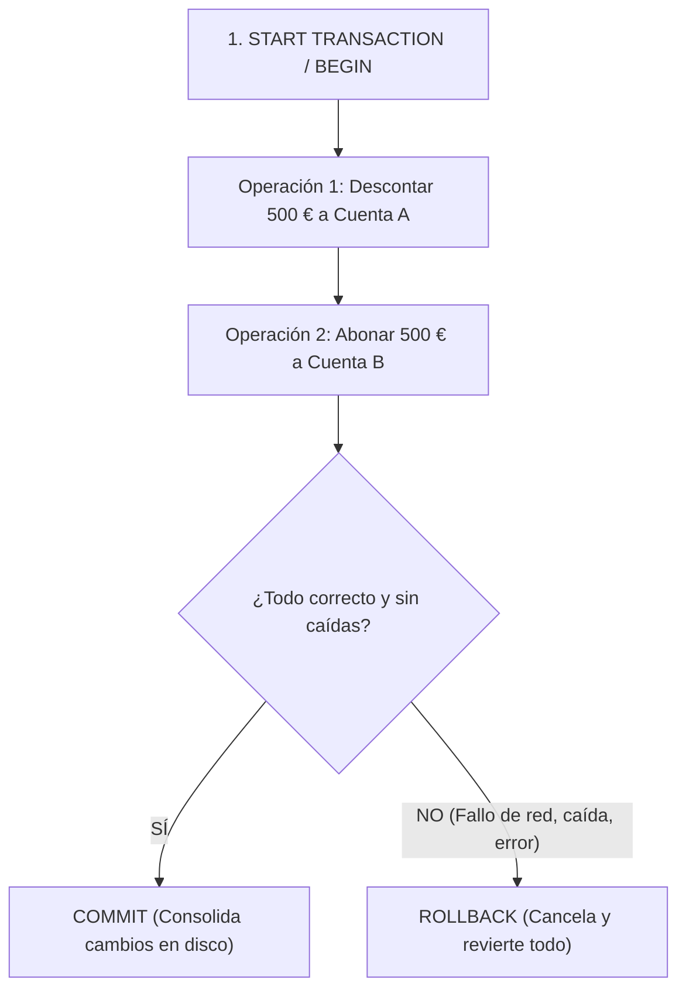

# 5. Manipulación de Datos (DML) y Transacciones ACID

El lenguaje de manipulación de datos (**DML - Data Manipulation Language**) comprende las sentencias destinadas a alterar el estado de la información almacenada en una base de datos: inserción (**`INSERT`**), actualización (**`UPDATE`**) y eliminación (**`DELETE`**), bajo el control de transacciones seguras (**`COMMIT`** y **`ROLLBACK`**).

---

## 1. Inserción de Registros (`INSERT INTO`)

Permite añadir nuevas filas a una tabla existente.

### Sintaxis y Modalidades:
```sql
-- 1. Inserción indicando columnas (Recomendado: desacoplado del orden físico de la tabla)
INSERT INTO empleados (emp_no, apellido, oficio, dir, fecha_alt, salario, comision, dept_no)
VALUES (1000, 'QUEVEDO', 'ANALISTA', 7782, CURDATE(), 3000, 0, 40);

-- 2. Inserción posicional sin nombres de columna (Requiere valores para TODAS las columnas en orden)
INSERT INTO empleados
VALUES (1000, 'QUEVEDO', 'ANALISTA', 7782, CURDATE(), 3000, 0, 40);

-- 3. Inserción múltiple de varias filas en una única sentencia (Mayor rendimiento de red y disco)
INSERT INTO empleados (emp_no, apellido, oficio, salario, dept_no) VALUES
  (1001, 'FERNÁNDEZ', 'PROGRAMADOR', 2000, 40),
  (1002, 'ALONSO',    'ADMINISTRADOR', 3000, 40);
```

### Inserción Masiva Basada en Consultas (`INSERT ... SELECT`)
Permite volcar datos calculados o extraídos de una tabla hacia otra:

```sql
-- Volcar a la tabla informaticos todos los empleados pertenecientes al departamento 40
INSERT INTO informaticos (emp_no, apellido, oficio, dir, fecha_alt, salario, comision, dept_no)
SELECT emp_no, apellido, oficio, dir, fecha_alt, salario, comision, dept_no
FROM empleados
WHERE dept_no = 40;
```

---

## 2. Modificación de Registros (`UPDATE`)

Actualiza los valores de una o varias columnas en registros ya existentes.

```sql
UPDATE tabla
SET columna1 = valor1, columna2 = valor2, ...
WHERE condicion;
```

> [!CAUTION] **Regla de supervivencia: La cláusula WHERE es crítica**
> Si se ejecuta un `UPDATE` sin cláusula `WHERE`, **se sobrescribirá el valor en todas las filas de la tabla sin posibilidad de distinción**.

### Modificación con Subconsultas Integradas
Las subconsultas pueden colocarse tanto en la condición `WHERE` como en la asignación `SET`:

```sql
-- Subconsulta en WHERE: Aumentar el salario a los empleados que trabajan en Madrid
UPDATE empleados
SET salario = salario * 1.10
WHERE dept_no = (SELECT dept_no FROM dept WHERE loc = 'MADRID');

-- Subconsulta en SET: Ajustar el objetivo de una oficina a la suma de cuotas de sus empleados
UPDATE oficinas
SET objetivo = (SELECT SUM(cuota) FROM empleados WHERE oficina = 30)
WHERE oficina = 30;
```

---

## 3. Borrado de Registros (`DELETE`)

Elimina filas completas de una tabla en base a una condición:

```sql
-- Borrado selectivo
DELETE FROM oficinas
WHERE region = 'Este';

-- Borrado utilizando subconsultas
DELETE FROM empleados
WHERE oficina IN (
    SELECT oficina
    FROM oficinas
    WHERE region = 'Este'
);
```

### 🆚 Diferencias: `DELETE` vs `TRUNCATE` vs `DROP`
| Comando | Nivel | ¿Admite WHERE? | Rendimiento | Transaccional / Rollback |
|---|---|---|---|---|
| **`DELETE`** | DML | **Sí** | Más lento (borra fila a fila y genera logs de rollback) | ✅ **Sí admite `ROLLBACK`** |
| **`TRUNCATE`** | DDL | No (vacía la tabla entera) | Inmediato (desasigna páginas de disco) | ❌ No reversible en la mayoría de motores |
| **`DROP TABLE`** | DDL | No (destruye datos y esquema) | Inmediato | ❌ Destruye la tabla por completo |

---

## 4. Control de Transacciones: El Paradigma ACID

Una **transacción** es una secuencia de una o más instrucciones SQL que forman una **unidad indivisible de trabajo**. 



### Las 4 Propiedades ACID:
1. **Atomicidad (*Atomicity*):** Garantiza que todas las operaciones de la transacción se completen con éxito o, si ocurre algún fallo, ninguna de ellas tenga efecto (*"todo o nada"*).
2. **Consistencia (*Consistency*):** Asegura que la transacción lleve a la base de datos de un estado válido a otro estado válido, respetando todas las claves primarias, foráneas y restricciones (*check constraints*).
3. **Aislamiento (*Isolation*):** Las operaciones de una transacción en curso permanecen aisladas e invisibles para otras transacciones simultáneas hasta que se confirmen.
4. **Durabilidad (*Durability*):** Una vez ejecutado `COMMIT`, los cambios son definitivos y resisten incluso a apagones o fallos catastróficos del sistema operativo.

---

### Comandos de Control Transaccional

- **`START TRANSACTION` (o `BEGIN`):** Inicia explícitamente el bloque transaccional.
- **`COMMIT`:** Valida y hace permanentes todos los cambios en el motor de almacenamiento.
- **`ROLLBACK`:** Cancela y desase todas las modificaciones efectuadas desde el inicio de la transacción, devolviendo la base de datos a su estado original intacto.

```sql
-- Caso de estudio: Transferencia bancaria segura
START TRANSACTION;

-- Paso 1: Restar saldo a la cuenta de origen
UPDATE cuentas
SET saldo = saldo - 500
WHERE num_cuenta = 11111;

-- Paso 2: Sumar saldo a la cuenta de destino
UPDATE cuentas
SET saldo = saldo + 500
WHERE num_cuenta = 22222;

-- Si ambas operaciones se ejecutan sin error:
COMMIT;
```

### Consideraciones en MySQL y MariaDB:
- **Modo `autocommit`:** Por defecto viene activado (`autocommit = 1`), ejecutando un commit implícito tras cada sentencia suelta. Al invocar `START TRANSACTION`, el autocommit se desactiva hasta que se emita `COMMIT` o `ROLLBACK`.
- **Motores Transaccionales:** Las transacciones exigen un motor con soporte ACID como **`InnoDB`**. Motores antiguos como `MyISAM` no admiten transacciones y dejan datos inconsistentes ante fallos.
