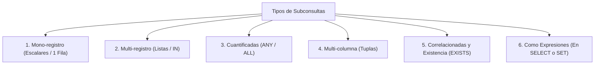
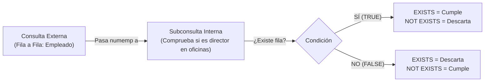

# 4. Subconsultas en SQL

Una **subconsulta (*subquery*)** es una sentencia `SELECT` anidada en el interior de otra consulta SQL principal (`SELECT`, `INSERT`, `UPDATE` o `DELETE`). Permite resolver consultas en varios pasos lógicos dinámicos sin necesidad de almacenar datos intermedios manualmente.

```sql
SELECT columnas
FROM tabla
WHERE columna OPERADOR (
    SELECT columna
    FROM otra_tabla
    WHERE condicion
);
```

### ⚙️ Principios de Arquitectura y Reglas de Uso
- **Orden de ejecución:** La subconsulta se ejecuta **una vez y con anterioridad** a la consulta principal externa.
- **Paso de datos:** El resultado producido por la subconsulta alimenta directamente la condición evaluada en la consulta externa.
- **Directrices de sintaxis obligatorias:**
  1. La subconsulta debe ir **siempre encerrada entre paréntesis `()`**.
  2. La subconsulta debe colocarse a la **derecha del operador de comparación**.
  3. **No se debe añadir la cláusula `ORDER BY`** dentro de una subconsulta estándar (la ordenación solo tiene sentido en el resultado final externo).
  4. Los operadores utilizados deben coincidir con la cardinalidad devuelta (operadores mono-registro para un único valor, u operadores de conjunto para listas).

---

## 1. Clasificación por Resultados Devueltos



---

### 1. Subconsultas Mono-Registro (Valor Simple)
Devuelven una **única fila con una única columna**.  
Se evalúan con los operadores relacionales estándar: `=`, `>`, `>=`, `<`, `<=`, `<>` (`!=`).

```sql
-- Obtener empleados con salario superior al del empleado 'JONES' (cuyo salario es 2975):
SELECT ename, sal
FROM emp
WHERE sal > (
    SELECT sal
    FROM emp
    WHERE empno = 7566
);
```

#### 🚨 Diagnóstico de Errores Comunes de Examen:

1. **Error `ORA-01427: single-row subquery returns more than one row`:**
   ```sql
   -- ❌ ERROR: El operador mono-registro '=' recibe múltiples filas por el GROUP BY
   SELECT empno, ename
   FROM emp
   WHERE sal = (
       SELECT MIN(sal)
       FROM emp
       GROUP BY deptno
   );
   ```
   * **Causa:** La subconsulta interna devuelve más de un registro (uno por cada departamento), colapsando el operador escalar `=`.
   * **Solución:** Sustituir `=` por el operador de conjuntos `IN` o un cuantificador `ANY`/`ALL`.

2. **Subconsulta que no devuelve registros (`no rows selected`):**
   ```sql
   SELECT ename, job
   FROM emp
   WHERE job = (
       SELECT job
       FROM emp
       WHERE ename = 'SMYTHE' -- Empleado inexistente
   );
   ```
   * **Comportamiento:** Si la subconsulta no encuentra datos, retorna `NULL`. En SQL cualquier comparación relacional con nulo (`job = NULL`) resulta en `UNKNOWN` (falso). Por tanto, la consulta principal no arroja ningún error de sintaxis, pero devuelve **0 filas**.

---

### 2. Subconsultas Multi-Columna (Comparación de Tuplas)
Permite comparar de forma simultánea múltiples columnas con una subconsulta que devuelve exactamente los mismos campos y tipos de datos:

```sql
-- Empleados que comparten el mismo oficio Y el mismo salario que 'JAMES':
SELECT ename, sal, job
FROM emp
WHERE (job, sal) = (
    SELECT job, sal
    FROM emp
    WHERE ename = 'JAMES'
);
```

---

### 3. Subconsultas Multi-Registro de Lista (`IN` / `NOT IN`)
Devuelven un conjunto de múltiples valores (una columna con cero, una o muchas filas).  
Se comparan mediante los operadores de pertenencia a conjuntos:

- **`IN`:** Verdadero si el valor coincide con cualquiera de la lista devuelta.
- **`NOT IN`:** Verdadero si el valor no coincide con ninguno de los elementos de la lista.

```sql
-- Empleados cuyo oficio coincida con cualquiera de los oficios presentes en el departamento 20
SELECT ename, job
FROM emp
WHERE job IN (
    SELECT job
    FROM emp
    WHERE deptno = 20
);
```

---

### 4. Modificadores Cuantificados: `ANY` (`SOME`) y `ALL`

Permiten combinar operadores de desigualdad relacional (`>`, `<`, etc.) con subconsultas que devuelven múltiples filas:

| Expresión con lista `(10, 20, 30)` | Significado lógico equivalente | Regla nemotécnica |
|---|---|---|
| **`> ANY (...)`** | Mayor que el mínimo elemento ($> 10$). | Con superar a **uno**, cumple. |
| **`< ANY (...)`** | Menor que el máximo elemento ($< 30$). | Con ser menor que **uno**, cumple. |
| **`= ANY (...)`** | Idéntico a **`IN`**. | Pertenece a la lista. |
| **`<> ANY (...)`** | Distinto de al menos uno. | `(col != a) OR (col != b)` |
| **`> ALL (...)`** | Mayor que **todos** los elementos ($> 30$). | Mayor que el **máximo**. |
| **`< ALL (...)`** | Menor que **todos** los elementos ($< 10$). | Menor que el **mínimo**. |
| **`<> ALL (...)`** | Idéntico a **`NOT IN`**. | No coincide con ninguno. |

#### Ejemplo con `ANY`:
Empleados que no son oficinistas pero ganan menos que **algún** oficinista (salarios oficinistas: 800, 950, 1100, 1300):
```sql
SELECT empno, ename, job, sal
FROM emp
WHERE sal < ANY (
    SELECT sal
    FROM emp
    WHERE job = 'CLERK'
)
AND job <> 'CLERK';
-- Cumplirá cualquier empleado que gane menos de 1300 € (el máximo de la lista).
```

#### Ejemplo con `ALL`:
Empleados cuyo salario es superior a **todas** las medias salariales por departamento (medias: 1566.67, 2175, 2916.67):
```sql
SELECT empno, ename, job, sal
FROM emp
WHERE sal > ALL (
    SELECT AVG(sal)
    FROM emp
    GROUP BY deptno
);
-- Solo cumplirá si el salario supera los 2916.67 € (el máximo de todas las medias).
```

---

### 5. Subconsultas Correlacionadas y de Existencia (`EXISTS` / `NOT EXISTS`)

En una **subconsulta correlacionada**, la consulta interna hace referencia a una o varias columnas de la consulta más externa mediante alias (`e.deptno`).  
Por tanto, la subconsulta **se evalúa fila por fila** para cada registro candidato de la consulta principal:

```sql
-- Mostrar los empleados cuyos salarios sean iguales al salario máximo de SU PROPIO departamento:
SELECT empno, ename, sal, deptno
FROM emp e
WHERE sal = (
    SELECT MAX(sal)
    FROM emp
    WHERE deptno = e.deptno -- Relación con la fila actual externa
);
```

#### Evaluación de Existencia con `EXISTS`
La cláusula **`EXISTS`** evalúa si una subconsulta correlacionada produce **al menos una fila**. Actúa como una comprobación booleana (`TRUE` o `FALSE`):

- **Alto rendimiento:** El motor detiene el escaneo en cuanto encuentra la primera coincidencia (*short-circuit evaluation*).
- **Sintaxis con asterisco:** Por convención se utiliza `SELECT *` o `SELECT 1`, ya que no se extraen datos reales, solo se valida la existencia.

```sql
-- Listar los departamentos que tienen al menos un empleado asignado:
SELECT deptno, dname
FROM dept d
WHERE EXISTS (
    SELECT *
    FROM emp e
    WHERE e.deptno = d.deptno
);
```



```sql
-- Listar los empleados que NO son directores de ninguna oficina
SELECT numemp, nombre, edad
FROM empleados e
WHERE NOT EXISTS (
    SELECT *
    FROM oficinas o
    WHERE o.dir = e.numemp
);
```

---

### 5. Subconsultas Usadas en Lugar de Expresiones

Una subconsulta escalar puede utilizarse en cualquier parte de una sentencia SQL donde se admita un valor o constante (en las cláusulas `SELECT`, `SET`, `WHERE` o `HAVING`), excepto en la lista de `ORDER BY`.

**Ejemplo de cálculo dinámico:** Mostrar cada empleado junto con su salario, la media salarial global de la empresa y la desviación respecto a dicha media:

```sql
SELECT nombre,
       salario,
       (SELECT ROUND(AVG(salario), 2) FROM empleados) AS "Salario Medio Empresa",
       salario - (SELECT AVG(salario) FROM empleados) AS "Diferencia con la Media"
FROM empleados;
```

---

## 2. Ejercicios Prácticos de Aula: Catálogo Fabricante-Producto

Basado en el esquema de prácticas de aula (`fabricante` y `producto`):

```sql
CREATE TABLE fabricante (
    id_fabricante INT PRIMARY KEY,
    nombre VARCHAR(100) NOT NULL
);

CREATE TABLE producto (
    id INT PRIMARY KEY,
    nombre VARCHAR(100) NOT NULL,
    precio NUMBER NOT NULL,
    id_fabricante INT NOT NULL,
    FOREIGN KEY (id_fabricante) REFERENCES fabricante(id_fabricante)
);
```

### Consultas con Operadores Básicos de Comparación

1. **Devuelve todos los productos del fabricante Lenovo:**
```sql
SELECT *
FROM producto
WHERE id_fabricante = (
    SELECT id_fabricante 
    FROM fabricante 
    WHERE nombre = 'Lenovo'
);
```

2. **Devuelve todos los datos de los productos que tienen el mismo precio que el producto más caro del fabricante Lenovo:**
```sql
SELECT *
FROM producto
WHERE precio = (
    SELECT MAX(p.precio)
    FROM producto p
    WHERE p.id_fabricante = (
        SELECT f.id_fabricante 
        FROM fabricante f 
        WHERE f.nombre = 'Lenovo'
    )
);
```

3. **Lista el nombre del producto más caro del fabricante Lenovo:**
```sql
SELECT nombre
FROM producto
WHERE id_fabricante = (
    SELECT id_fabricante 
    FROM fabricante 
    WHERE nombre = 'Lenovo'
)
AND precio = (
    SELECT MAX(precio)
    FROM producto
    WHERE id_fabricante = (
        SELECT id_fabricante 
        FROM fabricante 
        WHERE nombre = 'Lenovo'
    )
);
```

4. **Lista el nombre del producto más barato del fabricante Hewlett-Packard:**
```sql
SELECT nombre
FROM producto
WHERE id_fabricante = (
    SELECT id_fabricante 
    FROM fabricante 
    WHERE nombre = 'Hewlett-Packard'
)
AND precio = (
    SELECT MIN(precio)
    FROM producto
    WHERE id_fabricante = (
        SELECT id_fabricante 
        FROM fabricante 
        WHERE nombre = 'Hewlett-Packard'
    )
);
```

5. **Devuelve todos los productos de la base de datos que tienen un precio mayor o igual al producto más caro del fabricante Lenovo:**
```sql
SELECT *
FROM producto
WHERE precio >= (
    SELECT MAX(precio)
    FROM producto
    WHERE id_fabricante = (
        SELECT id_fabricante 
        FROM fabricante 
        WHERE nombre = 'Lenovo'
    )
);
```

6. **Lista todos los productos del fabricante Asus que tienen un precio superior al precio medio de todos sus productos:**
```sql
SELECT *
FROM producto
WHERE id_fabricante = (
    SELECT id_fabricante 
    FROM fabricante 
    WHERE nombre = 'Asus'
)
AND precio > (
    SELECT AVG(precio)
    FROM producto
    WHERE id_fabricante = (
        SELECT id_fabricante 
        FROM fabricante 
        WHERE nombre = 'Asus'
    )
);
```

### Consultas de Extremos y Pertenencia a Conjuntos

7. **Devuelve el producto más caro que existe en la tabla producto:**
```sql
SELECT *
FROM producto
WHERE precio = (
    SELECT MAX(precio) 
    FROM producto
);
```

8. **Devuelve el producto más barato que existe en la tabla producto:**
```sql
SELECT *
FROM producto
WHERE precio = (
    SELECT MIN(precio) 
    FROM producto
);
```

9. **Devuelve los nombres de los fabricantes que tienen productos asociados:**
```sql
SELECT nombre
FROM fabricante
WHERE id_fabricante IN (
    SELECT DISTINCT id_fabricante 
    FROM producto
);
```

10. **Devuelve los nombres de los fabricantes que NO tienen productos asociados:**
```sql
SELECT nombre
FROM fabricante
WHERE id_fabricante NOT IN (
    SELECT DISTINCT id_fabricante 
    FROM producto
);
```

