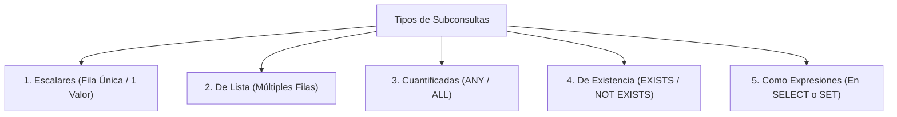
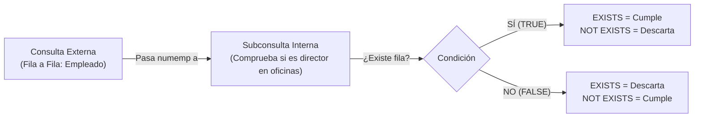

# 4. Subconsultas en SQL

Una **subconsulta (*subquery*)** es una sentencia `SELECT` anidada en el interior de otra consulta SQL principal (`SELECT`, `INSERT`, `UPDATE` o `DELETE`). Permite resolver consultas en varios pasos lógicos dinámicos sin necesidad de almacenar datos intermedios manualmente.

```sql
SELECT columnas
FROM tabla
WHERE columna OPERADOR (
    SELECT columna
    FROM otra_tabla
    WHERE condicion
);
```

---

## 1. Clasificación por Resultados Devueltos



---

### 1. Subconsultas Escalares (Valor Simple)
Devuelven una **única fila con una única columna**.  
Se utilizan con los operadores relacionales estándar: `=`, `<>`, `!=`, `>`, `>=`, `<`, `<=`.

> [!WARNING] **Error por cardinalidad múltiple**
> Si una subconsulta evaluada con un operador simple como `=` devuelve más de un registro, el motor abortará la consulta arrojando un error de ejecución (*single-row subquery returns more than one row*).

**Ejemplo:** Obtener el nombre de los empleados que tienen el mismo oficio que el empleado `'GIL'`:

```sql
-- 1. La subconsulta interna obtiene el oficio de GIL ('ANALISTA')
-- 2. La consulta externa busca todos los empleados con dicho oficio
SELECT nombre, oficio, salario
FROM empleados
WHERE oficio = (
    SELECT oficio
    FROM empleados
    WHERE apellido = 'GIL'
);
```

---

### 2. Subconsultas de Lista de Valores (`IN` / `NOT IN`)
Devuelven un conjunto de múltiples valores (una columna con cero, una o muchas filas).  
Se comparan mediante los operadores de pertenencia a conjuntos:

- **`IN`:** Verdadero si el valor coincide con cualquiera de la lista devuelta.
- **`NOT IN`:** Verdadero si el valor no coincide con ninguno de los elementos de la lista.

```sql
-- Empleados cuyo oficio coincida con cualquiera de los oficios presentes en el departamento 20
SELECT nombre, oficio, dept_no
FROM empleados
WHERE oficio IN (
    SELECT DISTINCT oficio
    FROM empleados
    WHERE dept_no = 20
);
```

---

### 3. Modificadores Cuantificados: `ANY` (`SOME`) y `ALL`

Permiten combinar operadores de desigualdad relacional (`>`, `<`, etc.) con subconsultas que devuelven múltiples filas:

| Expresión con lista `(10, 20, 30)` | Significado lógico equivalente | Regla nemotécnica |
|---|---|---|
| **`> ANY (...)`** | Mayor que el mínimo elemento ($> 10$). | Con superar a **uno**, cumple. |
| **`< ANY (...)`** | Menor que el máximo elemento ($< 30$). | Con ser menor que **uno**, cumple. |
| **`= ANY (...)`** | Idéntico a **`IN`**. | Pertenece a la lista. |
| **`<> ANY (...)`** | Distinto de al menos uno. | `(col != a) OR (col != b)` |
| **`> ALL (...)`** | Mayor que **todos** los elementos ($> 30$). | Mayor que el **máximo**. |
| **`< ALL (...)`** | Menor que **todos** los elementos ($< 10$). | Menor que el **mínimo**. |
| **`<> ALL (...)`** | Idéntico a **`NOT IN`**. | No coincide con ninguno. |

```sql
-- Empleados cuyo salario sea mayor que el salario máximo de algún departamento
SELECT nombre, salario, dept_no
FROM empleados
WHERE salario > ANY (
    SELECT MAX(salario)
    FROM empleados
    GROUP BY dept_no
);

-- Empleados que cobran más que TODOS los empleados del departamento 30
SELECT nombre, salario
FROM empleados
WHERE salario > ALL (
    SELECT salario
    FROM empleados
    WHERE dept_no = 30
);
```

---

### 4. Subconsultas de Existencia: `EXISTS` y `NOT EXISTS`

La cláusula **`EXISTS`** evalúa si una subconsulta correlacionada produce **al menos una fila**. Actúa como una comprobación booleana (`TRUE` o `FALSE`):

- **Alto rendimiento:** El motor detiene el escaneo en cuanto encuentra la primera coincidencia (*short-circuit evaluation*).
- **Sintaxis con asterisco:** Por convención se utiliza `SELECT *` o `SELECT 1`, ya que no se extraen datos reales, solo se valida la existencia.



```sql
-- Listar los empleados que NO son directores de ninguna oficina
SELECT numemp, nombre, edad
FROM empleados e
WHERE NOT EXISTS (
    SELECT *
    FROM oficinas o
    WHERE o.dir = e.numemp
);
```

---

### 5. Subconsultas Usadas en Lugar de Expresiones

Una subconsulta escalar puede utilizarse en cualquier parte de una sentencia SQL donde se admita un valor o constante (en las cláusulas `SELECT`, `SET`, `WHERE` o `HAVING`), excepto en la lista de `ORDER BY`.

**Ejemplo de cálculo dinámico:** Mostrar cada empleado junto con su salario, la media salarial global de la empresa y la desviación respecto a dicha media:

```sql
SELECT nombre,
       salario,
       (SELECT ROUND(AVG(salario), 2) FROM empleados) AS "Salario Medio Empresa",
       salario - (SELECT AVG(salario) FROM empleados) AS "Diferencia con la Media"
FROM empleados;
```

---

## 2. Ejercicios Prácticos de Aula: Catálogo Fabricante-Producto

Basado en el esquema de prácticas de aula (`fabricante` y `producto`):

```sql
CREATE TABLE fabricante (
    id_fabricante INT PRIMARY KEY,
    nombre VARCHAR(100) NOT NULL
);

CREATE TABLE producto (
    id INT PRIMARY KEY,
    nombre VARCHAR(100) NOT NULL,
    precio NUMBER NOT NULL,
    id_fabricante INT NOT NULL,
    FOREIGN KEY (id_fabricante) REFERENCES fabricante(id_fabricante)
);
```

### Consultas con Operadores Básicos de Comparación

1. **Devuelve todos los productos del fabricante Lenovo:**
```sql
SELECT *
FROM producto
WHERE id_fabricante = (
    SELECT id_fabricante 
    FROM fabricante 
    WHERE nombre = 'Lenovo'
);
```

2. **Devuelve todos los datos de los productos que tienen el mismo precio que el producto más caro del fabricante Lenovo:**
```sql
SELECT *
FROM producto
WHERE precio = (
    SELECT MAX(p.precio)
    FROM producto p
    WHERE p.id_fabricante = (
        SELECT f.id_fabricante 
        FROM fabricante f 
        WHERE f.nombre = 'Lenovo'
    )
);
```

3. **Lista el nombre del producto más caro del fabricante Lenovo:**
```sql
SELECT nombre
FROM producto
WHERE id_fabricante = (
    SELECT id_fabricante 
    FROM fabricante 
    WHERE nombre = 'Lenovo'
)
AND precio = (
    SELECT MAX(precio)
    FROM producto
    WHERE id_fabricante = (
        SELECT id_fabricante 
        FROM fabricante 
        WHERE nombre = 'Lenovo'
    )
);
```

4. **Lista el nombre del producto más barato del fabricante Hewlett-Packard:**
```sql
SELECT nombre
FROM producto
WHERE id_fabricante = (
    SELECT id_fabricante 
    FROM fabricante 
    WHERE nombre = 'Hewlett-Packard'
)
AND precio = (
    SELECT MIN(precio)
    FROM producto
    WHERE id_fabricante = (
        SELECT id_fabricante 
        FROM fabricante 
        WHERE nombre = 'Hewlett-Packard'
    )
);
```

5. **Devuelve todos los productos de la base de datos que tienen un precio mayor o igual al producto más caro del fabricante Lenovo:**
```sql
SELECT *
FROM producto
WHERE precio >= (
    SELECT MAX(precio)
    FROM producto
    WHERE id_fabricante = (
        SELECT id_fabricante 
        FROM fabricante 
        WHERE nombre = 'Lenovo'
    )
);
```

6. **Lista todos los productos del fabricante Asus que tienen un precio superior al precio medio de todos sus productos:**
```sql
SELECT *
FROM producto
WHERE id_fabricante = (
    SELECT id_fabricante 
    FROM fabricante 
    WHERE nombre = 'Asus'
)
AND precio > (
    SELECT AVG(precio)
    FROM producto
    WHERE id_fabricante = (
        SELECT id_fabricante 
        FROM fabricante 
        WHERE nombre = 'Asus'
    )
);
```

### Consultas de Extremos y Pertenencia a Conjuntos

7. **Devuelve el producto más caro que existe en la tabla producto:**
```sql
SELECT *
FROM producto
WHERE precio = (
    SELECT MAX(precio) 
    FROM producto
);
```

8. **Devuelve el producto más barato que existe en la tabla producto:**
```sql
SELECT *
FROM producto
WHERE precio = (
    SELECT MIN(precio) 
    FROM producto
);
```

9. **Devuelve los nombres de los fabricantes que tienen productos asociados:**
```sql
SELECT nombre
FROM fabricante
WHERE id_fabricante IN (
    SELECT DISTINCT id_fabricante 
    FROM producto
);
```

10. **Devuelve los nombres de los fabricantes que NO tienen productos asociados:**
```sql
SELECT nombre
FROM fabricante
WHERE id_fabricante NOT IN (
    SELECT DISTINCT id_fabricante 
    FROM producto
);
```

