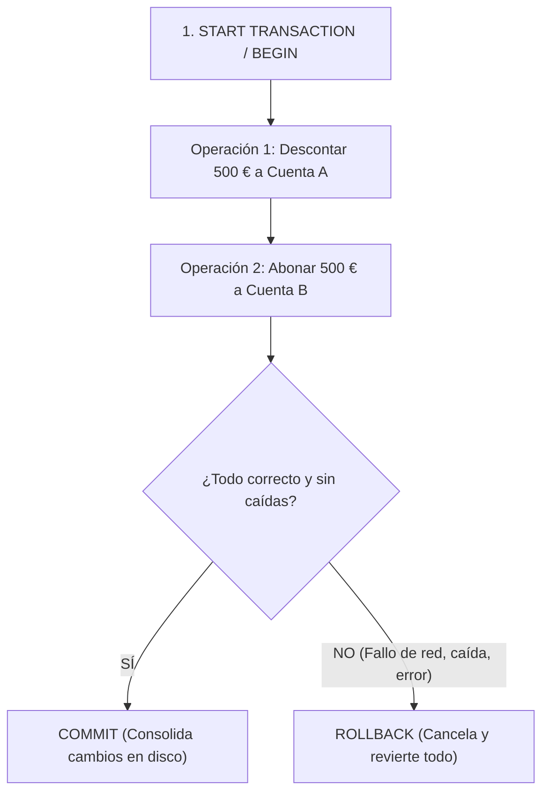

# 5. Manipulación de Datos (DML) y Transacciones ACID

El lenguaje de manipulación de datos (**DML - Data Manipulation Language**) comprende las sentencias destinadas a alterar el estado de la información almacenada en una base de datos: inserción (**`INSERT`**), actualización (**`UPDATE`**) y eliminación (**`DELETE`**), bajo el control de transacciones seguras (**`COMMIT`** y **`ROLLBACK`**).

---

## 1. Inserción de Registros (`INSERT INTO`)

Permite añadir nuevas filas a una tabla existente.

### Sintaxis y Modalidades:
```sql
-- 1. Inserción indicando columnas (Recomendado: desacoplado del orden físico de la tabla)
INSERT INTO empleados (emp_no, apellido, oficio, dir, fecha_alt, salario, comision, dept_no)
VALUES (1000, 'QUEVEDO', 'ANALISTA', 7782, CURDATE(), 3000, 0, 40);

-- 2. Inserción posicional sin nombres de columna (Requiere valores para TODAS las columnas en orden)
INSERT INTO empleados
VALUES (1000, 'QUEVEDO', 'ANALISTA', 7782, CURDATE(), 3000, 0, 40);

-- 3. Inserción múltiple de varias filas en una única sentencia (Mayor rendimiento de red y disco)
INSERT INTO empleados (emp_no, apellido, oficio, salario, dept_no) VALUES
  (1001, 'FERNÁNDEZ', 'PROGRAMADOR', 2000, 40),
  (1002, 'ALONSO',    'ADMINISTRADOR', 3000, 40);
```

> [!IMPORTANT] **Reglas de inserción y restricciones NOT NULL**
> - Los valores suministrados deben coincidir estrictamente en **número y tipo de dato** con la definición de la tabla.
> - Si se omiten columnas en la cláusula `INSERT`, la base de datos les asignará el valor `NULL` (o su valor `DEFAULT` si estuviera configurado). Si la columna se definió con la restricción `NOT NULL` y no tiene `DEFAULT`, la orden `INSERT` fallará de inmediato.

### Consultas de Datos Anexados (`INSERT ... SELECT`)
Permite introducir un conjunto de registros provenientes de otra fuente o combinar datos conocidos con información extraída dinámicamente de la base de datos:

```sql
-- Caso A: Volcado masivo entre tablas
INSERT INTO emp_bcn
SELECT *
FROM emp
WHERE deptno IN (
    SELECT deptno
    FROM dept
    WHERE loc = 'BARCELONA'
);

-- Caso B: Inserción individual combinando valores fijos y consultas
-- Insertar un empleado (código 1111, nombre 'GARCIA') en el departamento donde trabaja 'PEPE' y con su mismo sueldo:
INSERT INTO emp (empno, ename, hiredate, sal, deptno)
SELECT 1111, 'GARCIA', SYSDATE, sal, deptno
FROM emp
WHERE ename = 'PEPE';

-- Caso C: Insertar al empleado 2000 'SAAVEDRA', fecha del sistema, salario 20% superior al de 'MILLER' y sus mismos datos restantes:
INSERT INTO emp (empno, ename, hiredate, sal, job, mgr, deptno)
SELECT 2000, 'SAAVEDRA', SYSDATE, sal * 1.20, job, mgr, deptno
FROM emp
WHERE ename = 'MILLER';
```

---

## 2. Modificación de Registros (`UPDATE`)

Actualiza los valores de una o varias columnas en registros ya existentes.

```sql
UPDATE tabla
SET columna1 = valor1, columna2 = valor2, ...
WHERE condicion;
```

> [!CAUTION] **Regla de supervivencia: La cláusula WHERE es crítica**
> Si se ejecuta un `UPDATE` sin cláusula `WHERE`, **se sobrescribirá el valor en todas las filas de la tabla sin posibilidad de distinción**.

### Consultas de Actualización con Subconsultas
Las subconsultas pueden utilizarse tanto para calcular el nuevo valor asignado en el `SET` como para filtrar las filas afectadas en el `WHERE`:

```sql
-- 1. Subconsulta en SET (debe devolver un único valor escalar compatible):
UPDATE emp
SET sal = (SELECT MAX(sal) FROM emp)
WHERE empno = 7082;

-- 2. Subconsulta en WHERE:
UPDATE emp
SET sal = 1000
WHERE deptno = (SELECT deptno FROM dept WHERE loc = 'LORA');

-- 3. Combinación simultánea en SET y en WHERE:
-- Poner nombre en minúsculas y duplicar el sueldo de JAMES a todos los empleados de ACCOUNTING:
UPDATE emp
SET ename = LOWER(ename),
    sal = (
        SELECT sal * 2
        FROM emp
        WHERE ename = 'JAMES'
    )
WHERE deptno = (
    SELECT deptno
    FROM dept
    WHERE dname = 'ACCOUNTING'
);
```

---

## 3. Borrado de Registros (`DELETE`)

Elimina filas completas de una tabla en base a una condición:

```sql
-- Borrado selectivo
DELETE FROM oficinas
WHERE region = 'Este';

-- Borrado utilizando subconsultas
DELETE FROM empleados
WHERE oficina IN (
    SELECT oficina
    FROM oficinas
    WHERE region = 'Este'
);
```

### 🆚 Diferencias: `DELETE` vs `TRUNCATE` vs `DROP`
| Comando | Nivel | ¿Admite WHERE? | Rendimiento | Transaccional / Rollback |
|---|---|---|---|---|
| **`DELETE`** | DML | **Sí** | Más lento (borra fila a fila y genera logs de rollback) | ✅ **Sí admite `ROLLBACK`** |
| **`TRUNCATE`** | DDL | No (vacía la tabla entera) | Inmediato (desasigna páginas de disco) | ❌ No reversible en la mayoría de motores |
| **`DROP TABLE`** | DDL | No (destruye datos y esquema) | Inmediato | ❌ Destruye la tabla por completo |

---

## 4. Control de Transacciones: El Paradigma ACID

Una **transacción** es una secuencia de una o más instrucciones SQL que forman una **unidad indivisible de trabajo**. 



### Las 4 Propiedades ACID:
1. **Atomicidad (*Atomicity*):** Garantiza que todas las operaciones de la transacción se completen con éxito o, si ocurre algún fallo, ninguna de ellas tenga efecto (*"todo o nada"*).
2. **Consistencia (*Consistency*):** Asegura que la transacción lleve a la base de datos de un estado válido a otro estado válido, respetando todas las claves primarias, foráneas y restricciones (*check constraints*).
3. **Aislamiento (*Isolation*):** Las operaciones de una transacción en curso permanecen aisladas e invisibles para otras transacciones simultáneas hasta que se confirmen.
4. **Durabilidad (*Durability*):** Una vez ejecutado `COMMIT`, los cambios son definitivos y resisten incluso a apagones o fallos catastróficos del sistema operativo.

---

### Comandos de Control Transaccional

- **`START TRANSACTION` (o `BEGIN`):** Inicia explícitamente el bloque transaccional.
- **`COMMIT`:** Valida y hace permanentes todos los cambios en el motor de almacenamiento.
- **`ROLLBACK`:** Cancela y desase todas las modificaciones efectuadas desde el inicio de la transacción, devolviendo la base de datos a su estado original intacto.

```sql
-- Caso de estudio: Transferencia bancaria segura
START TRANSACTION;

-- Paso 1: Restar saldo a la cuenta de origen
UPDATE cuentas
SET saldo = saldo - 500
WHERE num_cuenta = 11111;

-- Paso 2: Sumar saldo a la cuenta de destino
UPDATE cuentas
SET saldo = saldo + 500
WHERE num_cuenta = 22222;

-- Si ambas operaciones se ejecutan sin error:
COMMIT;
```

### Consideraciones en MySQL y MariaDB:
- **Modo `autocommit`:** Por defecto viene activado (`autocommit = 1`), ejecutando un commit implícito tras cada sentencia suelta. Al invocar `START TRANSACTION`, el autocommit se desactiva hasta que se emita `COMMIT` o `ROLLBACK`.
- **Motores Transaccionales:** Las transacciones exigen un motor con soporte ACID como **`InnoDB`**. Motores antiguos como `MyISAM` no admiten transacciones y dejan datos inconsistentes ante fallos.

---

### Control Transaccional en Oracle Database

En Oracle SQL*Plus e iSQL*Plus el comportamiento transaccional difiere de otros motores:

1. **Parámetro `AUTOCOMMIT`:** Por defecto se encuentra en **`OFF`**. Por tanto, las operaciones `INSERT`, `UPDATE` y `DELETE` **no se consolidan en la base de datos hasta que el usuario ejecute explícitamente `COMMIT`**.
   - Para consultar el estado actual:
     ```sql
     SHOW AUTOCOMMIT;
     ```
   - Para activar la confirmación automática:
     ```sql
     SET AUTOCOMMIT ON;
     ```

2. **Órdenes SQL que fuerzan un `COMMIT` Implícito:**
   En Oracle existen sentencias que confirman de manera automática e irrevocable cualquier transacción pendiente antes de ejecutarse:
   - **Cierre y desconexión de sesión:** `QUIT`, `EXIT`, `CONNECT`, `DISCONNECT`.
   - **Sentencias DDL:** `CREATE TABLE`, `DROP TABLE`, `CREATE VIEW`, `DROP VIEW`, `ALTER`.
   - **Sentencias DCL:** `GRANT`, `REVOKE`.
   - **Auditoría:** `AUDIT`, `NOAUDIT`.

3. **`ROLLBACK` Automático:** Se produce cuando ocurre una caída imprevista del servidor, fallo de comunicaciones o error crítico del sistema antes de haber validado el trabajo con `COMMIT`.

---

## 5. Ejercicios Prácticos de Aula: Gestión Universitaria (DML con Subconsultas)

Basado en el esquema de base de datos universitaria (`departamento`, `persona`, `profesor`, `grado`, `asignatura`, `curso_escolar`, `alumno_se_matricula_asignatura`):

### 1. Actualización de Teléfonos
Actualizar el teléfono de los profesores que imparten asignaturas en el cuatrimestre 1 al número `'123456789'`:
```sql
UPDATE persona
SET telefono = '123456789'
WHERE id IN (
    SELECT DISTINCT id_profesor
    FROM asignatura
    WHERE cuatrimestre = 1
      AND id_profesor IS NOT NULL
);
```

### 2. Actualización de Ciudad de Alumnos
Actualizar la ciudad de los alumnos matriculados en asignaturas del grado en *"Grado en Ciencias Ambientales (Plan 2009)"* a `'Granada'`:
```sql
UPDATE persona
SET ciudad = 'Granada'
WHERE id IN (
    SELECT DISTINCT m.id_alumno
    FROM alumno_se_matricula_asignatura m
    WHERE m.id_asignatura IN (
        SELECT a.id
        FROM asignatura a
        WHERE a.id_grado = (
            SELECT g.id
            FROM grado g
            WHERE g.nombre = 'Grado en Ciencias Ambientales (Plan 2009)'
        )
    )
);
```

### 3. Actualización de Tipo de Asignatura
Actualizar el tipo de las asignaturas impartidas por el profesor *"David Schmidt Fisher"* a `'avanzada'`:
```sql
UPDATE asignatura
SET tipo = 'avanzada'
WHERE id_profesor = (
    SELECT id
    FROM persona
    WHERE nombre = 'David'
      AND apellido1 = 'Schmidt'
      AND apellido2 = 'Fisher'
);
```

### 4. Modificación de Créditos Específicos
Actualizar el número de créditos de las asignaturas matriculadas por el alumno con NIF `'26902806M'` al doble de su valor actual:
```sql
UPDATE asignatura
SET creditos = creditos * 2
WHERE id IN (
    SELECT id_asignatura
    FROM alumno_se_matricula_asignatura
    WHERE id_alumno = (
        SELECT id
        FROM persona
        WHERE nif = '26902806M'
    )
);
```

### 5. Actualización con Conversión de Fechas (`TO_DATE`)
Actualizar la fecha de nacimiento de los profesores del departamento `'Informática'` al 01/01/1980:
```sql
UPDATE persona
SET fecha_nacimiento = TO_DATE('01/01/1980', 'dd/mm/yyyy')
WHERE id IN (
    SELECT id_profesor
    FROM profesor
    WHERE id_departamento = (
        SELECT id
        FROM departamento
        WHERE nombre = 'Informática'
    )
);
```

### 6. Eliminación de Profesores sin Carga Docente Reciente
Eliminar los profesores que no hayan impartido ninguna asignatura en el último año escolar registrado:
```sql
DELETE FROM profesor
WHERE id_profesor NOT IN (
    SELECT DISTINCT a.id_profesor
    FROM asignatura a
    WHERE a.id_profesor IS NOT NULL
      AND a.id IN (
          SELECT m.id_asignatura
          FROM alumno_se_matricula_asignatura m
          WHERE m.id_curso_escolar = (
              SELECT id
              FROM curso_escolar
              WHERE anyo_fin = (
                  SELECT MAX(anyo_fin)
                  FROM curso_escolar
              )
          )
      )
);
```

### 7. Eliminación de Cursos Escolares sin Matrícula
Eliminar los cursos escolares que no tengan alumnos matriculados:
```sql
DELETE FROM curso_escolar
WHERE id NOT IN (
    SELECT DISTINCT id_curso_escolar
    FROM alumno_se_matricula_asignatura
);
```

### 8. Eliminación de Matrículas por Profesor
Eliminar los registros de alumnos matriculados en asignaturas impartidas por el profesor *"David Schmidt Fisher"*:
```sql
DELETE FROM alumno_se_matricula_asignatura
WHERE id_asignatura IN (
    SELECT id
    FROM asignatura
    WHERE id_profesor = (
        SELECT id
        FROM persona
        WHERE nombre = 'David'
          AND apellido1 = 'Schmidt'
          AND apellido2 = 'Fisher'
    )
);
```

### 9. Eliminación de Profesores por Departamento
Eliminar los registros de profesores que pertenecen al departamento `'Matemáticas'`:
```sql
DELETE FROM profesor
WHERE id_departamento = (
    SELECT id
    FROM departamento
    WHERE nombre = 'Matemáticas'
);
```

### 10. Eliminación de Asignaturas de un Cuatrimestre y Grado
Eliminar las asignaturas del cuatrimestre 2 del grado en *"Grado en Ingeniería Informática (Plan 2015)"*:
```sql
DELETE FROM asignatura
WHERE cuatrimestre = 2
  AND id_grado = (
      SELECT id
      FROM grado
      WHERE nombre = 'Grado en Ingeniería Informática (Plan 2015)'
  );
```

