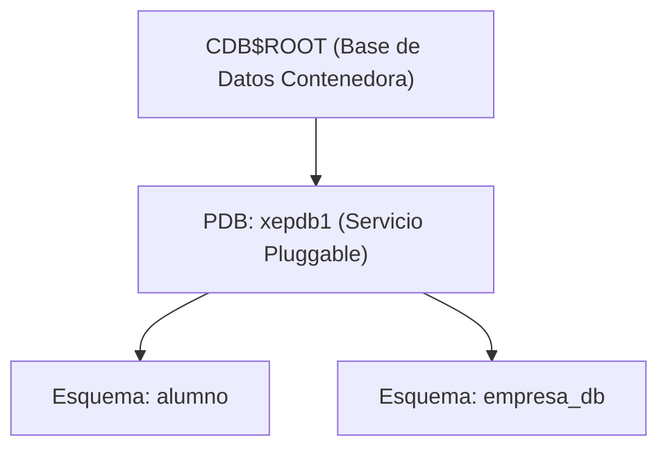

# 6. Administración de Oracle Database y Programación PL/SQL

En entornos empresariales, **Oracle Database** es uno de los motores relacionales más robustos. En ASGBD se aborda tanto la administración de instancias y usuarios multitenant (CDB/PDB) como la programación de lógica de negocio en servidor mediante **PL/SQL**.

---

## 1. Conexión y Gestión de Usuarios en Oracle Express (XE)

Desde Oracle 12c en adelante, el motor utiliza una arquitectura **Multitenant**:
- **CDB (*Container Database*):** Base de datos contenedora raíz (`CDB$ROOT`).
- **PDB (*Pluggable Database*):** Bases de datos conectables independientes donde residen las aplicaciones y esquemas de usuario (por defecto en Oracle XE se llama **`xepdb1`**).



### Protocolo de Creación y Configuración de un Usuario
Para que un usuario pueda conectarse y crear tablas en Oracle, deben ejecutarse los siguientes pasos desde el usuario administrativo **`system`**:

```sql
-- 1. Conexión al servicio pluggable xepdb1 con el usuario system
-- sqlplus system/contraseña@//localhost:1521/xepdb1

-- 2. Creación del usuario con su contraseña
CREATE USER nombre_usuario IDENTIFIED BY password_usuario;

-- 3. Concesión de roles básicos del sistema
GRANT connect, resource TO nombre_usuario;

-- 4. Asignación de cuota de almacenamiento ilimitada en el tablespace USERS
ALTER USER nombre_usuario QUOTA UNLIMITED ON USERS;
```

> [!IMPORTANT] **El rol de la cuota en tablespaces (Quota on USERS)**
> Aunque al usuario se le conceda el rol `RESOURCE`, **por defecto no tiene cuota asignada en disco**. Si no se ejecuta `ALTER USER ... QUOTA UNLIMITED ON USERS`, cualquier intento de `CREATE TABLE` o `INSERT` fallará con el error `ORA-01950: no privileges on tablespace 'USERS'`.

---

## 2. Programación en Servidor: Oracle PL/SQL

**PL/SQL (*Procedural Language / SQL*)** es la extensión procedural de Oracle que permite combinar la potencia declarativa de SQL con estructuras de control de flujo (bucles, condicionales, variables y control de excepciones).

### Estructura de un Bloque PL/SQL:
```sql
DECLARE
    -- Declaración de variables, constantes y tipos
    v_nombre VARCHAR2(50);
BEGIN
    -- Cuerpo ejecutable con sentencias SQL y lógica procedural
    SELECT ename INTO v_nombre FROM emp WHERE empno = 7839;
    DBMS_OUTPUT.PUT_LINE('Empleado: ' || v_nombre);
EXCEPTION
    -- Captura y tratamiento de errores en tiempo de ejecución
    WHEN NO_DATA_FOUND THEN
        DBMS_OUTPUT.PUT_LINE('No se encontró el empleado solicitado.');
    WHEN OTHERS THEN
        DBMS_OUTPUT.PUT_LINE('Error imprevisto: ' || SQLERRM);
END;
/
```

---

## 3. Procedimientos vs. Funciones Almacenadas

| Característica | Procedimiento (`PROCEDURE`) | Función (`FUNCTION`) |
|---|---|---|
| **Propósito** | Ejecutar una acción o conjunto de operaciones. | Calcular y retornar un valor específico. |
| **Sentencia `RETURN`** | Opcional (solo para terminar la ejecución antes). | **Obligatoria** en la cabecera y en el cuerpo. |
| **Llamada en SQL** | Desde bloques PL/SQL o con `EXECUTE` / `EXEC`. | **Directamente en sentencias `SELECT` o `WHERE`**. |
| **Parámetros** | Admite `IN` (entrada), `OUT` (salida) e `IN OUT` (entrada/salida). | Típicamente solo `IN`. |

---

## 4. Tipos de Parámetros en PL/SQL: Prácticas de Conversión de Cadenas

Para ilustrar las diferencias entre parámetros de entrada (`IN`), entrada/salida (`IN OUT`) y funciones, analizamos el caso práctico de **recibir una cadena en mayúsculas y transformarla a minúsculas**:

### 1. Procedimiento con Parámetro `IN`
El parámetro de entrada es de solo lectura. El procedimiento procesa el dato e imprime el resultado por consola:

```sql
SET SERVEROUTPUT ON;

CREATE OR REPLACE PROCEDURE minu (v_cad IN VARCHAR2)
AS
    v_cad_minu VARCHAR2(50);
BEGIN
    v_cad_minu := LOWER(v_cad);
    DBMS_OUTPUT.PUT_LINE(v_cad_minu);
END;
/

-- Formas de invocar el procedimiento:
-- A) Mediante el comando EXECUTE de SQL*Plus:
EXEC minu('HOLA MUNDO');

-- B) Dentro del cuerpo de un bloque anónimo:
BEGIN
    minu('HOLA MUNDO');
END;
/
```

### 2. Procedimiento con Parámetro `IN OUT`
El parámetro se pasa por referencia: entra con un valor inicial y el procedimiento lo sobrescribe directamente con el resultado transformado:

```sql
CREATE OR REPLACE PROCEDURE minu (v_cad IN OUT VARCHAR2)
AS
BEGIN
    v_cad := LOWER(v_cad);
END;
/

-- Llamada dentro de un bloque anónimo pasando una variable:
DECLARE
    v_cadena VARCHAR2(50);
BEGIN
    v_cadena := 'HOLA MUNDO DE NUEVO';
    minu(v_cadena); -- Modifica v_cadena directamente
    DBMS_OUTPUT.PUT_LINE(v_cadena);
END;
/
```

### 3. Función Almacenada (`FUNCTION`)
Retorna el valor transformado mediante la cláusula `RETURN`, permitiendo incrustarlo en cualquier expresión:

```sql
CREATE OR REPLACE FUNCTION f_minu (v_cad VARCHAR2)
RETURN VARCHAR2
AS
BEGIN
    RETURN LOWER(v_cad);
END;
/

-- Invocación dentro de un bloque anónimo:
BEGIN
    DBMS_OUTPUT.PUT_LINE(f_minu('HOLA MARTE'));
END;
/

-- O invocación directa desde una consulta SQL:
SELECT ename, f_minu(ename) AS "Nombre en Minúsculas"
FROM emp;
```

---

## 5. Procedimientos y Funciones sobre Tablas de Negocio

### Ejemplo: Procedimiento Almacenado
```sql
CREATE OR REPLACE PROCEDURE calcular_antiguedad (
    p_empno IN emp.empno%TYPE
)
IS
    v_ename    emp.ename%TYPE;
    v_hiredate emp.hiredate%TYPE;
    v_anios    NUMBER;
BEGIN
    SELECT ename, hiredate
    INTO v_ename, v_hiredate
    FROM emp
    WHERE empno = p_empno;

    v_anios := TRUNC(MONTHS_BETWEEN(SYSDATE, v_hiredate) / 12);
    DBMS_OUTPUT.PUT_LINE('Empleado: ' || v_ename || ' - Antigüedad: ' || v_anios || ' años');
EXCEPTION
    WHEN NO_DATA_FOUND THEN
        DBMS_OUTPUT.PUT_LINE('El código de empleado no existe.');
END calcular_antiguedad;
/
```

### Ejemplo: Función Almacenada
```sql
CREATE OR REPLACE FUNCTION obtener_salario_anual (
    p_salario emp.sal%TYPE,
    p_comision emp.comm%TYPE
)
RETURN NUMBER
IS
BEGIN
    RETURN (p_salario * 12) + NVL(p_comision, 0);
END obtener_salario_anual;
/

-- Uso directo en consultas SELECT cotidianas:
SELECT ename, sal, obtener_salario_anual(sal, comm) AS "Salario Anual Bruto"
FROM emp;
```

---

## 4. Disparadores de Base de Datos (Triggers)

Un **trigger** es un bloque de código PL/SQL que se ejecuta automáticamente cuando ocurre un evento de modificación (`INSERT`, `UPDATE` o `DELETE`) sobre una tabla.

```sql
-- Trigger para auditar cambios salariales a nivel de fila
CREATE OR REPLACE TRIGGER trg_auditoria_salario
BEFORE UPDATE OF sal ON emp
FOR EACH ROW
BEGIN
    -- :OLD contiene el valor antes de la actualización
    -- :NEW contiene el valor propuesto tras la actualización
    IF :NEW.sal < :OLD.sal THEN
        RAISE_APPLICATION_ERROR(-20001, 'No se permite reducir el salario de un empleado.');
    END IF;
END;
/
```
