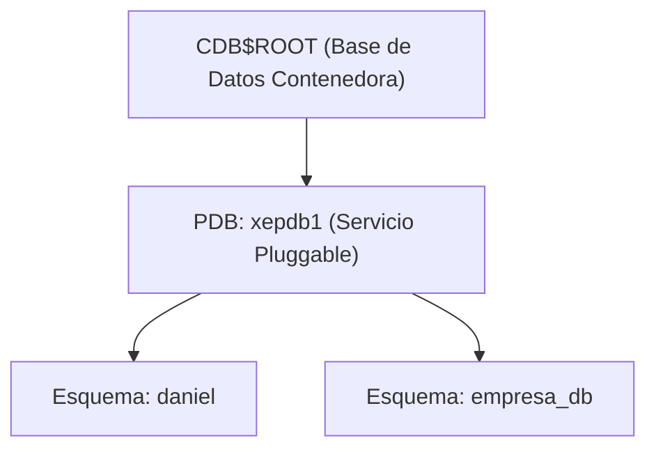
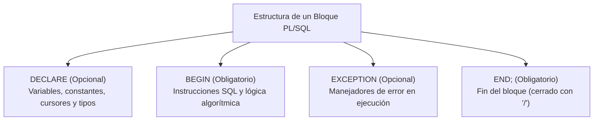
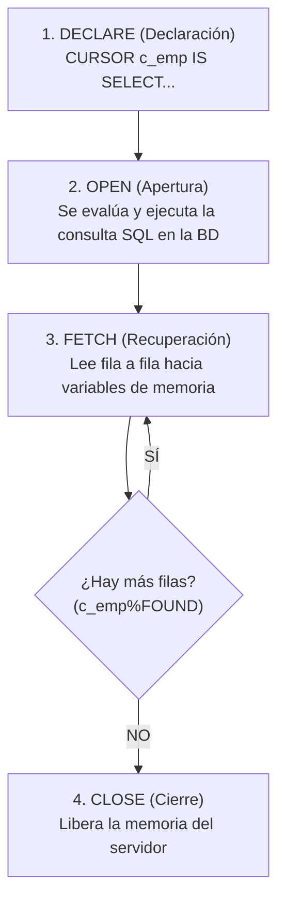
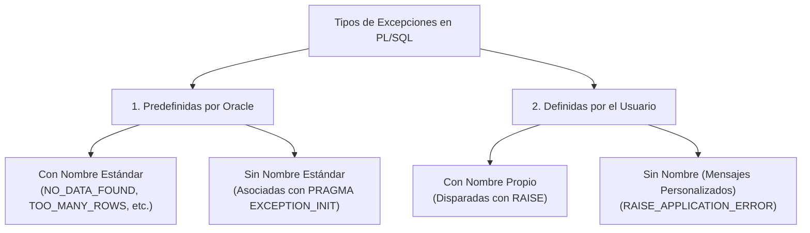

# 6. Administración de Oracle Database y Programación PL/SQL

En entornos empresariales, **Oracle Database** es uno de los motores relacionales más robustos. En ASGBD se aborda tanto la administración de instancias y usuarios multitenant (CDB/PDB) como la programación de lógica de negocio en servidor mediante **PL/SQL**.

---

## 1. Conexión y Gestión de Usuarios en Oracle Express (XE)

Desde Oracle 12c en adelante, el motor utiliza una arquitectura **Multitenant**:
- **CDB (*Container Database*):** Base de datos contenedora raíz (`CDB$ROOT`).
- **PDB (*Pluggable Database*):** Bases de datos conectables independientes donde residen las aplicaciones y esquemas de usuario (por defecto en Oracle XE se llama **`xepdb1`**).



### Protocolo de Creación y Configuración de un Usuario
Para que un usuario pueda conectarse y crear tablas en Oracle, deben ejecutarse los siguientes pasos desde el usuario administrativo **`system`**:

```sql
-- 1. Conexión al servicio pluggable xepdb1 con el usuario system
-- sqlplus system/contraseña@//localhost:1521/xepdb1

-- 2. Creación del usuario con su contraseña
CREATE USER daniel IDENTIFIED BY daniel;

-- 3. Concesión de roles básicos del sistema
-- CONNECT: Permite iniciar sesión (CREATE SESSION)
-- RESOURCE: Permite crear objetos de esquema (tablas, secuencias, disparadores, procedimientos)
GRANT connect, resource TO daniel;

-- 4. Asignación de cuota de almacenamiento ilimitada en el tablespace USERS
ALTER USER daniel QUOTA UNLIMITED ON USERS;
```

> [!IMPORTANT] **El rol de la cuota en tablespaces (Quota on USERS)**
> Aunque al usuario se le conceda el rol `RESOURCE`, **por defecto no tiene cuota asignada en disco**. Si no se ejecuta `ALTER USER ... QUOTA UNLIMITED ON USERS`, cualquier intento de `CREATE TABLE` o `INSERT` fallará con el error `ORA-01950: no privileges on tablespace 'USERS'`.

---

## 2. Fundamentos del Lenguaje PL/SQL

**PL/SQL (*Procedural Language / SQL*)** es la extensión procedural propietaria de Oracle que integra la capacidad declarativa de SQL con estructuras de control de flujo algorítmico (bucles, bifurcaciones condicionales, variables, registros y gestión de excepciones).

### Tipos de Bloques
1. **Bloques anónimos:** No se almacenan en el diccionario de datos de la base de datos; se envían desde la aplicación cliente (SQL*Plus, DBeaver) y se compilan/ejecutan al vuelo.
2. **Subprogramas con nombre (almacenados):** Procedimientos, funciones, paquetes y triggers que residen compilados permanentemente en el servidor.



### Estructura Canónica y Asignación de Variables
```sql
SET SERVEROUTPUT ON;

DECLARE
    -- Variables escalares simples
    v_nombre    VARCHAR2(30) := 'Juan Pérez';
    v_edad      NUMBER(3)    := 25;
    c_pi        CONSTANT NUMBER := 3.141592;
    
    -- Anclaje de tipos con %TYPE (Garantiza compatibilidad con el esquema)
    v_salario   emp.sal%TYPE;
    v_apellido  emp.ename%TYPE;
BEGIN
    -- Asignación por operador :=
    v_salario := 1500;
    
    -- Asignación mediante sentencia SELECT ... INTO (Debe retornar exactamente 1 fila)
    SELECT ename, sal
    INTO v_apellido, v_salario
    FROM emp
    WHERE empno = 7839;
    
    DBMS_OUTPUT.PUT_LINE('Empleado: ' || v_apellido || ' | Sueldo: ' || v_salario || ' €');
EXCEPTION
    WHEN NO_DATA_FOUND THEN
        DBMS_OUTPUT.PUT_LINE('No se ha encontrado el registro solicitado.');
    WHEN OTHERS THEN
        DBMS_OUTPUT.PUT_LINE('Error imprevisto: ' || SQLERRM);
END;
/
```

> [!NOTE] **Activación de salida por consola**
> En clientes como SQL*Plus o SQL Developer, el búfer de salida de `DBMS_OUTPUT.PUT_LINE` está inactivo por defecto. Se debe ejecutar **`SET SERVEROUTPUT ON;`** antes de lanzar cualquier bloque.

### Variables de Registro con `%ROWTYPE`
Permite declarar una variable estructurada que adopta automáticamente todas las columnas y tipos de una fila completa de una tabla o de un cursor:

```sql
DECLARE
    reg_emp emp%ROWTYPE;
BEGIN
    SELECT * INTO reg_emp
    FROM emp
    WHERE empno = 7839;

    DBMS_OUTPUT.PUT_LINE('Nombre: ' || reg_emp.ename);
    DBMS_OUTPUT.PUT_LINE('Puesto: ' || reg_emp.job);
    DBMS_OUTPUT.PUT_LINE('Fecha de Alta: ' || reg_emp.hiredate);
END;
/
```

---

## 3. Estructuras de Control de Flujo

### 1. Bifurcación Condicional: `IF-THEN-ELSIF-ELSE`
```sql
DECLARE
    v_salario emp.sal%TYPE := 2200;
    v_categoria VARCHAR2(20);
BEGIN
    IF v_salario < 1200 THEN
        v_categoria := 'Bajo';
    ELSIF v_salario BETWEEN 1200 AND 2500 THEN
        v_categoria := 'Medio';
    ELSE
        v_categoria := 'Directivo';
    END IF;
    
    DBMS_OUTPUT.PUT_LINE('Categoría asignada: ' || v_categoria);
END;
/
```

### 2. Estructura Selectiva: `CASE`
PL/SQL admite tanto el `CASE` simple como el `CASE` con condiciones de búsqueda evaluadas:

```sql
DECLARE
    v_deptno emp.deptno%TYPE := 20;
    v_sede   VARCHAR2(30);
BEGIN
    v_sede := CASE v_deptno
        WHEN 10 THEN 'ACCOUNTING - Nueva York'
        WHEN 20 THEN 'RESEARCH - Dallas'
        WHEN 30 THEN 'SALES - Chicago'
        WHEN 40 THEN 'OPERATIONS - Boston'
        ELSE 'Sede Desconocida'
    END;
    
    DBMS_OUTPUT.PUT_LINE('Sede: ' || v_sede);
END;
/
```

### 3. Bucles Repetitivos

````carousel
```sql
-- 1. Bucle Simple (LOOP ... EXIT WHEN)
DECLARE
    v_contador NUMBER := 1;
BEGIN
    LOOP
        DBMS_OUTPUT.PUT_LINE('Iteración: ' || v_contador);
        v_contador := v_contador + 1;
        EXIT WHEN v_contador > 5;
    END LOOP;
END;
/
```
<!-- slide -->
```sql
-- 2. Bucle Mientras (WHILE ... LOOP)
DECLARE
    v_i NUMBER := 1;
BEGIN
    WHILE v_i <= 5 LOOP
        DBMS_OUTPUT.PUT_LINE('Valor WHILE: ' || v_i);
        v_i := v_i + 1;
    END LOOP;
END;
/
```
<!-- slide -->
```sql
-- 3. Bucle Contador (FOR ... IN)
BEGIN
    -- Nota: 'i' se declara implícitamente como entero
    FOR i IN 1..5 LOOP
        DBMS_OUTPUT.PUT_LINE('Paso ascendente: ' || i);
    END LOOP;

    -- Con modificador REVERSE (cuenta decreciente)
    FOR i IN REVERSE 1..5 LOOP
        DBMS_OUTPUT.PUT_LINE('Paso inverso: ' || i);
    END LOOP;
END;
/
```
````

---

## 4. Programación Modular: Procedimientos vs. Funciones

| Característica | Procedimiento (`PROCEDURE`) | Función (`FUNCTION`) |
|---|---|---|
| **Propósito Principal** | Ejecutar una acción operativa (*"Hacer algo"*). | Calcular y retornar un único valor (*"Obtener algo"*). |
| **Retorno Directo** | **No** devuelve un valor directamente en cabecera. | **Sí**, obligatorio mediante la cláusula `RETURN`. |
| **Cómo devuelve datos** | Mediante parámetros de salida: `OUT` o `IN OUT`. | Mediante la sentencia explícita `RETURN valor;`. |
| **Forma de llamada** | Como sentencia independiente: `mi_proc(10);` o `EXEC mi_proc;`. | Dentro de expresiones: `v_res := mi_func(10);`. |
| **Integración en SQL** | ❌ **No** se puede invocar dentro de una `SELECT`. | ✅ **Sí** se puede usar en sentencias `SELECT`, `WHERE`, etc. |

### Modos de Parámetros en PL/SQL
- **`IN` (Por defecto):** El valor entra desde el entorno que llama al subprograma. Es de **solo lectura** dentro del cuerpo.
- **`OUT`:** El valor se genera dentro del procedimiento y se devuelve a la variable que se pasó al llamarlo.
- **`IN OUT`:** La variable entra con un valor inicial, el subprograma lo lee, lo modifica y lo devuelve alterado al finalizar.

### Caso de Estudio Práctico: Transformación de Cadenas a Minúsculas

#### A. Procedimiento con Parámetro `IN` (Impresión Interna)
```sql
CREATE OR REPLACE PROCEDURE minu (v_cad IN VARCHAR2)
AS
    v_cad_minu VARCHAR2(100);
BEGIN
    v_cad_minu := LOWER(v_cad);
    DBMS_OUTPUT.PUT_LINE(v_cad_minu);
END minu;
/

-- Invocación:
EXEC minu('HOLA MUNDO');
```

#### B. Procedimiento con Parámetro `IN OUT` (Modificación en la Variable de Entrada)
```sql
CREATE OR REPLACE PROCEDURE minu (v_cad IN OUT VARCHAR2)
AS
BEGIN
    v_cad := LOWER(v_cad);
END minu;
/

-- Invocación mediante bloque anónimo:
DECLARE
    v_texto VARCHAR2(100) := 'CURSO DE ASGBD';
BEGIN
    minu(v_texto);
    DBMS_OUTPUT.PUT_LINE('Texto transformado: ' || v_texto);
END;
/
```

#### C. Función Almacenada (`FUNCTION`) con `RETURN`
```sql
CREATE OR REPLACE FUNCTION f_minu (v_cad IN VARCHAR2)
RETURN VARCHAR2
AS
BEGIN
    RETURN LOWER(v_cad);
END f_minu;
/

-- Invocación en SQL directo:
SELECT ename, f_minu(ename) AS "Nombre Minúsculas"
FROM emp;
```

---

## 5. Gestión de Cursores en PL/SQL

Un **cursor** es un puntero hacia un área privada de memoria de trabajo (*Private SQL Area*) reservada por el motor Oracle para almacenar y procesar el conjunto de resultados generado por una consulta SQL.



### Tipos de Cursores
1. **Cursores Implícitos:** Generados de forma automática por Oracle para cada orden `DML` (`INSERT`, `UPDATE`, `DELETE`) o `SELECT ... INTO` de fila única.
   - Atributos accesibles mediante el prefijo `SQL`: `SQL%FOUND`, `SQL%NOTFOUND`, `SQL%ROWCOUNT`.
2. **Cursores Explícitos:** Declarados expresamente por el desarrollador para procesar consultas que devuelven **múltiples filas**.

### Atributos de un Cursor Explícito:
| Atributo | Tipo | Descripción |
|---|---|---|
| **`%ISOPEN`** | Booleano | `TRUE` si el cursor está abierto y listo para procesar. |
| **`%FOUND`** | Booleano | `TRUE` si el último `FETCH` recuperó con éxito una fila. |
| **`%NOTFOUND`** | Booleano | `TRUE` si el último `FETCH` llegó al final del conjunto (no devolvió fila). |
| **`%ROWCOUNT`** | Numérico | Número total de filas recuperadas hasta el momento. |

### Ciclo Clásico de un Cursor Explícito
```sql
DECLARE
    -- 1. Declaración del cursor (sin cláusula INTO)
    CURSOR c_empleados IS
        SELECT empno, ename, sal
        FROM emp
        WHERE deptno = 10;
        
    v_empno emp.empno%TYPE;
    v_ename emp.ename%TYPE;
    v_sal   emp.sal%TYPE;
BEGIN
    -- 2. Apertura segura comprobando %ISOPEN
    IF NOT c_empleados%ISOPEN THEN
        OPEN c_empleados;
    END IF;
    
    -- 3. Primera recuperación (Fetch)
    FETCH c_empleados INTO v_empno, v_ename, v_sal;
    
    -- Procesar mientras existan registros
    WHILE c_empleados%FOUND LOOP
        DBMS_OUTPUT.PUT_LINE('Nº: ' || v_empno || ' - ' || v_ename || ' - Salario: ' || v_sal);
        
        -- Siguiente recuperación
        FETCH c_empleados INTO v_empno, v_ename, v_sal;
    END LOOP;
    
    DBMS_OUTPUT.PUT_LINE('Total procesados: ' || c_empleados%ROWCOUNT);
    
    -- 4. Cierre obligatorio para liberar recursos
    CLOSE c_empleados;
END;
/
```

### Cursores con Variable de Registro (`%ROWTYPE`)
En lugar de listar múltiples variables en el `FETCH`, se usa una única variable estructurada asociada al cursor:

```sql
DECLARE
    CURSOR c_dept10 IS
        SELECT ename, sal, hiredate FROM emp WHERE deptno = 10;
    reg_c c_dept10%ROWTYPE;
BEGIN
    OPEN c_dept10;
    FETCH c_dept10 INTO reg_c;
    WHILE c_dept10%FOUND LOOP
        DBMS_OUTPUT.PUT_LINE(reg_c.ename || ' gana ' || reg_c.sal);
        FETCH c_dept10 INTO reg_c;
    END LOOP;
    CLOSE c_dept10;
END;
/
```

### Bucle `FOR` de Cursor (Enfoque Recomendado)
El bucle `FOR` simplifica y hace más robusto el código: **Oracle realiza automáticamente el `OPEN`, la declaración de la variable registro, el `FETCH` en cada iteración y el `CLOSE` final**:

```sql
DECLARE
    CURSOR c_emp IS
        SELECT ename, sal, TRUNC((SYSDATE - hiredate) / 365) AS antiguedad
        FROM emp
        WHERE deptno = 10;
BEGIN
    -- La variable 'reg' se declara, abre, lee y cierra implícitamente
    FOR reg IN c_emp LOOP
        DBMS_OUTPUT.PUT_LINE('Empleado: ' || reg.ename || ' | Salario: ' || reg.sal || ' | Años: ' || reg.antiguedad);
    END LOOP;
END;
/
```

---

## 6. Tratamiento Exhaustivo de Excepciones

Una **excepción** es una condición de error o advertencia anómala que surge durante la ejecución de un bloque PL/SQL, alterando el flujo normal del programa.



---

### 1. Excepciones Predefinidas por Oracle con Nombre
Oracle asigna identificadores directos a los errores de tiempo de ejecución más comunes:

| Nombre de la Excepción | Código de Error | Causa habitual |
|---|---|---|
| **`NO_DATA_FOUND`** | `ORA-01403` | Una sentencia `SELECT ... INTO` no devuelve ninguna fila. |
| **`TOO_MANY_ROWS`** | `ORA-01422` | Una sentencia `SELECT ... INTO` devuelve más de una fila. |
| **`ZERO_DIVIDE`** | `ORA-01476` | Intento de dividir un número por cero. |
| **`DUP_VAL_ON_INDEX`** | `ORA-00001` | Intento de insertar una clave primaria o valor `UNIQUE` duplicado. |
| **`INVALID_CURSOR`** | `ORA-01001` | Operación ilegal sobre un cursor (por ejemplo, hacer `FETCH` o `CLOSE` de un cursor ya cerrado). |
| **`VALUE_ERROR`** | `ORA-06502` | Error aritmético, de conversión, truncamiento de cadena o desbordamiento. |

```sql
DECLARE
    v_nombre emp.ename%TYPE;
BEGIN
    SELECT ename INTO v_nombre FROM emp WHERE deptno = 20; -- Devuelve varias filas
    DBMS_OUTPUT.PUT_LINE('Nombre: ' || v_nombre);
EXCEPTION
    WHEN TOO_MANY_ROWS THEN
        DBMS_OUTPUT.PUT_LINE('Error: La consulta ha retornado múltiples filas para un escalar.');
    WHEN NO_DATA_FOUND THEN
        DBMS_OUTPUT.PUT_LINE('Error: No se ha encontrado ningún empleado con ese criterio.');
END;
/
```

---

### 2. Excepciones Predefinidas por Oracle sin Nombre Estándar
Muchos errores de Oracle (como la violación de claves foráneas) no tienen un nombre de excepción predeterminado. Para capturarlas existen dos mecanismos:

#### Método A: Directiva `PRAGMA EXCEPTION_INIT`
Asocia un identificador definido por el desarrollador con el código numérico oficial de Oracle en la sección declarativa:

```sql
DECLARE
    -- 1. Declarar identificador de excepción
    e_violacion_fk EXCEPTION;
    
    -- 2. Asociar el identificador con el código ORA-02292 (Integrity constraint violated - child record found)
    PRAGMA EXCEPTION_INIT(e_violacion_fk, -2292);
    
    v_deptno dept.deptno%TYPE := 10;
BEGIN
    -- Si el departamento 10 tiene empleados asociados, la orden fallará:
    DELETE FROM dept WHERE deptno = v_deptno;
    COMMIT;
EXCEPTION
    WHEN e_violacion_fk THEN
        DBMS_OUTPUT.PUT_LINE('No se puede eliminar el departamento ' || v_deptno || ': tiene empleados asignados.');
END;
/
```

#### Método B: Captura en `WHEN OTHERS` con `SQLCODE` y `SQLERRM`
Las pseudofunciones `SQLCODE` (código numérico negativo) y `SQLERRM` (mensaje descriptivo) permiten inspeccionar cualquier error imprevisto:

```sql
BEGIN
    DELETE FROM dept WHERE deptno = 10;
EXCEPTION
    WHEN OTHERS THEN
        IF SQLCODE = -2292 THEN
            DBMS_OUTPUT.PUT_LINE('Error de integridad referencial detectado por SQLCODE (-2292)');
        ELSE
            DBMS_OUTPUT.PUT_LINE('Error inesperado código [' || SQLCODE || ']: ' || SQLERRM);
        END IF;
END;
/
```

---

### 3. Excepciones Definidas por el Usuario con Nombre (`RAISE`)
Permiten modelar reglas de negocio que no constituyen un error técnico para el motor SQL pero sí una anomalía funcional para la aplicación:

```sql
DECLARE
    e_saldo_insuficiente EXCEPTION;
    v_saldo NUMBER := 100;
    v_cargo NUMBER := 350;
BEGIN
    IF v_cargo > v_saldo THEN
        -- Provocación explícita de la excepción
        RAISE e_saldo_insuficiente;
    END IF;
    
    v_saldo := v_saldo - v_cargo;
    DBMS_OUTPUT.PUT_LINE('Operación autorizada. Saldo restante: ' || v_saldo);
EXCEPTION
    WHEN e_saldo_insuficiente THEN
        DBMS_OUTPUT.PUT_LINE('Operación rechazada: Saldo insuficiente para realizar el pago.');
END;
/
```

---

### 4. Emisión de Errores con `RAISE_APPLICATION_ERROR`
Es un procedimiento del sistema que permite **devolver mensajes de error personalizados y abortar la transacción** hacia la aplicación cliente (por ejemplo Java, Python, PHP o SQL Developer).

- **Rango de códigos permitidos:** Entre **`-20000`** y **`-20999`**.
- Solo puede invocarse desde subprogramas almacenados o bloques ejecutables.

```sql
CREATE OR REPLACE PROCEDURE actualizar_salario (
    p_empno emp.empno%TYPE,
    p_nuevo_sal emp.sal%TYPE
)
IS
BEGIN
    IF p_nuevo_sal <= 0 THEN
        -- Emisión de código y mensaje controlado hacia el cliente
        RAISE_APPLICATION_ERROR(-20001, 'El salario debe ser un valor positivo estrictamente mayor que cero.');
    END IF;

    UPDATE emp
    SET sal = p_nuevo_sal
    WHERE empno = p_empno;

    IF SQL%NOTFOUND THEN
        RAISE_APPLICATION_ERROR(-20002, 'El código de empleado indicado no existe en la base de datos.');
    END IF;
END actualizar_salario;
/
```

---

## 7. Disparadores de Base de Datos (Triggers)

Un **trigger** es un bloque de código PL/SQL asociado a una tabla o vista que se activa automáticamente al producirse un evento `DML` (`INSERT`, `UPDATE`, `DELETE`).

```sql
-- Trigger para auditar y bloquear bajadas salariales indebidas
CREATE OR REPLACE TRIGGER trg_auditoria_salario
BEFORE UPDATE OF sal ON emp
FOR EACH ROW
BEGIN
    -- :OLD contiene el valor del registro antes de la actualización
    -- :NEW contiene el nuevo valor que se pretende persistir
    IF :NEW.sal < :OLD.sal THEN
        RAISE_APPLICATION_ERROR(-20003, 'Infracción laboral: No se permite rebajar el salario a un trabajador.');
    END IF;
END;
/
```

---

## 8. Script Administrativo: Limpieza Integral del Esquema (*Drop All Objects*)

En laboratorios prácticos de ASGBD y entornos de desarrollo, a menudo es necesario **reiniciar por completo el esquema de trabajo** eliminando todas las tablas, vistas, secuencias, procedimientos, funciones, paquetes y sinónimos creados, sin necesidad de destruir el usuario ni requerir privilegios de `SYSDBA`:

```sql
BEGIN
    -- 1. Bucle cursor sobre todos los objetos del esquema actual
    FOR cur_rec IN (
        SELECT object_name, object_type
        FROM user_objects
        WHERE object_type IN (
            'TABLE',
            'VIEW',
            'MATERIALIZED VIEW',
            'PACKAGE',
            'PROCEDURE',
            'FUNCTION',
            'SEQUENCE',
            'SYNONYM',
            'PACKAGE BODY'
        )
    )
    LOOP
        BEGIN
            -- Si es una tabla, se eliminan forzadamente sus restricciones de integridad (FK)
            IF cur_rec.object_type = 'TABLE' THEN
                EXECUTE IMMEDIATE 'DROP ' || cur_rec.object_type || ' "' || cur_rec.object_name || '" CASCADE CONSTRAINTS';
            ELSE
                EXECUTE IMMEDIATE 'DROP ' || cur_rec.object_type || ' "' || cur_rec.object_name || '"';
            END IF;
        EXCEPTION
            WHEN OTHERS THEN
                DBMS_OUTPUT.PUT_LINE('FAILED: DROP ' || cur_rec.object_type || ' "' || cur_rec.object_name || '"');
        END;
    END LOOP;

    -- 2. Limpieza de sinónimos públicos creados por el usuario conectado
    FOR cur_rec IN (
        SELECT *
        FROM all_synonyms
        WHERE table_owner IN (SELECT USER FROM dual)
    )
    LOOP
        BEGIN
            EXECUTE IMMEDIATE 'DROP PUBLIC SYNONYM ' || cur_rec.synonym_name;
        END;
    END LOOP;
END;
/
```

> [!TIP] **Ventajas del script con SQL dinámico (`EXECUTE IMMEDIATE`)**
> - **Independencia del orden de dependencia:** Al incluir `CASCADE CONSTRAINTS`, no importa en qué orden aparezcan las tablas maestras e hijas en el catálogo.
> - **Tolerancia a fallos:** El subbloque interno `BEGIN ... EXCEPTION WHEN OTHERS` garantiza que si un objeto falla al borrarse, la ejecución no se aborta y continúa limpiando los objetos restantes.

