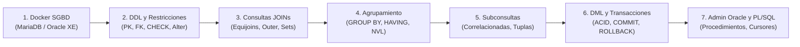

  <h1>🗄️ Adm. de Sistemas Gestores de BBDD (ASGBD)</h1>
  
El módulo de <strong>ASGBD</strong> profundiza en la administración de bases de datos corporativas (Oracle Database, MariaDB), despliegue en contenedores Docker, optimización de consultas SQL complejas (JOINs, Subconsultas, Agrupamientos), transacciones ACID y programación de lógica de servidor con PL/SQL.

## 🗺️ Mapa de Contenidos

El temario de ASGBD se organiza en 7 bloques temáticos estructurados:

---

## 📚 Bloques Temáticos de ASGBD

<table class="syllabus-table">
  <thead>
    <tr>
      <th>Bloque</th>
      <th>Título del Tema</th>
      <th>Conceptos y Prácticas Principales</th>
      <th>Tipo de Contenido</th>
      <th>Enlace</th>
    </tr>
  </thead>
  <tbody>
    <tr>
      <td><strong>01</strong></td>
      <td><strong>Docker y Contenedores para SGBD</strong></td>
      <td>Ciclo de vida de contenedores, volúmenes de persistencia, redes internas bridge, Docker Compose y despliegue automatizado de <strong>MariaDB</strong> y <strong>Oracle Express Edition (XE)</strong>.</td>
      <td>Docker + SGBD</td>
      <td><a class="module-link" href="01-docker-sgbd.md">Abrir tema :octicons-arrow-right-16:</a></td>
    </tr>
    <tr>
      <td><strong>02</strong></td>
      <td><strong>DDL, Diseño Físico y Restricciones (Oracle)</strong></td>
      <td>Esquemas de usuario, tipos de datos, restricciones con nomenclatura formal (<code>PK</code>, <code>FK</code>, <code>NN</code>, <code>UK</code>, <code>CK</code>), acciones referenciales (<code>ON DELETE CASCADE</code>), motores de almacenamiento (<code>InnoDB</code>, <code>MyISAM</code>) y órdenes <code>ALTER</code>/<code>TRUNCATE</code>.</td>
      <td>DDL + Diseño</td>
      <td><a class="module-link" href="02-diseno-fisico-ddl-oracle.md">Abrir tema :octicons-arrow-right-16:</a></td>
    </tr>
    <tr>
      <td><strong>03</strong></td>
      <td><strong>Consultas Multitabla y Combinaciones (JOINs)</strong></td>
      <td>Prevención de productos cartesianos (regla $N-1$), Equijoins sintaxis ANSI vs tradicional, Outer joins (trampa de <code>COUNT(*)</code> vs <code>COUNT(col)</code>), Self joins y <strong>operadores de conjuntos (<code>UNION</code>, <code>INTERSECT</code>, <code>MINUS</code>)</strong>.</td>
      <td>Consultas SQL</td>
      <td><a class="module-link" href="03-consultas-avanzadas-joins.md">Abrir tema :octicons-arrow-right-16:</a></td>
    </tr>
    <tr>
      <td><strong>04</strong></td>
      <td><strong>Funciones de Grupo y Agrupamiento</strong></td>
      <td>Funciones agregadas (<code>AVG</code>, <code>SUM</code>, <code>COUNT</code>, <code>MIN</code>, <code>MAX</code>), tratamiento de nulos con <code>NVL</code>, orden estricto de evaluación (<code>WHERE</code> $\rightarrow$ <code>GROUP BY</code> $\rightarrow$ <code>HAVING</code> $\rightarrow$ <code>ORDER BY</code>) y subconsultas en cláusula <code>HAVING</code>.</td>
      <td>Agrupamiento</td>
      <td><a class="module-link" href="04-agrupamiento-funciones-grupo.md">Abrir tema :octicons-arrow-right-16:</a></td>
    </tr>
    <tr>
      <td><strong>05</strong></td>
      <td><strong>Subconsultas en SQL</strong></td>
      <td>Arquitectura de subconsultas, mono-registro vs multi-registro (<code>IN</code>, <code>ANY</code>, <code>ALL</code>), subconsultas multi-columna de tuplas, subconsultas correlacionadas y diagnóstico de errores típicos (<code>ORA-01427</code>).</td>
      <td>Subconsultas</td>
      <td><a class="module-link" href="05-subconsultas.md">Abrir tema :octicons-arrow-right-16:</a></td>
    </tr>
    <tr>
      <td><strong>06</strong></td>
      <td><strong>Manipulación de Datos (DML) y Transacciones ACID</strong></td>
      <td>Órdenes <code>INSERT INTO</code> (inserciones masivas con <code>SELECT</code>), <code>UPDATE</code>, <code>DELETE</code>, propiedades ACID, régimen transaccional en Oracle (<code>AUTOCOMMIT OFF</code>, órdenes de <code>COMMIT</code> implícito) y caso práctico integral.</td>
      <td>DML + Transacciones</td>
      <td><a class="module-link" href="06-dml-transacciones.md">Abrir tema :octicons-arrow-right-16:</a></td>
    </tr>
    <tr>
      <td><strong>07</strong></td>
      <td><strong>Administración Oracle y Lógica PL/SQL</strong></td>
      <td>Conexión a Pluggable Databases (<code>xepdb1</code>), variables <code>%TYPE</code>/<code>%ROWTYPE</code>, control de flujo condicional y bucles, procedimientos vs funciones (parámetros <code>IN</code>, <code>OUT</code>, <code>IN OUT</code>), ciclo de vida de cursores y gestión de excepciones.</td>
      <td>Oracle PL/SQL</td>
      <td><a class="module-link" href="07-administracion-oracle-plsql.md">Abrir tema :octicons-arrow-right-16:</a></td>
    </tr>
  </tbody>
</table>

---

## 🛠️ Tecnologías y Entorno de Prácticas

- **Motores SGBD**: Oracle Database 21c/18c Express Edition y MariaDB 10.x / MySQL 8.x.
- **Entorno de Despliegue**: Docker Engine y Docker Compose.
- **Clientes SQL**: DBeaver Community, Oracle SQL Developer y cliente CLI `sqlplus`.
