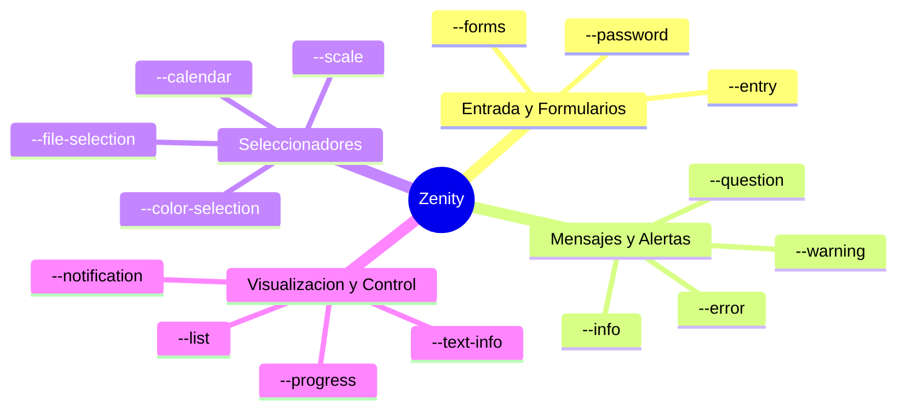

# Scripting Gráfico con Zenity

En entornos de administración donde las estaciones de trabajo o servidores disponen de servidor gráfico (X11 o Wayland con entornos como GNOME, KDE o XFCE), **Zenity** es la herramienta estándar para interactuar visualmente con el usuario desde scripts de Bash.

Se considera comúnmente la evolución moderna o "versión 2.0" gráfica de la utilidad de terminal `dialog`, permitiendo integrar ventanas y controles nativos GTK+ con una mínima curva de aprendizaje.

---

## 1. Introducción e Instalación

Zenity permite transformar scripts administrativos de consola en aplicaciones de escritorio intuitivas, facilitando la introducción de contraseñas, selección de archivos mediante exploradores gráficos, barras de progreso y formularios.

### Instalación en Debian/Ubuntu
```bash
sudo apt update
sudo apt install -y zenity
```

### Características Principales
- Retorna la entrada del usuario a través de la **salida estándar (`stdout`)**.
- Emite los códigos de retorno habituales en `$?`:
  - `0`: El usuario pulsó **Aceptar / OK** o seleccionó afirmativamente.
  - `1`: El usuario pulsó **Cancelar** o cerró la ventana con el aspa (`X`).
  - `5`: Tiempo límite de espera agotado (`--timeout`).

---

## 2. Catálogo de Diálogos de Zenity



---

## 3. Diálogos de Mensajes y Preguntas

Permiten informar de estados, alertar de incidencias o solicitar confirmación antes de operaciones críticas.

### 3.1 Mensajes de Información, Advertencia y Error

```bash
# Información:
zenity --info --title="Estado del Sistema" --text="La copia de seguridad se completó correctamente." --width=300

# Advertencia:
zenity --warning --title="Espacio Reducido" --text="La partición /var supera el 90% de ocupación."

# Error crítico:
zenity --error --title="Fallo de Conexión" --text="No se pudo contactar con el servidor LDAP."
```

### 3.2 Diálogo de Pregunta (`--question`)

Permite bifurcar el flujo de ejecución evaluando la respuesta con `$?`:

```bash
#!/bin/bash
zenity --question \
       --title="Confirmación de Servicio" \
       --text="¿Desea reiniciar el servidor web Apache2 en este momento?" \
       --ok-label="Sí, reiniciar" \
       --cancel-label="No, posponer"

if [ $? -eq 0 ]; then
    systemctl restart apache2
    zenity --info --text="Servicio Apache2 reiniciado con éxito."
else
    zenity --warning --text="Operación cancelada por el administrador."
fi
```

---

## 4. Entrada de Datos y Contraseñas

### 4.1 Entrada de Texto Simple (`--entry`)

Solicita una cadena de texto al usuario:

```bash
#!/bin/bash
USUARIO=$(zenity --entry \
                 --title="Gestión de Cuentas" \
                 --text="Introduce el nombre del nuevo usuario:" \
                 --entry-text="operador1")

if [ -n "$USUARIO" ]; then
    echo "Usuario a dar de alta: $USUARIO"
fi
```

### 4.2 Diálogo de Contraseña (`--password`)

Oculta los caracteres introducidos y permite la autenticación en dos campos (usuario y clave):

```bash
#!/bin/bash
# Captura de usuario y clave separada por una barra vertical (|)
CREDENCIALES=$(zenity --password --username)

if [ $? -eq 0 ]; then
    USUARIO=$(echo "$CREDENCIALES" | cut -d'|' -f1)
    CLAVE=$(echo "$CREDENCIALES" | cut -d'|' -f2)
    echo "Autenticando usuario $USUARIO en el sistema..."
fi
```

---

## 5. Diálogos de Formularios (`--forms`)

La opción `--forms` permite construir ventanas compuestas con múltiples campos de entrada combinados (cajas de texto, calendarios y campos ocultos):

```bash
#!/bin/bash
DATOS=$(zenity --forms \
               --title="Registro de Empleado - Vanecar S.L." \
               --text="Complete los datos para generar el alta en el sistema:" \
               --separator=";" \
               --add-entry="Nombre completo" \
               --add-entry="Correo electrónico" \
               --add-password="Clave provisional" \
               --add-calendar="Fecha de incorporación")

if [ $? -eq 0 ]; then
    NOMBRE=$(echo "$DATOS" | cut -d';' -f1)
    CORREO=$(echo "$DATOS" | cut -d';' -f2)
    FECHA=$(echo "$DATOS" | cut -d';' -f4)

    zenity --info --text="Empleado registrado:\n\nNombre: $NOMBRE\nEmail: $CORREO\nAlta: $FECHA"
fi
```

---

## 6. Selección de Archivos y Directorios (`--file-selection`)

Abre el explorador de archivos nativo de GTK para abrir o guardar ficheros:

| Modificador | Función |
| :--- | :--- |
| `--directory` | Permite seleccionar únicamente carpetas |
| `--multiple` | Habilita la selección de múltiples archivos |
| `--save` | Configura el diálogo en modo Guardar archivo |
| `--confirm-overwrite` | Pregunta confirmación si el archivo de destino ya existe |
| `--file-filter` | Filtra extensiones (ej: `--file-filter="*.tar.gz *.zip"`) |

```bash
#!/bin/bash
# Seleccionar directorio de origen para backup
ORIGEN=$(zenity --file-selection --directory --title="Seleccione el directorio a respaldar")

# Seleccionar ruta y nombre del archivo destino
DESTINO=$(zenity --file-selection --save --confirm-overwrite \
                 --title="Guardar archivo comprimido como..." \
                 --filename="backup-$(date +%F).tar.gz")

if [ -n "$ORIGEN" ] && [ -n "$DESTINO" ]; then
    tar -czf "$DESTINO" -C "$ORIGEN" .
    zenity --info --text="Respaldo completado en:\n$DESTINO"
fi
```

---

## 7. Diálogos de Listas y Tablas (`--list`)

Permiten presentar datos estructurados en filas y columnas, con soporte para listas de selección simple, casillas de verificación (`--checklist`) o botones de radio (`--radiolist`):

### 7.1 Lista con Selección Simple
```bash
#!/bin/bash
SERVICIO=$(zenity --list \
                  --title="Monitor de Servicios" \
                  --column="Servicio" --column="Puerto" --column="Descripción" \
                  "nginx" "80/443" "Servidor Web Principal" \
                  "ssh" "22" "Administración Remota" \
                  "mariadb" "3306" "Base de Datos Relacional")

echo "Servicio seleccionado para inspección: $SERVICIO"
```

### 7.2 Lista con Casillas de Verificación (`--checklist`)

```bash
#!/bin/bash
TAREAS=$(zenity --list --checklist \
                --title="Mantenimiento del Servidor" \
                --column="Marcar" --column="Código" --column="Acción" \
                TRUE "APT" "Actualizar lista de paquetes (apt update)" \
                FALSE "LOGS" "Purgar logs antiguos de /var/log" \
                TRUE "CACHE" "Limpiar paquetes descargados obsoletos" \
                --separator=" ")

for TAREA in $TAREAS; do
    case "$TAREA" in
        "APT") apt update ;;
        "LOGS") journalctl --vacuum-time=7d ;;
        "CACHE") apt clean ;;
    esac
done
```

---

## 8. Barras de Progreso Interactivas (`--progress`)

Zenity lee números del 0 al 100 desde la entrada estándar (`stdin`) para actualizar en tiempo real el porcentaje de la barra de progreso:

```bash
#!/bin/bash
(
echo "10"; sleep 1
echo "# Comprobando integridad del sistema de ficheros..."; sleep 1
echo "35"; sleep 1
echo "# Sincronizando repositorios remotos..."; sleep 1
echo "75"; sleep 1
echo "# Aplicando actualizaciones del kernel..."; sleep 1
echo "100"; sleep 1
echo "# Finalizado con éxito."
) | zenity --progress \
           --title="Actualización del Sistema" \
           --text="Iniciando tareas de mantenimiento..." \
           --percentage=0 \
           --auto-close

if [ $? -eq 0 ]; then
    zenity --info --text="El sistema está completamente actualizado."
fi
```

> [!TIP] Opción `--pulsate`
> Si el script ejecuta una tarea cuya duración exacta se desconoce (por ejemplo, una descarga prolongada con `wget` o una compilación), el parámetro `--pulsate` muestra una barra oscilante continua hasta que el proceso finaliza.

---

## 9. Visualización de Ficheros de Texto y Logs (`--text-info`)

Permite renderizar archivos extensos (términos de licencia, reportes, logs del sistema) con barra de desplazamiento:

```bash
#!/bin/bash
# Mostrar las últimas 50 líneas del registro de autenticación
tail -n 50 /var/log/auth.log > /tmp/auth_sample.log

zenity --text-info \
       --title="Registro de Autenticaciones Recientes (/var/log/auth.log)" \
       --filename="/tmp/auth_sample.log" \
       --width=700 --height=450 \
       --checkbox="He revisado los accesos sospechosos."

rm -f /tmp/auth_sample.log
```

---

## 10. Otros Controles Especializados

### 10.1 Diálogo de Calendario (`--calendar`)
```bash
FECHA_SELECCIONADA=$(zenity --calendar \
                            --title="Planificación de Backup" \
                            --text="Indique la fecha para la ejecución diferida:" \
                            --day=15 --month=11 --year=2026 \
                            --date-format="%Y-%m-%d")
```

### 10.2 Diálogo de Escala (`--scale`)
```bash
# Selector numérico deslizable (Slider)
NIVEL_COMPRESION=$(zenity --scale \
                          --title="Compresión GZIP" \
                          --text="Seleccione el nivel de compresión (1=Rápido, 9=Máximo):" \
                          --min-value=1 --max-value=9 --value=6 --step=1)
```

### 10.3 Diálogo de Selección de Color (`--color-selection`)
```bash
COLOR=$(zenity --color-selection --show-palette --title="Personalización de Tema")
```

### 10.4 Notificación en el Escritorio (`--notification`)
Envía una alerta emergente a la bandeja del sistema o gestor de notificaciones de la sesión de escritorio:

```bash
zenity --notification --text="Respaldo nocturno finalizado correctamente a las $(date +%H:%M)."
```

---

## 11. Caso Práctico Integrado: Panel Gráfico de Mantenimiento

A continuación se muestra un script administrativo completo que integra menús, preguntas, formularios y barras de progreso:

```bash
#!/bin/bash
# ==============================================================================
# Nombre: admin-panel.sh
# Finalidad: Asistente gráfico de mantenimiento para administradores de sistemas
# ==============================================================================

# 1. Comprobación de servidor X11 / Wayland
if [ -z "$DISPLAY" ] && [ -z "$WAYLAND_DISPLAY" ]; then
    echo "ERROR: Este script requiere una sesión gráfica activa." >&2
    exit 1
fi

ACCION=$(zenity --list --title="Panel de Control del Servidor" \
                --column="ID" --column="Módulo Administrativo" \
                1 "Comprobar estado de servicios clave" \
                2 "Crear copia de seguridad de un directorio" \
                3 "Ver usuarios conectados al sistema" \
                4 "Reiniciar servidor" \
                --width=450 --height=280)

case "$ACCION" in
    1)
        ESTADO="Servicio SSH: $(systemctl is-active ssh)\nServicio Cron: $(systemctl is-active cron)\nServicio UFW: $(systemctl is-active ufw)"
        zenity --info --title="Estado de Servicios" --text="$ESTADO"
        ;;
    2)
        DIR=$(zenity --file-selection --directory --title="Seleccione carpeta a respaldar")
        if [ -n "$DIR" ]; then
            DEST="/backup/$(basename "$DIR")-$(date +%F).tar.gz"
            (
                echo "20"; sleep 1
                echo "# Comprimiendo archivos..."; tar -czf "$DEST" -C "$DIR" . 2>/dev/null
                echo "100"; sleep 1
                echo "# Respaldo finalizado con éxito."
            ) | zenity --progress --title="Generando Respaldo" --percentage=0 --auto-close
            zenity --info --text="Copia almacenada en: $DEST"
        fi
        ;;
    3)
        who > /tmp/usuarios_activos.txt
        zenity --text-info --title="Sesiones de Usuario Activas" --filename=/tmp/usuarios_activos.txt --width=500
        rm -f /tmp/usuarios_activos.txt
        ;;
    4)
        if zenity --question --title="Alerta Crítica" --text="¿Confirma el reinicio del servidor?"; then
            reboot
        fi
        ;;
    *)
        exit 0
        ;;
esac
```
