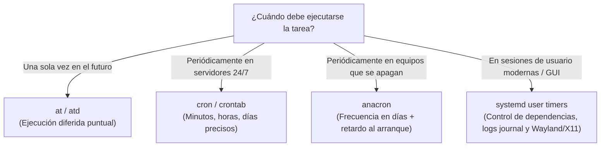
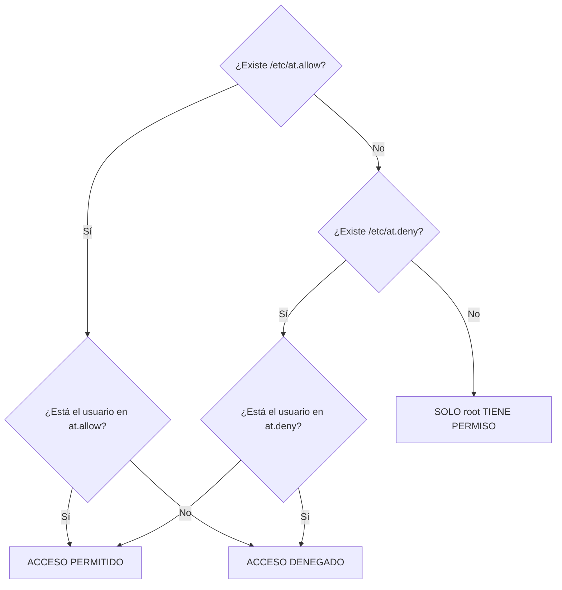
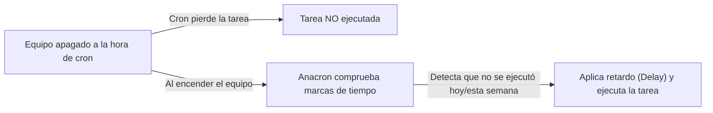

# Programación de Tareas: at, cron, anacron y systemd timers

La automatización de tareas en Linux permite delegar en el sistema operativo la ejecución desatendida de copias de seguridad, rotación de logs, sincronización de bases de datos, generación de informes y labores de mantenimiento predictivo.

---

## 1. Clasificación de Herramientas de Planificación

En la administración de sistemas operativos coexisten cuatro herramientas complementarias:



---

## 2. Ejecución Puntual Diferida: `at` y el Demonio `atd`

El comando `at` permite programar comandos o scripts para que se ejecuten **una sola vez** a una hora o fecha futura determinada.

### 2.1 Demonio del Servicio
Requiere que el demonio `atd` esté activo y habilitado en el arranque:
```bash
sudo apt install -y at
sudo systemctl enable --now atd
sudo systemctl status atd
```

### 2.2 Especificación de Horas y Fechas
`at` admite formatos temporales muy flexibles:

| Expresión de Tiempo | Significado |
| :--- | :--- |
| `at 17:30` | A las 17:30 horas del día actual (o del día siguiente si ya ha pasado) |
| `at now + 15 minutes` | Dentro de 15 minutos exactos |
| `at now + 2 hours` | Dentro de 2 horas |
| `at now + 3 days` | Dentro de 3 días a la hora actual |
| `at 02:00 tomorrow` | Mañana a las 02:00 AM |
| `at 23:00 25.12.26` | El 25 de diciembre de 2026 a las 23:00 |
| `at teatime` | A las 16:00 (hora del té tradicional) |
| `at noon` / `at midnight` | A las 12:00 del mediodía / 00:00 de la medianoche |

### 2.3 Creación de Tareas con `at`

#### Modo Interactivo (Entrada estándar)
Se indica la hora y se escriben los comandos. Se finaliza la entrada pulsando ++ctrl+d++:
```bash
at 22:30
warning: commands will be executed using /bin/sh
at> /usr/local/bin/backup_diario.sh
at> sync
at> <EOT>  # Pulsar Ctrl + D
job 4 at Fri Nov 14 22:30:00 2026
```

#### Modo No Interactivo (Script o Tubería)
```bash
# Mediante el flag -f leyendo desde archivo:
at -f /root/mantenimiento.sh 03:00 tomorrow

# Mediante tubería (pipe) con echo:
echo "systemctl restart apache2" | at now + 30 minutes
```

### 2.4 Gestión de la Cola: `atq`, `atrm` y Opciones Principales

| Opción de `at` | Utilidad equivalente | Descripción |
| :--- | :--- | :--- |
| `at -l` | `atq` | Lista los trabajos pendientes en la cola con su ID, fecha y usuario propietario. |
| `at -d <id>` | `atrm <id>` | Elimina el trabajo especificado por su número identificador. |
| `at -c <id>` | — | Muestra el script completo y todas las variables de entorno asociadas a la tarea guardada. |
| `at -f <file>` | — | Lee los comandos desde el archivo indicado en lugar de la consola. |
| `at -m` | — | Envía un correo electrónico al usuario cuando la tarea finaliza, incluso si no generó salida. |
| `at -q <cola>` | — | Asigna la tarea a una cola concreta (`a`-`z` para at, `A`-`Z` para batch). Letras mayores tienen menor prioridad de CPU (*nice*). |
| `at -v` | — | Muestra la hora de ejecución programada antes de leer los comandos. |

### 2.5 Control de Acceso y Seguridad de `at`

El acceso a la planificación mediante `at` se restringe mediante dos archivos en `/etc`:

- `/etc/at.allow`: Lista blanca de usuarios autorizados.
- `/etc/at.deny`: Lista negra de usuarios denegados.



> [!IMPORTANT] Precedencia de Seguridad
> - Si existe `/etc/at.allow`, el archivo `/etc/at.deny` es **completamente ignorado**. Solo pueden usar `at` los usuarios especificados explícitamente en `at.allow`.
> - Si un usuario está presente simultáneamente en ambos ficheros, **prevalece `at.allow`**.

---

## 3. Tareas Periódicas: `cron` y Tablas `crontab`

El demonio `cron` (`crond`) es el encargado de ejecutar procesos periódicos en segundo plano siguiendo una programación basada en minutos, horas, días del mes, meses y días de la semana.

### 3.1 Gestión del Servicio
```bash
sudo systemctl status cron
sudo systemctl is-enabled cron
```

### 3.2 Administración de las Tablas de Usuario (`crontab`)

Cada usuario del sistema (incluido `root`) dispone de su propia tabla `crontab` independiente, guardada en `/var/spool/cron/crontabs/<usuario>`:

```bash
# Editar la tabla crontab del usuario actual (abrirá el editor configurado):
crontab -e

# Configurar Nano como editor predeterminado de crontab:
export EDITOR=nano; crontab -e

# Visualizar las tareas programadas activas:
crontab -l

# Eliminar todas las tareas del usuario actual:
crontab -r

# Como superusuario (root), gestionar la tabla de otro usuario:
sudo crontab -u operador1 -l
sudo crontab -u operador1 -e
```

> [!WARNING] Carga de Ficheros en Crontab
> Si ejecutas `crontab fichero.txt`, el contenido de ese fichero **reemplazará completamente** todas las tareas que el usuario tuviese programadas previamente, sin pedir confirmación.

---

## 4. Sintaxis de Programación en `cron`

Una línea de `crontab` de usuario consta de **5 campos temporales** seguidos de la orden o comando a ejecutar:

```
┌───────────── Minuto (0 - 59)
│ ┌────────────── Hora (0 - 23)
│ │ ┌─────────────── Día del Mes (1 - 31)
│ │ │ ┌──────────────── Mes (1 - 12 o JAN-DEC)
│ │ │ │ ┌───────────────── Día de la Semana (0 - 7, donde 0 y 7 = Domingo)
│ │ │ │ │
* * * * * comando_a_ejecutar
```

### 4.1 Operadores Especiales

| Operador | Significado | Ejemplo | Explicación |
| :---: | :--- | :--- | :--- |
| `*` | Cualquier valor / siempre | `* * * * *` | Cada minuto de cada hora de cada día. |
| `,` | Lista de valores discretos | `15,45 * * * *` | En el minuto 15 y en el minuto 45 de cada hora. |
| `-` | Rango cerrado de valores | `0 9-18 * * 1-5` | Cada hora en punto de 9:00 a 18:00, de lunes a viernes. |
| `/` | Incremento o saltos (*steps*) | `*/10 * * * *` | Cada 10 minutos (`0, 10, 20, 30, 40, 50`). |
| `#` | Comentario | `# Tarea de backup` | Línea ignorada por el demonio cron. |

### 4.2 Cadenas de Sustitución Rápida

| Cadena | Equivalencia cron | Descripción |
| :--- | :--- | :--- |
| `@reboot` | — | Se ejecuta una sola vez tras el arranque del sistema. |
| `@yearly` / `@annually` | `0 0 1 1 *` | Una vez al año (1 de enero a medianoche). |
| `@monthly` | `0 0 1 * *` | Una vez al mes (el día 1 a las 00:00). |
| `@weekly` | `0 0 * * 0` | Una vez a la semana (domingo a las 00:00). |
| `@daily` / `@midnight`| `0 0 * * *` | Una vez al día (a las 00:00 medianoche). |
| `@hourly` | `0 * * * *` | Una vez por hora (en el minuto 0). |

### 4.3 Ejemplos Prácticos de Programación

```bash
# 1. Copia de seguridad cada noche a las 02:30 AM:
30 2 * * * /usr/local/bin/backup.sh > /var/log/backup.log 2>&1

# 2. Sincronización horaria NTP cada 4 horas:
0 */4 * * * /usr/sbin/ntpdate pool.ntp.org > /dev/null 2>&1

# 3. Limpieza de temporales todos los domingos a las 23:45:
45 23 * * 0 /usr/bin/find /tmp -type f -mtime +7 -delete

# 4. Enviar reporte el primer día de cada mes a las 08:00 AM:
0 8 1 * * /usr/local/bin/reporte_mensual.sh

# 5. Ejecutar tarea tras arrancar el equipo:
@reboot /usr/local/bin/notificar_arranque.sh
```

---

## 5. Buenas Prácticas Críticas en `cron`

1. **Utilizar siempre rutas absolutas**: El entorno de cron solo define un `$PATH` elemental (`/usr/bin:/bin`). Nunca invoques `backup.sh` directamente; utiliza siempre `/root/scripts/backup.sh` y binarios con su ruta (`/usr/bin/curl`).
2. **Redirección de salidas obligatoria**: Si un comando emite texto por `stdout` o `stderr` y no se redirige, `cron` intentará enviarlo por correo local (`mailx` / `/var/mail/usuario`). Si el servidor de correo local no está configurado, se acumularán avisos de error.
   ```bash
   # Redireccionar salida y errores a un log:
   * * * * * /ruta/script.sh >> /var/log/script.log 2>&1

   # Descartar toda salida:
   * * * * * /ruta/script.sh > /dev/null 2>&1
   ```
3. **Definir variables al inicio del crontab**:
   ```bash
   SHELL=/bin/bash
   PATH=/usr/local/sbin:/usr/local/bin:/sbin:/bin:/usr/sbin:/usr/bin
   MAILTO=admin@empresa.com
   ```

---

## 6. Programación a Nivel de Sistema: `/etc/crontab` y `run-parts`

A diferencia de las tablas de usuario gestionadas con `crontab -e`, el archivo `/etc/crontab` es la tabla central del sistema operativo.

### 6.1 Estructura de `/etc/crontab`
Incluye un **sexto campo obligatorio**: el **usuario** bajo el cual se ejecuta el proceso:

```bash
# Formato en /etc/crontab:
# min hora dia mes dsem usuario comando
17 *  * * * root    cd / && run-parts --report /etc/cron.hourly
25 6  * * * root    test -x /usr/sbin/anacron || ( cd / && run-parts --report /etc/cron.daily )
47 6  * * 7 root    test -x /usr/sbin/anacron || ( cd / && run-parts --report /etc/cron.weekly )
52 6  1 * * root    test -x /usr/sbin/anacron || ( cd / && run-parts --report /etc/cron.monthly )
```

### 6.2 La Utilidad `run-parts` y Directorios Periódicos

La orden `run-parts --report /ruta/directorio` ejecuta de manera secuencial todos los scripts ejecutables que contiene dicha carpeta:

- `/etc/cron.hourly/`: Tareas horarias.
- `/etc/cron.daily/`: Tareas diarias.
- `/etc/cron.weekly/`: Tareas semanales.
- `/etc/cron.monthly/`: Tareas mensuales.
- `/etc/cron.d/`: Ficheros de tareas complementarios (formato `/etc/crontab`).

> [!CAUTION] Reglas Estrictas de `run-parts`
> Para que `run-parts` reconozca y ejecute un script:
> 1. Debe tener **permiso de ejecución** (`chmod +x /etc/cron.daily/backup`).
> 2. **NO DEBE TENER EXTENSIÓN**. Archivos llamados `backup.sh`, `script.py` o `tarea.bash` **serán ignorados silenciosamente**. El nombre solo puede contener caracteres alfanuméricos, guiones y barras bajas (`[a-zA-Z0-9_-]`).

### 6.3 Caso Práctico Empresarial (Vanecar S.L.)

La empresa *Vanecar S.L.* necesita automatizar dos tareas clave en su servidor Debian:
1. Registrar diariamente a medianoche la lista de usuarios con sesión abierta en `/var/log/vanecar_usuarios.log`.
2. Realizar una copia de seguridad semanal de la base de datos de producción ubicada en `/srv/ventas/` comprimida en `/backup/`.

#### Solución Implementada:

```bash
# 1. Script para el registro diario:
sudo tee /etc/cron.daily/vanecar-usuarios << 'EOF'
#!/bin/bash
echo "=== Acceso de usuarios: $(date) ===" >> /var/log/vanecar_usuarios.log
who >> /var/log/vanecar_usuarios.log
echo "" >> /var/log/vanecar_usuarios.log
EOF
sudo chmod +x /etc/cron.daily/vanecar-usuarios

# 2. Tarea semanal en /etc/cron.d/vanecar-backup:
sudo tee /etc/cron.d/vanecar-backup << 'EOF'
# Backup semanal todos los domingos a las 03:00 AM ejecutado como root
0 3 * * 0 root /usr/bin/tar -czf /backup/ventas-$(date +\%F).tar.gz /srv/ventas/ >/dev/null 2>&1
EOF
```

---

## 7. Equipos Discontinuos: `anacron`

En servidores encendidos 24/7, `cron` es la solución ideal. Sin embargo, en ordenadores portátiles o estaciones de trabajo que se apagan por la noche o durante el fin de semana, **las tareas de cron programadas en ese intervalo nunca llegarán a ejecutarse**.

Para resolver este problema existe **Anacron** (*Anachronistic Cron*).



### 7.1 Diferencias entre `cron` y `anacron`

| Característica | `cron` | `anacron` |
| :--- | :--- | :--- |
| **Naturaleza del proceso** | Demonio permanente en memoria | Proceso ejecutable que se inicia y se cierra |
| **Precisión temporal** | Minutos, horas, días | Exclusivamente **días** (mínimo: 1 día) |
| **Comportamiento si se apaga** | La tarea se pierde | Se ejecuta al encender el equipo tras un retardo |
| **Usuarios** | Cualquier usuario del sistema | Típicamente solo el administrador (`root`) |
| **Relación** | Complementario a anacron | Complementario a cron |

### 7.2 Fichero de Configuración `/etc/anacrontab`

Sintaxis de las entradas:
```
Periodo_días   Retraso_minutos   Identificador_tarea   Comando
```

```bash
# Ejemplo estándar en /etc/anacrontab:
SHELL=/bin/sh
PATH=/usr/local/sbin:/usr/local/bin:/sbin:/bin:/usr/sbin:/usr/bin
HOME=/root
LOGNAME=root

# Periodo  Retraso  ID              Comando
1          5        cron.daily      run-parts --report /etc/cron.daily
7          10       cron.weekly     run-parts --report /etc/cron.weekly
@monthly   15       cron.monthly    run-parts --report /etc/cron.monthly
```

- **Periodo (días)**: Frecuencia de ejecución (`1` = cada día, `7` = semanal, `30` o `@monthly` = mensual).
- **Retraso (minutos)**: Minutos que espera Anacron **después de encender el ordenador** antes de lanzar el comando. Evita que el arranque se vuelva lento por la saturación de I/O de disco.
- **Identificador de tarea**: Nombre único asociado al trabajo; sirve para crear un fichero en `/var/spool/anacron/<identificador>` con la fecha (timestamp) de la última ejecución realizada con éxito.
- **Comando**: Script u orden a ejecutar.

### 7.3 Comandos de Inspección y Prueba
```bash
# Comprobar la sintaxis del archivo sin ejecutar nada:
sudo anacron -T

# Forzar la ejecución de todas las tareas ignorando las fechas registradas:
sudo anacron -f

# Actualizar las marcas de tiempo sin llegar a ejecutar los scripts:
sudo anacron -u
```

---

## 8. Ejecución de Aplicaciones Gráficas desde Tareas Programadas

Uno de los problemas más frecuentes en la administración de sistemas consiste en lanzar una aplicación gráfica (como `zenity`, un navegador o un script con GUI) desde `cron`.

### 8.1 El Problema: Ausencia de Variables de Sesión
`cron` se ejecuta en un entorno aislado sin terminal (`pts`), sin servidor gráfico y sin las variables de entorno `DISPLAY` o `WAYLAND_DISPLAY`, ni credenciales del protocolo de autorización X11 (`XAUTHORITY`).

### 8.2 Solución Clásica en X11
En sistemas que utilicen X11, se deben exportar manualmente las variables de pantalla del usuario con sesión activa:

```bash
# Permitir que el usuario local interactúe con la pantalla (ejecutar en la sesión de usuario):
xhost +SI:localuser:usuario

# En el crontab del usuario (no de root):
0 12 * * * DISPLAY=:0 XDG_RUNTIME_DIR=/run/user/1000 /usr/bin/zenity --info --text="Pausa activa de mediodía" >/dev/null 2>&1
```

---

## 9. La Solución Moderna: Systemd User Timers

En distribuciones modernas como **Debian 12 / 13**, la alternativa estándar y recomendada para programar tareas tanto de consola como gráficas (Wayland / X11) son los **Temporizadores de usuario de systemd** (*Systemd User Timers*).

### 9.1 Ventajas frente a Cron
- **Acceso nativo al entorno del usuario**: Hereda automáticamente `DISPLAY`, `WAYLAND_DISPLAY` y el bus de sesión D-Bus.
- **Gestión centralizada de logs**: Todos los eventos y salidas se registran en `journalctl --user`.
- **Soporte de persistencia**: Con `Persistent=true`, se comporta como Anacron si el equipo estaba suspendido o apagado.
- **Control de dependencias**: La tarea puede exigir que la red esté activa antes de arrancar.

### 9.2 Implementación Paso a Paso

#### Paso 1: Crear el Directorio de Servicios del Usuario
```bash
mkdir -p ~/.config/systemd/user
```

#### Paso 2: Crear el Fichero de Servicio (`.service`)
Define **qué** debe ejecutarse:
```ini
# ~/.config/systemd/user/aviso-mantenimiento.service
[Unit]
Description=Notificacion grafica de mantenimiento

[Service]
Type=oneshot
ExecStart=/usr/bin/zenity --info --title="Mantenimiento" --text="Recordatorio: Reinicio programado a las 22:00"
```

#### Paso 3: Crear el Fichero del Temporizador (`.timer`)
Define **cuándo** debe ejecutarse:
```ini
# ~/.config/systemd/user/aviso-mantenimiento.timer
[Unit]
Description=Temporizador de aviso de mantenimiento

[Timer]
# Ejecutar de lunes a viernes a las 14:00 horas
OnCalendar=Mon..Fri *-*-* 14:00:00
Persistent=true

[Install]
WantedBy=timers.target
```

#### Paso 4: Habilitar y Monitorizar el Temporizador
```bash
# Recargar el daemon de usuario:
systemctl --user daemon-reload

# Habilitar e iniciar el timer:
systemctl --user enable --now aviso-mantenimiento.timer

# Listar todos los temporizadores activos y su próxima ejecución:
systemctl --user list-timers

# Ver el registro de ejecuciones:
journalctl --user -u aviso-mantenimiento.service
```

---

## 10. Herramientas Gráficas de Planificación

- **`gnome-schedule`**: Histórica interfaz gráfica para gestionar cron y at en GNOME. **Quedó obsoleta y fue eliminada** de los repositorios oficiales de Debian 12/13.
- **`kcm_cron`**: Módulo del centro de control de KDE Plasma para la configuración gráfica de tareas programadas (`kcmshell6 kcm_cron` en entornos KDE).
- **Entorno moderno**: En escritorios corporativos actuales se recomienda el uso de scripts con Zenity combinados con **Systemd Timers** para proporcionar notificaciones programadas fiables y robustas.
