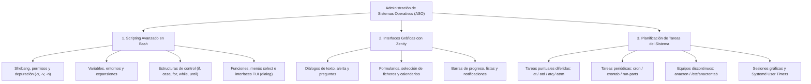

# Administración de Sistemas Operativos (ASO)

Bienvenido a la sección de apuntes y documentación práctica del módulo **Administración de Sistemas Operativos (ASO)** del 2º curso del Ciclo Formativo de Grado Superior en **Administración de Sistemas Informáticos en Red (ASIR)**.

---

## 🎯 Objetivos y Competencias del Módulo

El objetivo principal de ASO es dotar al administrador de sistemas de las capacidades necesarias para configurar, administrar, asegurar y automatizar servidores y estaciones de trabajo en entornos Linux y heterogéneos:

1. **Automatización mediante Scripting**: Desarrollar scripts profesionales en Bash para la gestión automatizada de tareas de administración, validación de parámetros, interacción CLI, interfaces textuales (`dialog`) y gráficas (`zenity`).
2. **Programación de Tareas**: Planificar ejecuciones puntuales (`at`) y periódicas (`cron`, `/etc/crontab`, `run-parts`), gestionar equipos con encendido no continuo (`anacron`), y configurar servicios/temporizadores modernos mediante **Systemd User Timers**.
3. **Gestión de Servicios y Procesos**: Supervisar el rendimiento, arranque del sistema, demonios del sistema operativo, gestión de logs y diagnósticos de incidentes.
4. **Seguridad y Control de Acceso**: Controlar la delegación de privilegios, listas de control de acceso a utilidades de programación de tareas (`at.allow`, `at.deny`, permisos en `crontab`).

---

## 🗺️ Mapa Conceptual de ASO



---

## 📚 Unidades del Módulo

A continuación puedes acceder a las guías detalladas organizadas por temas:

| Unidad | Título | Temas Clave |
| :--- | :--- | :--- |
| **01** | [Scripting en Bash y Automatización CLI](01-scripting-bash.md) | Sintaxis Bash, depuración (`-n`, `-v`, `-x`, `PS4`), comillas, aritmética (`let`, `$(( ))`, `bc`), condicionales (`if`, `test`), `case`, bucles (`for`, `while`, `until`), `select`, funciones y diálogos `dialog`. |
| **02** | [Scripting Gráfico con Zenity](02-zenity-gui-scripting.md) | Diálogos GTK en scripts: `--entry`, `--text-info`, mensajes informativos y de error, formularios `--forms`, selector de ficheros, listas, barras de progreso y notificaciones. |
| **03** | [Programación de Tareas (at, cron, anacron, systemd)](03-programacion-tareas-cron-systemd.md) | Ejecución diferida única con `at`, demonio `cron`, tablas `crontab`, `/etc/crontab` y utilidades `run-parts`, gestión de apagados con `anacron`, entorno gráfico y **Timers de systemd**. |

---

## 🛠️ Entorno de Laboratorio Recomendado

Para realizar las prácticas de este módulo se recomienda:

- **Sistema Operativo**: Distribución basada en Debian (Debian 12/13 GNU/Linux o Ubuntu LTS).
- **Intérprete**: GNU Bash 5.x (`/bin/bash`).
- **Paquetes clave**:
  ```bash
  sudo apt update
  sudo apt install -y at cron anacron dialog zenity bc curl tree
  ```
- **Control de servicios**:
  ```bash
  sudo systemctl enable --now atd cron
  ```
