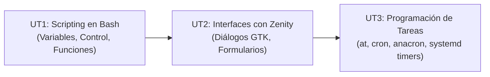

  <h1>💻 Administración de Sistemas Operativos (ASO)</h1>
  
El módulo de <strong>ASO</strong> profundiza en la gestión avanzada de servidores y puestos de trabajo Linux, automatización de tareas con scripts en Bash, creación de interfaces de usuario y programación de servicios con Cron y Systemd.

## 🗺️ Mapa de Contenidos

El temario se organiza en 3 unidades didácticas progresivas:

---

## 📚 Unidades Didácticas de ASO

<table class="syllabus-table">
  <thead>
    <tr>
      <th>Unidad</th>
      <th>Título del Tema</th>
      <th>Conceptos y Prácticas Principales</th>
      <th>Tipo de Contenido</th>
      <th>Enlace</th>
    </tr>
  </thead>
  <tbody>
    <tr>
      <td><strong>UT1</strong></td>
      <td><strong>Scripting en Bash y Automatización CLI</strong></td>
      <td>Shebang, permisos, depuración de scripts (<code>-x</code>, <code>-v</code>), variables de entorno, operaciones aritméticas, estructuras condicionales (<code>if</code>, <code>case</code>), bucles (<code>for</code>, <code>while</code>, <code>until</code>), menús <code>select</code>, funciones y cajas de diálogo TUI con <code>dialog</code>.</td>
      <td>Bash Scripting</td>
      <td><a class="module-link" href="01-scripting-bash.md">Abrir tema :octicons-arrow-right-16:</a></td>
    </tr>
    <tr>
      <td><strong>UT2</strong></td>
      <td><strong>Scripting Gráfico con Zenity</strong></td>
      <td>Creación de interfaces gráficas GTK para scripts: diálogos de entrada, cajas de texto informativas, avisos de advertencia/error, formularios con <code>--forms</code>, selección de archivos, calendarios, barras de progreso y notificaciones de escritorio.</td>
      <td>GUI Scripting</td>
      <td><a class="module-link" href="02-zenity-gui-scripting.md">Abrir tema :octicons-arrow-right-16:</a></td>
    </tr>
    <tr>
      <td><strong>UT3</strong></td>
      <td><strong>Programación de Tareas (Cron, Anacron, Systemd)</strong></td>
      <td>Planificación de ejecuciones únicas con <code>at</code>/<code>atd</code>, tareas periódicas con el demonio <code>cron</code> y tablas <code>crontab</code>, sincronización de equipos discontinuos con <code>anacron</code>, y servicios y temporizadores modernos mediante <strong>Systemd User Timers</strong>.</td>
      <td>Automatización</td>
      <td><a class="module-link" href="03-programacion-tareas-cron-systemd.md">Abrir tema :octicons-arrow-right-16:</a></td>
    </tr>
  </tbody>
</table>

---

## 🛠️ Entorno de Laboratorio Recomendado

- **Sistema Base**: Debian 12 / Ubuntu 22.04 / 24.04 LTS.
- **Intérprete**: GNU Bash (`/bin/bash`).
- **Paquetes clave**: `cron`, `at`, `anacron`, `zenity`, `dialog`, `bc`, `tree`.
- **Servicios activos**: `atd.service` y `cron.service`.
