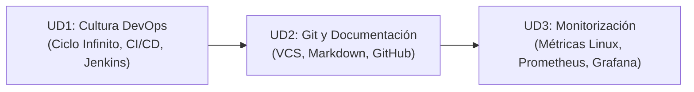

  <h1>♾️ Herramientas y Técnicas DevOps</h1>
  
El módulo de <strong>DevOps</strong> aborda las metodologías y herramientas que unen el desarrollo de software y la administración de sistemas: control de versiones con Git y GitHub, documentación técnica con Markdown, integración continua (CI/CD) y monitorización en tiempo real con Prometheus y Grafana.

## 🗺️ Mapa de Contenidos

El temario de DevOps se organiza en 3 unidades didácticas:

---

## 📚 Unidades Didácticas de DevOps

<table class="syllabus-table">
  <thead>
    <tr>
      <th>Unidad</th>
      <th>Título del Tema</th>
      <th>Conceptos y Prácticas Principales</th>
      <th>Tipo de Contenido</th>
      <th>Enlace</th>
    </tr>
  </thead>
  <tbody>
    <tr>
      <td><strong>UD1</strong></td>
      <td><strong>Introducción a la Cultura DevOps</strong></td>
      <td>Ruptura de silos tradicionales (Sysadmin vs Developer), el ciclo infinito DevOps (Plan, Build, Test, Deploy, Monitor), pipelines de integración y entrega continua (CI/CD) y automatización con Jenkins.</td>
      <td>Cultura + CI/CD</td>
      <td><a class="module-link" href="ud1-introduccion.md">Abrir tema :octicons-arrow-right-16:</a></td>
    </tr>
    <tr>
      <td><strong>UD2</strong></td>
      <td><strong>Git, Markdown y GitHub</strong></td>
      <td>Sistemas de control de versiones locales vs distribuidos, sintaxis completa Markdown, flujo de trabajo en las 3 áreas de Git (Directorio de trabajo, Staging, Repositorio) y colaboración con ramas y Pull Requests en GitHub.</td>
      <td>Git + GitHub</td>
      <td><a class="module-link" href="ud2-git-markdown.md">Abrir tema :octicons-arrow-right-16:</a></td>
    </tr>
    <tr>
      <td><strong>UD3</strong></td>
      <td><strong>Monitorización y Diagnóstico de Sistemas</strong></td>
      <td>Diagnóstico de rendimiento en Linux (<code>top</code>, <code>htop</code>, <code>ss</code>, <code>iostat</code>, <code>tcpdump</code>), auditoría de red con <code>nmap</code>, y arquitectura de monitorización con agentes, Zabbix, Prometheus y paneles Grafana.</td>
      <td>Monitorización</td>
      <td><a class="module-link" href="ud3-monitorizacion.md">Abrir tema :octicons-arrow-right-16:</a></td>
    </tr>
  </tbody>
</table>

---

## 🛠️ Herramientas de Trabajo

- **Control de Versiones**: Git CLI y GitHub.
- **Editor**: Visual Studio Code con extensiones Markdown y GitLens.
- **Monitorización**: Utilidades de Linux (`sysstat`, `htop`, `nmap`) y plataformas Prometheus / Grafana.
