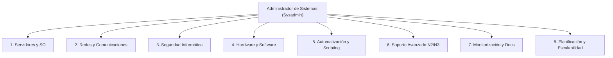
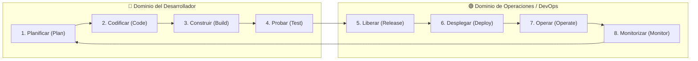
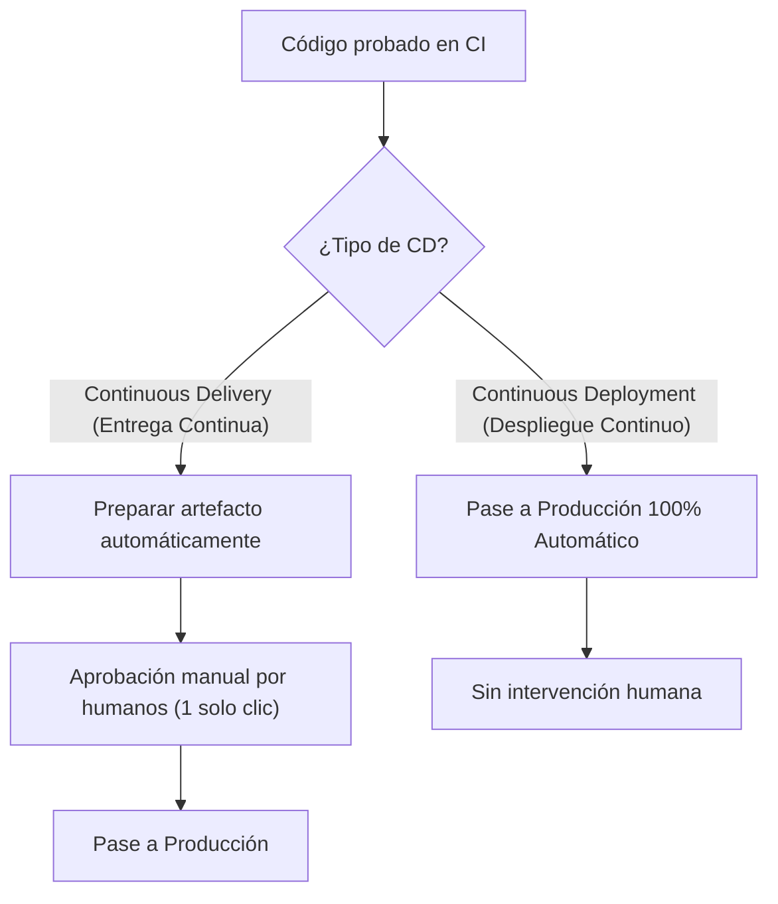

# UD1: Introducción a DevOps, CI/CD y Automatización

Esta unidad introduce los fundamentos metodológicos y culturales de **DevOps**, analizando la evolución del papel del administrador de sistemas tradicional, la colaboración con los equipos de desarrollo y control de calidad (QA), las etapas del ciclo de vida del software y las prácticas de integración y despliegue continuo (CI/CD).

---

## 1. Principios de DevOps y Roles Profesionales

Tradicionalmente, en las organizaciones de tecnología existía una separación estricta (silos) entre los equipos que programaban las aplicaciones y los equipos que las mantenían en los servidores. DevOps nace para eliminar esta barrera.

### 👤 El Administrador de Sistemas (Sysadmin)
Un **administrador de sistemas (*sysadmin*)** es el profesional encargado de garantizar que la infraestructura tecnológica de una organización funcione de manera segura, estable, disponible y eficiente.



#### Las 8 funciones esenciales del Sysadmin:
1. **Gestión de servidores y sistemas operativos:** Instalación, configuración y mantenimiento de servidores (GNU/Linux, Windows Server, entornos Unix), administración de cuentas de usuario, permisos y directivas de acceso, y control de recursos.
2. **Administración de redes y comunicaciones:** Configuración de redes locales (LAN), redes de área amplia (WAN), túneles VPN, conmutadores (*switches*), enrutadores (*routers*), puntos de acceso y cortafuegos (*firewalls*).
3. **Seguridad informática:** Implementación de políticas de contraseñas, cifrado y control de accesos, protección frente a malware e intrusiones, gestión de parches de seguridad y diseño de planes de recuperación ante desastres (*Disaster Recovery*).
4. **Gestión de hardware y software:** Supervisión del ciclo de vida de los equipos, inventario, optimización de recursos y gestión del licenciamiento.
5. **Automatización y scripting:** Desarrollo de scripts (Bash, PowerShell, Python) para tareas rutinarias como copias de seguridad, aprovisionamiento o despliegues.
6. **Soporte técnico avanzado:** Diagnóstico y resolución de incidencias complejas que el soporte de primer nivel (Helpdesk) no puede solventar.
7. **Monitorización y documentación:** Vigilancia proactiva de métricas e infraestructura y registro detallado de arquitecturas, configuraciones y procedimientos.
8. **Planificación y mejora continua:** Evaluación de nuevas tecnologías y diseño de arquitecturas escalables adaptadas al crecimiento del negocio.

> [!NOTE] **El Sysadmin según el tamaño de la empresa**
> - **En pequeñas y medianas empresas (PYMEs):** El administrador de sistemas suele ser multidisciplinar y asumir múltiples roles simultáneos (redes, soporte, servidores y seguridad).
> - **En grandes empresas y corporaciones:** Existe una alta especialización en departamentos concretos (administradores de bases de datos, ingenieros de redes, especialistas en ciberseguridad o ingenieros DevOps/SRE).

---

### 👥 Desarrollador vs. Analista de Sistemas
En el ciclo de ingeniería de software intervienen perfiles complementarios:

| Rol | Enfoque principal | Responsabilidad |
|---|---|---|
| **Analista de Sistemas** | **¿Qué y por qué?** | Comprende las necesidades del negocio y las traduce en requisitos técnicos y funcionales detallados. |
| **Desarrollador (Developer)** | **¿Cómo?** | Diseña, programa, construye y mantiene las aplicaciones y sistemas de software siguiendo los requisitos técnicos. |

---

### ♾️ ¿Qué es DevOps?
El término surge de la combinación de **Dev** (*Development* - Desarrollo) y **Ops** (*Operations* - Operaciones):

$$\text{DevOps} = \text{Desarrollo} + \text{Operaciones} \;(+\; \text{QA / Calidad})$$

- Es una **metodología y cambio cultural** orientado a unir a desarrolladores, administradores de sistemas y equipos de control de calidad (*QA - Quality Assurance*).
- **Objetivo fundamental:** Minimizar el riesgo de los cambios que se entregan a producción, permitiendo fabricar software con **mayor velocidad**, **calidad superior**, **menor coste** y una **frecuencia de lanzamientos muy elevada**.

---

## 2. Fases del Ciclo de Vida de DevOps

DevOps se representa típicamente mediante el símbolo de infinito ($\infty$), reflejando que el desarrollo y las operaciones forman un ciclo continuo y retroalimentado:



### Detalle de cada fase:
1. **Plan (Planificación):** Definición de requisitos, historias de usuario, prioridades y funcionalidades de la aplicación.
2. **Code (Codificación):** Escritura del código fuente y revisión colaborativa utilizando herramientas de control de versiones (Git).
3. **Build (Construcción):** Compilación del código, empaquetado de artefactos binarios o construcción de imágenes de contenedor (Docker).
4. **Test (Pruebas):** Ejecución automatizada de pruebas unitarias, de integración, rendimiento y seguridad para validar el código.
5. **Release (Liberación):** Preparación del software para su entrega; asignación de versiones (*tagging*) y verificación de dependencias.
6. **Deploy (Despliegue):** Publicación automática del software en los entornos correspondientes (pruebas, preproducción o producción).
7. **Operate (Operaciones):** Gestión, configuración de alta disponibilidad, mantenimiento y soporte del sistema en tiempo real.
8. **Monitor (Monitorización):** Supervisión continua del rendimiento, trazas de log y estado de salud de la aplicación para detectar errores antes de que impacten en los usuarios.

---

## 3. Prácticas y Herramientas de CI/CD

Las siglas **CI/CD** condensan dos de los pilares técnicos fundamentales de la ingeniería de software actual:

```
+--------------------------+-------------------------------------+
|  CI (Continuous Integr.) |        CD (Continuous Deliv./Deploy)|
+--------------------------+-------------------------------------+
 Código -> Build -> Tests  ->  Preparar Artefacto -> Desplegar
                                                        |
                                          (Manual o Automático)
```

### 1. Integración Continua (CI - *Continuous Integration*)
- **Definición:** Práctica en la que los desarrolladores integran sus cambios de código en un repositorio central compartido varias veces al día.
- **Funcionamiento:** Cada vez que se sube un cambio (*push* o *pull request*), un servidor automatizado compila el proyecto y lanza una batería de pruebas automáticas.
- **Objetivo:** Detectar fallos de forma temprana (evitando los tradicionales problemas de integración tardía o *merge hell*). Si algo falla, el equipo recibe alertas de inmediato.

### 2. Entrega Continua vs. Despliegue Continuo (CD)
Existen dos variantes esenciales bajo el acrónimo CD:



| Práctica | Nivel de automatización | ¿Cómo pasa a producción? |
|---|---|---|
| **Entrega Continua** (*Continuous Delivery*) | Alta | El artefacto queda compilado, probado y listo para producción, pero el despliegue final lo autoriza una persona con un clic. |
| **Despliegue Continuo** (*Continuous Deployment*) | Total | Va un paso más allá: cualquier cambio que supera con éxito las pruebas de CI se despliega en producción de forma inmediata y autónoma. |

> [!TIP] **Fórmula de recuerdo**
> - **CI** = Probar código constantemente.
> - **CD** = Entregar o desplegar código automáticamente.
> - **CI es la base indispensable sobre la que se construye CD.**

### ⚙️ El caso de Jenkins y los Pipelines
Herramientas como **Jenkins** no se limitan exclusivamente a hacer CI o solo CD; permiten diseñar **pipelines** completos que orquestan todo el ciclo:

```
[Desarrollador hace git push]
              │
              ▼
[Jenkins detecta el cambio en el repositorio]
              │
              ▼
[Compilación del código fuente]
              │
              ▼
[Ejecución de tests automáticos (unitarios, cobertura, linter)]
              │
              ▼
[Generación de la aplicación / imagen de contenedor]
              │
              ▼
[Despliegue en el entorno productivo (si está configurado)]
```

---

## 4. Automatización de Procesos

La automatización en entornos DevOps consiste en sustituir tareas operativas manuales y repetitivas por herramientas y scripts programados, garantizando consistencia, rapidez y tolerancia mínima a fallos.

### Los 5 grandes beneficios de la automatización:
1. **Reducción radical de errores humanos:** Los scripts y canalizaciones ejecutan exactamente la misma serie de instrucciones en cada iteración.
2. **Velocidad y eficiencia:** Operaciones que manualmente requerían horas de trabajo técnico se completan en cuestión de segundos o minutos.
3. **Escalabilidad:** Un proceso automatizado se puede replicar sobre uno, diez o cientos de servidores en la nube sin esfuerzo adicional.
4. **Mejora de la colaboración Dev-Ops:** Los programadores pueden probar y validar sus cambios de manera autónoma sin depender de peticiones manuales constantes al departamento de sistemas.
5. **Visibilidad y trazabilidad:** Toda acción queda documentada, versionada y registrada en registros (*logs*), simplificando auditorías y análisis de causas raíz (*post-mortems*).

### 🛠️ ¿Qué procesos automatiza un administrador de sistemas en DevOps?
- **Despliegues de software:** Publicación sin interrupción de servicio (*rolling updates*, *blue-green deployments*).
- **Aprovisionamiento y configuración de infraestructura:** Infraestructura como Código (IaC) mediante Ansible, Terraform o scripts de arranque.
- **Actualización y mantenimiento:** Instalación de parches de seguridad periódicos en flotas de servidores.
- **Supervisión y respuesta a incidentes:** Generación automática de alertas ante caídas de métricas y autorreparación (*auto-healing*).
- **Copias de seguridad y restauración:** Programación, verificación de integridad y pruebas de recuperación de bases de datos y volúmenes.
