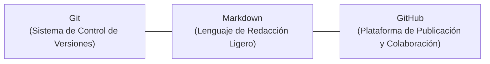
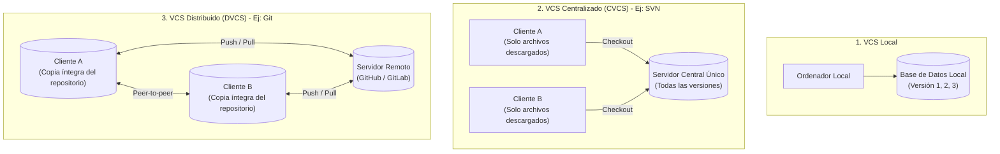
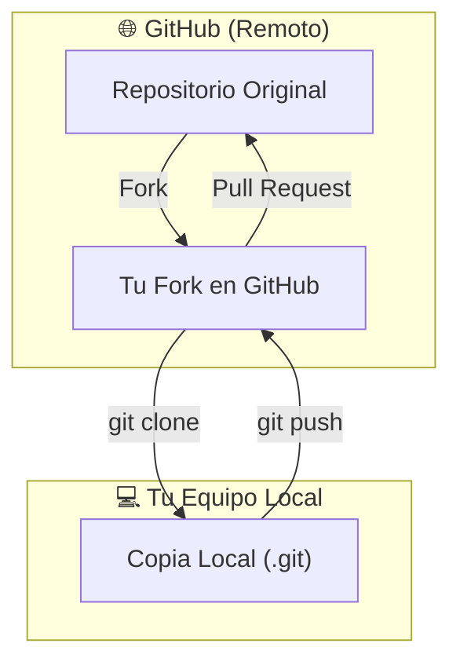
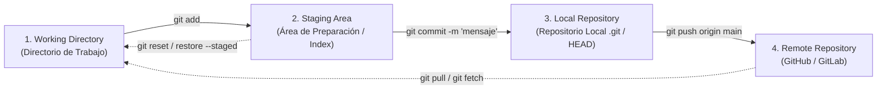

# UD2: Control de Versiones con Git, Markdown y GitHub

La producción de documentación técnica fiable y el desarrollo de software colaborativo requieren tres herramientas complementarias: un sistema de control de versiones (**Git**), un lenguaje ligero de redacción (**Markdown**) y una plataforma colaborativa en la nube (**GitHub**).



---

## 1. Sistemas de Control de Versiones (VCS)

Un **sistema de control de versiones (*Version Control System - VCS*)** es un software que registra los cambios realizados sobre un archivo o conjunto de archivos a lo largo del tiempo, permitiendo recuperar estados específicos anteriores en cualquier momento.

### ¿Por qué es imprescindible un VCS?
- Permite revertir archivos individuales o un proyecto completo a un estado anterior que funcionaba.
- Compara diferencias y cambios producidos a lo largo del tiempo línea a línea.
- Permite auditar la autoría: saber con exactitud quién modificó algo, qué introdujo y cuándo (*git blame*).
- Brinda tolerancia a fallos: ante pérdida accidental o corrupción de archivos, es trivial recuperar la última instantánea.

---

### Tipos de Arquitecturas de Control de Versiones



| Modelo | Funcionamiento | Limitación principal |
|---|---|---|
| **VCS Local** | Base de datos simple en el disco duro local donde se registraban los cambios de cada fichero. | No permite colaboración entre múltiples usuarios y si el disco local falla se pierde todo. |
| **VCS Centralizado (CVCS)** *(ej. SVN, CVS)* | Un único servidor central aloja todo el historial. Los colaboradores descargan únicamente la última instantánea del archivo de trabajo. | Punto único de fallo (*SPOF*): si el servidor central se cae o pierde conexión, nadie puede trabajar con el historial ni hacer commits. |
| **VCS Distribuido (DVCS)** *(ej. Git, Mercurial)* | Los colaboradores replican **por completo** todo el repositorio en su máquina local con su histórico íntegro. | Requiere mayor aprendizaje inicial, pero permite trabajar 100% desconectado de internet y ofrece redundancia total. |

### 🐙 Linus Torvalds y el nacimiento de Git
- Creado en **2005 por Linus Torvalds** para gestionar el desarrollo masivo del kernel de Linux.
- Diseñado para ser extremadamente rápido, eficiente en el manejo de grandes proyectos y con un flujo distribuido no lineal donde un servidor central es opcional.

---

## 2. Lenguaje de Marcas: Markdown

**Markdown** es un lenguaje de marcado ligero creado en **2004 por John Gruber** (con la colaboración de Aaron Swartz) con el propósito de aplicar formato a un texto plano de forma simple y humana, convirtiéndose con fidelidad en HTML.

- **Filosofía:** Mantener la máxima legibilidad incluso en texto plano sin procesar.
- Se ha convertido en el estándar indiscutible para documentación técnica, wikis, archivos `README` y generadores estáticos como MkDocs o Hugo.

### 📝 Editores populares de Markdown

| Editor | Plataforma | Características clave | Modelo |
|---|---|---|---|
| **Visual Studio Code** | Multiplataforma (Win, Mac, Linux) | Entorno profesional con visor integrado, terminal, soporte de extensiones y control de Git nativo. | Gratuito / Open Source |
| **Typora** | Multiplataforma | Interfaz minimalista unificada (sin doble panel), soporte excelente de tablas, fórmulas matemáticas y diagramas. | De pago (prueba gratuita) |
| **MarkdownPad** | Windows | Interfaz clásica de doble panel con exportación directa a PDF y HTML. | Freemium |
| **UberWriter / Apostrophe** | Linux (Ubuntu) | Editor libre enfocado en escritura sin distracciones con soporte para MathJax. | Gratuito / Open Source |
| **Dillinger.io** | Navegador Web | Editor online ágil sincronizable con Dropbox, Google Drive y GitHub. | Gratuito |
| **StackEdit.io** | Navegador Web | Editor online avanzado para colaboración en tiempo real con soporte MathJax y diagramas Mermaid. | Gratuito |

---

### 🧩 Las 8 Extensiones Esenciales para VS Code

Para convertir **Visual Studio Code** en la estación de trabajo definitiva para DevOps y documentación técnica, se recomienda esta suite de extensiones:

| Extensión | Propósito y Utilidad |
|---|---|
| **GitLens** | Supercarga Git en el editor: muestra autoría línea a línea (*blame* en tiempo real), explorador visual de commits, historial de cambios por bloque y navegación entre ramas. |
| **GitHub Pull Requests and Issues** | Permite crear, revisar, comentar y validar *Pull Requests* y gestionar *Issues* directamente desde VS Code sin necesidad de abrir el navegador. |
| **Markdown All in One** | Automatiza la escritura de Markdown con atajos de teclado rápidos, generación automática de tablas de contenidos (ToC), formateo de tablas y gestión de listas. |
| **Prettier – Code formatter** | Mantiene un formato de código uniforme y limpio en archivos Markdown, YAML, JSON, CSS y JavaScript cada vez que se guarda el archivo. |
| **markdownlint** | Analizador estático que detecta inconsistencias de estilo, errores en encabezados, sangrías erróneas o enlaces rotos en la sintaxis de Markdown. |
| **YAML** | Imprescindible para DevOps: autocompletado inteligente, validación sintáctica contra esquemas y detección de fallos en ficheros YAML (GitHub Actions, Ansible, Kubernetes). |
| **vscode-icons** | Reemplaza los iconos por defecto por iconos específicos del lenguaje y tecnología, facilitando la identificación visual inmediata de archivos y carpetas. |
| **Indent-Rainbow** | Colorea los niveles de indentación con una sutil gama de colores, lo que resulta crítico para no cometer errores en archivos estructurados por espacios como YAML o Python. |

---

## 3. La Plataforma GitHub

**GitHub** es la mayor plataforma web de alojamiento y colaboración de proyectos de software del mundo, basada en el motor de Git.

- **Historia:** Fundada en 2008 y adquirida por **Microsoft en junio de 2018**.
- **Función social:** Además de almacenar código, actúa como red social técnica que permite realizar bifurcaciones (*forks*), seguir a otros ingenieros, debatir en incidencias (*issues*) y contribuir a proyectos de código abierto globales.

---

## 4. Conceptos Fundamentales de Git y GitHub

### Componentes de un Proyecto
- **Repositorio (*Repo*):** Espacio digital donde se almacenan el código fuente, la documentación, los archivos de configuración y la base de datos completa de versiones (`.git`).
  - *Público:* Visible para toda la comunidad en internet.
  - *Privado:* Acceso restringido exclusivamente a los colaboradores autorizados.
- **Archivo `README.md`:** Documento de bienvenida obligatorio colocado en la raíz del repositorio. Describe el propósito del proyecto, requisitos de instalación, autoría, índice y licencia.
- **Ramas (*Branches*):** Líneas de desarrollo paralelas que permiten trabajar en nuevas funcionalidades sin alterar la versión estable.
  - Rama `main` (antiguamente `master`): contiene el código base listo para producción.
  - Ramas de funcionalidad (*feature branches*): ramas de desarrollo temporal.

---

### Operaciones Esenciales: Vocabulario Técnico



- **`Clone` vs. `Fork`:**
  - **`git clone`:** Descarga una copia local (offline) del repositorio remoto a tu máquina de trabajo.
  - **`Fork`:** Crea una copia independiente del proyecto de otro usuario dentro de tu propia cuenta en los servidores de GitHub para poder trabajar en él sin alterar el original.
- **`Commit`:** Instantánea congelada en el tiempo de los archivos modificados. Cada commit contiene un identificador único (hash SHA-1), un mensaje explicativo y los datos del autor.
- **`Push`:** Operación de envío que transfiere los commits registrados en la máquina local al repositorio remoto.
- **`Pull Request (PR)`:** Mecanismo formal de propuesta de cambios en GitHub. Solicita al propietario del repositorio original que revise tus modificaciones y las integre en la rama principal.
- **`Merge`:** Fusión de dos ramas. Incorpora los cambios de una rama secundaria dentro de la rama destino.

---

## 5. El Flujo de Trabajo en las 3 Áreas de Git

Git organiza el estado de los archivos en **tres áreas de trabajo locales** antes de sincronizarlos con el servidor remoto:



### Descripción de las áreas:
1. **Working Directory (Directorio de trabajo):** Es la carpeta real de tu sistema operativo donde estás editando, creando o eliminando archivos con tu editor de texto.
2. **Staging Area / Index (Área de preparación):** Es una zona intermedia donde se colocan temporalmente mediante el comando `git add` aquellos archivos específicos que van a formar parte del próximo commit.
3. **Local Repository (Repositorio local):** La base de datos permanente de Git (directorio oculto `.git`). Cuando ejecutas `git commit`, la instantánea del Staging Area queda registrada de forma definitiva en el historial local.

### Comandos básicos del flujo:
```bash
# 1. Comprobar el estado actual del directorio y área de preparación
git status

# 2. Añadir cambios específicos o todos los cambios al Staging Area
git add archivo.txt
git add .

# 3. Guardar los cambios preparados en el repositorio local con un mensaje claro
git commit -m "feat: añadir documentación sobre CI/CD"

# 4. Enviar los cambios confirmados al servidor remoto (GitHub)
git push origin main

# 5. Descargar y fusionar los cambios más recientes del servidor remoto
git pull origin main
```
