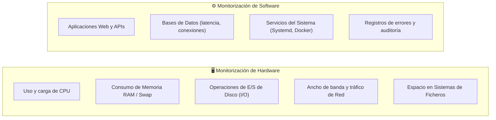
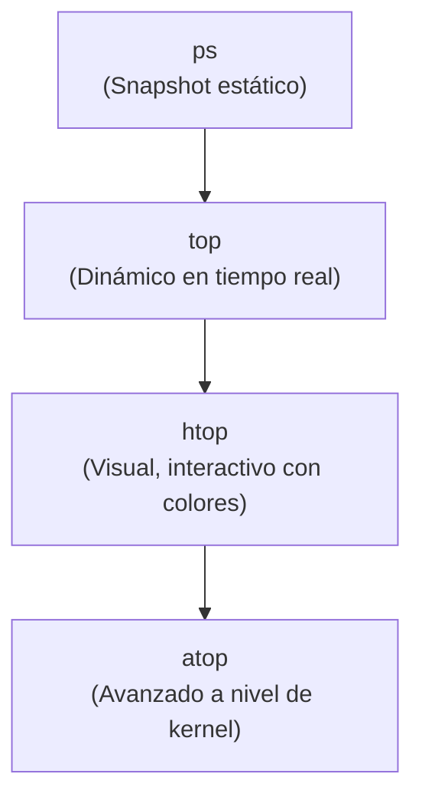
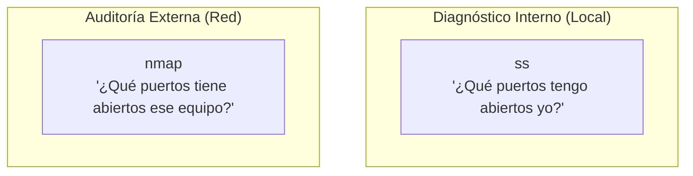
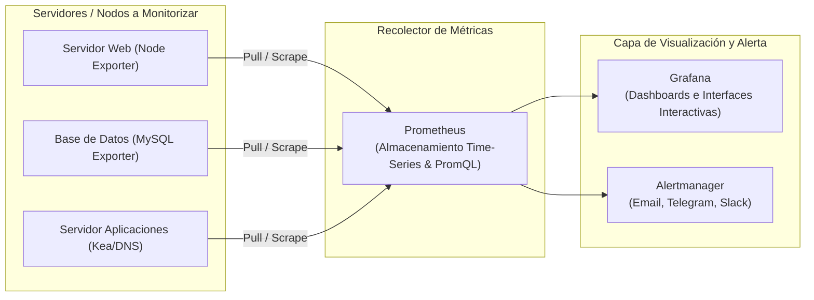

# UD3: Monitorización de Sistemas y Métricas

La monitorización es el conjunto de prácticas y herramientas destinadas a supervisar el comportamiento, disponibilidad y rendimiento de los sistemas informáticos, garantizando una postura proactiva frente a cualquier incidente.

> [!QUESTION] **El principio fundamental de la monitorización**
> *¿Qué pasaría si un servidor crítico falla y nadie se entera hasta que los usuarios empiezan a quejarse?*  
> El objetivo de la monitorización en DevOps es **detectar cualquier anomalía antes de que afecte al usuario final y al negocio**.

---

## 1. Fundamentos de la Monitorización

Supervisar y recopilar datos sobre el funcionamiento de los sistemas comprende dos niveles interdependientes:



### ¿Por qué es crítico monitorizar?
1. **Detección temprana de incidentes:** Identificar cuellos de botella y errores silenciosos antes de que desemboquen en una interrupción de servicio.
2. **Optimización de recursos:** Conocer el consumo real para evitar sobredimensionar o infradimensionar servidores.
3. **Planificación de capacidad (*Capacity Planning*):** Predecir cuándo se agotará el almacenamiento o la memoria según tendencias de crecimiento.
4. **Medidas proactivas:** Disparar acciones automáticas (*auto-scaling*, reinicios automáticos) ante umbrales de alerta.

---

## 2. Herramientas CLI Nativas del Sistema Operativo

GNU/Linux dispone de utilidades nativas de terminal imprescindibles para el diagnóstico inmediato en administración de sistemas y DevOps.

### ⚙️ Monitorización de Procesos



| Comando | Descripción | Ejemplo de uso práctico |
|---|---|---|
| `ps` | Muestra una instantánea puntual de los procesos activos en ejecución. | `ps aux \| grep nginx` |
| `top` | Proporciona una vista dinámica en tiempo real de los procesos que más CPU y memoria consumen. | `top` |
| `htop` | Versión mejorada e interactiva de `top` con barras de colores, scroll vertical/horizontal y envío de señales (`kill`). | `htop` |
| `atop` | Monitor avanzado que registra y analiza la actividad detallada de todos los procesos a nivel de hardware y kernel. | `atop` |

---

### 💾 Memoria, Espacio y Rendimiento de Disco

```bash
# Ver memoria física y Swap en formato humano (MB / GB)
free -h

# Espacio usado y libre en todos los sistemas de archivos montados
df -h

# Espacio ocupado por directorios en la ruta actual
du -sh * | sort -h

# Estadísticas de lectura y escritura en dispositivos de disco cada 2 segundos
iostat -xz 2
```

- **`free`:** Informa con precisión sobre la cantidad de memoria RAM libre, utilizada, compartida y la ocupación de la memoria de intercambio (*Swap*).
- **`df` (*Disk Free*):** Muestra el porcentaje de ocupación, inodos y espacio disponible en cada partición montada.
- **`du` (*Disk Usage*):** Calcula el espacio real que ocupan archivos o árboles de directorios específicos.
- **`iostat`:** Analiza la carga de operaciones de entrada/salida (I/O) en los discos para detectar cuellos de botella de acceso a disco.

---

### 🌐 Monitorización del Tráfico de Red

| Herramienta | Qué muestra | Tipo de análisis | Nivel de detalle | Tipo de interfaz |
|---|---|---|---|---|
| **`tcpdump`** | Paquetes de red individuales | Análisis profundo a nivel de paquete | 🔴 Muy alto | Texto plano en consola |
| **`tcptrack`** | Conexiones TCP activas en tiempo real | Resumen estructurado por conexión (IPs/Puertos) | 🟡 Medio | Texto dinámico |
| **`iptraf`** | Estadísticas globales por interfaz y protocolo | Resumen visual completo de tráfico | 🟢 Medio / Alto | Menús interactivos con ncurses |
| **`bmon`** | Consumo instantáneo de ancho de banda | Métricas agregadas de entrada y salida | 🔵 Medio / Bajo | Gráficos de barras en texto plano |

---

### 🔌 Inspección de Puertos y Servicios de Red



| Herramienta | Función | Ámbito de actuación | Caso de uso principal |
|---|---|---|---|
| **`ss`** (*Socket Statistics*) | Muestra conexiones de red, sockets en escucha y estadísticas TCP/UDP. Reemplazo moderno y eficiente de `netstat`. | **Local** | Identificar qué procesos locales tienen puertos abiertos y escuchando (`ss -tulpn`). |
| **`nmap`** (*Network Mapper*) | Escáner y auditor de seguridad que rastrea hosts, detecta puertos abiertos, servicios y versiones de SO. | **Red (remota o local)** | Auditoría externa, descubrimiento de equipos en la subred y pruebas de penetración. |

> [!TIP] **Regla nemotécnica rápida**
> - **`ss`** = *"¿Qué puertos tengo abiertos yo en mi máquina?"*
> - **`nmap`** = *"¿Qué puertos tiene abiertos aquel servidor en la red?"*

```bash
# Ver puertos TCP y UDP en escucha en la máquina local sin resolver DNS (-n)
ss -tulpn

# Escanear puertos abiertos y versiones de servicio en un servidor remoto
nmap -sV 192.168.1.50
```

---

## 3. Plataformas de Monitorización de Infraestructuras

Para infraestructuras corporativas o entornos en la nube con decenas de servidores, las herramientas locales no son suficientes. Se emplean sistemas de monitorización centralizados:



### Comparativa de soluciones:
- **Nagios:**
  - *Herramienta clásica de código abierto.*
  - Supervisa hosts, puertos y servicios mediante plugins locales y remotos (NRPE).
  - Genera informes y notificaciones fiables; excelente para redes locales y entornos tradicionales.
- **Zabbix:**
  - *Solución integral empresarial todo en uno.*
  - Monitorización con agente o sin agente (SNMP, IPMI, JMX).
  - Incluye recolección de métricas, motor de alertas avanzado y gráficos personalizables en una interfaz web nativa.
- **Prometheus:**
  - *Estándar cloud-native para DevOps (graduado en CNCF).*
  - Diseñado para entornos dinámicos y contenedores (Docker y Kubernetes).
  - Emplea un modelo de **series temporales**, recolección basada en *pull* periódicos (*scraping*) y un potente lenguaje de consultas (**PromQL**).
- **Grafana:**
  - *Plataforma líder de visualización y dashboards.*
  - No es una base de datos de monitorización por sí misma, sino un motor de visualización interactivo que se conecta a fuentes como Prometheus, Zabbix, Elasticsearch o InfluxDB para crear cuadros de mando claros, atractivos y accionables.

---

### 🏆 Resumen del panorama actual
- **Nagios:** Sigue vigente en sistemas clásicos o pequeñas arquitecturas locales estables.
- **Zabbix / Prometheus + Grafana:** Dominan la monitorización moderna, entornos cloud y canalizaciones DevOps por su flexibilidad, escalabilidad y capacidades visuales.
