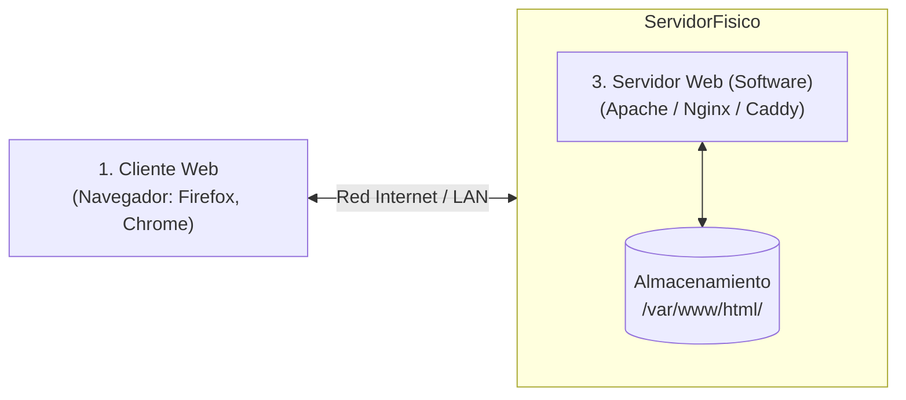
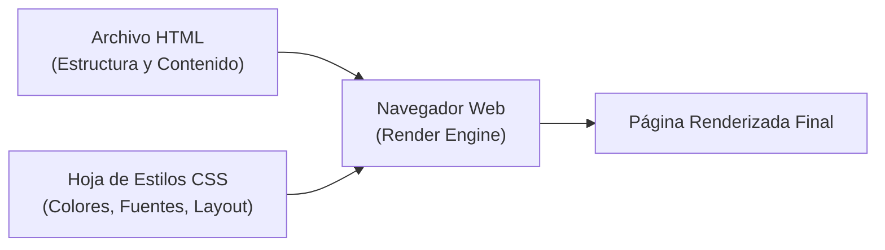
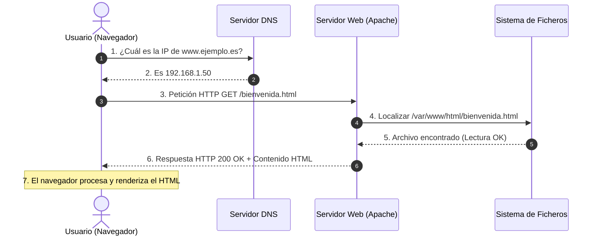

# Fundamentos de la Web y Arquitectura Cliente-Servidor

Para comprender cómo se implantan y administran las aplicaciones web en entornos de producción, es imprescindible analizar la infraestructura subyacente que permite la comunicación entre el navegador de un usuario y los servidores web en Internet.

---

## 1. El Escenario Mínimo de la Web

En su concepción original más básica, la World Wide Web opera como un sistema de distribución de documentos hipertexto accesible mediante la red.

Para que exista una comunicación web funcional se requieren tres elementos fundamentales:



1. **Un cliente**: Un dispositivo de usuario ejecutando un navegador web (*user-agent*) capaz de emitir peticiones y renderizar código HTML/CSS.
2. **Un servidor físico (o máquina virtual/contenedor)**: Un equipo informático encendido ininterrumpidamente (24/7) y conectado a una red con una dirección IP accesible.
3. **Un software servidor web (ej. Apache HTTP Server)**: Un servicio en segundo plano escuchando en un puerto de red (habitualmente `80` para HTTP y `443` para HTTPS) encargado de gestionar peticiones y despachar archivos almacenados en su sistema de ficheros local.

---

## 2. Anatomía de una URL: La Dirección Postal de la Red

Una **URL** (*Uniform Resource Locator*) es el identificador estándar utilizado para localizar y acceder a cualquier recurso en la Web.

Consideremos el siguiente ejemplo:

$$\text{http://192.168.1.50:80/documentos/bienvenida.html?curso=asir\#seccion1}$$

```
  http://      192.168.1.50      :80       /documentos/bienvenida.html   ?curso=asir    #seccion1
└────┬───┘   └───────┬──────┘   └──┬─┘    └──────────────┬────────────┘ └─────┬─────┘  └────┬────┘
 Protocolo       Host / IP       Puerto          Ruta del Recurso         Parámetros     Ancla
```

| Componente | Función Técnica |
| :--- | :--- |
| **Protocolo (`http://` o `https://`)** | Define el lenguaje y las reglas de cifrado empleadas para la comunicación. |
| **Host o Dominio (`192.168.1.50` o `www.miweb.es`)** | Identifica la máquina destino. Si se indica un nombre de dominio, el servicio **DNS** actúa como una "agenda telefónica" traduciendo el nombre legible a la dirección IP numérica correspondiente. |
| **Puerto (`:80` o `:443`)** | Punto de acceso lógico del servicio en el servidor. Por defecto se omite si es el puerto estándar (80 para HTTP, 443 para HTTPS). |
| **Ruta del recurso (`/documentos/bienvenida.html`)** | Ruta relativa al directorio raíz de documentos del servidor web (por ejemplo, en Apache `/var/www/html/documentos/bienvenida.html`). |
| **Parámetros de consulta (*Query String*)** | Datos pasados al recurso tras el signo `?` estructurados en pares `clave=valor`. |
| **Fragmento o Ancla (`#seccion1`)** | Marcador de posición interno interpretado exclusivamente por el navegador para desplazarse a una sección de la página; nunca se envía al servidor web. |

---

## 3. Lenguajes del Lado del Cliente: HTML y CSS

Cuando un servidor web atiende una solicitud básica, no envía una imagen ya dibujada en pantalla, sino **texto plano con marcas estructuradas**:

### 3.1 ¿Qué es una Etiqueta HTML?
**HTML** (*HyperText Markup Language*) define la estructura y semántica del documento mediante etiquetas delimitadas por corchetes angulares (`<` y `>`):

```html
<!DOCTYPE html>
<html lang="es">
<head>
    <meta charset="UTF-8">
    <title>Demostración IAW</title>
</head>
<body>
    <h1>¡Bienvenidos a Implantación de Aplicaciones Web!</h1>
    <p>Esta es una página estática servida por Apache.</p>
</body>
</html>
```
El motor de renderizado del navegador lee el archivo secuencialmente y construye el árbol **DOM** (*Document Object Model*), asignando a cada etiqueta su representación visual por defecto.

### 3.2 Separación de Estructura y Presentación (HTML + CSS)
En los estándares web modernos, la presentación visual jamás debe mezclarse con la estructura lógica:



1. El archivo HTML incluye un enlace en su cabecera: `<link rel="stylesheet" href="estilos.css">`.
2. El navegador descarga primero el documento HTML y descubre la necesidad de descargar la hoja CSS.
3. El motor aplica las reglas de diseño (colores, fuentes, márgenes y posicionamiento responsive) sobre las etiquetas del DOM.

---

## 4. El Ciclo de Petición y Respuesta (Modelo Cliente-Servidor)

La comunicación en la Web se basa en el modelo **Cliente-Servidor** asíncrono sobre la pila de protocolos **TCP/IP**:



### Fases del Proceso:
1. **Resolución DNS**: El navegador consulta la dirección IP del host a través de los servidores DNS configurados en el sistema operativo.
2. **Establecimiento de Conexión TCP**: Se realiza el protocolo de saludo en tres pasos (*Three-Way Handshake* SYN $\rightarrow$ SYN-ACK $\rightarrow$ ACK) sobre el puerto 80/443.
3. **Petición del Cliente (*Request*)**: El navegador emite una solicitud con el método HTTP adecuado (generalmente `GET`) indicando el recurso solicitado.
4. **Búsqueda y Recuperación en el Servidor**: El servidor web mapea la URL solicitada con el árbol de directorios de su disco duro (*DocumentRoot*).
5. **Envío de Respuesta (*Response*)**: El servidor devuelve un código de estado numérico (ej. `200 OK`, `404 Not Found`) junto con las cabeceras y el cuerpo del archivo.
6. **Renderizado en Cliente**: El navegador analiza el contenido recibido y emite peticiones adicionales para recursos secundarios vinculados (imágenes, fuentes, CSS, scripts JS).

---

## 5. Sitios Web Estáticos vs. Sitios Web Dinámicos

Una de las distinciones arquitectónicas fundamentales en IAW es el contraste entre recursos puramente estáticos y aplicaciones web dinámicas:

```mermaid
flowchart TD
    subgraph Estático ["1. Modelo Estático (Solo Lectura)"]
        C1["Cliente"] -->|GET /index.html| S1["Servidor Apache"]
        S1 -->|Lee archivo tal cual| D1[("Disco Duro")]
        S1 -->|200 OK (HTML intacto)| C1
    end

    subgraph Dinámico ["2. Modelo Dinámico (Procesamiento Lado Servidor)"]
        C2["Cliente"] -->|POST /login.php| S2["Servidor Apache"]
        S2 -->|Ejecuta intérprete| PHP["PHP Engine"]
        PHP <-->|SQL Query| BBDD[("Base de Datos")]
        PHP -->|HTML generado al vuelo| S2
        S2 -->|200 OK (HTML personalizado)| C2
    end
```

| Criterio | Sitio Web Estático | Aplicación Web Dinámica |
| :--- | :--- | :--- |
| **Generación del contenido** | Preexistente; archivos `.html`, `.css` y `.jpg` almacenados en disco. | Se genera en tiempo de ejecución ("al vuelo") según la petición y los datos de entrada. |
| **Interacción con el usuario** | Pasiva; lectura y descarga de información (como un tablón de anuncios). | Activa; formularios de login, carritos de compra, búsquedas y publicaciones. |
| **Tecnologías en el servidor** | Servidor web básico (Apache, Nginx). | Servidor web + intérprete de backend (PHP, Python, Node.js) + SGBD (MariaDB, PostgreSQL). |
| **Rendimiento y consumo** | Consumo mínimo de CPU y memoria; excelente almacenamiento en caché. | Mayor demanda de recursos de cómputo; requiere optimización de bases de datos y balanceo de carga. |

---

## 6. La Necesidad de Interacción

En el escenario estático, el flujo de datos es **unidireccional** (Servidor $\rightarrow$ Cliente). Sin embargo, las aplicaciones del mundo real exigen que el usuario envíe datos de vuelta al servidor:

- Validar credenciales de acceso (usuario y contraseña).
- Filtrar catálogos o buscar productos.
- Rellenar formularios de soporte o tramitación de pedidos.
- Subir documentos y archivos adjuntos.

Para habilitar este flujo bidireccional entran en juego dos tecnologías clave que estudiaremos en la siguiente unidad:
1. **En el cliente**: La etiqueta HTML `<form>` y sus controles de entrada.
2. **En la red**: Los métodos y estructuras de empaquetado del **protocolo HTTP** (`GET` vs `POST`).
