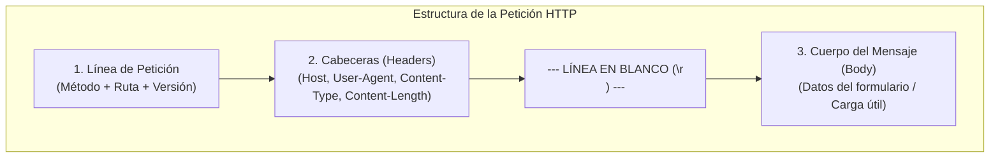
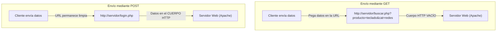
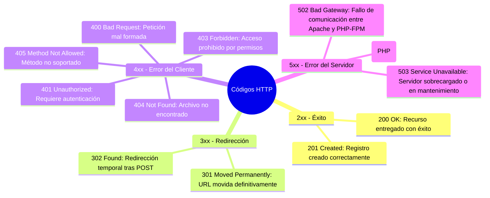

# Protocolo HTTP y Formularios Web

En el desarrollo y la administración de aplicaciones web, la interacción bidireccional entre el cliente y el servidor depende de dos piezas complementarias: los **formularios HTML**, que recopilan la información del usuario en el navegador, y el **protocolo HTTP**, que transporta dichos datos a través de la red.

---

## 1. La Anatomía de un Mensaje HTTP (El "Sobre" Digital)

Cuando un navegador web envía información a un servidor (por ejemplo, al enviar un formulario), no transmite texto desorganizado. La información viaja encapsulada bajo las especificaciones de **HTTP/1.1** o **HTTP/2** en una estructura estricta compuesta por **tres secciones y una línea delimitadora**:

```
┌────────────────────────────────────────────────────────────────────────┐
│ 1. Línea de Petición (Request Line)                                     │
│    POST /procesar_post.php HTTP/1.1                                    │
├────────────────────────────────────────────────────────────────────────┤
│ 2. Cabeceras HTTP (Headers - Metadatos de la Petición)                  │
│    Host: localhost                                                     │
│    User-Agent: Mozilla/5.0 (X11; Linux x86_64; rv:128.0) Gecko...     │
│    Content-Type: application/x-www-form-urlencoded                     │
│    Content-Length: 30                                                  │
├────────────────────────────────────────────────────────────────────────┤
│    [ LÍNEA EN BLANCO OBLIGATORIA (\r\n) ]                              │
├────────────────────────────────────────────────────────────────────────┤
│ 3. Cuerpo del Mensaje (Body Message / Carga Útil)                      │
│    usuario=alumno_asir&clave=12345                                     │
└────────────────────────────────────────────────────────────────────────┘
```



### 1.1 Línea de Petición (*Request Line*)
Es la primera línea del paquete y define la acción requerida:
- **Método HTTP (Verbo)**: Indica la operación a realizar (`GET`, `POST`, `PUT`, `DELETE`, `HEAD`, `OPTIONS`).
- **Ruta del recurso**: Dirección relativa al DocumentRoot (`/procesar_post.php`).
- **Versión del protocolo**: Normalmente `HTTP/1.1` o `HTTP/2`.

### 1.2 Cabeceras de Petición (*Headers*)
Proporcionan información técnica de contexto para que el servidor web sepa cómo tratar el mensaje:
- `Host`: El nombre de dominio o IP al que se dirige la petición (indispensable para que Apache gestione múltiples *Virtual Hosts* en la misma IP).
- `User-Agent`: Identifica el navegador, motor de renderizado y sistema operativo del cliente.
- `Content-Type`: Define el formato en el que viajan los datos dentro del cuerpo. Para formularios HTML convencionales es:
  `application/x-www-form-urlencoded`
  Para formularios con subida de archivos es:
  `multipart/form-data`
- `Content-Length`: Tamaño en bytes del cuerpo del mensaje.

### 1.3 La Línea en Blanco Obligatoria (`\r\n`)
En la especificación HTTP, un salto de línea CRLF vacío actúa como separador físico. Indica al servidor web (Apache/Nginx) que la lectura de cabeceras ha concluido y que los siguientes bytes recibidos pertenecen al cuerpo de la petición.

### 1.4 Cuerpo del Mensaje (*Body Message*)
Es la carga útil donde se alojan los datos reales introducidos por el usuario codificados en pares clave-valor (`usuario=alumno_asir&clave=12345`).

---

## 2. El Formulario HTML (`<form>`)

Para permitir que el usuario introduzca datos y los remita al servidor, HTML proporciona la etiqueta `<form>`:

```html
<form action="procesar.php" method="POST">
    <label for="usr">Nombre de usuario:</label>
    <input type="text" id="usr" name="usuario" required>

    <label for="pwd">Contraseña:</label>
    <input type="password" id="pwd" name="clave" required>

    <button type="submit">Iniciar Sesión</button>
</form>
```

### 2.1 Los Tres Atributos Sagrados de un Formulario

| Atributo | Ubicación | Función Técnica |
| :--- | :--- | :--- |
| `action` | `<form action="...">` | Define **a dónde viaja** la petición: la URL o archivo script en el servidor (ej. `procesar.php`) que procesará los datos. Si se deja vacío, se envía a la misma página. |
| `method` | `<form method="...">` | Define **cómo viaja** la información: el verbo HTTP empleado (`GET` o `POST`). |
| `name` | `<input name="...">` | **¡Crítico!** Define **el nombre de la variable** con la que el servidor identificará el dato. Si a un `<input>` se le olvida el atributo `name`, el navegador **nunca enviará ese campo**. |

> [!CAUTION] Error común: `id` vs `name`
> El atributo `id` se utiliza en el navegador para enlazar etiquetas `<label for="...">` y manipular el elemento desde JavaScript o CSS. Sin embargo, **el servidor solo reconoce el atributo `name`**. Un campo con `id="usuario"` pero sin `name="usuario"` no llegará al backend.

### 2.2 Controles de Entrada Habituales

```html
<!-- Texto simple y contraseñas -->
<input type="text" name="nombre" placeholder="Tu nombre">
<input type="password" name="clave">

<!-- Opciones de radio (excluyentes) y casillas múltiples -->
<input type="radio" name="genero" value="M"> Masculino
<input type="radio" name="genero" value="F"> Femenino
<input type="checkbox" name="acepto_terminos" value="1">

<!-- Menú desplegable -->
<select name="curso">
    <option value="asir1">1º ASIR</option>
    <option value="asir2" selected>2º ASIR</option>
</select>

<!-- Campos ocultos (tokens de seguridad o IDs de registro) -->
<input type="hidden" name="id_sesion" value="abc123xyz">

<!-- Subida de ficheros (requiere enctype="multipart/form-data" en <form>) -->
<input type="file" name="adjunto">
```

---

## 3. Comparativa Exhaustiva: Método GET vs. Método POST

La elección entre `GET` y `POST` es una de las decisiones de diseño y seguridad más importantes en la implantación web:



| Criterio | Método `GET` | Método `POST` |
| :--- | :--- | :--- |
| **Ubicación de los datos** | Adosados a la propia URL tras un signo `?` (*Query String*). | Ocultos en el **Cuerpo de la petición HTTP (*Body*)**. |
| **Estado del Cuerpo HTTP** | Completamente **vacío** (`Content-Length: 0`). | Contiene la carga útil codificada. |
| **Visibilidad en el navegador** | Totalmente visible en la barra de direcciones. | Invisible en la barra de direcciones; la URL queda limpia. |
| **Historial del navegador** | Los datos quedan grabados en el historial de navegación. | Los datos **no** quedan almacenados en el historial de URLs. |
| **Marcadores (Favoritos)** | Se puede guardar en favoritos y compartir el enlace con los parámetros exactos. | No se puede marcar la consulta específica como favorito. |
| **Límite de tamaño** | Limitado por la longitud máxima de URL (aprox. 2.048 caracteres según navegador y servidor). | Sin límite estricto de protocolo (configurable en el servidor mediante directivas como `post_max_size`). |
| **Seguridad de datos sensibles** | **Inseguro**: Nunca debe usarse para contraseñas, DNIs o números de tarjeta. | **Adecuado**: No expone credenciales en pantalla ni en logs de acceso de URLs. |
| **Subida de archivos (*Uploads*)** | Imposible. | Soporta subidas binarias mediante `multipart/form-data`. |
| **Idempotencia / Semántica** | Idempotente: diseñado para **consultar o leer** datos sin alterar el estado del servidor. | No idempotente: diseñado para **crear, modificar o registrar** datos en el servidor. |
| **Casos de uso típicos** | Buscadores, filtros de tienda online, ordenación y paginación. | Inicios de sesión (login), registros, pagos online, subida de documentos. |

---

## 4. Códigos de Estado HTTP en la Interacción Web

Cuando el servidor atiende la solicitud de un formulario o enlace, responde con un código numérico estandarizado de tres dígitos:



> [!NOTE] El patrón Post/Redirect/Get (PRG)
> Para evitar que un usuario vuelva a enviar accidentalmente un formulario al recargar la página (pulsando F5) y duplique una compra o un registro, los servidores web modernos responden a un `POST` con una redirección `302 Found` hacia una página de confirmación que se solicita mediante `GET`.

---

## 5. El Salto al Servidor: Recepción en PHP

Una vez que Apache recibe el mensaje HTTP y comprueba que el recurso solicitado tiene extensión `.php`:

1. Apache delega el procesamiento del archivo en el intérprete de **PHP**.
2. PHP inspecciona automáticamente la petición HTTP entrante y puebla dos tablas asociativas en memoria denominadas **arrays superglobales**:
   - Si el formulario utilizó `method="GET"`, los parámetros se extraen de la URL y se guardan en el array `$_GET`.
   - Si el formulario utilizó `method="POST"`, los parámetros se extraen del cuerpo del mensaje y se guardan en el array `$_POST`.

En la siguiente unidad aprenderemos a programar scripts en PHP para procesar estos datos, validarlos y construir respuestas dinámicas personalizadas.
