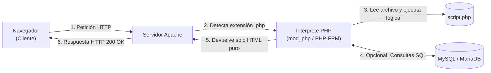
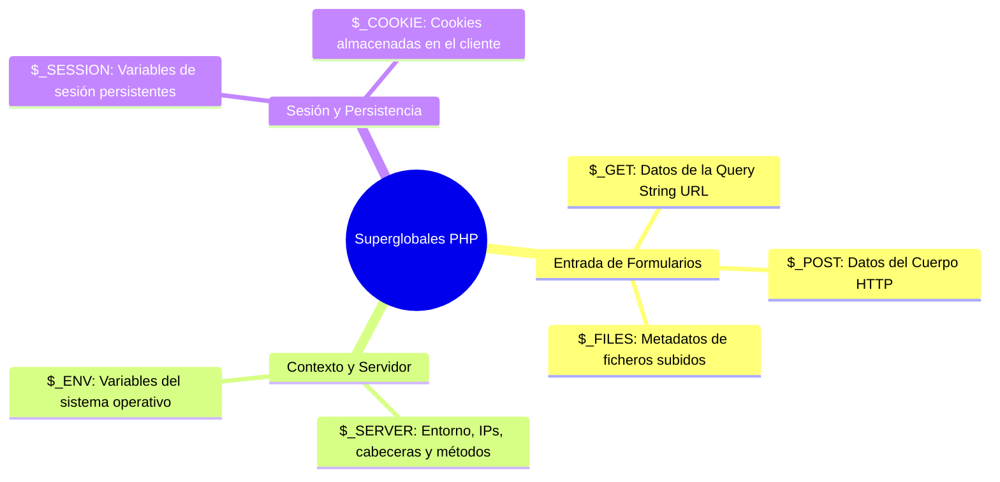

# Programación del Lado del Servidor con PHP

**PHP** (*PHP: Hypertext Preprocessor*) es el lenguaje de programación del lado del servidor (*backend*) más extendido en la Web, responsable de impulsar plataformas y gestores de contenidos como WordPress, Drupal, Moodle o Laravel.

A diferencia de JavaScript en el navegador, el código PHP se ejecuta **íntegramente en el servidor web** antes de que la respuesta sea transmitida al cliente. El navegador nunca llega a ver el código fuente PHP original, sino únicamente el resultado final generado (habitualmente HTML, CSS o JSON).

---

## 1. Arquitectura de Ejecución de PHP



### Modos de Integración con el Servidor Web:
1. **Módulo integrado (`mod_php`)**: El intérprete de PHP se carga como un módulo dentro del propio proceso de Apache. Es sencillo de configurar pero consume más memoria en sitios de alto tráfico.
2. **FastCGI Process Manager (`PHP-FPM`)**: Estándar en la administración moderna. PHP corre como un servicio daemon independiente (`systemctl status php8.2-fpm`) que atiende peticiones de Apache o Nginx a través de un socket UNIX (`/run/php/php8.2-fpm.sock`) o TCP (`127.0.0.1:9000`), ofreciendo mayor rendimiento y aislamiento de usuarios.

---

## 2. Sintaxis Fundamental de PHP

### 2.1 Etiquetas y Delimitadores
El código PHP se delimita entre las etiquetas `<?php` y `?>`:

```php
<?php
// Esto es un comentario de una sola línea
# Esto también es un comentario de una línea
/* Comentario
   multilínea */

echo "¡Hola mundo desde el servidor!";
```

> [!TIP] Buena Práctica de PHP.net
> En archivos que contienen **únicamente código PHP** (como clases, funciones o scripts de procesamiento), es una recomendación oficial **omitir la etiqueta de cierre `?>`**. Esto evita que se introduzcan espacios en blanco o saltos de línea accidentales al final del archivo que corrompan las cabeceras HTTP (`headers already sent`).

### 2.2 Sensibilidad a Mayúsculas y Minúsculas (*Case Sensitivity*)
- **Variables**: Son **sensibles** a mayúsculas y minúsculas (`$usuario`, `$Usuario` y `$USUARIO` son tres variables completamente distintas).
- **Funciones y palabras clave**: Son **insensibles** (`echo`, `ECHO`, `strlen()` o `STRLEN()` funcionan exactamente igual).

---

## 3. Variables, Tipos de Datos y Operadores

En PHP todas las variables comienzan con el símbolo del dólar (`$`) y no requieren declaración previa de tipo (tipado dinámico y débil):

```php
<?php
$modulo = "Implantación de Aplicaciones Web";  // String (Cadena)
$curso = 2;                                    // Integer (Entero)
$notaMedia = 8.75;                             // Float (Coma flotante)
$aprobado = true;                              // Boolean (Verdadero/Falso)
$servicios = null;                             // NULL (Sin valor)
```

### 3.1 Cadenas y Concatenación
- **Comillas dobles (`"..."`)**: Permiten la **interpolación** de variables y caracteres de escape (`\n`, `\t`).
- **Comillas simples (`'...'`)**: Tratan el texto como **literal estricto**.
- **Operador de concatenación**: En PHP se utiliza el **punto (`.`)**, no el signo más (`+`):

```php
<?php
$alumno = "Daniel";
$horas = 6;

// Interpolación con comillas dobles:
echo "El alumno $alumno cursa $horas horas semanales.<br>";

// Concatenación explícita con punto (.):
echo 'Bienvenido: ' . $alumno . ' al curso de ASIR.<br>';
```

---

## 4. Estructuras de Control

### 4.1 Condicionales (`if`, `elseif`, `else`)
```php
<?php
$puntuacion = 7.5;

if ($puntuacion >= 9.0) {
    echo "Calificación: Sobresaliente";
} elseif ($puntuacion >= 7.0) {
    echo "Calificación: Notable";
} elseif ($puntuacion >= 5.0) {
    echo "Calificación: Aprobado";
} else {
    echo "Calificación: Suspenso";
}
```

### 4.2 El Operador Ternario y Coalescencia Nula (`??`)
```php
// Operador ternario:
$estado = ($nota >= 5) ? "Apto" : "No apto";

// Operador de fusión null (PHP 7+): si no existe, toma el valor por defecto:
$nombre = $_POST['usuario'] ?? 'Invitado';
```

### 4.3 Bucles y la Estructura `foreach`
Aunque PHP soporta `for`, `while` y `do-while`, la instrucción por excelencia para trabajar con datos web es **`foreach`**:

```php
<?php
$servidores = ["dns.empresa.local", "web.empresa.local", "db.empresa.local"];

foreach ($servidores as $servidor) {
    echo "Host monitorizado: $servidor <br>";
}
```

---

## 5. Arrays en PHP: Indexados y Asociativos

Los arrays en PHP son en realidad mapas ordenados flexibles que pueden actuar como listas indexadas, tablas hash o diccionarios:

### 5.1 Arrays Indexados Numéricamente
```php
<?php
$puertos = [80, 443, 22, 3306];
echo $puertos[0]; // Imprime 80
```

### 5.2 Arrays Asociativos (Pares Clave $\rightarrow$ Valor)
Fundamentales para entender cómo PHP gestiona las entradas de un formulario web:

```php
<?php
$configuracion = [
    "servidor" => "localhost",
    "puerto"   => 3306,
    "bd"       => "gestion_asir",
    "ssl"      => true
];

echo "Conectando a la base de datos: " . $configuracion["bd"];

// Recorrer claves y valores:
foreach ($configuracion as $clave => $valor) {
    echo "<p>Parámetro <strong>$clave</strong>: $valor</p>";
}
```

---

## 6. Variables Superglobales de PHP

Las **superglobales** son arrays asociativos predefinidos por el motor de PHP que están disponibles automáticamente en cualquier parte del código (sin necesidad de importar ni usar la palabra clave `global`):



### 6.1 `$_GET`
Contiene todos los parámetros enviados en la URL tras el carácter `?`:
```php
// Si la URL es: http://localhost/buscar.php?producto=switch&vlan=10
$item = $_GET['producto']; // "switch"
$vlan = $_GET['vlan'];     // "10"
```

### 6.2 `$_POST`
Almacena los datos enviados en el cuerpo del mensaje HTTP cuando el formulario utiliza `method="POST"`:
```php
// En un formulario con <input name="login"> y <input name="password">
$usuario = $_POST['login'];
$clave   = $_POST['password'];
```

### 6.3 `$_SERVER`
Proporciona metadatos del servidor y de la petición HTTP en curso:

| Clave | Descripción |
| :--- | :--- |
| `$_SERVER['REQUEST_METHOD']` | Método HTTP utilizado (`GET`, `POST`, `HEAD`). |
| `$_SERVER['REMOTE_ADDR']` | Dirección IP del cliente que realiza la petición. |
| `$_SERVER['HTTP_USER_AGENT']` | Cabecera del navegador y sistema operativo del usuario. |
| `$_SERVER['SERVER_NAME']` | Nombre del host o VirtualHost configurado en Apache. |
| `$_SERVER['DOCUMENT_ROOT']` | Ruta física en el disco del DocumentRoot (`/var/www/html`). |

---

## 7. Validación, Sanitización y Seguridad en Formularios

> [!CAUTION] Regla de Oro de la Administración Web
> **"Nunca confíes en los datos enviados por el usuario"**. Cualquier parámetro recibido por `$_GET` o `$_POST` puede haber sido manipulado con fines maliciosos (ataques XSS, SQL Injection o desbordamientos).

### 7.1 Comprobación de Existencia con `isset()` y `empty()`
- `isset($var)`: Devuelve `true` si la variable o clave del array existe y no es `null`.
- `empty($var)`: Devuelve `true` si la variable no existe, está vacía (`""`), es `0` o `false`.

### 7.2 Prevención de Ataques XSS con `htmlspecialchars()`
El ataque **Cross-Site Scripting (XSS)** consiste en inyectar código HTML o JavaScript malicioso (ej: `<script>alert(document.cookie)</script>`) en un formulario para que el servidor lo imprima en la pantalla de otros usuarios.

Para neutralizarlo, se convierte cualquier carácter especial en su correspondiente entidad HTML inocua:

```php
<?php
// Entrada potencialmente dañina:
$comentario = "<script>alert('Ataque XSS');</script>";

// Sanitización obligatoria antes de mostrar en pantalla:
$comentarioSeguro = htmlspecialchars($comentario, ENT_QUOTES, 'UTF-8');

echo $comentarioSeguro;
// Salida en el HTML: &lt;script&gt;alert(&#039;Ataque XSS&#039;);&lt;/script&gt;
// El navegador lo muestra como texto normal y NO lo ejecuta como script.
```

### 7.3 Limpieza con `trim()` y `stripslashes()`
```php
function limpiar_entrada($dato) {
    $dato = trim($dato);            // Elimina espacios en blanco al inicio y final
    $dato = stripslashes($dato);     // Elimina barras invertidas de escape (\)
    $dato = htmlspecialchars($dato, ENT_QUOTES, 'UTF-8');
    return $dato;
}
```

---

## 8. Caso Práctico Integrado de Aula: Formulario Seguro y Procesamiento Backend

A continuación se muestra una arquitectura típica de aula en la que un formulario HTML envía datos a un script de procesamiento en PHP:

### Archivo 1: `registro.html` (Lado del Cliente)
```html
<!DOCTYPE html>
<html lang="es">
<head>
    <meta charset="UTF-8">
    <title>Alta de Usuario - Servidor ASIR</title>
</head>
<body>
    <h2>Formulario de Registro de Usuario</h2>
    <form action="procesar_registro.php" method="POST">
        <p>
            <label for="nombre">Nombre de usuario:</label><br>
            <input type="text" id="nombre" name="usuario" required>
        </p>
        <p>
            <label for="email">Correo electrónico:</label><br>
            <input type="email" id="email" name="correo" required>
        </p>
        <p>
            <label for="rol">Rol en el sistema:</label><br>
            <select id="rol" name="rol">
                <option value="operador">Operador de Sistemas</option>
                <option value="tecnico">Técnico de Red</option>
                <option value="auditor">Auditor de Seguridad</option>
            </select>
        </p>
        <button type="submit">Dar de alta en el sistema</button>
    </form>
</body>
</html>
```

### Archivo 2: `procesar_registro.php` (Lado del Servidor)
```php
<?php
// 1. Verificar que la petición llegó mediante el método POST
if ($_SERVER["REQUEST_METHOD"] !== "POST") {
    http_response_code(405); // Method Not Allowed
    die("ERROR: Método no permitido. Debe enviar los datos mediante el formulario.");
}

// 2. Extraer y sanitizar las entradas de $_POST
$usuario = htmlspecialchars(trim($_POST['usuario'] ?? ''), ENT_QUOTES, 'UTF-8');
$correo  = filter_var(trim($_POST['correo'] ?? ''), FILTER_SANITIZE_EMAIL);
$rol     = htmlspecialchars(trim($_POST['rol'] ?? ''), ENT_QUOTES, 'UTF-8');

// 3. Validación de campos obligatorios
$errores = [];

if (empty($usuario)) {
    $errores[] = "El campo nombre de usuario es obligatorio.";
}
if (!filter_var($correo, FILTER_VALIDATE_EMAIL)) {
    $errores[] = "La dirección de correo electrónico no tiene un formato válido.";
}

// 4. Generación de respuesta dinámica
?>
<!DOCTYPE html>
<html lang="es">
<head>
    <meta charset="UTF-8">
    <title>Resultado del Procesamiento</title>
</head>
<body>
    <?php if (!empty($errores)): ?>
        <h3 style="color: red;">Se detectaron los siguientes errores:</h3>
        <ul>
            <?php foreach ($errores as $error): ?>
                <li><?= $error ?></li>
            <?php endforeach; ?>
        </ul>
        <p><a href="registro.html">Volver al formulario</a></p>
    <?php else: ?>
        <h3 style="color: green;">¡Usuario registrado con éxito!</h3>
        <table border="1" cellpadding="6">
            <tr><th>Campo</th><th>Valor Almacenado</th></tr>
            <tr><td>Usuario</td><td><?= $usuario ?></td></tr>
            <tr><td>Email</td><td><?= $correo ?></td></tr>
            <tr><td>Perfil</td><td><?= $rol ?></td></tr>
            <tr><td>IP de origen</td><td><?= $_SERVER['REMOTE_ADDR'] ?></td></tr>
            <tr><td>Fecha/Hora</td><td><?= date("Y-m-d H:i:s") ?></td></tr>
        </table>
    <?php endif; ?>
</body>
</html>
```
