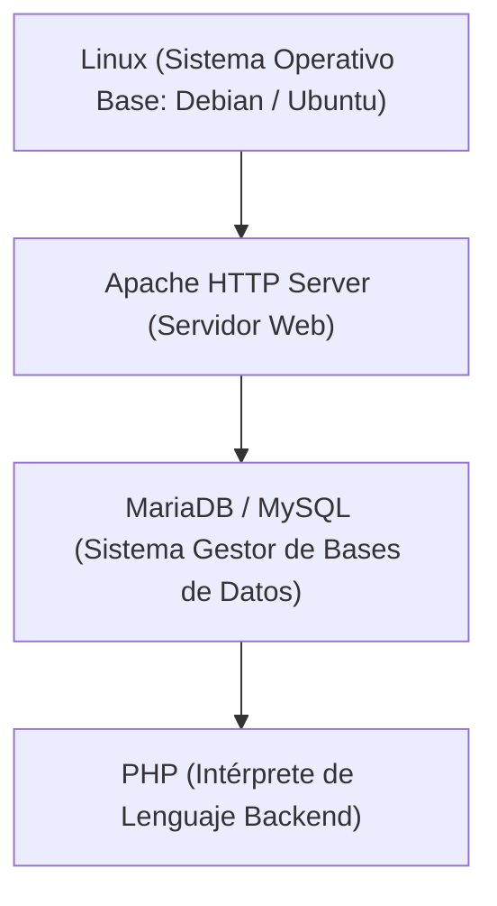
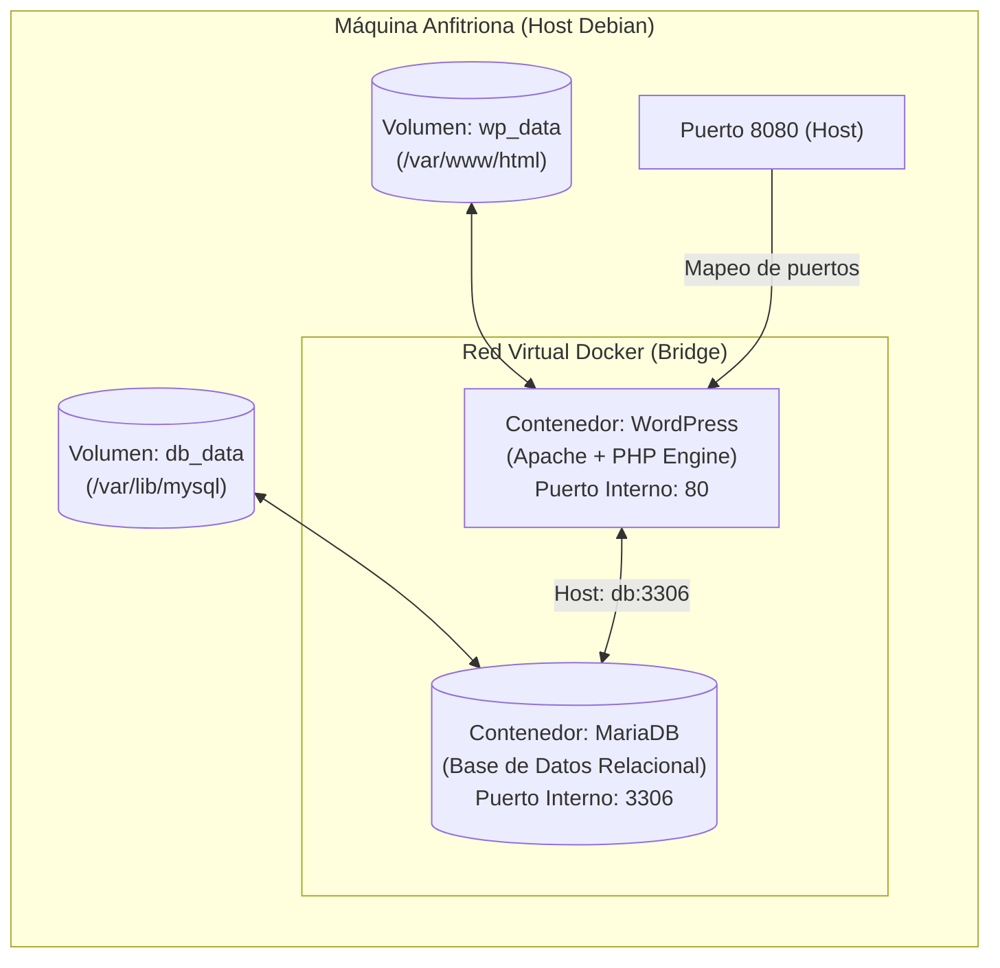

# Despliegue de Servidores Web y Contenedores Docker

En la administración de sistemas moderna, el despliegue de aplicaciones web ha evolucionado desde la instalación manual en servidores físicos (*bare metal*) hacia el empaquetado en **contenedores Docker** y la orquestación mediante **Docker Compose**.

---

## 1. La Pila LAMP Tradicional vs. Arquitecturas Modernas

La arquitectura clásica para alojar aplicaciones web dinámicas en entornos Linux es la pila **LAMP**:



### 1.1 Configuración de Virtual Hosts en Apache
En Debian/Ubuntu, los sitios web se configuran en `/etc/apache2/sites-available/`:

```apache
# /etc/apache2/sites-available/miapp.conf
<VirtualHost *:80>
    ServerName www.miapp.local
    ServerAdmin admin@miapp.local
    DocumentRoot /var/www/miapp

    <Directory /var/www/miapp>
        Options -Indexes +FollowSymLinks
        AllowOverride All
        Require all granted
    </Directory>

    ErrorLog ${APACHE_LOG_DIR}/miapp_error.log
    CustomLog ${APACHE_LOG_DIR}/miapp_access.log combined
</VirtualHost>
```

```bash
# Habilitar el sitio y el módulo de reescritura:
sudo a2ensite miapp.conf
sudo a2enmod rewrite
sudo systemctl reload apache2
```

---

## 2. Despliegue Contenerizado con Docker y Docker Compose

Docker permite encapsular el servidor web, el intérprete PHP, la base de datos y todas sus dependencias en contenedores aislados, eliminando conflictos de versiones y simplificando los despliegues.



---

## 3. Pila Completa: WordPress + MariaDB con Docker Compose

A continuación se detalla la configuración del archivo `docker-compose.yml` para desplegar el gestor de contenidos WordPress conectado a una base de datos MariaDB con persistencia de datos:

```yaml
version: '3.8'

services:
  # Servicio de Base de Datos
  db:
    image: mariadb:10.6
    container_name: iaw_mariadb
    restart: always
    environment:
      MYSQL_ROOT_PASSWORD: secret_root_pass
      MYSQL_DATABASE: wordpress_db
      MYSQL_USER: wp_user
      MYSQL_PASSWORD: wp_secure_password
    volumes:
      - db_data:/var/lib/mysql
    networks:
      - red_iaw

  # Servicio de Aplicación Web (WordPress con Apache y PHP)
  wordpress:
    image: wordpress:latest
    container_name: iaw_wordpress
    restart: always
    depends_on:
      - db
    ports:
      - "8080:80"
    environment:
      WORDPRESS_DB_HOST: db:3306
      WORDPRESS_DB_NAME: wordpress_db
      WORDPRESS_DB_USER: wp_user
      WORDPRESS_DB_PASSWORD: wp_secure_password
    volumes:
      - wp_data:/var/www/html
    networks:
      - red_iaw

# Definición de volúmenes para persistencia
volumes:
  db_data:
    driver: local
  wp_data:
    driver: local

# Red interna privada
networks:
  red_iaw:
    driver: bridge
```

### 3.1 Puntos Clave de la Configuración:
1. **Resolución DNS interna**: WordPress se conecta al servidor de base de datos usando el nombre del servicio `db` (`WORDPRESS_DB_HOST: db:3306`). Docker resuelve automáticamente ese nombre a la IP interna del contenedor.
2. **Persistencia mediante volúmenes**: Los directorios `/var/lib/mysql` y `/var/www/html` se asocian a volúmenes gestionados por Docker. Si los contenedores se reinician, actualizan o destruyen, los datos y los archivos subidos no se pierden.
3. **Aislamiento de puertos**: El puerto de la base de datos (3306) no se expone al exterior; solo es accesible por los contenedores pertenecientes a la red `red_iaw`. Solo el puerto web (80) se publica en el host a través del puerto `8080`.

---

## 4. Gestión del Ciclo de Vida del Stack

Comandos habituales para administrar la pila en el servidor:

```bash
# 1. Iniciar los contenedores en segundo plano (daemon):
docker compose up -d

# 2. Comprobar el estado y puertos de los contenedores:
docker compose ps

# 3. Ver los logs en tiempo real para diagnosticar incidencias:
docker compose logs -f wordpress
docker compose logs -f db

# 4. Acceder a la consola interna de un contenedor en ejecución:
docker compose exec wordpress bash
docker compose exec db mysql -u root -p

# 5. Realizar una copia de seguridad (backup) de la base de datos al vuelo:
docker compose exec db mysqldump -u wp_user -pwp_secure_password wordpress_db > backup_wp_$(date +%F).sql

# 6. Detener los servicios sin borrar los volúmenes de datos:
docker compose stop

# 7. Detener y eliminar los contenedores y la red:
docker compose down
```

---

## 5. Tareas de Mantenimiento y Permisos en el Servidor

Cuando se gestionan aplicaciones web sobre Apache/PHP (ya sea en Docker o en el host), los permisos de lectura y escritura son críticos:

- **Usuario del servidor web**: En sistemas Debian/Ubuntu el servidor web corre bajo el usuario y grupo `www-data:www-data`.
- **Ajuste de permisos para subida de archivos**:
  ```bash
  # Ajustar propiedad de los archivos:
  sudo chown -R www-data:www-data /var/www/miapp

  # Permisos recomendados: 755 para carpetas y 644 para archivos
  sudo find /var/www/miapp -type d -exec chmod 755 {} \;
  sudo find /var/www/miapp -type f -exec chmod 644 {} \;
  ```
