# Implantación de Aplicaciones Web (IAW)

Bienvenido a la sección de apuntes y documentación práctica del módulo **Implantación de Aplicaciones Web (IAW)** del 2º curso del Ciclo Formativo de Grado Superior en **Administración de Sistemas Informáticos en Red (ASIR)**.

---

## 🎯 Objetivos y Competencias del Módulo

El objetivo principal de IAW es dotar al futuro administrador de sistemas de las destrezas necesarias para instalar, configurar, asegurar, monitorizar y gestionar aplicaciones web y gestores de contenidos en servidores físicos, máquinas virtuales y entornos de contenedores:

1. **Comprender los Fundamentos de la Web y la Arquitectura Cliente-Servidor**: Protocolos de red subyacentes (HTTP/HTTPS, TCP/IP, DNS), separación de capas (presentación, lógica y datos), y el funcionamiento de peticiones estáticas vs dinámicas.
2. **Dominar el Protocolo HTTP y la Interacción con Formularios**: Análisis del ciclo de petición-respuesta, cabeceras HTTP, métodos de transporte (`GET` vs `POST`), codificación de parámetros y subida de archivos.
3. **Programación y Procesamiento en el Servidor (PHP)**: Sintaxis básica de PHP, manipulación de tipos y arrays, manejo de variables superglobales (`$_GET`, `$_POST`, `$_SERVER`), control de sesiones y sanitización de datos contra ataques como Cross-Site Scripting (XSS).
4. **Despliegue y Administración de Servicios Web (LAMP / Contenedores)**: Configuración de servidores web (Apache, Nginx), módulos de ejecución PHP (`mod_php` vs `php-fpm`), bases de datos asociadas (MariaDB/MySQL) y orquestación con Docker Compose.

---

## 🗺️ Mapa Conceptual de IAW

```mermaid
flowchart TD
    subgraph Cliente ["1. Lado del Cliente (Frontend / Navegador)"]
        Browser["Navegador Web\n(HTML5, CSS3, JS)"]
        Form["Formularios Web (<form>)\n(Métodos GET / POST)"]
    end

    subgraph Red ["2. Capa de Transporte y Red"]
        DNS["Servidor DNS\n(Traducción Dominio -> IP)"]
        HTTP["Protocolo HTTP / HTTPS\n(Línea de petición, Cabeceras, Cuerpo)"]
    end

    subgraph Servidor ["3. Lado del Servidor (Backend / LAMP)"]
        WebServer["Servidor Web (Apache / Nginx)\n(Enrutamiento y recursos estáticos)"]
        PHP["Intérprete PHP\n($_GET, $_POST, lógica de negocio)"]
        DB[(Base de Datos\nMariaDB / MySQL)]
    end

    Browser -->|Consulta IP| DNS
    Browser -->|Petición HTTP Request| WebServer
    Form -->|Envío de datos| HTTP
    HTTP --> WebServer
    WebServer -->|Pasa script dinámico| PHP
    PHP <-->|Consultas SQL| DB
    PHP -->|Genera HTML dinámico| WebServer
    WebServer -->|Respuesta HTTP Response| Browser
```



---

## 📚 Unidades del Módulo

A continuación puedes consultar los temas desarrollados con explicaciones teóricas, diagramas técnicos y ejemplos prácticos:

| Unidad | Título | Temas Clave |
| :--- | :--- | :--- |
| **01** | [Fundamentos de la Web y Arquitectura Cliente-Servidor](01-fundamentos-web-arquitectura-cliente-servidor.md) | Cómo funciona la Web (MDN), escenario mínimo, anatomía de una URL, DNS, ciclo de petición-respuesta HTTP, separación estructura/estilo (HTML/CSS), sitios estáticos vs dinámicos. |
| **02** | [Protocolo HTTP y Formularios Web](02-protocolo-http-formularios.md) | Anatomía del mensaje HTTP (Línea de petición, Cabeceras, Cuerpo), etiqueta `<form>`, atributos sagrados (`action`, `method`, `name`), comparativa detallada `GET` vs `POST`. |
| **03** | [Programación del Lado del Servidor con PHP](03-programacion-servidor-php.md) | Introducción a PHP (W3Schools & PHP.net), sintaxis, tipos, arrays indexados y asociativos, superglobales `$_GET`, `$_POST`, `$_SERVER`, validación y sanitización anti-XSS (`htmlspecialchars`). |
| **04** | [Despliegue de Servidores Web y Contenedores Docker](04-despliegue-servidores-web-docker.md) | Arquitecturas LAMP/LEMP, Apache con `mod_php` vs `php-fpm`, despliegue automatizado con Docker Compose (WordPress + MariaDB) y persistencia de volúmenes. |

---

## 🛠️ Requisitos de Laboratorio

Para seguir las prácticas y ejercicios propuestos en este módulo se recomienda disponer de:

- **Sistema Base**: Debian 12/13 o Ubuntu 22.04/24.04 LTS.
- **Pila LAMP local**:
  ```bash
  sudo apt update
  sudo apt install -y apache2 php libapache2-mod-php mariadb-server php-mysql
  ```
- **Entorno de Contenedores**: Docker Engine y Docker Compose plugin (`docker compose`).
