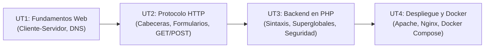

  <h1>🌐 Implantación de Aplicaciones Web (IAW)</h1>
  
El módulo de <strong>IAW</strong> capacita al administrador de sistemas para diseñar, configurar, desplegar y mantener servicios web dinámicos, arquitecturas cliente-servidor (LAMP/LEMP) y contenedores Docker en producción.

## 🗺️ Mapa de Contenidos

El temario oficial se estructura en 4 unidades didácticas progresivas:

---

## 📚 Unidades Didácticas de IAW

<table class="syllabus-table">
  <thead>
    <tr>
      <th>Unidad</th>
      <th>Título del Tema</th>
      <th>Conceptos y Prácticas Principales</th>
      <th>Tipo de Contenido</th>
      <th>Enlace</th>
    </tr>
  </thead>
  <tbody>
    <tr>
      <td><strong>UT1</strong></td>
      <td><strong>Fundamentos Web y Arquitectura Cliente-Servidor</strong></td>
      <td>Cómo funciona la Web, ciclo de petición-respuesta, resolución DNS, estructura de una URL, separación estructura/estilo (HTML5/CSS3) y diferencias entre páginas estáticas y dinámicas.</td>
      <td>Teoría Base</td>
      <td><a class="module-link" href="01-fundamentos-web-arquitectura-cliente-servidor.md">Abrir tema :octicons-arrow-right-16:</a></td>
    </tr>
    <tr>
      <td><strong>UT2</strong></td>
      <td><strong>Protocolo HTTP y Formularios Web</strong></td>
      <td>Estructura interna del mensaje HTTP (línea de petición, cabeceras, códigos de estado 2xx/3xx/4xx/5xx), formularios HTML5, atributos <code>action</code>, <code>method</code> y comparativa exhaustiva entre <code>GET</code> y <code>POST</code>.</td>
      <td>Protocolo + Práctica</td>
      <td><a class="module-link" href="02-protocolo-http-formularios.md">Abrir tema :octicons-arrow-right-16:</a></td>
    </tr>
    <tr>
      <td><strong>UT3</strong></td>
      <td><strong>Programación Backend con PHP</strong></td>
      <td>Fundamentos del lenguaje PHP, arrays indexados y asociativos, variables superglobales (<code>$_GET</code>, <code>$_POST</code>, <code>$_SERVER</code>), control de sesiones y sanitización de datos contra vulnerabilidades XSS (<code>htmlspecialchars</code>).</td>
      <td>Backend PHP</td>
      <td><a class="module-link" href="03-programacion-servidor-php.md">Abrir tema :octicons-arrow-right-16:</a></td>
    </tr>
    <tr>
      <td><strong>UT4</strong></td>
      <td><strong>Despliegue Web y Contenedores Docker</strong></td>
      <td>Arquitecturas LAMP y LEMP, Apache con <code>mod_php</code> frente a <code>php-fpm</code>, orquestación automatizada de servicios multicontenedor con Docker Compose (WordPress + MariaDB) y volúmenes persistentes.</td>
      <td>Docker + Despliegue</td>
      <td><a class="module-link" href="04-despliegue-servidores-web-docker.md">Abrir tema :octicons-arrow-right-16:</a></td>
    </tr>
  </tbody>
</table>

---

## 🛠️ Entorno de Laboratorio Recomendado

- **Sistema Operativo**: Debian 12 / Ubuntu 22.04 / 24.04 LTS.
- **Servidor Web**: Apache2 y PHP 8.x (`libapache2-mod-php` y `php-fpm`).
- **Base de Datos**: MariaDB Server / MySQL.
- **Virtualización Ligera**: Docker Engine y Docker Compose plugin (`docker compose`).
