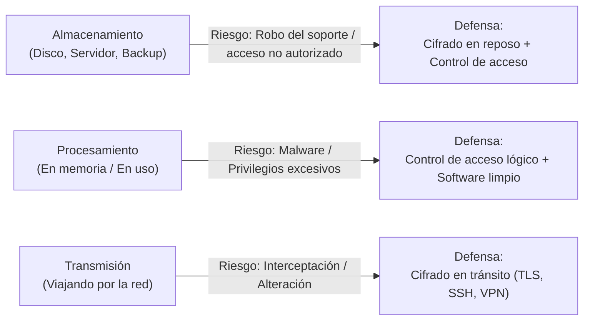
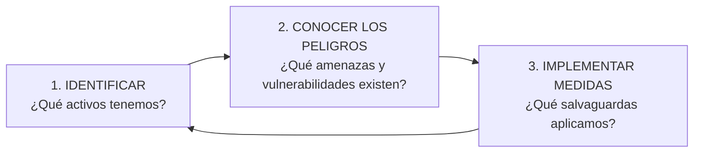
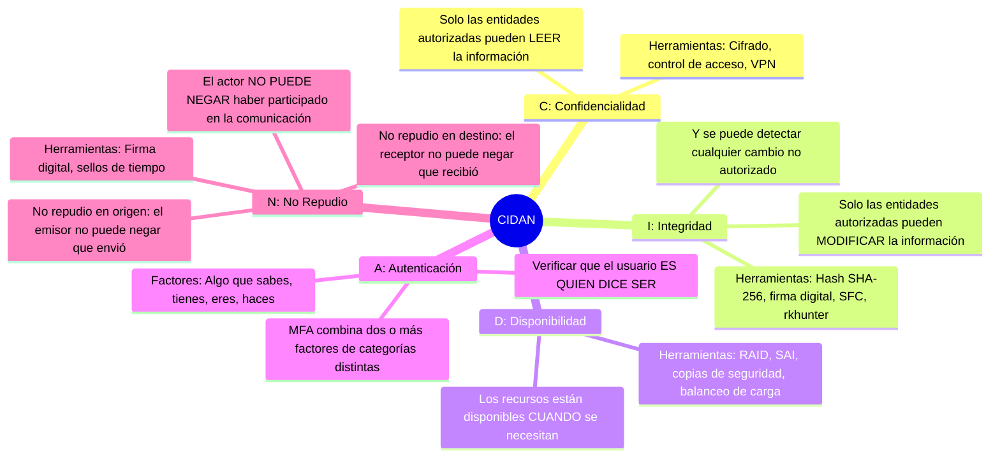
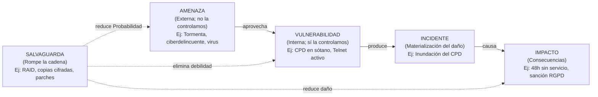
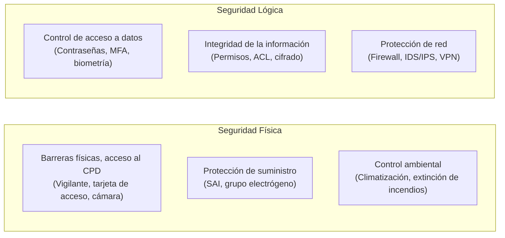

# UT1: Fundamentos de la Seguridad Informática

La seguridad informática no consiste en adquirir productos, sino en comprender y gestionar riesgos de forma continua. Este tema establece el vocabulario y los modelos mentales que estructuran todo el módulo SAD.

---

## 1. ¿Por Qué y Qué Proteger?

Los sistemas informáticos almacenan, procesan y transmiten información de la que hoy depende casi toda actividad profesional y personal. Esta dependencia tiene una cara incómoda: nuestros equipos son potentes y al mismo tiempo frágiles. Un descuido, un robo o un programa malicioso pueden borrar o filtrar en segundos años de trabajo.

### 1.1 Los Tres Momentos del Ciclo de Vida de la Información

La información se protege de forma diferente según en qué fase de su ciclo se encuentre:

> [!NOTE] Analogía del Correo Electrónico
> Cuando consultas el email: los mensajes están cifrados en el servidor (**almacenamiento**), se descifran en tu cliente de correo (**procesamiento**) y viajan protegidos por TLS entre el servidor y tu equipo (**transmisión**). Si descuidas cualquiera de los tres momentos, la cadena se rompe.

### 1.2 Qué Protegemos (Los Activos del Sistema)

| Activo | Amenaza Típica | Medida Principal |
| :--- | :--- | :--- |
| **Hardware / Equipos** | Robo físico, fallo de disco, sabotaje | Cifrado de disco, control de acceso físico, SAI |
| **Aplicaciones (Software)** | Vulnerabilidades, software sin parchear | Instalar solo lo necesario; política de actualizaciones |
| **Datos** | Filtración, ransomware, eliminación | Copias de seguridad cifradas, redundancia (RAID) |
| **Comunicaciones** | Escucha (sniffing), suplantación (MITM) | Cifrado en tránsito (TLS, VPN, SSH) |
| **Personas y Reputación** | Ingeniería social, credenciales robadas | Formación, MFA, política de contraseñas |

### 1.3 El Proceso de Protección es un Ciclo Continuo

> [!IMPORTANT] La seguridad completa no existe
> El objetivo realista no es ser invulnerable, sino maximizar la seguridad dentro de las posibilidades de presupuesto y formación disponibles. Siempre queda un **riesgo residual** aceptable. Como ironizó Eugene Spafford: *"El único sistema totalmente seguro sería uno apagado, desconectado y encerrado bajo llave"*.

---

## 2. Definición de Seguridad Informática

Conviene distinguir dos términos que a menudo se confunden:

- **Seguro**: libre de todo daño, peligro o riesgo → es un ideal inalcanzable para cualquier sistema conectado y en uso.
- **Fiable**: que se comporta tal y como se espera → es medible y mejorable con nuestras decisiones.

La seguridad informática es el **conjunto de medidas y controles que aseguran la confidencialidad, integridad y disponibilidad de los activos** de un sistema de información (hardware, software, firmware y la información que almacenan, procesan y comunican).

---

## 3. Objetivos: El Modelo CIDAN

Todo lo que hacemos en seguridad sirve a uno o varios de los cinco objetivos del modelo **CIDAN**. Son la columna vertebral del módulo: cada medida que estudies (cifrado, RAID, firma digital, cortafuegos...) persigue alguno de ellos.

> [!TIP] ¿Qué objetivo prima en cada entorno?
> - **Militar**: Confidencialidad (que el enemigo no lea).
> - **Servidor de archivos compartido**: Disponibilidad (que el equipo pueda trabajar).
> - **Banca**: Integridad (es más grave que alguien modifique un saldo que solo que lo lea).

---

## 4. Conceptos Clave: Activos, Amenazas, Vulnerabilidades y Riesgo

Este vocabulario es el que se usa en cualquier empresa, auditoría o informe de seguridad:

| Concepto | Definición Precisa |
| :--- | :--- |
| **Activo** | Todo lo que hay que proteger: hardware, software, datos, comunicaciones, personas, reputación. |
| **Amenaza** | Posible causa externa de un incidente. No la controlamos; solo estimamos su probabilidad. |
| **Vulnerabilidad** | Debilidad interna del activo que una amenaza puede explotar. Sí la controlamos: detectarla y corregirla es nuestra tarea. |
| **Incidente** | La materialización de la amenaza: el daño ya ha ocurrido. |
| **Impacto** | Medición del daño: pérdida económica, horas de servicio caído, sanciones, reputación. |
| **Riesgo** | `Riesgo = Probabilidad de la amenaza × Magnitud del impacto` |
| **Salvaguarda** | Medida que reduce el riesgo actuando sobre la probabilidad, la vulnerabilidad o el impacto. |

> [!CAUTION] Distinción Amenaza vs. Vulnerabilidad
> - **Una tormenta** = amenaza (externa, no la controlamos).
> - **Tener el CPD en un sótano inundable** = vulnerabilidad (interna, podemos cambiar la ubicación).

### 4.1 La Matriz de Riesgo

Priorizar por intuición lleva a errores. La matriz de riesgo obliga a usar números:

| Riesgo (P × I) | Nivel |
| :--- | :--- |
| 1 – 6 | 🟢 Bajo |
| 8 – 9 | 🟡 Medio |
| 12 – 16 | 🔴 Alto |

**Ejemplo**: Un instituto con un único servidor sin redundancia. Amenaza: fallo de disco (probabilidad baja → `2`). Vulnerabilidad alta (sin RAID ni copia). Impacto: 24 h sin archivos (`4`). **Riesgo = 2 × 4 = 8 → Medio-Alto**. Salvaguarda: instalar RAID y programar copias.

---

## 5. Seguridad Física vs. Seguridad Lógica

> [!WARNING] No son alternativas, son complementarias
> De nada sirve la contraseña más fuerte del mundo si cualquiera puede entrar a la sala del servidor y llevarse el disco. Y de nada sirven las cámaras de seguridad si las credenciales de administración son `admin/admin`.

---

## 6. Seguridad Activa vs. Seguridad Pasiva

Según cuándo actúan respecto al incidente:

| Criterio | Seguridad **Activa** | Seguridad **Pasiva** |
| :--- | :--- | :--- |
| **Cuándo actúa** | **Antes o durante** el incidente | **Después** del incidente |
| **Objetivo** | Anular o reducir el riesgo | Reducir el impacto una vez ocurrido |
| **Tipo** | Preventiva o Reactiva | Correctiva / Mitigadora |
| **Ejemplos** | Autenticación, política de contraseñas, parcheo de sistemas, IDS/IPS, cortafuegos | SAI, RAID, copias de seguridad, cifrado de disco, planes de continuidad |

> [!NOTE] Analogía del Automóvil
> - **ABS y control de estabilidad** = seguridad activa (evitan el accidente).
> - **Cinturón de seguridad y airbag** = seguridad pasiva (reducen el daño si el accidente ocurre igualmente).

---

## 7. Buenas Prácticas de Administración de Seguridad

Una lista de "higiene" que toda organización debería mantener:

1. **Inventariar activos**: No se puede proteger lo que no se sabe que existe.
2. **Principio de mínimo privilegio**: Dar solo los permisos estrictamente necesarios para cada función.
3. **Instalar solo lo necesario**: Cada programa adicional es una superficie de ataque más.
4. **Gestión de parches**: Activar actualizaciones automáticas y suscribirse a boletines de seguridad de los fabricantes.
5. **Revisar logs con regularidad**: Los registros del sistema (`/var/log/auth.log` en Linux, Visor de Eventos en Windows) revelan intentos de acceso y anomalías.
6. **Política de contraseñas**: Longitud mínima (≥ 12 caracteres), complejidad, caducidad y bloqueo por intentos fallidos.
7. **Formación de usuarios**: El usuario es el eslabón más débil. Debe ver la seguridad como una ayuda, no como un obstáculo.
8. **Auditorías externas** (*Tiger Teams*): Empresas especializadas que atacan nuestros sistemas de forma controlada para revelar los puntos de entrada antes que un atacante real.
9. **Plan ante catástrofes**: Documentar y ensayar procedimientos de recuperación ante distintos escenarios (ataque, desastre natural, arranque parcial de servicios).
10. **Revisar cuentas activas**: Dar de baja inmediatamente los accesos de exempleados.
