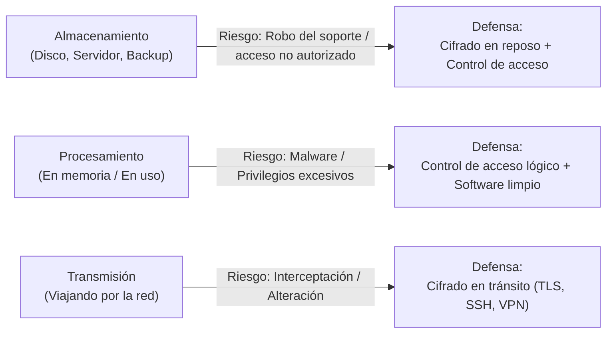
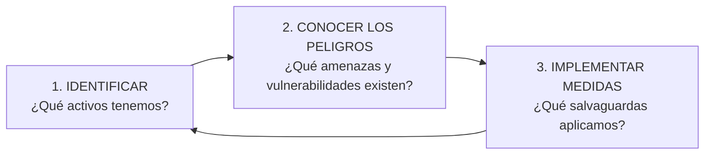
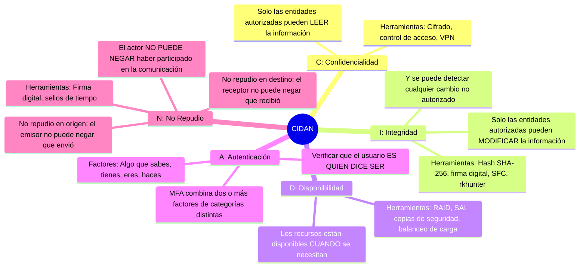
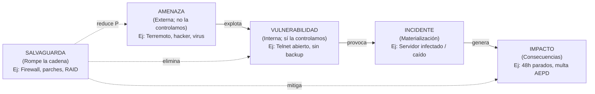
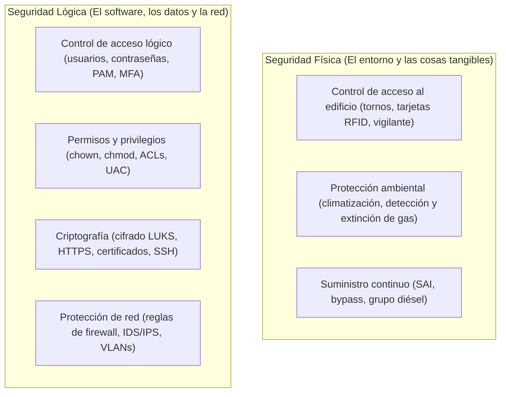

# UT1: Fundamentos de la Seguridad Informática

Teoría Fundamental
Preguntas Típicas de Examen

La seguridad informática no consiste en adquirir productos, sino en comprender y gestionar riesgos de forma continua. Este tema establece el vocabulario y los modelos mentales que estructuran todo el módulo SAD.

---

## 🎯 Objetivos de Estudio de la Unidad

Al finalizar el estudio de esta unidad deberás ser capaz de:

- [x] Diferenciar con precisión entre **Seguro** y **Fiable**.
- [x] Memorizar y justificar con ejemplos los 5 pilares del modelo **CIDAN**.
- [x] Aplicar la fórmula del **Riesgo** ($R = P \times I$) y clasificar activos, amenazas y vulnerabilidades en una auditoría.
- [x] Clasificar medidas en **Física vs Lógica** y en **Activa vs Pasiva** sin dudar ante preguntas trampa de examen.
- [x] Aplicar el principio de **mínimo privilegio** y las 10 buenas prácticas de administración.

---

## 1. ¿Por Qué y Qué Proteger?

Los sistemas informáticos almacenan, procesan y transmiten información de la que hoy depende casi toda actividad profesional y personal. Esta dependencia tiene una cara incómoda: nuestros equipos son potentes y al mismo tiempo frágiles. Un descuido, un robo o un programa malicioso pueden borrar o filtrar en segundos años de trabajo.

### 1.1 Los Tres Momentos del Ciclo de Vida de la Información

La información se protege de forma diferente según en qué fase de su ciclo se encuentre:

> [!NOTE] Analogía del Correo Electrónico
> Cuando consultas el email: los mensajes están cifrados en el servidor (**almacenamiento**), se descifran en tu cliente de correo (**procesamiento**) y viajan protegidos por TLS entre el servidor y tu equipo (**transmisión**). Si descuidas cualquiera de los tres momentos, la cadena se rompe.

### 1.2 Qué Protegemos (Los Activos del Sistema)

| Activo | Amenaza Típica | Medida Principal |
| :--- | :--- | :--- |
| **Hardware / Equipos** | Robo físico, fallo de disco, sabotaje | Cifrado de disco, control de acceso físico, SAI |
| **Aplicaciones (Software)** | Vulnerabilidades, software sin parchear | Instalar solo lo necesario; política de actualizaciones |
| **Datos** | Filtración, ransomware, eliminación | Copias de seguridad cifradas, redundancia (RAID) |
| **Comunicaciones** | Escucha (*sniffing*), suplantación (*MITM*) | Cifrado en tránsito (TLS, VPN, SSH) |
| **Personas y Reputación** | Ingeniería social, credenciales robadas | Formación, MFA, política de contraseñas |

### 1.3 El Proceso de Protección es un Ciclo Continuo

> [!IMPORTANT] La seguridad total o al 100% no existe
> El objetivo realista no es ser invulnerable, sino maximizar la seguridad dentro de las posibilidades de presupuesto y formación disponibles. Siempre queda un **riesgo residual** aceptable. Como ironizó Eugene Spafford: *"El único sistema totalmente seguro sería uno apagado, desconectado y encerrado bajo llave"*.

---

## 2. Definición de Seguridad Informática

Conviene distinguir dos términos que a menudo se confunden en exámenes:

- **Seguro**: libre de todo daño, peligro o riesgo $\rightarrow$ es un ideal inalcanzable para cualquier sistema conectado y en uso.
- **Fiable**: que se comporta tal y como se espera $\rightarrow$ es medible y mejorable con nuestras decisiones de diseño.

La seguridad informática es el **conjunto de medidas y controles que aseguran la confidencialidad, integridad y disponibilidad de los activos** de un sistema de información (hardware, software, firmware y la información que almacenan, procesan y comunican).

---

## 3. Objetivos: El Modelo CIDAN

Clave de Examen

Todo lo que hacemos en seguridad sirve a uno o varios de los cinco objetivos del modelo **CIDAN**:

=== "C — Confidencialidad"
    - **Definición**: La información solo puede ser conocida o leída por personas o procesos autorizados.
    - **Ataque típico**: *Sniffing* de red, filtración de base de datos, robo de portátil sin cifrar.
    - **Salvaguardas**: Cifrado simétrico/asimétrico (LUKS, BitLocker, AES), permisos de ficheros, túneles VPN.

=== "I — Integridad"
    - **Definición**: La información se mantiene exacta, completa y sin modificaciones no autorizadas desde su creación.
    - **Ataque típico**: Man-in-the-Middle (MITM) que altera un paquete bancario, manipulación de logs de auditoría.
    - **Salvaguardas**: Funciones Hash criptográficas (SHA-256), firmas digitales, comprobadores de integridad (`tripwire`, `rkhunter`).

=== "D — Disponibilidad"
    - **Definición**: Los servicios, datos y recursos deben estar accesibles para los usuarios legítimos siempre que los necesiten.
    - **Ataque típico**: Ataques de Denegación de Servicio (DoS / DDoS), caída del suministro eléctrico, fallo de disco duro.
    - **Salvaguardas**: SAIs (*UPS*), grupos electrógenos, matrices RAID, balanceadores de carga, copias de seguridad 3-2-1.

=== "A — Autenticación"
    - **Definición**: Garantizar la certeza de la identidad de quien solicita acceso al sistema.
    - **Ataque típico**: Robo de contraseñas por diccionario, fuerza bruta o *phishing*.
    - **Salvaguardas**: Doble factor MFA (TOTP), certificados digitales, biometría.

=== "N — No Repudio"
    - **Definición**: Imposibilidad de que el emisor niegue haber enviado un mensaje (*no repudio en origen*) o de que el receptor niegue haberlo recibido (*no repudio en destino*).
    - **Ataque típico**: Negar haber autorizado una transferencia o compra en una plataforma web.
    - **Salvaguardas**: Firma digital basada en certificados reconocidos y sellado de tiempo (*Time Stamping*).

> [!TIP] ¿Qué pilar prima según el tipo de organización?
> - **Entorno militar / Inteligencia**: Confidencialidad (evitar filtraciones a toda costa).
> - **Servicios web / E-commerce**: Disponibilidad (cada minuto caído supone miles de euros perdidos).
> - **Entorno bancario / Registros contables**: Integridad (un saldo alterado es inaceptable).

---

## 4. Activos, Amenazas, Vulnerabilidades y Riesgo

| Concepto | Carácter | Definición y Ejemplo |
| :--- | :--- | :--- |
| **Activo** | Interno | Elemento valioso para la organización (datos de clientes, servidor web, reputación). |
| **Amenaza** | **Externo** | Causa potencial de incidente. **No la controlamos**, solo medimos su probabilidad (ej: tormenta, ataque de ransomware). |
| **Vulnerabilidad** | **Interno** | Debilidad o fallo en el sistema que puede ser explotado. **Sí la controlamos** y debemos corregirla (ej: puerto 23 abierto, contraseñas por defecto). |
| **Incidente** | Hecho | Ocurrencia del evento negativo. |
| **Impacto** | Magnitud | Pérdida ocasionada (económica, legal, operativa). |
| **Riesgo** | Cálculo | $$Riesgo = Probabilidad \times Impacto$$ |
| **Salvaguarda** | Control | Mecanismo técnico u organizativo que reduce el riesgo. |

> [!CAUTION] Pregunta clásica de examen: ¿Amenaza o Vulnerabilidad?
> - **"Un empleado abre un adjunto sospechoso"** $\rightarrow$ El correo infectado es la **amenaza**; la falta de concienciación o de filtro antivirus es la **vulnerabilidad**.
> - **"Tener el rack de servidores sin cerradura en el pasillo"** $\rightarrow$ Es una **vulnerabilidad** (debilidad interna).

### 4.1 La Matriz de Riesgo

Para priorizar las inversiones en seguridad se emplea la matriz de riesgo:

| Riesgo ($P \times I$) | Nivel de Riesgo | Acción Requerida |
| :---: | :---: | :--- |
| **1 – 6** | 🟢 **Bajo** | Asumir el riesgo residual o monitorizar periódicamente. |
| **8 – 9** | 🟡 **Medio** | Planificar salvaguardas a corto/medio plazo. |
| **12 – 16** | 🔴 **Alto / Crítico** | Actuación inmediata: mitigar, transferir o suspender el servicio. |

---

## 5. Clasificaciones de la Seguridad

### 5.1 Seguridad Física vs. Lógica

### 5.2 Seguridad Activa vs. Pasiva

Muy Preguntado en Test

| Criterio | Seguridad **Activa** (Preventiva / Reactiva) | Seguridad **Pasiva** (Correctiva / Mitigadora) |
| :--- | :--- | :--- |
| **Momento de acción** | **Antes o durante** el intento de ataque. | **Después** de que el incidente se ha producido. |
| **Finalidad** | **Evitar** que ocurra el daño o neutralizarlo en el acto. | **Minimizar el impacto** y permitir la recuperación del servicio. |
| **Analogía** | Alarma perimetral, antivirus en tiempo real, frenos ABS. | Airbag, extintor de incendios, seguro contra robo. |
| **Ejemplos técnicos** | - Contraseñas robustas y MFA. - Parches y actualizaciones de SO. - Reglas de firewall e IDS/IPS. - Control de acceso por huella dactilar. | - Copias de seguridad periódicas (backups). - Sistemas SAI (*alimentación de emergencia*). - Matrices de discos RAID redundantes. - Planes de recuperación ante desastres (DRP). |

> [!WARNING] Cuidado con el SAI en los exámenes
> Muchos alumnos clasifican el SAI como seguridad activa pensando que "está enchufado y activo". **Es falso**: el SAI es **seguridad pasiva**, porque entra en funcionamiento **cuando el fallo eléctrico ya ha ocurrido**, con el único fin de mitigar el impacto (evitar que el servidor se apague abruptamente).

---

## 6. Buenas Prácticas de Administración de Sistemas

1. **Principio de Mínimo Privilegio**: Nadie debe tener permisos de `root` o administrador para sus tareas diarias comunes.
2. **Inventario exhaustivo de activos**: No se puede defender lo que se ignora que está conectado a la red.
3. **Minimización de superficie de ataque**: Desinstalar servicios, paquetes y puertos no indispensables.
4. **Gestión sistemática de parches**: Automatizar actualizaciones de seguridad y suscribirse a boletines CVE.
5. **Monitorización y análisis de logs**: Centralizar registros en un servidor SIEM y revisar accesos anómalos.
6. **Política de credenciales fuertes**: Longitud mínima ($\ge 12$ caracteres), bloqueo por fuerza bruta y caducidad razonable.
7. **Formación y concienciación continua**: El eslabón humano es el vector principal de la ingeniería social.
8. **Auditorías periódicas (*Hacking ético*)**: Simular ataques controlados para descubrir fallos antes que los cibercriminales.
9. **Copias de seguridad verificadas**: Un backup no probado equivale a no tener backup.
10. **Bajas de usuarios inmediatas**: Desactivar credenciales de empleados en el momento exacto de su desvinculación laboral.

---

## 📝 Chuleta Rápida de Repaso (Flashcard)

| Pregunta rápida | Respuesta directa |
| :--- | :--- |
| ¿Qué significa **CIDAN**? | **C**onfidencialidad, **I**ntegridad, **D**isponibilidad, **A**utenticación, **N**o repudio. |
| ¿Cuál es la fórmula del Riesgo? | $\text{Riesgo} = \text{Probabilidad de la amenaza} \times \text{Impacto del incidente}$. |
| ¿El SAI es activa o pasiva? | **Pasiva** (actúa cuando ya se ha producido el corte eléctrico). |
| ¿El cortafuegos es activo o pasivo? | **Activo** (previene y bloquea conexiones entrantes sospechosas). |
| ¿Qué diferencia a un activo de una vulnerabilidad? | El activo es lo valioso; la vulnerabilidad es la debilidad que tiene ese activo. |

---

## ❓ Test de Autoevaluación

??? question "¿Cuál de los pilares del modelo CIDAN se vulnera si un atacante altera un registro contable sin ser detectado?"
    **Respuesta**: Se vulnera la **Integridad**. La integridad garantiza que los datos no son modificados por terceros no autorizados y que cualquier alteración puede ser detectada fehacientemente (por ejemplo, mediante hashes o firmas).

??? question "Clasifica las siguientes medidas según sean FÍSICA / LÓGICA y ACTIVA / PASIVA: (a) Cerradura biométrica del CPD, (b) Copia de seguridad en NAS externo, (c) Antivirus con análisis en tiempo real."
    **Respuesta**:
    
    - **(a) Cerradura biométrica del CPD**: Seguridad **Física** y **Activa** (impide físicamente la entrada a personas no autorizadas antes de que accedan).
    - **(b) Copia de seguridad en NAS**: Seguridad **Lógica** y **Pasiva** (permite restaurar los datos tras una pérdida o cifrado por ransomware).
    - **(c) Antivirus en tiempo real**: Seguridad **Lógica** y **Activa** (detecta y neutraliza el malware antes o durante su ejecución).

??? question "Una empresa sufre un fallo en el disco duro de su servidor principal. Disponían de un RAID 1, por lo que el sistema siguió funcionando sin interrupción. ¿Qué pilar de la seguridad se protegió y mediante qué tipo de seguridad?"
    **Respuesta**: Se protegió la **Disponibilidad** mediante una medida de seguridad **Pasiva** (el fallo del disco ya se produjo, pero la redundancia mitigó el impacto evitando la parada del servicio).
