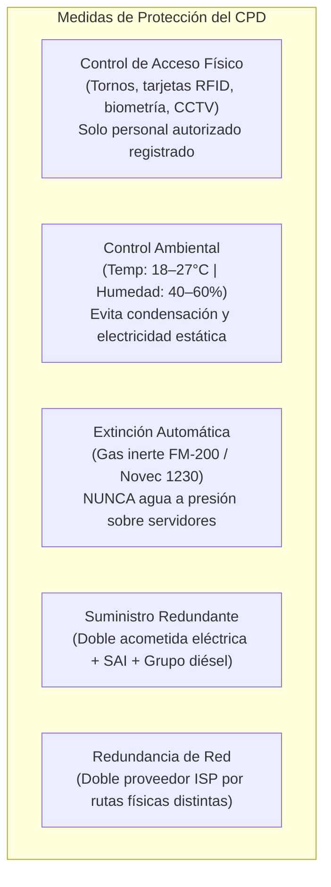
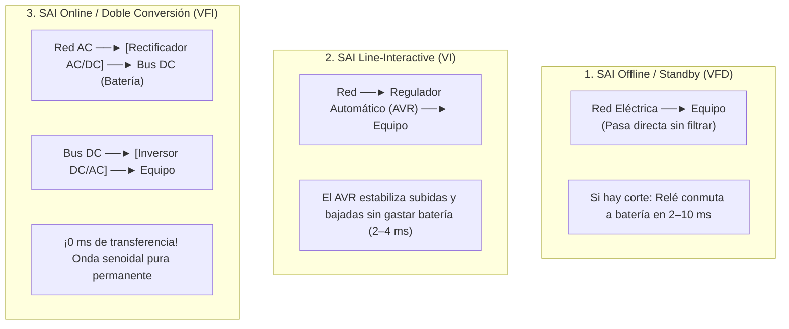
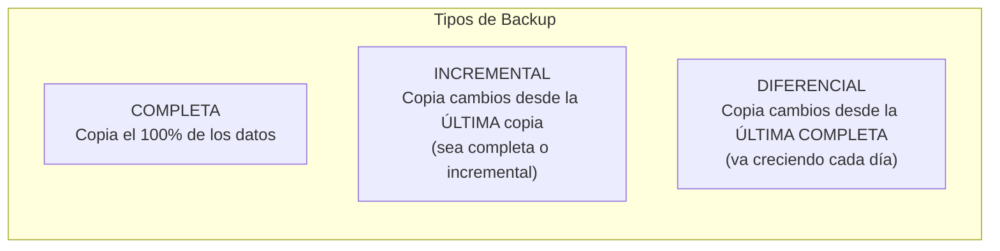

# UT2: Seguridad Física, SAI y Copias de Seguridad

<span class="badge badge-practice">Laboratorio & Cálculo</span>
<span class="badge badge-exam">Preguntas Típicas de Examen</span>

La seguridad física protege los activos materiales del sistema: los equipos, la sala que los alberga, el suministro eléctrico y los soportes donde viven los datos. Sin ella, todas las medidas lógicas quedan en nada si alguien se lleva el disco o arde la sala del servidor.

---

## 🎯 Objetivos de Estudio de la Unidad

Al finalizar el estudio de esta unidad deberás ser capaz de:

- [x] Identificar las condiciones ambientales y medidas de seguridad física de un CPD estándar.
- [x] Comparar las 3 topologías de SAI (**Offline**, **Line-Interactive**, **Online Doble Conversión**) y saber cuál elegir según el equipo.
- [x] Calcular la potencia en Volt-Amperios ($VA$) y Watios ($W$) para dimensionar un SAI aplicando factores de potencia y márgenes de seguridad.
- [x] Diseñar una política de copias de seguridad combinando **Completa**, **Incremental** y **Diferencial**, aplicando la regla de oro **3-2-1**.
- [x] Calcular el espacio útil y la tolerancia a fallos de los niveles de almacenamiento **RAID (0, 1, 5, 6, 10)**.

---

## 1. El Centro de Proceso de Datos (CPD)

El CPD (*Data Center*) es el recinto donde se concentran los servidores, equipos de red y sistemas de almacenamiento de una organización. Su diseño determina la **Disponibilidad** de todos los servicios.



### 1.1 Matriz de Amenazas Físicas y Salvaguardas

| Amenaza Física | Consecuencia | Salvaguarda Obligatoria |
| :--- | :--- | :--- |
| **Inundación / Filtraciones** | Cortocircuito y destrucción | Ubicar el CPD en plantas intermedias; **nunca en sótanos**; suelo técnico elevado con sensores de agua. |
| **Incendio** | Destrucción total | Detectores ópticos de ionización y supresión automática por **gas inerte** (asfixia el fuego sin dañar la electrónica). |
| **Robo / Sabotaje** | Pérdida de confidencialidad | Bastidores (*racks*) cerrados con llave, CCTV 24/7 y registro de accesos. |
| **Picos y cortes eléctricos** | Parada abrupta / daño HW | **SAI (UPS)** + Grupo electrógeno con conmutación automática (*ATS*). |
| **Electricidad estática** | Descargas destructivas | Suelo antiestático y mantener la humedad relativa entre el **40% y el 60%** (si baja del 30% se dispara la estática). |

---

## 2. El SAI (Sistema de Alimentación Ininterrumpida / UPS)

> [!IMPORTANT] Naturaleza del SAI
> El SAI es una salvaguarda de **Seguridad Física y Pasiva**: actúa **tras** producirse la anomalía eléctrica para mitigar el impacto, garantizando la **Disponibilidad** y permitiendo un apagado ordenado o el arranque del grupo electrógeno.

### 2.1 Topologías de SAI: Comparativa Técnica



=== "🟡 SAI Offline (Standby / VFD)"
    - **Cómo funciona**: En condiciones normales alimenta los equipos directamente desde la red eléctrica. Si detecta un corte, activa un relé mecánico que conmuta a la batería.
    - **Tiempo de conmutación**: **2 a 10 ms** (algunos servidores sensibles pueden reiniciarse).
    - **Salida**: Onda pseudo-senoidal o cuadrada.
    - **Uso**: Ordenadores domésticos, impresoras, terminales no críticos.

=== "🟠 SAI Line-Interactive (VI)"
    - **Cómo funciona**: Incorpora un **AVR** (*Automatic Voltage Regulator*). Corrige automáticamente pequeñas subidas (*surges*) o bajadas (*sags*) de tensión modificando las tomas de un autotransformador, sin gastar batería.
    - **Tiempo de conmutación**: **2 a 4 ms**.
    - **Salida**: Onda senoidal aproximada o pura.
    - **Uso**: Estaciones de trabajo de diseño, switches de distribución, servidores de PYME, NAS.

=== "🟢 SAI Online de Doble Conversión (VFI)"
    - **Cómo funciona**: Convierte toda la corriente alterna de la red en continua (AC $\rightarrow$ DC) para alimentar el bus y las baterías, y luego la vuelve a convertir en alterna pura (DC $\rightarrow$ AC) para alimentar la carga.
    - **Tiempo de conmutación**: **0 ms** (la carga ya se está alimentando del inversor en todo momento).
    - **Salida**: Onda **senoidal pura perfecta**, libre de cualquier ruido eléctrico.
    - **Bypass estático**: Si el propio SAI se avería, conmuta instantáneamente a la red directa sin cortar la energía.
    - **Uso**: Servidores de CPD, racks de comunicaciones críticos, quirófanos, industria.

---

### 2.2 Cálculo y Dimensionado de un SAI para Exámenes

<span class="badge badge-exam">Ejercicio Típico de Examen</span>

Para dimensionar un SAI se deben seguir estrictamente 3 pasos:

#### Caso Práctico: Dimensionar el SAI de un Rack
Disponemos de un rack con el siguiente equipamiento:
- 2 Servidores de 400 W cada uno = $800\text{ W}$
- 1 Cabina de discos NAS = $120\text{ W}$
- 2 Switches gestionados de 30 W = $60\text{ W}$
- 1 Router perimetral = $40\text{ W}$

```
Paso 1: Sumar potencia activa real (W)
Potencia total = 800 + 120 + 60 + 40 = 1020 W

Paso 2: Aplicar margen de seguridad y crecimiento futuro (25%)
Potencia con margen = 1020 W × 1,25 = 1275 W

Paso 3: Calcular la Potencia Aparente en Volt-Amperios (VA)
Fórmula: VA = Vatios / Factor de Potencia (FP)
(Tomando FP estándar en equipos informáticos modernos FP = 0,9):
VA = 1275 / 0,9 = 1416,67 VA
```

> [!TIP] Selección Comercial
> Elegiríamos comercialmente un SAI Online de **1500 VA (o 2000 VA)** que garantice al menos **1300 W** de entrega real.

---

## 3. Copias de Seguridad (Backup)

### 3.1 Comparativa de Tipos de Copia



| Tipo de Copia | Velocidad al Copiar | Espacio Requerido | Restauración | Archivos Necesarios para Restaurar |
| :--- | :---: | :---: | :---: | :--- |
| **Completa** | 🐢 Muy lenta | 📦 Muy alto | 🚀 **Muy rápida** | Solo la última copia completa. |
| **Incremental** | 🚀 **Muy rápida** | 📦 **Mínimo** | 🐢 Lenta y delicada | Copia completa + **todas las incrementales** intermedias en orden estricto. Si falla una, se pierde la cadena. |
| **Diferencial** | 🚗 Media | 📦 Moderado | 🚗 Media | Copia completa + **solo la última copia diferencial**. |

---

### 3.2 La Regla de Oro: Estrategia 3-2-1

<span class="badge badge-key">Regla Indispensable</span>

```
   ┌────────────────────────────────────────────────────────┐
   │                       REGLA 3-2-1                      │
   │  3 Copias de los datos (1 original + 2 backups)        │
   │  2 Soportes físicos distintos (ej: SSD local + NAS/LTO)│
   │  1 Copia FUERA del centro físico (Nube o sede remota)  │
   │    └─► REQUISITO: Siempre CIFRADA                      │
   └────────────────────────────────────────────────────────┘
```

> [!CAUTION] Riesgo de ignorar el "1"
> Si tienes la copia original en el servidor y el backup en un NAS dentro de la misma sala, un incendio, una inundación o un robo se llevará ambas copias al mismo tiempo.

---

## 4. Redundancia de Almacenamiento: RAID

RAID (*Redundant Array of Independent Disks*) combina múltiples discos para aportar **tolerancia a fallos** (Disponibilidad), **rendimiento** (velocidad) o ambos.

| Nivel RAID | Nombre | Discos Mínimos | Espacio Útil | Tolerancia a Fallos | Rendimiento |
| :---: | :--- | :---: | :---: | :---: | :---: |
| **RAID 0** | *Striping* (Fraccionamiento) | 2 | $N \times S$ (100%) | ❌ **0 discos** (si uno falla, se pierde TODO) | 🔼 Muy alto (Lectura y Escritura) |
| **RAID 1** | *Mirroring* (Espejo) | 2 | $50\%$ | ✅ **1 disco** por pareja | 🔼 Buena lectura, escritura normal |
| **RAID 5** | Fraccionamiento con paridad distribuida | **3** | $(N - 1) \times S$ | ✅ **1 disco** | 🔼 Alta lectura, escritura moderada por cálculo de paridad |
| **RAID 6** | Fraccionamiento con doble paridad | **4** | $(N - 2) \times S$ | ✅ **2 discos** | 🔼 Excelente lectura, escritura más lenta |
| **RAID 10** | Espejo de franjas (RAID 1+0) | **4** (pares) | $50\%$ | ✅ **1 disco por cada sub-array** en espejo | 🚀 Máximo rendimiento y recuperación rápida |

> [!WARNING] Mantra del Administrador de Sistemas
> **"RAID NO ES UNA COPIA DE SEGURIDAD"**. El RAID protege contra el fallo mecánico de un disco duro. No protege si un usuario borra un archivo por error, si entra un ransomware que cifra la partición o si cae un rayo que quema el chasis entero.

---

## 📝 Chuleta Rápida de Examen (Fórmulas Clave)

| Parámetro | Fórmula |
| :--- | :--- |
| **Cálculo de VA de un SAI** | $\text{VA} = \frac{\text{Watios Totales} \times 1,25}{\text{Factor de Potencia (FP)}}$ |
| **Espacio útil RAID 5** | $\text{Capacidad Útil} = (N - 1) \times \text{Capacidad del disco menor}$ |
| **Espacio útil RAID 6** | $\text{Capacidad Útil} = (N - 2) \times \text{Capacidad del disco menor}$ |
| **Espacio útil RAID 1 / RAID 10** | $\text{Capacidad Útil} = \frac{N \times S}{2}$ ($50\%$ del total de discos) |
| **Restauración con Incrementales** | Completa base + Incremental 1 + Incremental 2 + ... + Incremental $N$ |
| **Restauración con Diferenciales** | Completa base + Última Diferencial |

---

## ❓ Test de Autoevaluación

??? question "¿Por qué en un CPD nunca se debe utilizar agua convencional como agente extintor de incendios?"
    **Respuesta**: Porque el agua convencional es conductora de electricidad (provocaría cortocircuitos masivos y explosiones en equipos encendidos) y destruiría irremediablemente los componentes electrónicos y cabinas de almacenamiento. En su lugar se emplean **gases inertes (FM-200, Novec 1230 o Inergen)**, que extinguen el fuego desplazando el oxígeno o enfriando la reacción química sin dejar residuo ni conducir la corriente.

??? question "Una empresa tiene 4 discos duros de 4 TB cada uno. ¿Qué capacidad útil y qué tolerancia a fallos obtendrá si monta un RAID 5 vs un RAID 6?"
    **Respuesta**:
    
    - **Con RAID 5**: Fórmula $(N - 1) \times S = (4 - 1) \times 4\text{ TB} = \mathbf{12\text{ TB}}$ útiles. Tolera el fallo de **1 solo disco**.
    - **Con RAID 6**: Fórmula $(N - 2) \times S = (4 - 2) \times 4\text{ TB} = \mathbf{8\text{ TB}}$ útiles. Tolera el fallo simultáneo de **hasta 2 discos**.

??? question "¿Qué diferencia fundamental existe entre un SAI Interactivo y un SAI Online en el momento en que se produce un corte en la red eléctrica?"
    **Respuesta**: El **SAI Interactivo** tiene un tiempo de conmutación mecánico de **2 a 4 ms** mientras el relé cambia a la batería. El **SAI Online** tiene **0 ms de tiempo de transferencia**, ya que los servidores se alimentan de forma continua y permanente a través del inversor del SAI; la red solo recarga el bus de corriente continua, por lo que ante un corte no hay conmutación alguna.
