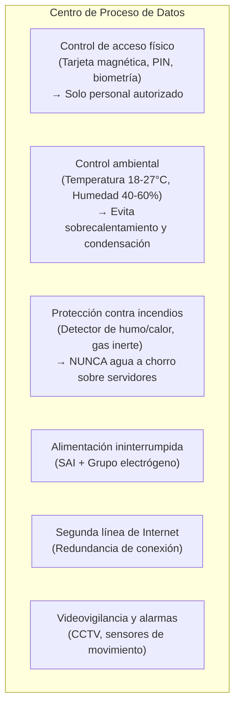
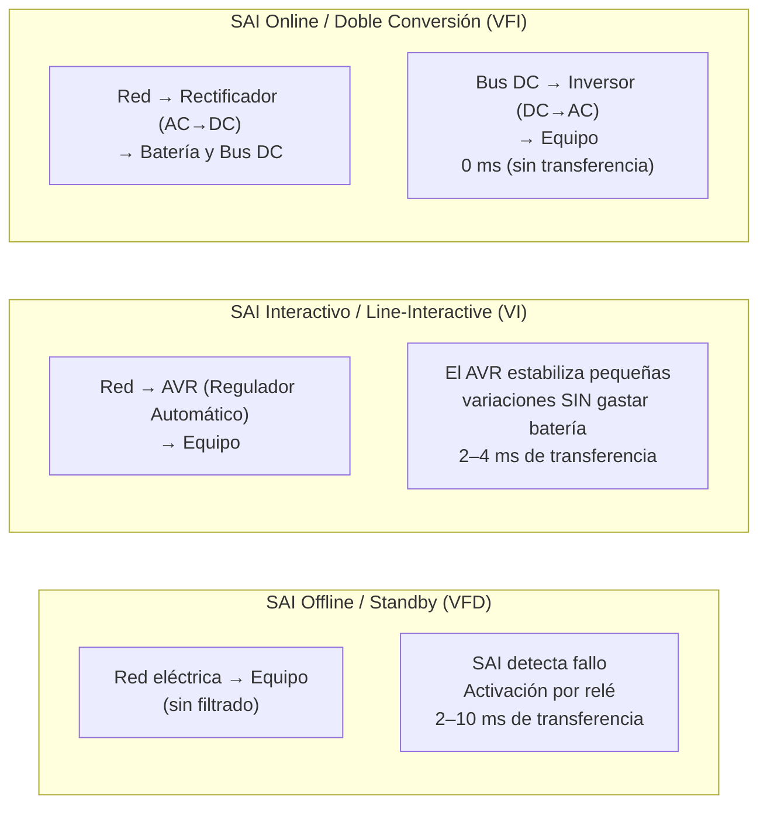
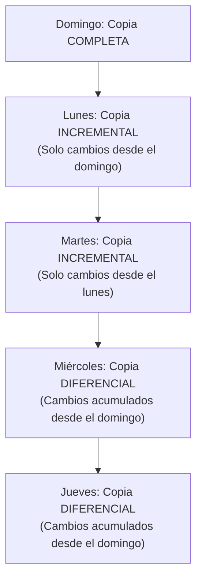

# UT2: Seguridad Física, SAI y Copias de Seguridad

La seguridad física protege los activos materiales del sistema: los equipos, la sala que los alberga, el suministro eléctrico y los soportes donde viven los datos. Sin ella, todas las medidas lógicas quedan en nada si alguien se lleva el disco.

---

## 1. El Centro de Proceso de Datos (CPD)

El CPD es la sala donde se concentran los servidores, los equipos de comunicaciones y los sistemas de almacenamiento de una organización. Su diseño y protección determina la disponibilidad de todos los servicios.

### 1.1 Ubicación y Protección Física



### 1.2 Amenazas Físicas a los Sistemas

| Amenaza | Salvaguarda Recomendada |
| :--- | :--- |
| **Desastres naturales** (inundación, terremoto) | Ubicar el CPD en pisos altos y zonas no sísmicas; nunca en sótanos inundables. |
| **Robo de hardware** | Control de acceso físico multicapa, cámaras CCTV, tornillos de seguridad en bastidores. |
| **Fallos del suministro eléctrico** | SAI para cortes breves; grupo electrógeno para cortes prolongados; segunda línea de red. |
| **Problemas eléctricos** (picos de tensión, ruido) | SAI con regulación de tensión; alimentación estabilizada. |
| **Temperatura y humedad excesivas** | Sistema de climatización de precisión con monitorización y alarmas de temperatura. |
| **Incendios** | Detectores ópticos de humo y calor; extintores de gas inerte (FM-200, Novec); supresión automática. |
| **Interferencias electromagnéticas** | Blindaje adecuado; alejamiento de fuentes de radiación potente (> 5 V/m puede alterar el procesamiento). |

---

## 2. El SAI (Sistema de Alimentación Ininterrumpida)

> **El SAI es la salvaguarda pasiva por excelencia contra los fallos del suministro eléctrico.**

Protege la **Disponibilidad** (la «D» del modelo CIDAN), proporciona tiempo para un apagado ordenado de los equipos o para que arranque el grupo electrógeno.

### 2.1 Tipos de SAI según su Topología

Existen tres tecnologías de SAI, ordenadas de menor a mayor nivel de protección y coste:



#### Comparativa Técnica Detallada

| Característica | 🟡 SAI Offline | 🟠 SAI Interactivo | 🟢 SAI Online |
| :--- | :--- | :--- | :--- |
| **Estabilización de tensión (AVR)** | No | Sí (correcciones moderadas) | Sí (reconstrucción total de la onda) |
| **Tiempo de conmutación a batería** | 2 – 10 ms | 2 – 4 ms | **0 ms** (sin interrupción) |
| **Forma de onda en batería** | Pseudo-senoidal o cuadrada | Senoidal (aproximada o pura) | **Senoidal pura** |
| **Protección frente a la red** | Baja (solo apagones y picos extremos) | Media (apagones + variaciones de tensión) | **Máxima** (aislamiento total) |
| **Bypass automático** | No suele incluir | No suele incluir | Sí (si el SAI falla, la red pasa directo) |
| **Coste** | Bajo | Moderado | Alto |
| **Calor y ruido generados** | Mínimo | Bajo | Moderado (ventilación del inversor continuo) |
| **Aplicación típica** | PCs domésticos, impresoras, routers | Puestos de trabajo, NAS, switches, pymes | Servidores críticos, CPDs, equipos médicos, industriales |

> [!NOTE] ¿Por qué el SAI Online es la mejor opción para servidores?
> Los equipos se alimentan **permanentemente** desde el inversor interno del SAI, que a su vez se nutre del bus de corriente continua cargado por la red eléctrica. Si la red falla, ya no hay nada que "conmutar": la batería ya estaba en el circuito desde el principio. El resultado es **0 ms de interrupción** y una onda senoidal pura sin ningún ruido eléctrico.

### 2.2 Cálculo de la Capacidad Necesaria de un SAI

Para dimensionar correctamente un SAI es necesario conocer el consumo real de los equipos a proteger y aplicar márgenes de seguridad:

#### Paso 1: Calcular el Consumo Total en Vatios (W)
Suma el consumo de cada equipo. Ejemplo de un pequeño servidor rack:

| Equipo | Consumo (W) |
| :--- | :--- |
| Servidor principal | 350 W |
| Switch gestionado | 40 W |
| NAS (almacenamiento) | 60 W |
| Monitor de administración | 25 W |
| **Total real** | **475 W** |

#### Paso 2: Añadir Margen de Crecimiento (20–30 %)
`475 W × 1,25 = 594 W` (con margen del 25%)

#### Paso 3: Convertir a Volt-Amperios (VA)

$$VA = \frac{W}{FP}$$

Donde **FP** es el Factor de Potencia (en SAI modernos, `FP ≈ 0,9` a `1`):

$$VA = \frac{594}{0,9} \approx 660\ VA$$

> [!TIP] Regla práctica
> Para equipos de TI modernos, se suele tomar `FP = 0,9`. Si el SAI tiene marcado `600 VA / 540 W`, los 540 W reales que puede entregar son los que cuentan para nuestro cálculo, no los VA.

#### Autonomía
La duración de la batería depende inversamente de la carga conectada: cuanta más carga, menor autonomía. Se expresa en minutos y es un valor fundamental para garantizar el tiempo de apagado controlado o el arranque del grupo electrógeno.

---

## 3. Copias de Seguridad (Backup)

La copia de seguridad es la salvaguarda pasiva fundamental para garantizar la **recuperación de datos** tras un incidente. Los datos son el activo más valioso; si desaparecen, la organización se paraliza.

### 3.1 Tipos de Copia de Seguridad



| Tipo | Qué Copia | Tiempo de Copia | Espacio | Tiempo de Restauración |
| :--- | :--- | :--- | :--- | :--- |
| **Completa** | Todo, siempre | Lenta | Mucho | **Rápida** (todo en un sitio) |
| **Incremental** | Solo lo que cambió desde la **última copia** (sea del tipo que sea) | Muy rápida | Poco | **Lenta** (necesita completa + todas las incrementales en orden) |
| **Diferencial** | Todo lo que cambió desde la **última copia completa** | Media | Crece progresivamente | **Media** (necesita completa + última diferencial) |

**Ejemplo práctico de restauración**: Esquema completa el domingo + incrementales de lunes a sábado. El disco muere el jueves:
- Con **incrementales**: Restaurar completa (domingo) + incremental del lunes + del martes + del miércoles → 4 cintas/archivos.
- Con **diferenciales**: Restaurar completa (domingo) + diferencial del miércoles → solo 2 archivos, pero el miércoles ocupa más que las tres incrementales juntas.

### 3.2 La Regla 3-2-1

La regla de oro de las copias de seguridad en cualquier organización seria:

```
3 copias de los datos
2 soportes físicos distintos (disco local + cinta / NAS externo)
1 copia fuera de las instalaciones (nube, caja fuerte bancaria) → Y CIFRADA
```

> [!CAUTION] Sin la copia externa, un incendio o robo en el CPD destruye los datos y todas sus copias a la vez.

### 3.3 Ubicaciones y Medios de Almacenamiento

| Tipo de Almacenamiento | Ventajas | Desventajas |
| :--- | :--- | :--- |
| **Disco duro externo / NAS local** | Acceso rápido, alta capacidad, bajo coste/GB | Vulnerable a incendio o robo en el mismo espacio físico |
| **Cinta magnética (LTO)** | Enorme capacidad, bajo coste, duradera (30+ años) | Lenta de acceso; requiere lectora especial |
| **Nube (AWS S3, Azure Blob, Backblaze)** | Externalización del riesgo físico; acceso remoto | Dependencia de red; costes recurrentes; privacidad de datos |
| **Disco óptico (Blu-ray archivado)** | Muy durable si se almacena correctamente | Capacidad limitada; obsolescencia de lectoras |

---

## 4. Redundancia de Almacenamiento: RAID

**RAID** (*Redundant Array of Independent Disks*) es una tecnología que combina varios discos físicos en un único volumen lógico para mejorar la **disponibilidad** (tolerancia a fallos) o el **rendimiento** (o ambos):

| Nivel | Nombre | Discos Mínimos | Tolerancia a Fallos | Rendimiento | Uso Típico |
| :--- | :--- | :--- | :--- | :--- | :--- |
| **RAID 0** | Striping | 2 | ❌ Ninguna (si falla uno, todo se pierde) | 🔼 Lectura/Escritura muy alta | Edición de vídeo; datos NO críticos |
| **RAID 1** | Mirroring | 2 | ✅ 1 disco | ➡ Escritura igual; lectura mejorada | Servidores de base de datos |
| **RAID 5** | Striping con paridad distribuida | 3 | ✅ 1 disco | 🔼 Buena lectura | Servidores de archivos empresariales |
| **RAID 6** | Striping con doble paridad | 4 | ✅ 2 discos | 🔽 Escritura más lenta | CPDs de alta disponibilidad |
| **RAID 10** | Mirroring + Striping | 4 | ✅ 1 disco por par | 🔼 Lectura/Escritura muy alta | Bases de datos críticas y servidores de alto rendimiento |

> [!WARNING] RAID no es un sustituto de las copias de seguridad
> RAID protege contra el **fallo físico de un disco**, pero no contra un borrado accidental, un ransomware que cifra los datos, un incendio que destruye todos los discos del array, ni un ataque que corrompa la información. La regla 3-2-1 sigue siendo obligatoria aunque se disponga de RAID.
