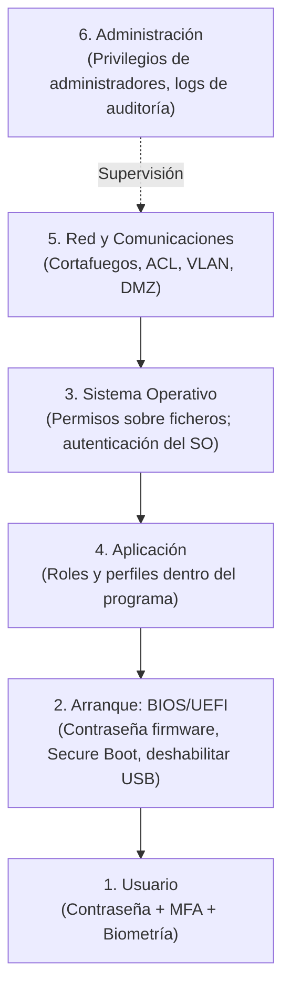
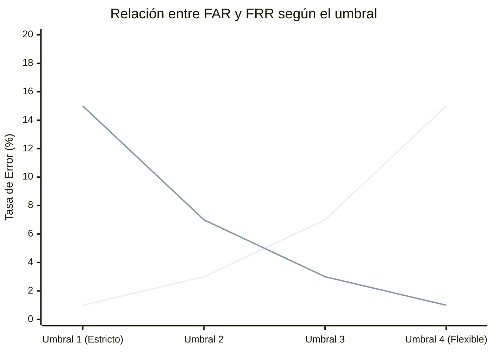
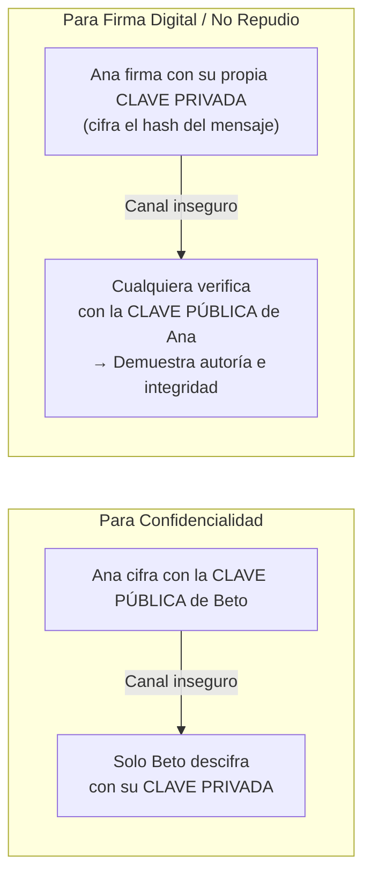
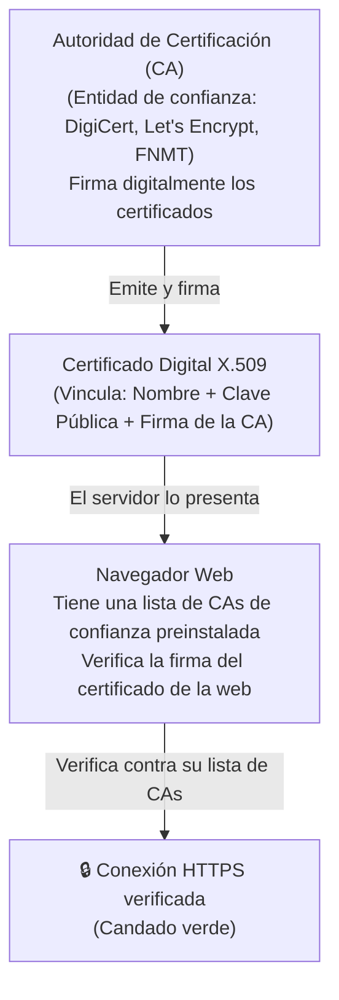

# UT3: Control de Acceso, Criptografía y PKI

El control de acceso y la criptografía son los pilares técnicos de tres objetivos del modelo CIDAN: **Confidencialidad**, **Integridad** y **No Repudio**. Esta unidad los estudia de lo más concreto (contraseñas y biometría) a lo más abstracto (firma digital y PKI).

---

## 1. Control de Acceso Lógico por Capas (Defensa en Profundidad)

El control de acceso lógico no es una única barrera, sino una **serie de capas concéntricas** que un atacante debe superar consecutivamente:



> [!NOTE] La defensa en profundidad
> Quien supera un nivel todavía tiene más capas por delante. Esto contiene el movimiento lateral de un atacante que consigue comprometer un punto del sistema.

---

## 2. Autenticación: Contraseñas y Factores

### 2.1 Ataques contra Contraseñas

| Tipo de Ataque | Cómo Funciona | Defensa |
| :--- | :--- | :--- |
| **Fuerza bruta** | Probar sistemáticamente todas las combinaciones posibles. | Bloqueo de cuenta tras N intentos; contraseñas largas |
| **Diccionario** | Probar palabras reales y variaciones habituales (`Madrid2024`). | Exigir complejidad; prohibir palabras del diccionario |
| **Phishing de credenciales** | Engañar al usuario para que las escriba en un sitio falso. | MFA; verificar URL antes de introducir credenciales |

### 2.2 Características de una Contraseña Robusta

- **Longitud suficiente**: mínimo 12 caracteres (preferiblemente 16+). Cada carácter añadido multiplica exponencialmente el tiempo de fuerza bruta.
- **Combinación de caracteres**: mayúsculas, minúsculas, dígitos y símbolos (`!@#$%^&*`).
- **Sin secuencias ni palabras de diccionario**: evitar `qwerty`, `123456`, nombres propios o fechas.
- **Única por servicio**: nunca reutilizar contraseñas entre cuentas.
- **Caducidad periódica**: establecida por política, forzada por el sistema.

```bash
# Linux: Configurar complejidad de contraseñas con PAM
# Archivo: /etc/security/pwquality.conf
minlen = 12          # Longitud mínima
minclass = 3         # Al menos 3 tipos de caracteres (may, min, dig, sym)
maxrepeat = 2        # No más de 2 caracteres repetidos consecutivos

# Configurar caducidad con chage
sudo chage -M 90 usuario    # La contraseña caduca en 90 días
sudo chage -l usuario       # Ver configuración de expiración

# Bloqueo por intentos fallidos (pam_faillock)
# /etc/security/faillock.conf
deny = 5          # Bloquear tras 5 intentos fallidos
unlock_time = 300 # Desbloquear automáticamente tras 300 segundos (5 min)
```

```powershell
# Windows: Política de contraseñas via Directivas de Seguridad Local
# secpol.msc → Directivas de cuenta → Directiva de contraseñas
# Longitud mínima: 12 caracteres
# Vigencia máxima: 90 días
# Bloqueo de cuenta: 5 intentos → bloqueo durante 30 minutos

# Comprobar intentos fallidos en el Visor de Eventos:
# Evento 4625 = Inicio de sesión fallido
# Evento 4624 = Inicio de sesión correcto
Get-WinEvent -FilterHashtable @{LogName='Security'; Id=4625} | Select-Object -First 10
```

### 2.3 Autenticación Multifactor (MFA / 2FA)

Combinar **factores de categorías distintas** para que el robo de uno no sea suficiente:

| Factor | Categoría | Ejemplos |
| :--- | :--- | :--- |
| **Algo que sabes** | Conocimiento | Contraseña, PIN, pregunta de seguridad |
| **Algo que tienes** | Posesión | Token OTP (Google Authenticator), tarjeta inteligente, llave de seguridad FIDO2 |
| **Algo que eres** | Inherencia (biometría) | Huella dactilar, reconocimiento facial, iris |
| **Algo que haces** | Comportamiento | Patrón de escritura, firma manuscrita, dinámica de tecleo |

> [!TIP] Por qué MFA es la medida más efectiva por esfuerzo invertido
> Si un atacante roba la contraseña (algo que sabes), seguirá bloqueado si la cuenta exige también el teléfono del usuario (algo que tienes). Las credenciales filtradas en bases de datos de *breachers* son inútiles si el sistema usa MFA.

---

## 3. Sistemas Biométricos

### 3.1 Tipos de Biometría

- **Biometría fisiológica** (*lo que eres*): huella dactilar, geometría facial, iris, geometría de la mano, voz.
- **Biometría conductual** (*cómo haces algo*): firma manuscrita, dinámica de tecleo, patrón de marcha.

### 3.2 Métricas de Evaluación: FAR y FRR



| Métrica | Nombre Completo | Qué Mide | Consecuencia de ser Alta |
| :--- | :--- | :--- | :--- |
| **FAR** | *False Acceptance Rate* | Frecuencia con que el sistema acepta a un **impostor** | Brecha de seguridad |
| **FRR** | *False Rejection Rate* | Frecuencia con que el sistema rechaza a un **usuario legítimo** | Frustración y pérdida de productividad |

> [!CAUTION] Las biométricas no son la panacea
> - **No son revocables**: si te roban una contraseña, la cambias; tu huella dactilar es permanente. Una filtración biométrica es para siempre.
> - **Son vulnerables a suplantación (*spoofing*)**: fotografías, moldes de silicona, voz sintética con IA.
> - **RGPD (Art. 9)**: Los datos biométricos usados para identificar a una persona son **datos especialmente protegidos**. Su tratamiento está prohibido en general, salvo excepciones como el consentimiento explícito.

---

## 4. Listas de Control de Acceso (ACL)

Una **ACL** (*Access Control List*) es una lista de reglas que define qué **sujetos** pueden realizar qué **acciones** sobre qué **recursos**:

```
SUJETO (usuario/grupo/IP)  +  RECURSO (fichero/puerto/BD)  +  ACCIÓN (leer/escribir/ejecutar)
```

```bash
# ACL en Linux (Sistema de Ficheros)
# Ver ACL de un directorio:
getfacl /srv/proyectos

# Dar permiso de lectura al grupo "auditores" sin cambiar los permisos estándar UNIX:
setfacl -m g:auditores:r /srv/proyectos/confidencial

# Regla de red en UFW (cortafuegos):
sudo ufw allow from 192.168.1.0/24 to any port 22 proto tcp   # SSH solo desde LAN interna
sudo ufw deny from any to any port 23 proto tcp                # Bloquear Telnet a todos
```

---

## 5. Criptografía Aplicada

La criptografía es la base técnica de tres objetivos del CIDAN: **Confidencialidad** (cifrado), **Integridad** (hash) y **No Repudio** (firma digital).

### 5.1 Cifrado Simétrico

Emisor y receptor comparten la **misma clave secreta** para cifrar y descifrar:

```
Texto claro ──[Cifrar con CLAVE K]──► Texto cifrado ──[Descifrar con CLAVE K]──► Texto claro
```

- **Algoritmo de referencia**: AES (Advanced Encryption Standard) — estándar del NIST, ampliamente usado.
- **Ventaja**: Muy rápido; ideal para grandes volúmenes de datos.
- **Problema crítico**: ¿Cómo intercambiar la clave K por un canal seguro sin que nadie la intercepte?

### 5.2 Cifrado Asimétrico (Clave Pública / Clave Privada)

Resuelve el problema del intercambio de clave. Cada usuario tiene **un par de claves matemáticamente vinculadas**:



- **Algoritmos de referencia**: RSA, ECC (Elliptic Curve Cryptography).
- **Desventaja**: Lento; no se usa para cifrar archivos grandes directamente.

### 5.3 Esquema Híbrido (Lo Que Usa TLS en la Práctica)

TLS (el protocolo detrás de HTTPS) combina lo mejor de los dos mundos:

1. **Fase de apretón de manos (asimétrico)**: El cliente y el servidor usan criptografía asimétrica para acordar de forma segura una clave de sesión aleatoria (K).
2. **Fase de datos (simétrico)**: Con la clave de sesión K acordada, toda la comunicación posterior se cifra simétricamente con AES, que es mucho más rápido.

### 5.4 Funciones Hash e Integridad

Una función *hash* (o función resumen) transforma datos de cualquier tamaño en una **huella de longitud fija e irreversible**:

| Propiedad | Descripción |
| :--- | :--- |
| **Determinismo** | El mismo dato produce siempre el mismo hash. |
| **Efecto avalancha** | Cambiar un solo bit del dato produce un hash completamente diferente. |
| **No reversibilidad** | No se puede reconstruir el dato original a partir del hash. |
| **Libre de colisiones** | (Ideal) Dos datos distintos no producen el mismo hash. |

```bash
# Verificar la integridad de una descarga ISO con SHA-256
sha256sum debian-12.9.0-amd64-netinst.iso
# Comparar con el hash publicado en la web oficial de Debian

# Linux: verificar integridad de archivos del sistema
rkhunter --propupd    # Crear base de huellas con el sistema limpio (¡hacer tras instalación!)
rkhunter --check      # Analizar; comparar con la base de referencia

# Windows: Verificar archivos del sistema
sfc /scannow          # System File Checker
```

### 5.5 Firma Digital, Certificados y PKI

La **firma digital** combina el hash y el cifrado asimétrico para proporcionar a la vez:
- ✅ **Integridad**: Si el documento cambia, el hash no coincide al verificar.
- ✅ **Autenticación**: Solo el firmante tiene su clave privada.
- ✅ **No repudio**: No puede negar que firmó.

```
1. Se calcula: Hash(documento) = H
2. Se firma:   Firma = Cifrar(H, Clave_Privada_Firmante)
3. Para verificar: Descifrar(Firma, Clave_Pública_Firmante) debe coincidir con Hash(documento_recibido)
```

#### Infraestructura de Clave Pública (PKI) y Certificados Digitales

**El problema de confianza**: ¿Cómo sé que la clave pública que he recibido es realmente de quien dice ser y no de un atacante en un *Man-in-the-Middle*?



---

## 6. Cifrado en Reposo y en Tránsito

| Escenario | Herramientas Principales | Protege contra |
| :--- | :--- | :--- |
| **Reposo (datos guardados)** | BitLocker (Windows), LUKS/dm-crypt (Linux), eCryptfs, GnuPG | Robo del disco o del servidor físico |
| **Tránsito (datos en movimiento)** | TLS/HTTPS, SSH, VPN (OpenVPN, WireGuard, IPSec) | Interceptación (*sniffing*), alteración (*MITM*) |

```bash
# Linux: Cifrar un disco/partición completo con LUKS
cryptsetup luksFormat /dev/sdb              # Formatear como contenedor LUKS
cryptsetup open /dev/sdb disco_cifrado      # Abrir y mapear como dispositivo
mkfs.ext4 /dev/mapper/disco_cifrado         # Crear sistema de ficheros encima
mount /dev/mapper/disco_cifrado /mnt/datos  # Montar

# Generar par de claves RSA para SSH (autenticación sin contraseña)
ssh-keygen -t ed25519 -C "admin@empresa.local"
ssh-copy-id usuario@servidor.empresa.local  # Instalar clave pública en el servidor
```

> [!IMPORTANT] Reposo y tránsito son dos problemas distintos
> - Cifrar el disco no protege los datos mientras viajan por la red.
> - Cifrar el canal (TLS/VPN) no protege lo que queda guardado en el servidor si alguien accede localmente.
> - Un sistema bien protegido aplica **ambos** sin excepción.
