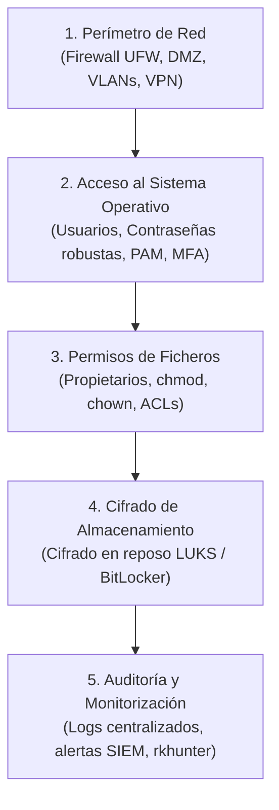
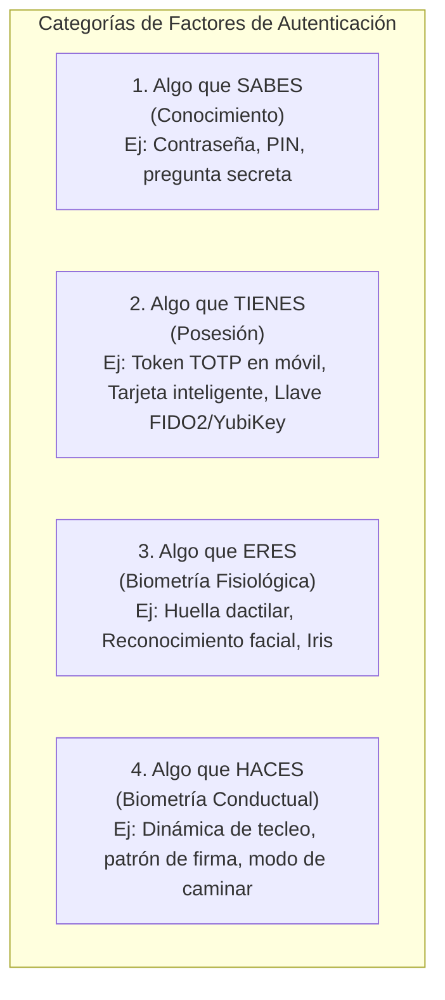
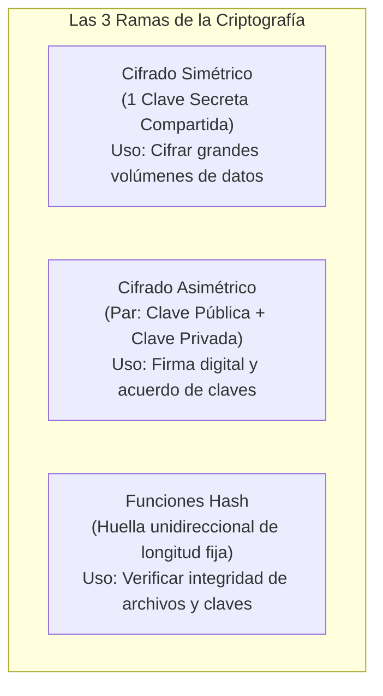
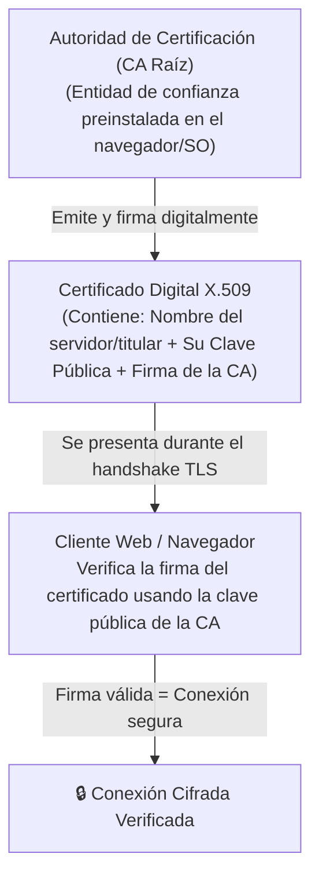
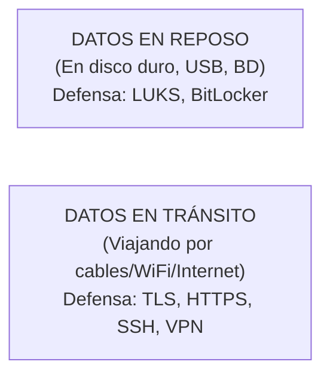

# UT3: Control de Acceso, Criptografía y PKI

<span class="badge badge-key">Criptografía Fundamental</span>
<span class="badge badge-exam">Preguntas Típicas de Examen</span>

El control de acceso y la criptografía son los motores técnicos de tres pilares del modelo CIDAN: **Confidencialidad**, **Integridad** y **No Repudio**. Esta unidad te enseña desde los métodos de autenticación cotidiana (contraseñas, MFA y biometría) hasta la infraestructura de clave pública (PKI, TLS, firmas digitales y cifrado de discos).

---

## 🎯 Objetivos de Estudio de la Unidad

Al finalizar el estudio de esta unidad deberás ser capaz de:

- [x] Explicar el principio de **Defensa en Profundidad** y ordenar sus capas de seguridad lógica.
- [x] Configurar directivas de contraseñas robustas en Linux (`pwquality`, `pam_faillock`) y Windows (`secpol.msc`).
- [x] Clasificar los factores de autenticación (**MFA**) según su categoría (sabes, tienes, eres, haces).
- [x] Entender las tasas de error biométricas (**FAR** y **FRR**) y su impacto en la seguridad vs usabilidad.
- [x] Diferenciar sin dudar entre **Cifrado Simétrico (AES)**, **Asimétrico (RSA/ECC)** y **Funciones Hash (SHA-256)**.
- [x] Describir el funcionamiento de una **Firma Digital** y una jerarquía de certificación **PKI**.
- [x] Aplicar cifrado en **reposo** (LUKS, BitLocker) y en **tránsito** (TLS, SSH, VPN).

---

## 1. Defensa en Profundidad (Control por Capas)

El control de acceso lógico no consiste en una única puerta blindada, sino en una **sucesión de anillos concéntricos**. Si un atacante supera una barrera, la siguiente capa debe frenar su avance:



---

## 2. Autenticación y Factores (MFA)

### 2.1 Tipos de Ataques contra Contraseñas

| Tipo de Ataque | Mecánica | Contramedida Técnica Principal |
| :--- | :--- | :--- |
| **Fuerza Bruta** | Prueba matemática de todas las combinaciones posibles ($A-Z, a-z, 0-9, \text{símbolos}$). | Bloqueo temporal tras $N$ intentos fallidos (`pam_faillock`) y longitud $\ge 12$ caracteres. |
| **Diccionario** | Prueba listas de palabras comunes, contraseñas filtradas y variaciones (`Password123!`). | Prohibir términos comunes (`pwquality.conf`) y verificar diccionarios de brechas. |
| **Phishing** | Suplantación visual de portales para robar credenciales. | **Autenticación Multifactor (MFA)**: tener la contraseña ya no basta para entrar. |

---

### 2.2 Los 4 Factores de Autenticación (MFA / 2FA)

<span class="badge badge-exam">Clasificación Muy Preguntada</span>

Para que un sistema sea **MFA legítimo**, debe combinar factores de **al menos dos categorías distintas**:



> [!WARNING] Pregunta Trampa de Examen sobre 2FA
> Si un sistema te pide **una contraseña** y luego **un PIN numérico**, ¿es doble factor (2FA)?
> **NO**. Ambos pertenecen a la misma categoría (*algo que sabes*). Para ser 2FA real debe exigir, por ejemplo, contraseña (*algo que sabes*) + código generado en el móvil (*algo que tienes*).

---

### 2.3 Implementación Práctica: Configuración en Linux y Windows

=== "🐧 Linux (PAM y Chage)"
    ```bash
    # 1. Configurar complejidad obligatoria de contraseñas
    # Editar /etc/security/pwquality.conf:
    minlen = 12          # Longitud mínima de 12 caracteres
    minclass = 3         # Exigir al menos 3 clases (mayúsculas, minúsculas, dígitos, símbolos)
    maxrepeat = 2        # Máximo 2 caracteres idénticos seguidos

    # 2. Configurar bloqueo por intentos fallidos
    # En /etc/security/faillock.conf:
    deny = 5             # Bloquear al 5º fallo consecutivo
    unlock_time = 600    # Bloqueo durante 10 minutos (600 segundos)

    # 3. Forzar caducidad y cambio periódico con chage:
    sudo chage -M 90 -W 7 usuario  # Caduca a los 90 días, avisa 7 días antes
    sudo chage -d 0 usuario        # Obliga a cambiarla en el próximo inicio de sesión
    ```

=== "🪟 Windows Server (GPO y PowerShell)"
    ```powershell
    # Configuración mediante secpol.msc (Directiva de Seguridad Local):
    # Directivas de cuenta -> Directiva de contraseñas:
    # - Longitud mínima: 12 caracteres
    # - La contraseña debe cumplir requisitos de complejidad: Habilitada
    # - Vigencia máxima: 90 días

    # Directivas de bloqueo de cuenta:
    # - Umbral de bloqueo: 5 intentos incorrectos
    # - Duración del bloqueo: 15 minutos

    # Auditar intentos de acceso fallidos mediante Visor de Eventos / PowerShell:
    Get-WinEvent -FilterHashtable @{LogName='Security'; Id=4625} | Select-Object TimeCreated, Message -First 5
    ```

---

## 3. Biometría: Tasas de Error FAR y FRR

Los sistemas biométricos no son binarios (sí/no exacto), sino que calculan un porcentaje de similitud estadística:

| Métrica | Nombre | Definición | Impacto si es alta |
| :--- | :--- | :--- | :--- |
| **FAR** | *False Acceptance Rate* (Tasa de Falsa Aceptación) | Porcentaje de veces que el sistema deja pasar a un **impostor**. | 🔴 **Fallo Crítico de Seguridad** (acceso no autorizado). |
| **FRR** | *False Rejection Rate* (Tasa de Falso Rechazo) | Porcentaje de veces que el sistema bloquea a un **usuario legítimo**. | 🟡 **Problema de Usabilidad** (molestias al usuario). |

> [!TIP] Punto de Cruce (EER - Equal Error Rate)
> El punto donde la curva de FAR y la curva de FRR se cruzan se denomina **EER**. Cuanto más bajo sea el EER de un dispositivo biométrico, **mayor es su calidad y precisión global**.

---

## 4. Criptografía: Simétrica vs Asimétrica vs Hash

<span class="badge badge-exam">Tabla Comparativa Clave</span>



| Criterio | Cifrado Simétrico | Cifrado Asimétrico | Funciones Hash |
| :--- | :--- | :--- | :--- |
| **Número de claves** | **1 sola clave** (secreta para cifrar y descifrar). | **2 claves vinculadas** (Pública para todos, Privada solo tuya). | **0 claves** (cálculo matemático matemático determinista). |
| **Velocidad** | 🚀 **Muy rápido**. | 🐢 **Muy lento y pesado**. | 🚀 Extremadamente rápido. |
| **Algoritmos típicos** | **AES** (128/256 bits), ChaCha20, 3DES (obsoleto). | **RSA** (2048/4096 bits), ECC (Curvas Elípticas). | **SHA-256**, SHA-3, MD5/SHA-1 (rotos/inseguros). |
| **Objetivo CIDAN** | **Confidencialidad** masiva (discos, túneles VPN). | **No repudio**, autenticación y cifrado de claves. | **Integridad** (detección de cambios). |

---

## 5. El Mecanismo de la Firma Digital y PKI

### 5.1 ¿Cómo se genera y cómo se comprueba una Firma Digital?

La firma digital resuelve a la vez la **Integridad**, la **Autenticación** y el **No Repudio**:

```
PASO 1: GENERACIÓN DE LA FIRMA (Por el emisor con su CLAVE PRIVADA)
Documento Original ──► [Algoritmo SHA-256] ──► Hash H1
Hash H1 + CLAVE PRIVADA DEL EMISOR ──► [Cifrado Asimétrico] ──► FIRMA DIGITAL

PASO 2: VERIFICACIÓN DE LA FIRMA (Por el receptor con la CLAVE PÚBLICA del emisor)
Firma Digital + CLAVE PÚBLICA DEL EMISOR ──► [Descifrado] ──► Hash Obtenido H1
Documento Recibido ──► [Algoritmo SHA-256] ──► Hash Calculado H2

¿H1 == H2?
├── SÍ: El documento es auténtico y NO ha sido alterado ✅
└── NO: El documento fue modificado en el camino o la firma no es legítima ❌
```

---

### 5.2 Jerarquía de Certificados Digitales (PKI)

¿Cómo sabe el receptor que la clave pública de Ana pertenece realmente a Ana y no a un atacante intermediario (*MITM*)?

Para resolverlo interviene una **Autoridad de Certificación (CA)** de confianza reconocida (como FNMT, DigiCert o Let's Encrypt):



---

## 6. Cifrado en Reposo y en Tránsito: Laboratorio



### Laboratorio Práctico con Comandos

=== "🔒 Cifrado de Discos con LUKS (Linux)"
    ```bash
    # 1. Instalar herramientas
    sudo apt install cryptsetup -y

    # 2. Formatear la partición con el formato cifrado estándar LUKS
    sudo cryptsetup luksFormat /dev/sdb1

    # 3. Abrir la partición cifrada (solicitará la contraseña maestra)
    sudo cryptsetup open /dev/sdb1 datos_seguros

    # 4. Crear sistema de archivos ext4 sobre el dispositivo descifrado virtual
    sudo mkfs.ext4 /dev/mapper/datos_seguros

    # 5. Montar en un directorio para trabajar normalmente
    sudo mkdir -p /mnt/privado
    sudo mount /dev/mapper/datos_seguros /mnt/privado

    # 6. Al terminar: desmontar y cerrar el contenedor seguro
    sudo umount /mnt/privado
    sudo cryptsetup close datos_seguros
    ```

=== "🌐 Comprobación de Integridad y Claves SSH"
    ```bash
    # Calcular hash SHA-256 para verificar que una ISO no está corrupta ni infectada
    sha256sum debian-12.9.0-amd64-netinst.iso

    # Generar par de claves asimétricas robustas para SSH (Ed25519)
    ssh-keygen -t ed25519 -C "admin@empresa.com"
    # id_ed25519     -> Tu CLAVE PRIVADA (NUNCA se comparte)
    # id_ed25519.pub -> Tu CLAVE PÚBLICA (se sube al servidor)

    # Copiar la clave pública al servidor remoto para login sin contraseña
    ssh-copy-id -i ~/.ssh/id_ed25519.pub usuario@192.168.1.50
    ```

---

## 📝 Chuleta Rápida de Examen

| Concepto | Regla mnemotécnica / Resumen |
| :--- | :--- |
| **¿Para qué sirve el Cifrado Simétrico?** | Para cifrar datos rápidamente con una sola clave compartida (ej: AES-256 en LUKS o BitLocker). |
| **¿Para qué sirve el Cifrado Asimétrico?** | Para firmar documentos y acordar claves seguras entre desconocidos (ej: RSA, TLS). |
| **¿Con qué clave se FIRMA digitalmente?** | Con la **CLAVE PRIVADA del emisor** (solo él puede hacerlo). |
| **¿Con qué clave se VERIFICA una firma?** | Con la **CLAVE PÚBLICA del emisor** (cualquiera puede comprobarlo). |
| **¿Con qué clave se CIFRA para enviar un secreto?** | Con la **CLAVE PÚBLICA del destinatario** (para que solo su privada pueda descifrar). |
| **¿Qué es el FAR?** | Tasa que deja entrar a un impostor (el fallo más peligroso en biometría). |

---

## ❓ Test de Autoevaluación

??? question "Si Ana quiere enviar un mensaje confidencial a Beto usando criptografía asimétrica, ¿con qué clave debe cifrarlo Ana y con qué clave lo descifrará Beto?"
    **Respuesta**: Ana debe cifrar el mensaje con la **CLAVE PÚBLICA de Beto**. De este modo, únicamente Beto (poseedor exclusivo de su correspondiente **CLAVE PRIVADA**) será matemáticamente capaz de descifrarlo.

??? question "¿Por qué una función Hash como SHA-256 no sirve para enviar mensajes secretos?"
    **Respuesta**: Porque una función hash es **unidireccional e irreversible**: destruye la información original generando un resumen matemático de longitud fija. A partir del hash resultante es matemáticamente imposible recuperar el texto o archivo original. Su propósito exclusivo es garantizar la **Integridad**, no la confidencialidad.

??? question "En un control de acceso de alta seguridad de una base militar, ¿se configurará el sensor biométrico con un umbral que priorice un FAR muy bajo o un FRR muy bajo?"
    **Respuesta**: Se priorizará un **FAR (False Acceptance Rate) extremadamente bajo**, prácticamente cero. En una instalación crítica es preferible que el sistema rechace por error en primera instancia a un usuario legítimo (FRR alto, subsanable reintentando) antes que permitir la entrada a un impostor (FAR).
