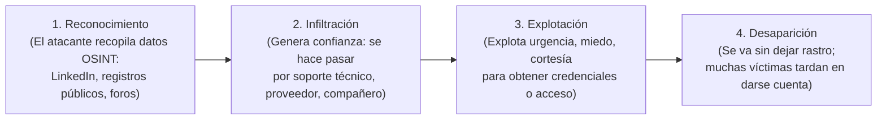
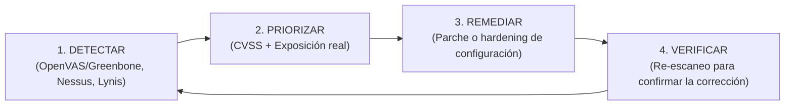
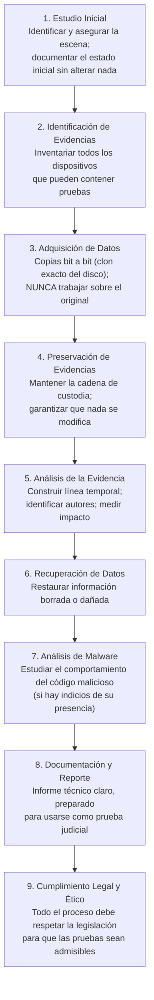

# UT4: Amenazas, Vulnerabilidades y Análisis Forense

Esta unidad estudia las amenazas desde su origen (el factor humano), el perfil técnico de las vulnerabilidades y los marcos internacionales para gestionarlas, la protección perimetral de la red y, por último, qué hacer cuando todo falla: el análisis forense digital.

---

## 1. Ingeniería Social: El Eslabón Más Débil

La ingeniería social manipula a las **personas** (no a las máquinas) para que entreguen información o acceso que de otro modo estarían protegidos. Es el ataque más rentable: no ataca la tecnología, sino la **confianza humana**.



### 1.1 Técnicas de Ingeniería Social más Habituales

| Técnica | Descripción | Ejemplo Real |
| :--- | :--- | :--- |
| **Phishing** | Correo que suplanta a una entidad de confianza (banco, Hacienda, red social) con enlace a web falsa o adjunto infectado. | Email de "Correos" pidiendo pagar tasas para liberar un paquete. |
| **Spear Phishing** | Phishing muy personalizado dirigido a un individuo concreto, usando datos OSINT sobre él. | Email al director financiero con asunto sobre una factura que realmente existe. |
| **Whaling** | Spear phishing dirigido a ejecutivos de alto nivel ("cazar ballenas"). | Email al CEO firmado como el director general pidiendo una transferencia urgente. |
| **Vishing** | Fraude por llamada de voz simulando ser soporte técnico, banco o entidad gubernamental. | Llamada de "Microsoft" avisando de un virus en el PC. |
| **Smishing** | Variante por SMS o mensajería instantánea. | SMS de "tu paquete está retenido, paga aquí: [enlace]". |
| **Pretexting** | Inventar un escenario creíble (historia falsa) para obtener información. | Llamar al banco haciéndose pasar por el titular para confirmar un dato. |
| **Baiting** | Dejar un "cebo" (ej: pendrive etiquetado como "Nóminas 2026") para que la víctima lo conecte e infecte su equipo. | USB abandonado en el parking de la empresa. |
| **Quid pro quo** | Ofrecer un beneficio (software gratis, soporte técnico falso) a cambio de credenciales. | "Te arreglo el PC gratis si me das tu usuario de administrador". |
| **Shoulder Surfing** | Espiar "por encima del hombro" mientras la víctima teclea su PIN o contraseña. | Mirar la pantalla de alguien en el cajero automático o en un café. |
| **Dumpster Diving** | Rebuscar en la basura: documentos con datos, post-its con contraseñas, discos viejos sin borrar. | Recuperar facturas con datos de clientes de los contenedores de una empresa. |

### 1.2 Defensa contra la Ingeniería Social

1. **Verificar la identidad** por un canal oficial independiente (llama tú al banco al número oficial, no al que te dan).
2. **Desconfiar de la urgencia**: la prisa es la herramienta favorita del atacante.
3. **Comprobar los remitentes**: revisar el dominio completo del correo (no solo el nombre visible).
4. **Pasar el cursor sobre los enlaces** antes de pulsar para ver la URL real.
5. **No conectar dispositivos desconocidos** (pendrives, discos) a equipos de la empresa.
6. **Recordar**: ninguna entidad legítima pide nunca la contraseña completa por teléfono o correo.

---

## 2. Vulnerabilidades: Clasificación y Gestión

### 2.1 Clasificación por Tipología

| Tipo | Descripción | Ejemplos |
| :--- | :--- | :--- |
| **Técnica** | Fallo en hardware o software. | Inyección SQL, desbordamiento de búfer, servicio sin parchear, permisos excesivos. |
| **Humana** | Fallo de personas u organización. | Reutilizar contraseñas, cuentas de exempleados activas, no tener política de copias. |
| **Física / Ambiental** | Debilidad del entorno material. | CPD sin extinción de incendios, sala de servidores sin control de acceso, ausencia de SAI. |

### 2.2 Clasificación por Origen (Cuándo Nació el Fallo)

| Origen | Descripción | Corrección |
| :--- | :--- | :--- |
| **Diseño** | El fallo está en la arquitectura o el protocolo antes de escribir código. Usar un protocolo que no cifra por diseño (Telnet, HTTP). | Sustituir por alternativa segura (SSH, HTTPS). |
| **Implementación** | Bug introducido al programar: inyección SQL, XSS, desbordamiento de búfer. | Parche del fabricante o auditoría de código. |
| **Configuración** | El software es correcto pero está mal configurado o sin parchear. Credenciales por defecto, `chmod 777`, puerto de administración expuesto. | *Hardening* y gestión de parches. Es el origen más frecuente. |

### 2.3 Marcos Profesionales: CVE, CWE y CVSS

| Estándar | Qué Identifica | Ejemplo | Quién lo Mantiene |
| :--- | :--- | :--- | :--- |
| **CVE** | Una vulnerabilidad **concreta** en un producto concreto. | `CVE-2021-44228` (Log4Shell) | MITRE ([cve.org](https://cve.org)) |
| **CWE** | El **tipo de debilidad** subyacente (la categoría). | `CWE-89` = Inyección SQL | MITRE ([cwe.mitre.org](https://cwe.mitre.org)) |
| **CVSS** | La **severidad** numérica (puntuación de 0 a 10). | `9,8 / Crítica` | FIRST ([first.org/cvss](https://first.org/cvss)) |

**La relación entre ellos**: Una CVE (el caso concreto) es una instancia de una CWE (la categoría del fallo), y se le asigna una puntuación CVSS (la gravedad).

| Puntuación CVSS | Nivel de Severidad |
| :--- | :--- |
| 0,0 | Ninguna |
| 0,1 – 3,9 | 🟢 Baja |
| 4,0 – 6,9 | 🟡 Media |
| 7,0 – 8,9 | 🔴 Alta |
| 9,0 – 10,0 | 🔴🔴 Crítica |

> [!WARNING] CVSS mide severidad técnica, no riesgo real
> Una vulnerabilidad con CVSS 9,8 en un servidor interno apagado puede tener menos riesgo real que una con CVSS 5,0 en el servidor web público de la empresa. El riesgo depende también de la exposición y la criticidad del activo afectado.

### 2.4 Ciclo de Gestión de Vulnerabilidades



---

## 3. Rootkits e Integridad del Sistema

### 3.1 ¿Qué es un Rootkit?

Un rootkit es un conjunto de herramientas maliciosas cuyo objetivo es **obtener acceso privilegiado (root/administrador) y mantenerlo ocultando su propia presencia**. Su rasgo definitorio no es infectar, sino el **sigilo**: se interpone entre quien pregunta (`¿qué procesos hay?`, `¿qué archivos hay?`) y la respuesta del sistema, **falseando lo que el administrador ve**.

| Tipo | Dónde se Instala | Dificultad de Detección |
| :--- | :--- | :--- |
| **Userland** | Sustituye binarios y bibliotecas del sistema (`ls`, `ps`, `netstat`). | Más fácil de detectar desde fuera. |
| **Kernel** | Se carga como módulo del núcleo; opera con el mismo privilegio que el SO. | Muy difícil; desde dentro el sistema miente. |
| **Bootkit / Firmware** | Se aloja en el gestor de arranque, UEFI o firmware de un dispositivo. | Persiste incluso tras reinstalar el SO. |

> [!CAUTION] Con un rootkit de kernel instalado, no puedes confiar en nada de lo que el propio sistema te informa.
> La detección fiable se realiza **desde fuera**: arrancando con un Live USB limpio y analizando el disco desde otro sistema operativo, comparando hashes de ficheros críticos contra una base de referencia creada cuando el sistema estaba limpio.

### 3.2 Herramientas de Detección y Verificación de Integridad

```bash
# --- LINUX ---
# rkhunter (Rootkit Hunter): detector de rootkits y ficheros sospechosos
rkhunter --propupd    # 1) Crear base de huellas SOLO en sistema limpio recién instalado
rkhunter --check      # 2) Comparar estado actual con la base de referencia
# Log en: /var/log/rkhunter.log

# chkrootkit: complementario a rkhunter
apt install chkrootkit
chkrootkit

# Verificar integridad de archivos individualmente con hash:
sha256sum /bin/ls /sbin/sshd /usr/bin/sudo > huellas_referencia.txt  # Guardar en sistema limpio
sha256sum --check huellas_referencia.txt                               # Verificar más tarde
```

```powershell
# --- WINDOWS ---
# Paso 1: Reparar el almacén de componentes (antes de SFC)
DISM /Online /Cleanup-Image /RestoreHealth

# Paso 2: Verificar y reparar archivos del sistema protegidos
sfc /scannow

# Log de SFC: %WinDir%\Logs\CBS\CBS.log (buscar líneas con [SR])
```

---

## 4. Protección Perimetral

El perímetro es la frontera entre la red interna y el exterior (Internet). En la administración moderna, con el teletrabajo y la nube, este perímetro se ha difuminado y requiere un enfoque de **defensa en profundidad** con múltiples capas:

```
                           INTERNET
                               │
              ┌────────────────┴─────────────────┐
              │  Router/Firewall frontera (IPS)  │
              └──────────────────────────────────┘
                    │                    │
           ┌────────┴───────┐   ┌────────┴────────┐
           │      DMZ       │   │   Red Interna   │
           │  Servidor Web  │   │   Segmentada    │
           │  Servidor Mail │   │                 │
           │  Servidor DNS  │   │  VLAN Usuarios  │
           └────────────────┘   │  VLAN Servidores│
                                │  VLAN Invitados │
                                │  VLAN Gestión   │
                                └────────┬────────┘
                                         │
                             [VPN] ◄──── Teletrabajadores
```

### 4.1 Componentes del Perímetro

| Componente | Función | Analogía |
| :--- | :--- | :--- |
| **Cortafuegos (Firewall)** | Filtra tráfico entre redes según reglas (IP, puerto, protocolo). Primera línea de defensa. | Portero en la entrada del edificio. |
| **IDS** (*Intrusion Detection System*) | **Detecta** y **avisa** de patrones de ataque en el tráfico. No actúa. | Alarma antirrobo que suena pero no cierra las puertas. |
| **IPS** (*Intrusion Prevention System*) | **Detecta** y **bloquea** automáticamente el tráfico malicioso. | Alarma antirrobo que sí cierra y bloquea la entrada. |
| **DMZ** (*Zona Desmilitarizada*) | Subred aislada para servicios accesibles desde Internet. Si comprometen el servidor web, no llegan a la red interna. | Zona de recepción entre la calle y la oficina. |
| **VLAN** | Segmentación lógica de la red interna. Contiene el movimiento lateral de un atacante. | Puertas cortafuego entre departamentos del edificio. |
| **NAC** (*Network Access Control*) | Controla qué dispositivos pueden conectarse a la red. Evita que un visitante enchufe su portátil. | Tornos con tarjeta en la empresa. |
| **VPN** (*Virtual Private Network*) | Túnel cifrado y autenticado para acceso remoto seguro (teletrabajo). | Pasillo privado y blindado hasta la oficina desde casa. |

```bash
# --- UFW (Uncomplicated Firewall en Debian/Ubuntu) ---
sudo ufw enable
sudo ufw default deny incoming     # Bloquear todo entrante por defecto
sudo ufw default allow outgoing    # Permitir todo saliente por defecto

# Permitir servicios específicos:
sudo ufw allow 22/tcp      # SSH
sudo ufw allow 80/tcp      # HTTP
sudo ufw allow 443/tcp     # HTTPS

# Permitir SSH solo desde la red local:
sudo ufw allow from 192.168.1.0/24 to any port 22 proto tcp

# Ver estado con reglas numeradas:
sudo ufw status numbered

# Eliminar una regla por número:
sudo ufw delete 3
```

---

## 5. Análisis Forense Digital

Cuando, a pesar de todas las medidas, ocurre un incidente, entra en juego el **análisis forense digital**: la disciplina que identifica, preserva, analiza y presenta datos electrónicos para responder a cuatro preguntas:
1. ¿**Cómo** ocurrió el ataque?
2. ¿**Quién** lo hizo?
3. ¿**Qué datos** se vieron afectados?
4. ¿**Cómo evitarlo** en el futuro?

### 5.1 Finalidad del Análisis Forense

| Fin | Descripción |
| :--- | :--- |
| **Preventivo** | Aprender del incidente para prevenir los siguientes. |
| **Correctivo** | Identificar y corregir los fallos que lo hicieron posible. |
| **Probatorio** | Aportar pruebas con validez legal ante un tribunal o proceso disciplinario. |
| **Auditor** | Auditar el estado de sistemas, redes y procedimientos. |

### 5.2 Tipos de Análisis Forense

- **De dispositivos informáticos**: ordenadores de sobremesa, servidores.
- **De dispositivos móviles**: smartphones, tablets.
- **De memoria**: memoria volátil (RAM) y no volátil (discos, SSDs).
- **De redes**: análisis de tráfico capturado con `tcpdump`, Wireshark.
- **De software y malware**: ingeniería inversa de código malicioso.

### 5.3 Fases del Análisis Forense

La secuencia es estricta: alterarla puede invalidar legalmente toda la investigación:



### 5.4 La Cadena de Custodia

> **La cadena de custodia es el concepto más importante del análisis forense.**

Es el **procedimiento controlado** que documenta quién, cuándo y cómo maneja cada evidencia, desde que se localiza en la escena del incidente hasta su análisis en el laboratorio. Una sola laguna en ese registro puede **invalidar toda la investigación** ante un tribunal, por muy sólidas que sean las conclusiones técnicas.

Por eso se trabaja siempre sobre **copias bit a bit** del original, nunca sobre el disco o dispositivo incautado directamente.

> [!NOTE] Analogía con la Investigación Policial
> Es exactamente como la cadena de pruebas en un juicio penal: si el fiscal no puede demostrar que la prueba física no fue manipulada entre la escena del crimen y el juzgado, el juez la descarta. No importa lo convincente que sea la evidencia técnica: sin cadena de custodia, no tiene valor legal.
