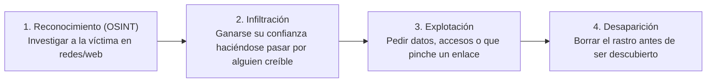
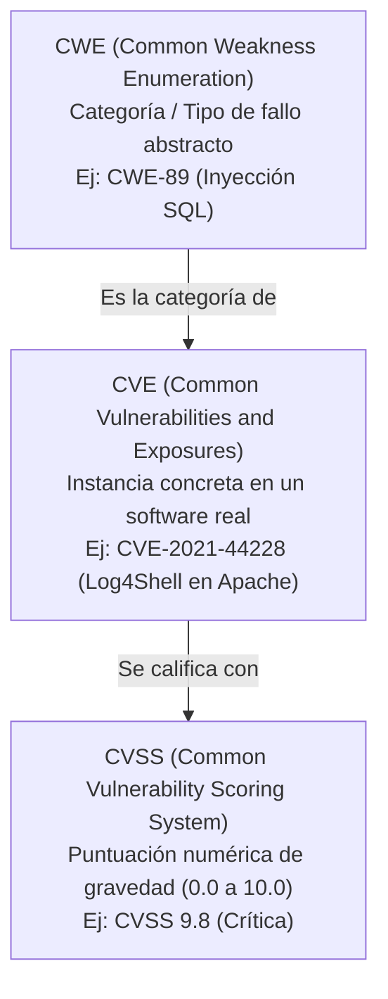
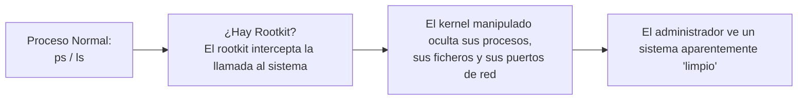
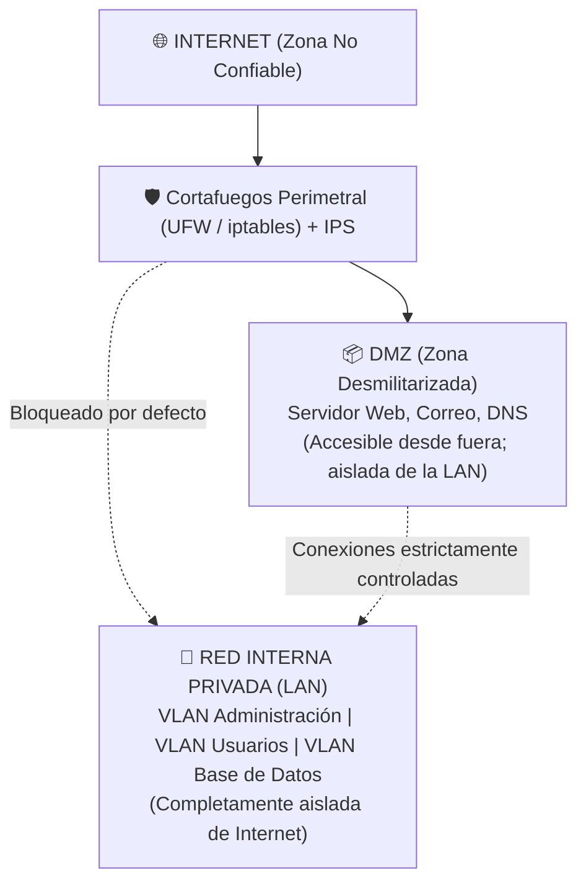
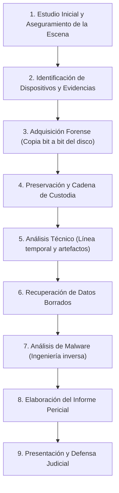
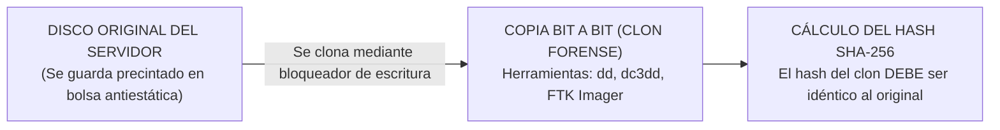

# UT4: Amenazas, Vulnerabilidades y Análisis Forense

<span class="badge badge-exam">Seguridad Ofensiva y Defensiva</span>
<span class="badge badge-practice">Prácticas Forenses y Redes</span>

Esta unidad estudia las amenazas desde su origen más habitual (el engaño humano a través de la ingeniería social), las debilidades del software (**CVE/CVSS**), las técnicas de sigilo de los **rootkits**, la protección perimetral mediante **firewalls e IDS/IPS** y, finalmente, el protocolo riguroso del **análisis forense digital** y la **cadena de custodia**.

---

## 🎯 Objetivos de Estudio de la Unidad

Al finalizar el estudio de esta unidad deberás ser capaz de:

- [x] Identificar las 10 técnicas principales de **Ingeniería Social** (phishing, vishing, baiting, smishing...).
- [x] Clasificar vulnerabilidades por origen (**Diseño**, **Implementación**, **Configuración**) y tipología.
- [x] Interpretar identificadores **CVE**, clasificaciones **CWE** y puntuaciones de severidad **CVSS**.
- [x] Explicar qué es un **Rootkit**, sus niveles (Userland, Kernel, Bootkit) y por qué un SO infectado no es fiable para auditarse a sí mismo.
- [x] Configurar un cortafuegos perimetral con **UFW** y diferenciar entre un **Firewall**, un **IDS**, un **IPS** y una **DMZ**.
- [x] Enumerar las 9 fases del **Análisis Forense Digital** y justificar la importancia jurídica de la **Cadena de Custodia**.

---

## 1. Ingeniería Social: Manipulación del Eslabón Humano

La ingeniería social no busca vulnerabilidades en el código, sino en la **psicología de las personas**: explota la confianza, la curiosidad, el miedo a la autoridad o el sentido de urgencia.



### 1.1 Catálogo de Técnicas de Ingeniería Social

<span class="badge badge-exam">Preguntas Típicas de Emparejar Conceptos</span>

| Técnica | Medio / Canal | Mecánica del Ataque | Ejemplo Cotidiano |
| :--- | :--- | :--- | :--- |
| **Phishing** | Correo electrónico masivo | Suplanta la imagen de bancos, mensajerías o servicios para robar claves o infectar. | Email falso de Correos: *"Pague 2€ de tasas para liberar su paquete"*. |
| **Spear Phishing** | Correo personalizado | Ataque dirigido a una víctima concreta investigada previamente con fuentes abiertas (OSINT). | Email al contable citando el número real de una factura que la empresa espera. |
| **Whaling** | Correo a la alta dirección | *Phishing* dirigido exclusivamente a directores generales, CEOs o altos cargos. | Correo simulando ser el presidente de la junta ordenando una compra confidencial. |
| **Vishing** | Llamada telefónica (voz) | El atacante finge ser técnico informático o empleado del banco para pedir códigos SMS/MFA. | *"Le llamamos de soporte de Microsoft, su PC está enviando virus"*. |
| **Smishing** | Mensajes SMS / WhatsApp | Mensajería móvil con enlaces a portales fraudulentos o descargas de malware. | *"Su cuenta bancaria ha sido bloqueada. Verifíquela en este enlace"*. |
| **Baiting** | Soporte físico ("Cebo") | Dejar un pendrive o disco infectado en un lugar concurrido para que alguien lo enchufe. | Un USB abandonado en el aparcamiento con la etiqueta *"Sueldos_Direccion_2026.xlsx"*. |
| **Pretexting** | Escenario ficticio | Construir una historia elaborada para engañar a un empleado haciéndose pasar por auditor o proveedor. | *"Hola, soy el nuevo técnico de redes de la sede central y necesito verificar tu IP y usuario"*. |
| **Quid pro quo** | Promesa de servicio | Ofrecer una ayuda o beneficio ficticio a cambio de credenciales o instalación de un ejecutable. | *"Llamo para hacer el mantenimiento informático gratis que contrató su empresa"*. |
| **Shoulder Surfing** | Observación física directa | Espiar por encima del hombro o mediante cámaras mientras el usuario teclea su PIN o contraseña. | Mirar el teclado numérico del cajero automático o la pantalla del portátil en el tren. |
| **Dumpster Diving** | Búsqueda en la basura | Rebuscar en papeleras o contenedores documentos en papel con claves, nóminas, facturas o discos viejos. | Rescatar del contenedor hojas de cálculo con datos de clientes sin triturar. |

---

## 2. Gestión de Vulnerabilidades: CVE, CWE y CVSS

### 2.1 Origen de las Vulnerabilidades: ¿Cuándo nace el fallo?

| Origen | Explicación | Ejemplo de Examen |
| :--- | :--- | :--- |
| **De Diseño** | El fallo reside en la arquitectura teórica o en el protocolo antes de programar nada. | Diseñar un protocolo que transmite contraseñas en texto claro sin cifrar (como Telnet o HTTP). |
| **De Implementación** | El diseño era correcto, pero el programador cometió un error al escribir el código. | Una inyección SQL por no sanear variables o un desbordamiento de búfer (*Buffer Overflow*) en C. |
| **De Configuración** | El software está bien programado, pero el administrador lo instaló con ajustes inseguros. | Dejar las credenciales por defecto (`admin/admin`), otorgar permisos `chmod 777` o dejar el puerto SSH abierto a todo Internet sin restricciones. |

---

### 2.2 El Trío de Estándares Internacionales



| Escala CVSS v3/v4 | Severidad | Acción Inmediata |
| :---: | :---: | :--- |
| **0.0** | Informativa | Ninguna. |
| **0.1 – 3.9** | 🟢 **Baja** | Parchear en ventanas de mantenimiento habituales. |
| **4.0 – 6.9** | 🟡 **Media** | Planificar corrección a corto plazo. |
| **7.0 – 8.9** | 🔴 **Alta** | Aplicar parches o mitigaciones prioritarias. |
| **9.0 – 10.0** | 🔴🔴 **Crítica** | Alerta máxima: remediación inmediata (servicio expuesto a ejecución remota de código sin autenticación). |

---

## 3. Rootkits y Detección de Integridad

Un **Rootkit** no busca únicamente infectar, sino conseguir acceso de nivel `root` o administrador y **mantenerse totalmente invisible**:



### Niveles de Rootkits

- **Userland (Espacio de Usuario)**: Sustituye ejecutables comunes del sistema (`/bin/ls`, `/bin/ps`, `/bin/netstat`). Se detecta fácilmente comparando los hashes de los ficheros contra un sistema limpio.
- **Kernel**: Se instala como módulo del núcleo (`LKM`) o parchea la tabla de llamadas al sistema (`sys_call_table`). **El propio sistema operativo miente al administrador**.
- **Bootkit / Firmware**: Infecta la BIOS/UEFI o el Master Boot Record (MBR). Sobrevive incluso al formateo y reinstalación completa del sistema operativo.

> [!CAUTION] Regla de Oro Forense ante Rootkits
> Si sospechas que un servidor tiene un rootkit de nivel kernel, **no puedes confiar en ningún comando ejecutado dentro de ese servidor**. Debes apagarlo, extraer el disco y analizarlo desde un **Live CD / USB limpio externo**.

---

## 4. Protección Perimetral de Redes



### Componentes de Seguridad Perimetral

| Dispositivo / Tecnología | Función Primaria | Analogía de Seguridad |
| :--- | :--- | :--- |
| **Cortafuegos (*Firewall*)** | Filtra paquetes por IP origen/destino, puerto y protocolo. | El vigilante de la garita que pide el pase. |
| **IDS (*Intrusion Detection*)** | Analiza el tráfico buscando firmas de ataques y **alerta** (no bloquea). | Una alarma con detector de humos que suena. |
| **IPS (*Intrusion Prevention*)** | Analiza el tráfico y **bloquea la conexión maliciosa en tiempo real**. | Un sistema que además de sonar, cierra puertas antiincendios. |
| **DMZ (*Zona Desmilitarizada*)** | Subred intermedia para servidores públicos (web, correo). Si son hackeados, la red interna queda a salvo. | El vestíbulo de visitas de un edificio gubernamental. |
| **VLANs (*Virtual LANs*)** | Segmenta la red interna para evitar que un malware en un PC de usuario salte a la base de datos. | Puertas estancas entre compartimentos de un barco. |

=== "🐧 Práctica con Cortafuegos UFW (Ubuntu/Debian)"
    ```bash
    # 1. Restablecer y configurar política por defecto más segura:
    # Denegar todo el tráfico entrante, permitir todo el saliente
    sudo ufw default deny incoming
    sudo ufw default allow outgoing

    # 2. Permitir acceso SSH solo desde la subred de administración interna:
    sudo ufw allow from 192.168.10.0/24 to any port 22 proto tcp

    # 3. Permitir servidores web públicos:
    sudo ufw allow 80/tcp
    sudo ufw allow 443/tcp

    # 4. Activar el firewall y comprobar las reglas numeradas:
    sudo ufw enable
    sudo ufw status numbered
    ```

---

## 5. Análisis Forense Digital y Cadena de Custodia

El análisis forense digital reconstruye los hechos tras un incidente de seguridad para determinar **quién**, **cómo**, **cuándo** y **qué datos se vieron afectados**, con plena validez judicial.

### 5.1 Las 9 Fases del Análisis Forense



---

### 5.2 La Cadena de Custodia

> [!IMPORTANT] ¿Qué es la Cadena de Custodia?
> Es el **registro cronológico e ininterrumpido** que documenta quién tuvo acceso a cada evidencia electrónica, en qué fecha y hora exactas, con qué propósito y bajo qué medidas de custodia.
> 
> Si la cadena de custodia se rompe o contiene incongruencias, **el juez declarará la prueba nula**, independientemente de lo concluyente que sea el informe técnico.



> [!CAUTION] Regla Inquebrantable del Perito Informático
> **NUNCA se analiza ni se enciende el disco original incautado**. Siempre se coloca un bloqueador de escritura por hardware (*write-blocker*), se extrae una imagen bit a bit (`dd` / `dc3dd`), se comprueba que el hash del clon coincide exactamente con el original, y se trabaja **únicamente sobre copias de la imagen forense**.

---

## 📝 Chuleta Rápida de Examen

| Pregunta directa | Respuesta clara |
| :--- | :--- |
| ¿Qué diferencia hay entre **Phishing** y **Spear Phishing**? | El *Phishing* es masivo e indiscriminado; el *Spear Phishing* está dirigido a una persona o empresa concreta tras investigarla. |
| ¿Qué diferencia hay entre una **CVE** y una **CWE**? | **CWE** es el tipo de debilidad genérica (ej: inyección SQL); **CVE** es el fallo concreto en un programa y versión específica. |
| ¿Qué diferencia a un **IDS** de un **IPS**? | El **IDS** solo detecta y avisa (pasivo); el **IPS** detecta y bloquea la conexión (activo). |
| ¿Para qué sirve una **DMZ**? | Para aislar los servidores con acceso público a Internet de la red interna de la empresa. |
| ¿Por qué se calcula el **Hash** en una evidencia forense? | Para demostrar ante el tribunal que la copia no ha sido alterada ni manipulada desde su adquisición. |

---

## ❓ Test de Autoevaluación

??? question "Un empleado de contabilidad recibe un correo supuestamente de su director general pidiéndole con máxima urgencia que transfiera 50.000 € a una cuenta desconocida para cerrar un contrato confidencial. ¿Qué tipo exacto de ataque es?"
    **Respuesta**: Es un ataque de **Whaling** (o fraude del CEO), que es una variante especializada de *Spear Phishing* dirigida a personal con acceso a fondos económicos o a la alta dirección.

??? question "¿Por qué una vulnerabilidad con puntuación CVSS 9.5 (Crítica) en un servidor de laboratorio interno puede tener menos riesgo real para la empresa que una de CVSS 6.0 en el servidor web público?"
    **Respuesta**: Porque el **Riesgo** no es solo la severidad técnica de la vulnerabilidad, sino la **Probabilidad de explotación $\times$ Impacto**. El servidor interno aislado no tiene conectividad directa desde Internet (probabilidad de ataque muy baja), mientras que el servidor web público está expuesto 24/7 a escaneos y ataques continuos de cualquier persona en el mundo.

??? question "Durante una investigación forense, un técnico conecta un disco duro sospechoso directamente a su portátil con Windows para ver las carpetas con el Explorador de Archivos antes de clonarlo. ¿Qué error gravísimo acaba de cometer?"
    **Respuesta**: Ha cometido un error que **invalida legalmente la evidencia**. Al conectar un disco sin un **bloqueador de escritura hardware**, el sistema operativo Windows escribe automáticamente metadatos en el disco (fechas de último acceso `atime`, registros de volumen, archivos ocultos), alterando el estado original y rompiendo la **Cadena de Custodia**.
