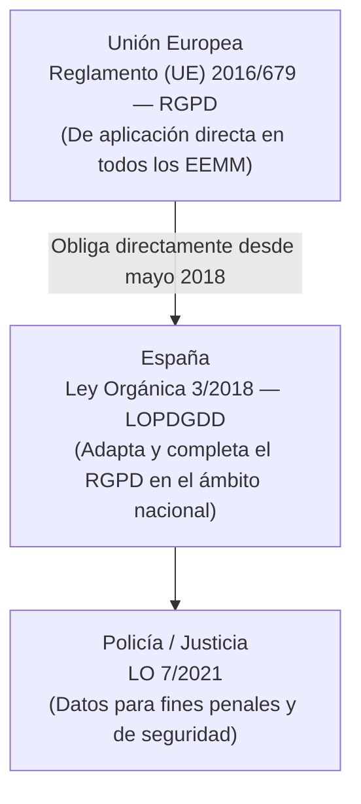
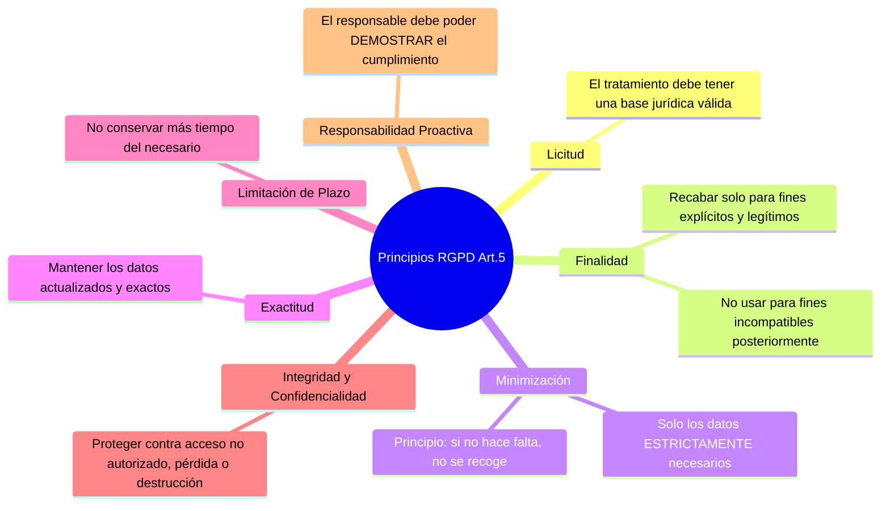
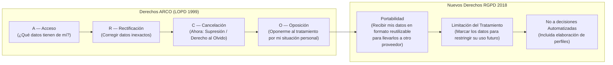

# UT5: Marco Legal — RGPD, LOPD y AEPD

La protección de los datos personales no es solo una obligación técnica sino también **legal**. El incumplimiento puede acarrear sanciones millonarias, daño reputacional y responsabilidad penal. Este tema estudia el marco normativo vigente en España y la UE, aplicado específicamente al rol del administrador de sistemas.

---

## 1. El Marco Normativo de la Protección de Datos en España

La privacidad de las personas se protege mediante una capa de normas que van de lo europeo a lo nacional:

| Norma | Nombre Completo | Vigencia |
| :--- | :--- | :--- |
| **RGPD** | Reglamento General de Protección de Datos (UE 2016/679) | Desde el 25 de mayo de 2018 |
| **LOPDGDD** | Ley Orgánica 3/2018 de Protección de Datos Personales y garantía de los derechos digitales | Desde el 7 de diciembre de 2018 |
| **LO 7/2021** | Protección de datos personales tratados para fines de prevención e investigación penal | Desde el 29 de mayo de 2021 |

> [!IMPORTANT] ¿El RGPD reemplaza a la LOPD antigua?
> La antigua LOPD (Ley Orgánica 15/1999) quedó derogada con la nueva LOPDGDD de 2018. Esta última adapta el RGPD a la realidad española y añade garantías específicas sobre los derechos digitales de los ciudadanos (ej: derecho a la desconexión digital laboral).

---

## 2. Conceptos Fundamentales del RGPD

### 2.1 ¿Qué es un Dato Personal?

Cualquier información que, sola o en combinación con otros datos, permita **identificar directa o indirectamente a una persona física**:

- Nombre, apellidos, DNI/NIF, número de pasaporte.
- Dirección postal o de correo electrónico.
- Número de teléfono, dirección IP, cookie de seguimiento.
- Datos de salud, biométricos, de localización GPS.

### 2.2 Roles en el Tratamiento de Datos

| Rol | Descripción | Ejemplo |
| :--- | :--- | :--- |
| **Interesado (*Data Subject*)** | La persona cuyos datos se tratan. | El empleado, el cliente, el alumno. |
| **Responsable del Tratamiento** | Quien decide **por qué** y **cómo** se tratan los datos. Asume la responsabilidad legal. | La empresa, el hospital, el instituto. |
| **Encargado del Tratamiento** | Quien trata los datos **en nombre del responsable**. | El proveedor de servicios cloud, la gestoría, la empresa de mensajería. |
| **Delegado de Protección de Datos (DPD)** | Figura obligatoria en ciertos tratamientos. Supervisa el cumplimiento y es el punto de contacto con la AEPD. | Obligatorio en Administraciones Públicas, hospitales y empresas con tratamiento masivo de datos sensibles. |

### 2.3 Principios del Tratamiento (Art. 5 RGPD)

Todo tratamiento de datos personales debe cumplir estos principios, que son los pilares del RGPD:

### 2.4 Bases Jurídicas del Tratamiento (Art. 6 RGPD)

Para tratar datos personales debe existir al menos una de estas seis bases legales:

1. **Consentimiento explícito** del interesado (libre, informado, específico y verificable).
2. **Ejecución de un contrato** del que el interesado es parte.
3. **Obligación legal** que incumbe al responsable.
4. **Protección de intereses vitales** del interesado u otra persona.
5. **Interés público** o ejercicio de poderes públicos.
6. **Interés legítimo** del responsable o de un tercero (con evaluación de proporcionalidad).

---

## 3. Derechos de los Ciudadanos: De ARCO a ARCO+POL

Con el RGPD, los clásicos derechos **ARCO** se ampliaron con nuevos derechos adicionales:

| Derecho | Qué Permite | Plazo de Respuesta |
| :--- | :--- | :--- |
| **Acceso** | Saber si se tratan tus datos, qué datos, con qué finalidad, a quién se ceden. | 1 mes (ampliable 2 meses) |
| **Rectificación** | Exigir la corrección de datos inexactos o incompletos. | 1 mes |
| **Supresión (Olvido)** | Pedir el borrado cuando los datos ya no son necesarios, el consentimiento se retira o el tratamiento es ilícito. | 1 mes |
| **Oposición** | Oponerse al tratamiento para fines de *marketing* directo o por razones de situación personal. | Inmediato (para marketing directo) |
| **Portabilidad** | Recibir los datos en formato estructurado y legible por máquina para trasladarlos. | 1 mes |
| **Limitación** | Solicitar que los datos se "congelen" mientras se resuelve una reclamación o se verifica su exactitud. | Inmediato |

> [!NOTE] ¿Son gratuitos estos derechos?
> Sí. El ejercicio de los derechos es **gratuito** con carácter general. Solo se pueden cobrar tasas cuando las solicitudes son manifiestamente infundadas o excesivas. Se dirigen directamente al responsable del tratamiento, que tiene hasta **1 mes** para responder.

---

## 4. La AEPD (Agencia Española de Protección de Datos)

La **AEPD** es la autoridad de control independiente encargada de velar por el cumplimiento de la normativa de protección de datos en España. Tiene personalidad jurídica propia y actúa con plena independencia.

### 4.1 Funciones Principales

- **Supervisar y controlar** el cumplimiento del RGPD y la LOPDGDD.
- **Atender reclamaciones** de los ciudadanos cuando una entidad ignora su solicitud de ejercicio de derechos.
- **Investigar e imponer sanciones** a las organizaciones infractoras.
- **Publicar guías y orientaciones** de cumplimiento (disponibles en [aepd.es](https://www.aepd.es)).
- **Evaluar Evaluaciones de Impacto** (EIPD) en tratamientos de alto riesgo.

### 4.2 Régimen Sancionador del RGPD

Las multas del RGPD son las más elevadas de la historia en materia de privacidad:

| Infracción | Sanción Máxima |
| :--- | :--- |
| **Infracción grave** (Art. 83.5): tratamiento sin base jurídica, vulneración de los principios, incumplimiento de los derechos de los interesados. | **20.000.000 € o el 4% del volumen de negocio mundial** (el mayor de ambos). |
| **Infracción leve** (Art. 83.4): falta de registros de tratamiento, no notificar una brecha a la AEPD, incumplimientos técnicos. | **10.000.000 € o el 2% del volumen de negocio mundial** (el mayor de ambos). |

---

## 5. Obligaciones Técnicas y Organizativas del Responsable

Como administrador de sistemas, muchas de las obligaciones del RGPD se materializan en medidas técnicas concretas:

### 5.1 Privacidad desde el Diseño y por Defecto (Art. 25 RGPD)

> Los sistemas deben diseñarse desde cero con la protección de datos integrada, no añadida a posteriori.

- **Por Diseño (*Privacy by Design*)**: Incorporar la privacidad en la arquitectura del sistema desde la fase de diseño (cifrado, control de acceso, minimización de datos recogidos).
- **Por Defecto (*Privacy by Default*)**: La configuración inicial del sistema debe ser la más restrictiva posible en cuanto a privacidad (ej: no compartir datos de usuario con terceros por defecto).

### 5.2 Registro de Actividades de Tratamiento (Art. 30 RGPD)

Documento interno que el responsable debe mantener actualizado describiendo cada tratamiento de datos que realiza. No es necesario notificarlo a la AEPD (salvo excepciones), pero debe poder presentarlo en cualquier inspección.

### 5.3 Notificación de Brechas de Seguridad (Arts. 33-34 RGPD)

| Obligación | Plazo | A Quién |
| :--- | :--- | :--- |
| Notificar la brecha a la AEPD | **72 horas** desde que el responsable tiene conocimiento de ella | AEPD (sede electrónica) |
| Comunicar la brecha a los afectados | Sin dilación indebida | Los interesados afectados, cuando la brecha suponga alto riesgo para sus derechos |

> [!CAUTION] Una brecha de seguridad que no se notifica en 72 horas puede constituir una infracción independiente sancionable, incluso si la brecha original se contiene rápidamente.

### 5.4 Evaluaciones de Impacto en Protección de Datos (EIPD / DPIA)

Obligatoria cuando un tratamiento sea susceptible de **entrañar un alto riesgo** para los derechos y libertades de las personas (Art. 35 RGPD). Ejemplos de tratamientos que requieren EIPD:

- Videovigilancia a gran escala en espacios públicos.
- Tratamiento masivo de datos biométricos, de salud o de menores.
- *Scoring* crediticio o perfilado de personas mediante algoritmos.
- Decisiones automatizadas con efectos jurídicos significativos.

La EIPD debe contener:
1. Descripción detallada del tratamiento y sus finalidades.
2. Evaluación de la necesidad y proporcionalidad del tratamiento.
3. Evaluación de los riesgos para los derechos de los interesados.
4. Medidas previstas para hacer frente a los riesgos.

---

## 6. Protección de Datos en las Relaciones Laborales

La AEPD ha publicado una **Guía de Protección de Datos en las Relaciones Laborales** (actualizada diciembre 2025) que aborda las situaciones más frecuentes en el entorno de trabajo:

### 6.1 Aspectos Críticos para el Administrador de Sistemas

| Situación | Punto Clave de Privacidad |
| :--- | :--- |
| **Videovigilancia laboral** | El trabajador debe ser informado de las cámaras y su finalidad. No puede haber cámaras en vestuarios o zonas de descanso. Los datos deben borrarse en un máximo de 1 mes. |
| **Geolocalización de empleados** | Solo permitida para controlar el trabajo con información previa y proporcionalidad. Monitorizar 24/7 (incluido tiempo libre) no está justificado. |
| **Control del correo y dispositivos corporativos** | Requiere política de uso claramente comunicada. No puede ser una vigilancia masiva y arbitraria; debe ser proporcional y motivada. |
| **Acceso a datos de salud** | Son datos especialmente sensibles. Solo el médico de empresa tiene acceso; la empresa solo puede conocer las limitaciones laborales resultantes, no el diagnóstico. |
| **Registro de jornada** | Obligatorio legalmente; los datos deben conservarse 4 años y el empleado tiene derecho de acceso a sus propios registros. |
| **Sistemas de denuncias (*whistleblowing*)** | El denunciante debe poder hacerlo de forma anónima si lo desea. Los datos del denunciado deben protegerse hasta que haya indicios fundados. |

### 6.2 La IA Agéntica desde la Perspectiva de Protección de Datos

La AEPD ha publicado orientaciones específicas (v1.2, febrero 2026) sobre los sistemas de **Inteligencia Artificial Agéntica**:

- Un **agente de IA** es un sistema de IA que usa modelos de lenguaje para cumplir un objetivo de forma autónoma, tomando decisiones intermedias.
- Presenta **vulnerabilidades específicas**: manipulación del contexto (*prompt injection*), acceso a herramientas externas (APIs, bases de datos, correo) y cadenas de razonamiento difíciles de auditar.
- El responsable del tratamiento debe aplicar **privacidad desde el diseño** al implementar agentes de IA que procesen datos personales.
- Resulta especialmente relevante cuando el agente puede tomar **decisiones automatizadas** con efectos sobre personas (Art. 22 RGPD).

---

## 7. El CCN-CERT: Referencia de Ciberseguridad en España

El **Centro Criptológico Nacional (CCN-CERT)** es el organismo del Gobierno de España responsable de gestionar ciberincidentes que afecten a las Administraciones Públicas e infraestructuras críticas.

Sus recursos clave para el administrador de sistemas:

| Recurso | Descripción |
| :--- | :--- |
| **Guías CCN-STIC** | Guías técnicas de configuración segura (*hardening*) para sistemas operativos, aplicaciones y redes. Disponibles en [ccn-cert.cni.es/es/guias](https://www.ccn-cert.cni.es/es/guias.html). |
| **Alertas Tempranas** | Notificaciones urgentes sobre vulnerabilidades activamente explotadas o campañas de malware en curso. |
| **ROCIO / REYES** | Plataformas de gestión de incidentes y análisis de amenazas para las AAPP. |
| **ENS (Esquema Nacional de Seguridad)** | Marco de requisitos de seguridad de obligado cumplimiento para los sistemas de información de las Administraciones Públicas (Real Decreto 311/2022). |
