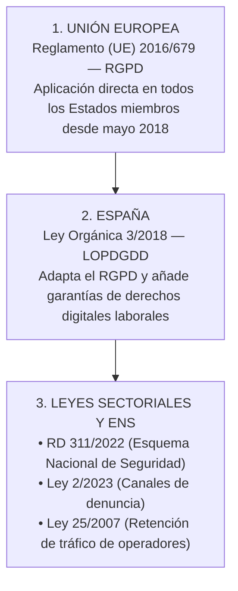
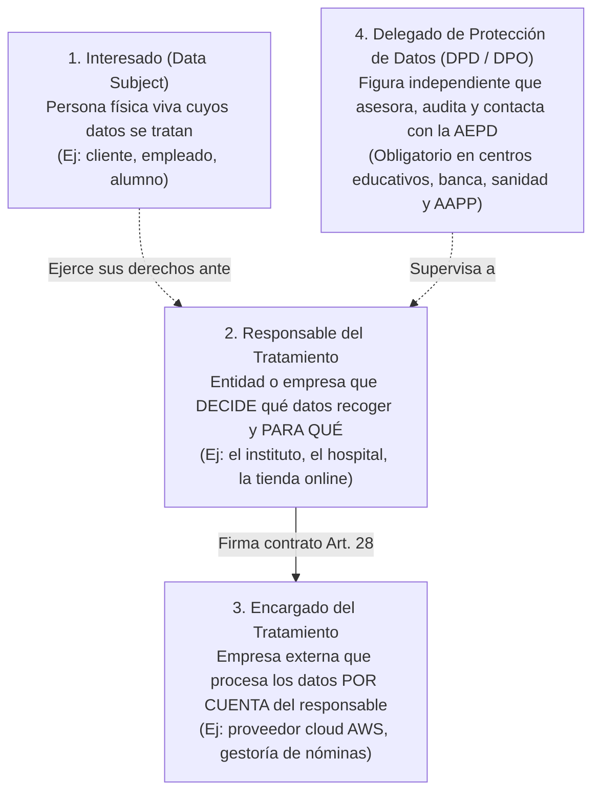
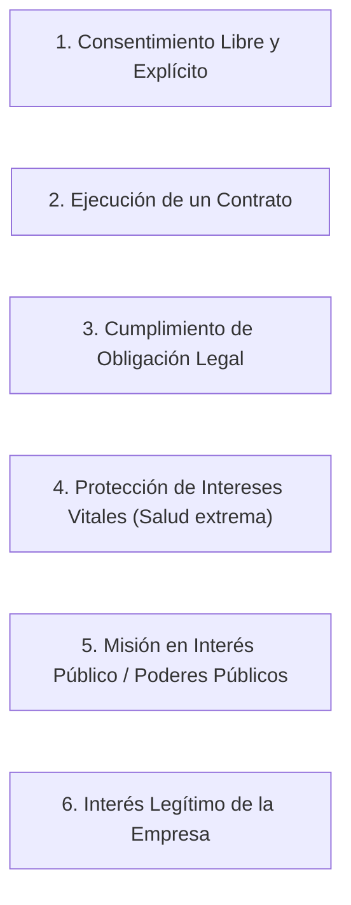
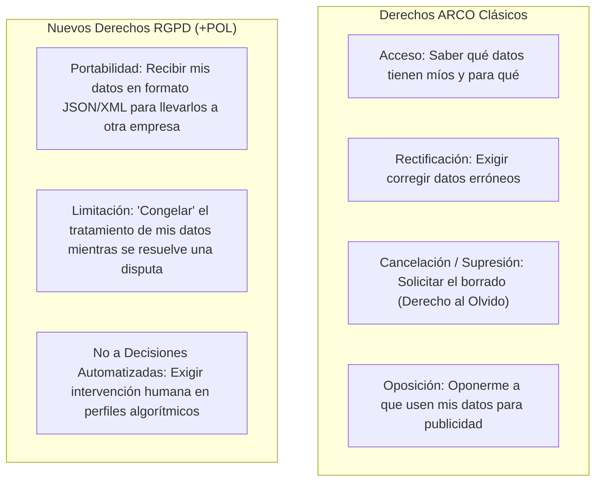
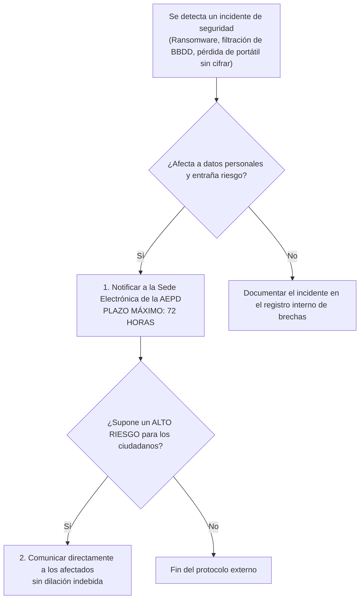
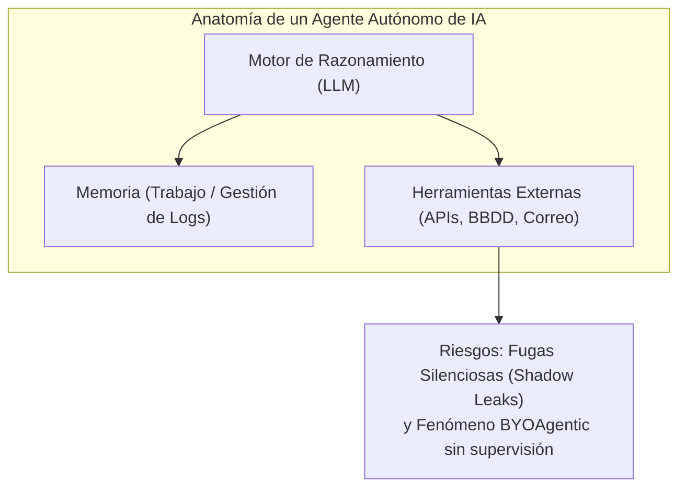

# UT5: Marco Legal — RGPD, LOPD y AEPD

Marco Legal y Normativo
Obligaciones del Sysadmin

La protección de los datos personales no es solo una buena práctica técnica, sino un **mandato legal estricto**. El incumplimiento del marco normativo conlleva sanciones económicas históricas (hasta 20 millones de euros o el 4% de la facturación mundial), responsabilidades penales e inhabilitación profesional.

Esta unidad te explica cómo cumplir la ley española y europea desde la perspectiva técnica del administrador de sistemas.

---

## 🎯 Objetivos de Estudio de la Unidad

Al finalizar el estudio de esta unidad deberás ser capaz de:

- [x] Conocer la jerarquía de normas en España: **RGPD (UE 2016/679)**, **LOPDGDD (LO 3/2018)** y **ENS (RD 311/2022)**.
- [x] Diferenciar con precisión los roles del tratamiento: **Interesado**, **Responsable**, **Encargado** y **DPD**.
- [x] Memorizar los **7 principios del tratamiento** del Art. 5 del RGPD y las **6 bases jurídicas** del Art. 6.
- [x] Explicar y gestionar los derechos de los ciudadanos: **ARCO + POL** (Portabilidad, Olvido, Limitación).
- [x] Aplicar el protocolo de **notificación de brechas de seguridad en menos de 72 horas** a la AEPD.
- [x] Conocer las normas sobre **videovigilancia laboral**, **geolocalización**, **registro de jornada** y canales de **whistleblowing**.
- [x] Identificar los riesgos y medidas de seguridad al desplegar **Inteligencia Artificial Agéntica** según la AEPD (v1.2 Feb 2026).

---

## 1. El Marco Normativo en España

| Norma | Nombre y Alcance | Relevancia para el Administrador |
| :--- | :--- | :--- |
| **RGPD (UE 2016/679)** | Reglamento General de Protección de Datos | Norma suprema en toda la UE. Fija las multas, los principios, las bases jurídicas y los derechos. |
| **LOPDGDD (LO 3/2018)** | Ley Orgánica de Protección de Datos y Derechos Digitales | Adapta el RGPD en España. Regula los derechos digitales de los trabajadores (desconexión digital, control de dispositivos, cámaras). |
| **RD 311/2022 (ENS)** | Esquema Nacional de Seguridad | Requisitos obligatorios de seguridad en las Administraciones Públicas y sus proveedores tecnológicos. |
| **Ley 2/2023** | Protección del informante (*Whistleblowing*) | Obliga a implantar canales de denuncia internos y anónimos en empresas de $\ge 50$ trabajadores. |
| **Ley 25/2007** | Conservación de datos de comunicaciones | Obliga a ISPs y operadores a retener metadatos de conexión IP durante 1 año para la justicia. |

---

## 2. Conceptos Fundamentales: Roles y Principios

### 2.1 Los 4 Roles del Tratamiento

Muy Preguntado en Exámenes

---

### 2.2 Los 7 Principios Sagrados del RGPD (Art. 5)

Todo sistema informático debe respetar estos 7 principios:

1. **Licitud, lealtad y transparencia**: El tratamiento debe tener base legal válida y explicarse con lenguaje claro.
2. **Limitación de la finalidad**: Los datos recogidos para un fin (ej: matricular a un alumno) no pueden usarse para otro incompatible (ej: enviarle publicidad comercial).
3. **Minimización de datos**: Recoger única y exclusivamente los datos estrictamente necesarios para la finalidad.
4. **Exactitud**: Los datos deben ser veraces y mantenerse permanentemente actualizados.
5. **Limitación del plazo de conservación**: Borrar o bloquear los datos en cuanto expire el tiempo necesario o legal.
6. **Integridad y confidencialidad**: Proteger los datos contra accesos no autorizados, pérdida o robo (mediante cifrado, backups y control de acceso).
7. **Responsabilidad proactiva (*Accountability*)**: El responsable debe ser capaz de **demostrar documentalmente** que cumple con todas las medidas anteriores.

---

### 2.3 Las 6 Bases Jurídicas para Tratar Datos (Art. 6)

Para tratar cualquier dato personal, la empresa debe ampararse en **al menos una** de estas 6 razones:

> [!WARNING] Cuidado con el consentimiento en el trabajo
> En el ámbito laboral, el **consentimiento del empleado casi nunca es válido** por existir una situación de subordinación y desequilibrio. La base legal utilizada es casi siempre la **ejecución del contrato de trabajo** o el **cumplimiento de una obligación legal** (Seguridad Social, tributaria).

---

## 3. Los Derechos de los Ciudadanos: De ARCO a ARCO+POL

El RGPD amplió los antiguos derechos **ARCO** españoles a un abanico mucho más completo:

### Plazos de Respuesta Obligatorios

- El responsable tiene un plazo improrrogable de **1 mes** para responder a cualquier ejercicio de derechos (ampliable a 2 meses en casos muy complejos).
- El ejercicio de derechos es **completamente gratuito** para el ciudadano.

---

## 4. Obligaciones Técnicas del Sysadmin

### 4.1 Notificación de Brechas de Seguridad (Arts. 33 y 34 RGPD)

Regla de las 72 Horas

---

### 4.2 Privacidad desde el Diseño y por Defecto (Art. 25)

- **Privacy by Design**: Pensar en la privacidad desde el primer diagrama de la base de datos (cifrado LUKS/TLS, hashing de contraseñas, RBAC).
- **Privacy by Default**: Por defecto, la configuración inicial del sistema debe ser la más restrictiva posible (no marcar casillas preactivadas, no compartir datos por defecto).

---

## 5. Protección de Datos en el Ámbito Laboral (Guía AEPD)

| Ámbito Laboral | Regla Estricta | Consecuencia Legal |
| :--- | :--- | :--- |
| **Videovigilancia** | • Obligatorio cartel informativo visible. • Borrado de grabaciones en **máximo 1 mes**. • **Prohibido en vestuarios, aseos y zonas de descanso**. | Multas graves de la AEPD si hay cámaras en zonas privadas o falta de aviso. |
| **Geolocalización GPS** | • Se debe informar previamente al trabajador. • Solo permitida durante la jornada laboral. • **Prohibido monitorizar en descansos o tiempo libre**. | Vulneración del derecho fundamental a la intimidad. |
| **Registro de Jornada** | Obligatorio por ley. Los datos deben conservarse durante **4 años** y el empleado tiene derecho a ver sus registros. | Inspección de Trabajo sanciona su ausencia o manipulación. |
| **Whistleblowing** | Canales internos de denuncia con garantía total de **anonimato**, acuse de recibo en 7 días y resolución en 3 meses. | Obligatorio por la Ley 2/2023 para empresas de $\ge 50$ empleados. |
| **Datos de Salud** | Categoría especial (Art. 9). El médico de empresa comunica solo si es **Apto o No Apto**. **La empresa nunca puede conocer el diagnóstico médico**. | El diagnóstico está protegido por secreto médico absoluto. |

---

## 6. IA Agéntica y Protección de Datos (AEPD Feb 2026)

La AEPD ha emitido orientaciones pioneras (v1.2, febrero 2026) sobre el despliegue de **Agentes de Inteligencia Artificial** en tratamientos de datos personales:

### Medidas Obligatorias al Implementar Agentes de IA

1. **Involucrar al DPD desde el diseño**: Evaluar la Evaluación de Impacto (EIPD) antes de dar acceso a datos corporativos.
2. **Evitar el *BYOAgentic***: Impedir que empleados creen agentes autónomos sin control conectando bases de datos de la empresa a herramientas cloud externas.
3. **Límites duros (*Circuit Breakers*)**: Forzar un número máximo de pasos y llamadas a herramientas para evitar bucles infinitos y exfiltraciones masivas.
4. **Supervisión humana (*Human-in-the-Loop*)**: Especialmente si el agente toma decisiones con impacto legal (evaluación de empleados, descartes de currículums, préstamos).

---

## 📝 Chuleta Rápida de Examen

| Parámetro / Pregunta | Respuesta Inmediata |
| :--- | :--- |
| **Plazo máximo para notificar una brecha a la AEPD** | **72 horas** desde que se tiene constancia del incidente. |
| **Plazo máximo de conservación de videovigilancia** | **1 mes** (30 días). |
| **Plazo de retención del registro de jornada** | **4 años**. |
| **Sanción máxima por infracción muy grave del RGPD** | Hasta **20.000.000 €** o el **4% del volumen de negocio mundial**. |
| **Diferencia entre Responsable y Encargado** | El **Responsable** decide los fines (la empresa); el **Encargado** trata los datos por orden suya (proveedor cloud, gestoría). |
| **¿En qué casos es obligatorio un DPD?** | Administraciones Públicas, centros docentes, hospitales, banca y tratamiento masivo de datos especiales. |

---

## ❓ Test de Autoevaluación

??? question "Una empresa de hosting sufre un ciberataque el viernes por la noche que expone la base de datos de usuarios de sus clientes. ¿Quién es el Encargado del Tratamiento, quién el Responsable y cuánto tiempo tienen para notificarlo a la AEPD?"
    **Respuesta**: La empresa de hosting es el **Encargado del Tratamiento** (presta la infraestructura), mientras que las empresas cuyos clientes están en esa base de datos son los **Responsables del Tratamiento**. El Encargado debe notificar inmediatamente al Responsable, y el Responsable dispone de un plazo máximo de **72 horas** para notificar la brecha a la AEPD.

??? question "¿Puede una empresa instalar cámaras de videovigilancia con grabación en el comedor de empleados para evitar que dejen platos sucios?"
    **Respuesta**: **Rotundamente NO**. El Art. 89 de la LOPDGDD y la doctrina consolidada de la AEPD y el Tribunal Supremo prohíben de forma absoluta la instalación de sistemas de videovigilancia en lugares destinados al descanso, ocio o esparcimiento de los trabajadores (comedores, vestuarios, salas de descanso y aseos), considerándolo una infracción muy grave.

??? question "¿Por qué la AEPD alerta contra el fenómeno 'BYOAgentic' en las organizaciones?"
    **Respuesta**: Porque los empleados, atraídos por la facilidad de herramientas no-code o chats con agentes autónomos, pueden automatizar flujos conectando datos confidenciales de la empresa a APIs externas sin conocimiento del departamento de seguridad ni del Delegado de Protección de Datos (DPD), provocando fugas de datos invisibles (*shadow leaks*) y tratamientos no autorizados.
