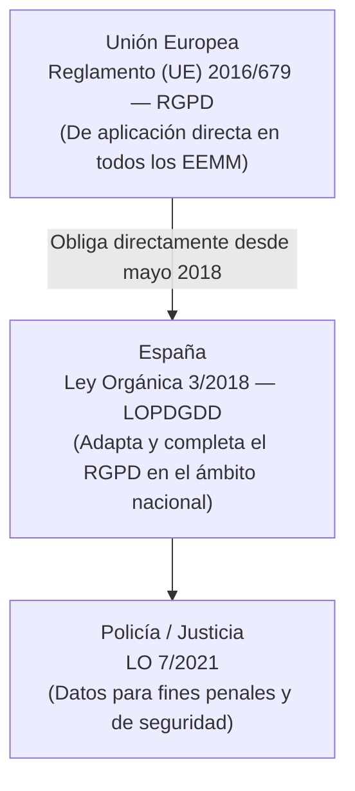
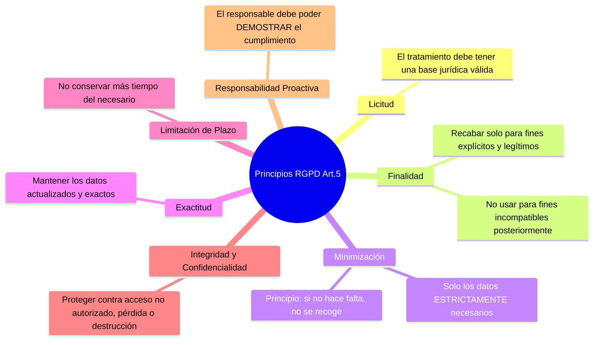
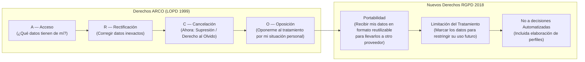
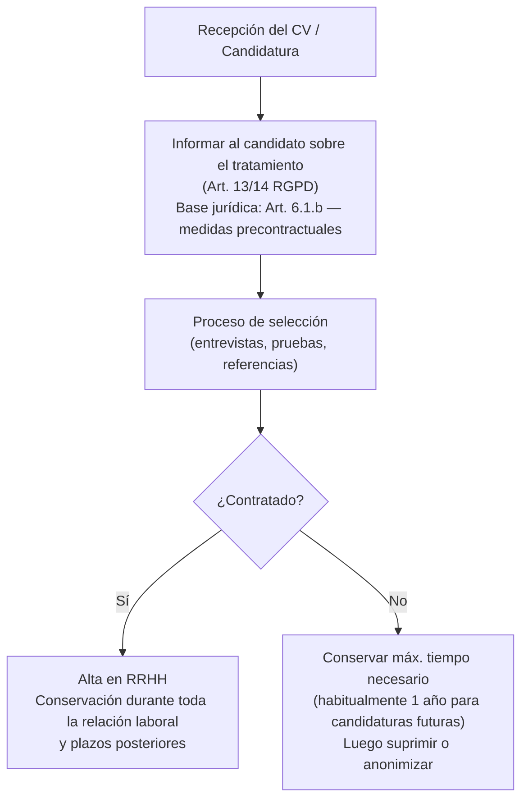
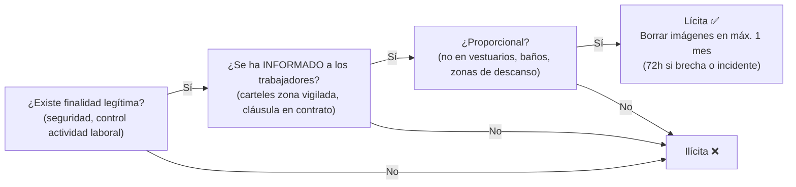
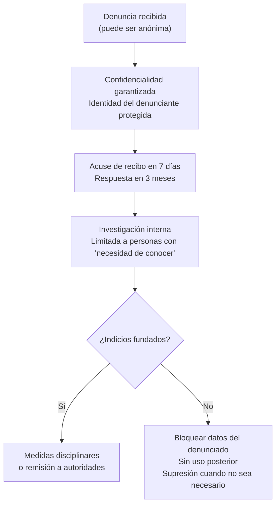
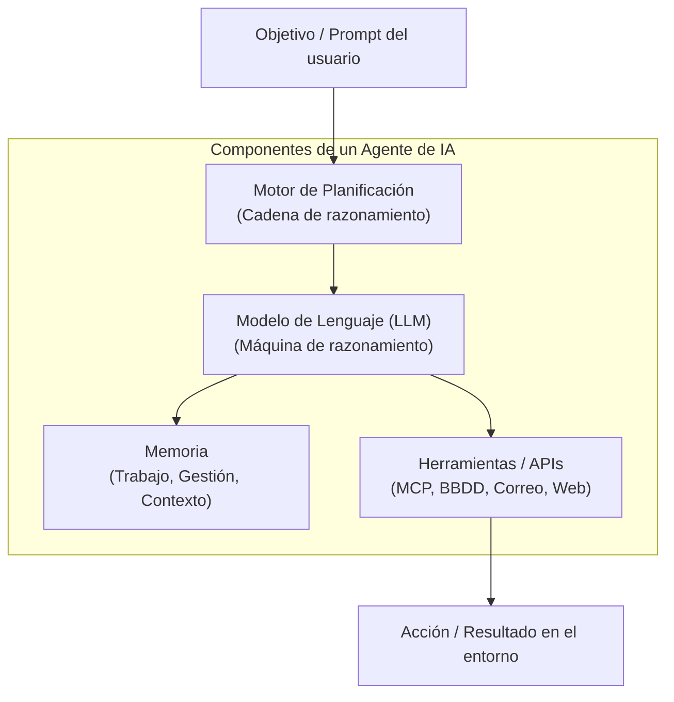
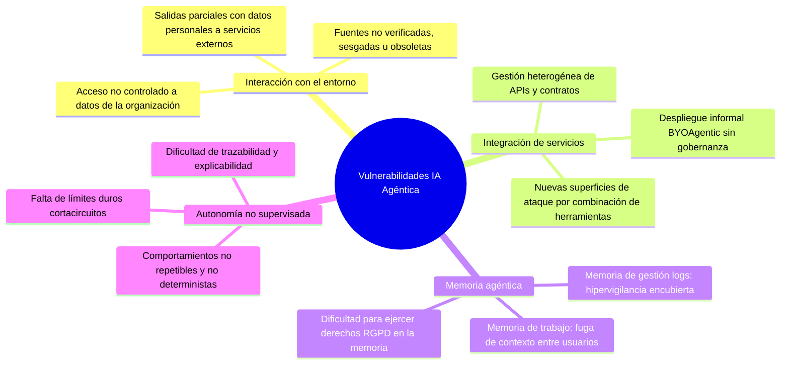

# UT5: Marco Legal — RGPD, LOPD y AEPD

La protección de los datos personales no es solo una obligación técnica sino también **legal**. El incumplimiento puede acarrear sanciones millonarias, daño reputacional y responsabilidad penal. Este tema estudia el marco normativo vigente en España y la UE, aplicado específicamente al rol del administrador de sistemas.

---

## 1. El Marco Normativo de la Protección de Datos en España

La privacidad de las personas se protege mediante una capa de normas que van de lo europeo a lo nacional:

| Norma | Nombre Completo | Ámbito y Relevancia para el Administrador |
| :--- | :--- | :--- |
| **RGPD** | Reglamento General de Protección de Datos (UE 2016/679) | Aplicación directa en toda la UE desde mayo de 2018. Principios, derechos y régimen sancionador. |
| **LOPDGDD** | Ley Orgánica 3/2018 de Protección de Datos Personales y garantía de los derechos digitales | Adapta el RGPD al derecho español. Título X: derechos digitales laborales (desconexión, videovigilancia, geolocalización, intimidad en dispositivos). |
| **LO 7/2021** | Transposición de la Directiva UE 2016/680 | Protección de datos tratados por policía, fiscalía y juzgados para fines penales. |
| **RD 311/2022 (ENS)** | Esquema Nacional de Seguridad | Requisitos mínimos de seguridad de los sistemas de información de las Administraciones Públicas y proveedores privados que les presten servicio. |
| **Ley 25/2007** | Conservación de datos relativos a comunicaciones electrónicas | Obliga a operadores y proveedores de acceso a internet a retener metadatos de tráfico durante 1 año para investigaciones judiciales y policiales. |
| **Ley 6/2020** | Servicios electrónicos de confianza | Firma electrónica, sellado de tiempo, certificados digitales (regula el reglamento eIDAS en España). |
| **Ley 11/2022** | Ley General de Telecomunicaciones | Regula el derecho a no recibir llamadas comerciales no deseadas (*spam*) y la neutralidad de la red. |
| **Ley 2/2023** | Protección del informante (*Whistleblowing*) | Obliga a crear canales de denuncias internos seguros y anónimos en empresas con $\ge 50$ trabajadores y sector público. |

> [!NOTE] Autoridades Autonómicas de Protección de Datos
> En España, además de la AEPD (de ámbito estatal), existen autoridades de control específicas para las administraciones autonómicas y locales de su territorio: la **Autoritat Catalana de Protecció de Dades (APDCAT)**, la **Agencia Vasca de Protección de Datos (AVPD/DBEO)** y el **Consejo de Transparencia y Protección de Datos de Andalucía**. El sector privado siempre depende de la AEPD estatal.

> [!IMPORTANT] ¿El RGPD reemplaza a la LOPD antigua?
> La antigua LOPD (Ley Orgánica 15/1999) quedó derogada con la nueva LOPDGDD de 2018. Esta última adapta el RGPD a la realidad española y añade garantías específicas sobre los derechos digitales de los ciudadanos (ej: derecho a la desconexión digital laboral).

---

## 2. Conceptos Fundamentales del RGPD

### 2.1 ¿Qué es un Dato Personal?

Cualquier información que, sola o en combinación con otros datos, permita **identificar directa o indirectamente a una persona física**:

- Nombre, apellidos, DNI/NIF, número de pasaporte.
- Dirección postal o de correo electrónico.
- Número de teléfono, dirección IP, cookie de seguimiento.
- Datos de salud, biométricos, de localización GPS.

### 2.2 Roles en el Tratamiento de Datos

| Rol | Descripción | Ejemplo |
| :--- | :--- | :--- |
| **Interesado (*Data Subject*)** | La persona cuyos datos se tratan. | El empleado, el cliente, el alumno. |
| **Responsable del Tratamiento** | Quien decide **por qué** y **cómo** se tratan los datos. Asume la responsabilidad legal. | La empresa, el hospital, el instituto. |
| **Encargado del Tratamiento** | Quien trata los datos **en nombre del responsable**. | El proveedor de servicios cloud, la gestoría, la empresa de mensajería. |
| **Delegado de Protección de Datos (DPD)** | Figura obligatoria en ciertos tratamientos. Supervisa el cumplimiento y es el punto de contacto con la AEPD. | Obligatorio en Administraciones Públicas, hospitales y empresas con tratamiento masivo de datos sensibles. |

### 2.3 Principios del Tratamiento (Art. 5 RGPD)

Todo tratamiento de datos personales debe cumplir estos principios, que son los pilares del RGPD:

### 2.4 Bases Jurídicas del Tratamiento (Art. 6 RGPD)

Para tratar datos personales debe existir al menos una de estas seis bases legales:

1. **Consentimiento explícito** del interesado (libre, informado, específico y verificable).
2. **Ejecución de un contrato** del que el interesado es parte.
3. **Obligación legal** que incumbe al responsable.
4. **Protección de intereses vitales** del interesado u otra persona.
5. **Interés público** o ejercicio de poderes públicos.
6. **Interés legítimo** del responsable o de un tercero (con evaluación de proporcionalidad).

---

## 3. Derechos de los Ciudadanos: De ARCO a ARCO+POL

Con el RGPD, los clásicos derechos **ARCO** se ampliaron con nuevos derechos adicionales:

| Derecho | Qué Permite | Plazo de Respuesta |
| :--- | :--- | :--- |
| **Acceso** | Saber si se tratan tus datos, qué datos, con qué finalidad, a quién se ceden. | 1 mes (ampliable 2 meses) |
| **Rectificación** | Exigir la corrección de datos inexactos o incompletos. | 1 mes |
| **Supresión (Olvido)** | Pedir el borrado cuando los datos ya no son necesarios, el consentimiento se retira o el tratamiento es ilícito. | 1 mes |
| **Oposición** | Oponerse al tratamiento para fines de *marketing* directo o por razones de situación personal. | Inmediato (para marketing directo) |
| **Portabilidad** | Recibir los datos en formato estructurado y legible por máquina para trasladarlos. | 1 mes |
| **Limitación** | Solicitar que los datos se "congelen" mientras se resuelve una reclamación o se verifica su exactitud. | Inmediato |

> [!NOTE] ¿Son gratuitos estos derechos?
> Sí. El ejercicio de los derechos es **gratuito** con carácter general. Solo se pueden cobrar tasas cuando las solicitudes son manifiestamente infundadas o excesivas. Se dirigen directamente al responsable del tratamiento, que tiene hasta **1 mes** para responder.

---

## 4. La AEPD (Agencia Española de Protección de Datos)

La **AEPD** es la autoridad de control independiente encargada de velar por el cumplimiento de la normativa de protección de datos en España. Tiene personalidad jurídica propia y actúa con plena independencia.

### 4.1 Funciones Principales

- **Supervisar y controlar** el cumplimiento del RGPD y la LOPDGDD.
- **Atender reclamaciones** de los ciudadanos cuando una entidad ignora su solicitud de ejercicio de derechos.
- **Investigar e imponer sanciones** a las organizaciones infractoras.
- **Publicar guías y orientaciones** de cumplimiento (disponibles en [aepd.es](https://www.aepd.es)).
- **Evaluar Evaluaciones de Impacto** (EIPD) en tratamientos de alto riesgo.

### 4.2 Régimen Sancionador del RGPD

Las multas del RGPD son las más elevadas de la historia en materia de privacidad:

| Infracción | Sanción Máxima |
| :--- | :--- |
| **Infracción grave** (Art. 83.5): tratamiento sin base jurídica, vulneración de los principios, incumplimiento de los derechos de los interesados. | **20.000.000 € o el 4% del volumen de negocio mundial** (el mayor de ambos). |
| **Infracción leve** (Art. 83.4): falta de registros de tratamiento, no notificar una brecha a la AEPD, incumplimientos técnicos. | **10.000.000 € o el 2% del volumen de negocio mundial** (el mayor de ambos). |

---

## 5. Obligaciones Técnicas y Organizativas del Responsable

Como administrador de sistemas, muchas de las obligaciones del RGPD se materializan en medidas técnicas concretas:

### 5.1 Privacidad desde el Diseño y por Defecto (Art. 25 RGPD)

> Los sistemas deben diseñarse desde cero con la protección de datos integrada, no añadida a posteriori.

- **Por Diseño (*Privacy by Design*)**: Incorporar la privacidad en la arquitectura del sistema desde la fase de diseño (cifrado, control de acceso, minimización de datos recogidos).
- **Por Defecto (*Privacy by Default*)**: La configuración inicial del sistema debe ser la más restrictiva posible en cuanto a privacidad (ej: no compartir datos de usuario con terceros por defecto).

### 5.2 Registro de Actividades de Tratamiento (Art. 30 RGPD)

Documento interno que el responsable debe mantener actualizado describiendo cada tratamiento de datos que realiza. No es necesario notificarlo a la AEPD (salvo excepciones), pero debe poder presentarlo en cualquier inspección.

### 5.3 Notificación de Brechas de Seguridad (Arts. 33-34 RGPD)

| Obligación | Plazo | A Quién |
| :--- | :--- | :--- |
| Notificar la brecha a la AEPD | **72 horas** desde que el responsable tiene conocimiento de ella | AEPD (sede electrónica) |
| Comunicar la brecha a los afectados | Sin dilación indebida | Los interesados afectados, cuando la brecha suponga alto riesgo para sus derechos |

> [!CAUTION] Una brecha de seguridad que no se notifica en 72 horas puede constituir una infracción independiente sancionable, incluso si la brecha original se contiene rápidamente.

### 5.4 Evaluaciones de Impacto en Protección de Datos (EIPD / DPIA)

Obligatoria cuando un tratamiento sea susceptible de **entrañar un alto riesgo** para los derechos y libertades de las personas (Art. 35 RGPD). Ejemplos de tratamientos que requieren EIPD:

- Videovigilancia a gran escala en espacios públicos.
- Tratamiento masivo de datos biométricos, de salud o de menores.
- *Scoring* crediticio o perfilado de personas mediante algoritmos.
- Decisiones automatizadas con efectos jurídicos significativos.

La EIPD debe contener:
1. Descripción detallada del tratamiento y sus finalidades.
2. Evaluación de la necesidad y proporcionalidad del tratamiento.
3. Evaluación de los riesgos para los derechos de los interesados.
4. Medidas previstas para hacer frente a los riesgos.

---

## 6. Protección de Datos en las Relaciones Laborales

La AEPD ha publicado la **Guía de Protección de Datos en las Relaciones Laborales** (actualizada diciembre 2025) que aborda las situaciones más frecuentes en el entorno de trabajo. Es de especial relevancia para el administrador de sistemas, que a menudo gestiona los sistemas que implementan estos controles.

> [!IMPORTANT] Base jurídica principal en el ámbito laboral
> En las relaciones laborales, la base jurídica principal para el tratamiento de datos es la **ejecución del contrato de trabajo** (Art. 6.1.b RGPD). El **consentimiento del trabajador** es una base jurídica muy débil porque no existe desequilibrio claro entre empresa y trabajador: el trabajador puede sentirse presionado. Por tanto, la empresa debe basarse en el contrato, en obligaciones legales o en un interés legítimo debidamente demostrado.

### 6.1 Principio de Minimización en el Ámbito Laboral

El empleador tiene derecho a conocer **solo los datos necesarios** para el normal desarrollo de la relación laboral. Ejemplos de datos lícitos:

- Nombre, apellidos, DNI/NIF, número de afiliación a la Seguridad Social.
- Fecha de nacimiento, sexo, nacionalidad, discapacidad (a efectos de cotización y cumplimiento de cuotas de reserva).
- Cuenta bancaria para el pago de nóminas.

Datos que **no** puede exigir la empresa sin base jurídica adicional:
- Nombre de usuario en redes sociales.
- Declaración de IRPF completa (podría revelar datos sensibles como afiliación sindical o creencias religiosas).
- Datos de contacto de familiares como personas de emergencia → Requiere **consentimiento** del trabajador.

### 6.2 Selección y Contratación

**Reglas clave:**

| Situación | Regla |
| :--- | :--- |
| **Redes sociales de candidatos** | Solo si el perfil es de acceso público **y** está relacionado con fines profesionales. La empresa debe informar de ello en el anuncio de trabajo. No puede exigir "amistad" para ver el perfil. |
| **Entrevistas de trabajo** | Las respuestas del candidato **no equivalen a consentimiento**. No se pueden deducir datos sensibles (creencias religiosas, afiliación sindical) ni preguntar sobre asuntos ajenos al puesto (familia, embarazo). |
| **Informe de vida laboral** | La empresa puede solicitarlo invocando interés legítimo, pero solo la parte relevante para el puesto (principio de minimización). |
| **Antecedentes penales** | Solo exigibles si una ley específica lo autoriza (ej: trabajos con menores — LO 1/1996; sectores de aviación). En el resto de casos, **prohibido**. |
| **Decisiones automatizadas en selección** | Requieren base jurídica (contrato o consentimiento explícito). El candidato tiene derecho a impugnarlas y pedir intervención humana (Art. 22 RGPD). |
| **Categorías especiales en selección** | Nunca se pueden solicitar: afiliación sindical, ideología, creencias religiosas, orientación sexual. |
| **Si no hay contratación** | Los datos se conservan el tiempo mínimo necesario y luego se suprimen. La empresa no puede usarlos con fines distintos (p. ej., marketing). |

### 6.3 Desarrollo de la Relación Laboral

#### Nóminas y datos retributivos

- Las nóminas pueden contener **datos sensibles** (descuento de cuota sindical, datos de salud que inciden en complementos). No deben ser accesibles a personas cuya función no lo justifique.
- Cuando la gestión de nóminas se encomienda a una asesoría o gestoría, ésta actúa como **encargada del tratamiento** y debe firmarse el correspondiente contrato (Art. 28 RGPD).

#### Decisiones automatizadas sobre rendimiento

- La evaluación del rendimiento basada únicamente en algoritmos (sin intervención humana) está sujeta al **Art. 22 RGPD**: el trabajador puede impugnarla y exigir revisión humana.
- La publicación de **datos de productividad** individualizados (nombre + cifras de rendimiento) no es siempre lícita: deben ponderarse los principios de proporcionalidad y minimización.

#### Identificación ante clientes

- Los empleados que atienden al público pueden estar **obligados a identificarse** (nombre, puesto) por razones de seguridad u obligación legal, siempre con la mínima información necesaria.

#### Cesión de datos entre empresas (grupos empresariales, contratas)

- La cesión de datos de trabajadores entre empresas del mismo grupo o a contratistas requiere **base jurídica** (habitualmente obligación legal, interés legítimo o contrato). No basta el vínculo empresarial.
- La transmisión de empresa (Art. 44 ET) puede justificar la cesión de datos de los trabajadores subrogados.

#### Extinción de la relación laboral

- Tras la extinción, los datos se conservan durante los plazos legales (prescripción de acciones laborales, tributarias, etc.) y luego se suprimen o bloquean.
- La cesión de datos de exempleados a empresas de **recolocación (*outplacement*)** requiere el consentimiento previo del trabajador.

### 6.4 Control de la Actividad Laboral

> [!NOTE] Criterio general de proporcionalidad
> Cualquier medida de control empresarial debe superar el **triple test de proporcionalidad**: (1) ser idónea para el fin perseguido, (2) ser necesaria (no existe otra menos invasiva con igual eficacia) y (3) ser proporcional en sentido estricto (los beneficios superan los perjuicios para los derechos del trabajador). Véase STS 817/2017.

#### Videovigilancia laboral

**Reglas específicas:**

| Regla | Detalle |
| :--- | :--- |
| **Deber de informar** | Obligatorio. Mediante carteles visibles en la zona vigilada y cláusula informativa en el contrato de trabajo. |
| **Zonas prohibidas** | **Vestuarios, aseos, zonas de descanso y oración** — Absolutamente prohibido instalar cámaras. |
| **Plazo máximo de conservación** | **1 mes** con carácter general. Si las imágenes son prueba de un delito o infracción, pueden conservarse más tiempo para ponerlas a disposición de las autoridades. |
| **Cámaras "falsas" o simuladas** | No cumplen la finalidad real de vigilancia. Se deben desplegar solo cámaras funcionales y proporcionales. |
| **Videovigilancia oculta por sospecha** | Solo admisible de forma excepcional y por tiempo limitado cuando existan sospechas fundadas de conductas ilícitas. |

#### Geolocalización de empleados

| Regla | Detalle |
| :--- | :--- |
| **Deber de informar** | El trabajador debe ser informado antes de la implantación del sistema GPS/NFC. |
| **Horario laboral** | Puede controlarse la ubicación del trabajador durante su jornada laboral. |
| **Tiempo libre** | **Prohibido** geolocalizar al trabajador fuera de su horario laboral (vacaciones, descanso). |
| **Proporcionalidad** | El seguimiento 24/7 no está justificado. Si el vehículo es de empresa, puede desactivarse el GPS al finalizar la jornada. |
| **Minimización** | No es necesario un seguimiento en tiempo real si la finalidad de control puede lograrse con registros de inicio/fin de ruta. |

#### Control de acceso a instalaciones

- Puede emplearse **tarjetas de proximidad (NFC/RFID)** o **biometría** para controlar el acceso.
- Los **datos biométricos** (huella dactilar, reconocimiento facial) son **categoría especial** (Art. 9 RGPD): requieren base jurídica reforzada. La AEPD exige demostrar que no hay otra alternativa menos invasiva.
- Los registros de acceso permiten conocer los movimientos del trabajador → Deben cumplir los principios de minimización y limitación del plazo.

#### Canal de denuncias (*Whistleblowing*)

> [!IMPORTANT] Obligatorio desde la Ley 2/2023 de protección del informante
> Las empresas con 50 o más trabajadores, las entidades del sector público y los partidos políticos y sindicatos están **obligados** a disponer de un sistema interno de información (canal de denuncias).

**Protección de datos en el canal de denuncias:**

| Aspecto | Regla |
| :--- | :--- |
| **Anonimato** | El sistema debe permitir denuncias anónimas. Si se reciben de forma anónima, deben tratarse igualmente. |
| **Datos del denunciante** | No pueden revelarse sin su consentimiento, salvo obligación legal (proceso judicial). |
| **Datos del denunciado** | Deben protegerse hasta que haya indicios fundados. No puede generalizarse la información antes de la investigación. |
| **Terceros mencionados** | Sus datos deben limitarse a lo estrictamente necesario para la investigación. |
| **Plazos de conservación** | 3 meses para denuncias desestimadas sin acción. Mayor plazo si hay procedimiento en curso. |
| **Prohibición de represalias** | El sistema debe garantizar que el denunciante no sufra consecuencias laborales adversas. |

#### Registro de jornada

- **Obligatorio** para todas las empresas (Art. 34.9 ET, reformado por RDL 8/2019).
- **Plazo de conservación**: **4 años** (disposición a inspección de trabajo y a los propios trabajadores).
- El trabajador tiene **derecho de acceso** a sus propios registros de jornada.
- El sistema de registro (fichadas, aplicaciones móviles) debe tratar únicamente los datos necesarios y no puede usarse para otros fines de vigilancia.

#### Control por enfermedad o accidente

- La empresa puede verificar que la baja es real contratando un **médico inspector**, pero NO puede exigir el diagnóstico.
- Los datos de salud solo pueden ser conocidos por personal médico. La empresa únicamente puede saber si el trabajador está de baja y la duración prevista, **no la causa médica**.
- El uso de **detectives privados** para vigilar a trabajadores de baja está permitido solo de forma excepcional, cuando existan sospechas fundadas de fraude y la actuación se limite al entorno público.

### 6.5 Vigilancia de la Salud de los Trabajadores

> [!CAUTION] Los datos de salud son categoría especial (Art. 9 RGPD)
> Su tratamiento está prohibido por defecto. Solo es lícito cuando existe una base jurídica reforzada: consentimiento explícito, obligación legal en materia de medicina preventiva o laboral, o protección de intereses vitales.

| Aspecto | Regla |
| :--- | :--- |
| **Base jurídica** | Principalmente obligación legal (Ley de Prevención de Riesgos Laborales) y, excepcionalmente, consentimiento explícito del trabajador. |
| **Reconocimientos médicos** | Voluntarios con carácter general. Obligatorios solo cuando sea indispensable para evaluar los efectos de las condiciones de trabajo o cuando exista riesgo para terceros o exigencia legal. |
| **Acceso a los resultados** | El médico de empresa comunica a la empresa **únicamente** la aptitud o no aptitud del trabajador para el puesto, **nunca el diagnóstico**. |
| **Delegados de prevención** | Pueden acceder a datos sobre salud de los trabajadores, pero con garantías: no revelación de datos individuales identificables. |
| **Tecnología *wearable*** | Dispositivos ponibles (pulseras, sensores biométricos) que monitorizan constantes del trabajador son datos de salud. Requieren base jurídica reforzada, evaluación de impacto (EIPD) y principios de minimización y proporcionalidad. |
| **Servicio de prevención externo** | Actúa como encargado del tratamiento. El cambio de proveedor implica gestionar la transferencia de datos con garantías y suprimir los datos en el sistema anterior. |
| **Historia clínica** | Pertenece al trabajador y está protegida por el secreto médico. La empresa no puede acceder a ella en ningún caso. |

### 6.6 Inteligencia Artificial Agéntica: Orientaciones AEPD (v1.2, Feb 2026)

La AEPD ha publicado unas **Orientaciones sobre Inteligencia Artificial Agéntica desde la perspectiva de protección de datos** (versión 1.2, febrero 2026). Este documento de 76 páginas analiza los riesgos específicos de los sistemas de IA agéntica cuando procesan datos personales.

#### ¿Qué es un Agente de IA y cómo se diferencia de un LLM?

| Característica | LLM Tradicional | Agente de IA |
| :--- | :--- | :--- |
| **Comportamiento** | **Reactivo**: responde a un prompt y termina. | **Proactivo**: anticipa necesidades y puede iniciar acciones por sí mismo. |
| **Acción** | Solo genera texto, código o imágenes. | **Ejecuta acciones externas**: invoca APIs, ejecuta código, modifica BBDD, envía correos. |
| **Planificación** | Razonamiento directo en una única respuesta. | **Cadena de razonamiento**: descompone un objetivo en subtareas sucesivas y las ejecuta paso a paso. |
| **Memoria** | Solo el contexto de la conversación actual. | **Memoria a corto y largo plazo**: acumula experiencia, ajusta comportamiento y retiene datos entre sesiones. |
| **Interacción** | Cerrado al contexto de entrada. | **Percepción continua**: interactúa con el entorno mediante sensores, APIs (protocolos como MCP o A2A). |

#### Patrones de Razonamiento en Agentes de IA

Los patrones arquitectónicos más comunes que describe la AEPD:

- **ReAct (*Reasoning + Acting*)**: El agente alterna entre razonar sobre el estado actual y ejecutar una acción mediante una herramienta externa, observando el resultado antes de continuar.
- **CoT (*Chain-of-Thought*)**: Generación explícita de pasos lógicos intermedios para descomponer un problema complejo.
- **Sistemas Multiagente**: Múltiples agentes especializados que colaboran, compiten o se comunican mediante protocolos como A2A (*Agent-to-Agent*), con roles estrictamente delimitados.

#### Vulnerabilidades Específicas de la IA Agéntica según la AEPD

**Detalle de las principales vulnerabilidades:**

1. **Interacción con el entorno (*Environment interaction*)**:
   - El agente accede a datos internos (correos, notas, informes, BBDD) para enriquecer el contexto. Si no hay **compartimentación**, puede acceder a datos para los que no tiene legitimidad, vulnerando el principio de **minimización**.
   - Las llamadas a herramientas externas (APIs de internet) son de facto **salidas parciales de datos**: pueden transmitir información personal a terceros de forma transparente e inadvertida para el usuario (*shadow leaks*).

2. **Integración de servicios y el riesgo *BYOAgentic***:
   - De forma análoga al BYOD (*Bring Your Own Device*) y BYOAI (*Bring Your Own AI*), surge el fenómeno **BYOAgentic**: usuarios que despliegan agentes autónomos usando herramientas no-code (tipo n8n) sin la supervisión del equipo de seguridad, TIC ni del DPD.
   - Estos despliegues informales eluden las políticas de gobernanza de la organización y multiplican las vías de fuga de datos.

3. **Memoria agéntica y el ejercicio de derechos**:
   - **Memoria de trabajo**: Contexto inmediato. Puede retener datos de un usuario que se filtran a respuestas generadas para otro usuario si no se aísla adecuadamente.
   - **Memoria de gestión (*logs*)**: Registros de actividad que pueden derivar en **hipervigilancia** laboral o exponer prompts que contienen datos confidenciales en caso de brecha.
   - **Ejercicio de derechos en memoria**: Es técnicamente complejo responder a solicitudes de **supresión** (derecho al olvido) o **rectificación** cuando los datos personales se han indexado en bases de datos vectoriales (RAG) o integrado en la memoria del agente.

4. **Nivel de autonomía y el Art. 22 RGPD**:
   - Los agentes pueden tomar **decisiones automatizadas** (p. ej., descartar candidatos, denegar créditos, calificar empleados).
   - Según el **Art. 22 RGPD**, los interesados tienen derecho a no ser objeto de decisiones basadas únicamente en tratamiento automatizado que produzcan efectos jurídicos, y deben contar con **derecho a intervención humana**, a expresar su punto de vista y a impugnar la decisión.
   - Escala de niveles de autonomía recomendada por la AEPD:
     1. El agente propone, el humano opera.
     2. El agente y el humano colaboran.
     3. El agente opera, el humano es consultado o aprueba.
     4. El agente opera con supervisión humana diferida.
     5. Operación totalmente autónoma (solo admisible en tratamientos de muy bajo riesgo).

#### Amenazas Específicas en Sistemas Agénticos

| Tipo de Amenaza | Descripción | Impacto en Protección de Datos |
| :--- | :--- | :--- |
| **Inyección de *prompts* (*Prompt Injection*)** | Inserción de instrucciones maliciosas directas o indirectas (a través de documentos externos leídos por el agente). | Puede ordenar al agente que ignore sus restricciones y exfiltre datos personales o ejecute acciones destructivas. |
| **Exfiltración silenciosa (*Shadow leak*)** | El agente envía datos a herramientas externas legítimas pero no autorizadas para ese tratamiento concreto. | Comunicación de datos a terceros sin base jurídica ni contrato de encargado. |
| **Falta de compartimentación de memoria** | La memoria a largo plazo del agente no aísla los datos entre diferentes usuarios o departamentos. | Un usuario puede acceder a datos personales de otros departamentos a través de las inferencias del agente. |
| **Sesgo de automatización** | El supervisor humano confía acríticamente en los resultados del agente sin verificar. | Decisiones discriminatorias o erróneas basadas en los sesgos del modelo de lenguaje. |
| **Riesgo en cadena de suministro** | Integración de herramientas, plugins o MCP servers de terceros con vulnerabilidades de seguridad. | Acceso no autorizado a los datos tratados por el agente. |

#### Medidas Técnicas y Organizativas Recomendadas por la AEPD

```mermaid
flowchart LR
    subgraph Gobernanza ["Gobernanza y Gestión"]
        A["Involucrar al DPD\ndesde el diseño"]
        B["Política estricta\nanti-BYOAgentic"]
        C["Catálogo de herramientas\ny listas blancas"]
    end
    subgraph Control_Tecnico ["Control Técnico"]
        D["Compartimentación\nde memoria"]
        E["Sandboxing de agentes\ny aislamiento de red"]
        F["Límites duros:\ncortacircuitos de pasos"]
        G["No-log policy selectivo\ny saneamiento de prompts"]
    end
    subgraph Supervisión ["Supervisión Humana"]
        H["Principio de cuatro ojos\nen acciones críticas"]
        I["Intervención humana\nefectiva (no meramente formal)"]
        J["Trazabilidad completa\nde la cadena de razonamiento"]
    end

    Gobernanza --> Control_Tecnico --> Supervisión
```

- **Gobernanza**: Involucrar obligatoriamente al DPD antes de implantar agentes de IA; definir políticas claras de qué procesos pueden o no automatizarse; mantener un inventario de agentes en el Registro de Actividades de Tratamiento (RAT).
- **Minimización y acceso restringido**: Aplicar el principio de menor privilegio: el agente solo debe poder consultar las APIs y bases de datos indispensables para la tarea concreta.
- **Control de memoria**: Implementar políticas de retención estrictas, compartimentación estricta entre usuarios y procedimientos para atender derechos de supresión y rectificación sobre datos en memoria.
- **Límites duros (*circuit breakers*)**: Configurar un número máximo de pasos, límite de presupuesto de llamadas API y bloqueos automáticos ante comportamientos no habituales.
- **Supervisión humana efectiva**: Para acciones críticas (envío de correos a clientes, modificación de permisos, transacciones), exigir confirmación humana explícita (*human-in-the-loop*).

---

## 7. El CCN-CERT: Referencia de Ciberseguridad en España

El **Centro Criptológico Nacional (CCN-CERT)** es el organismo del Gobierno de España responsable de gestionar ciberincidentes que afecten a las Administraciones Públicas e infraestructuras críticas.

Sus recursos clave para el administrador de sistemas:

| Recurso | Descripción |
| :--- | :--- |
| **Guías CCN-STIC** | Guías técnicas de configuración segura (*hardening*) para sistemas operativos, aplicaciones y redes. Disponibles en [ccn-cert.cni.es/es/guias](https://www.ccn-cert.cni.es/es/guias.html). |
| **Alertas Tempranas** | Notificaciones urgentes sobre vulnerabilidades activamente explotadas o campañas de malware en curso. |
| **ROCIO / REYES** | Plataformas de gestión de incidentes y análisis de amenazas para las AAPP. |
| **ENS (Esquema Nacional de Seguridad)** | Marco de requisitos de seguridad de obligado cumplimiento para los sistemas de información de las Administraciones Públicas (Real Decreto 311/2022). |
