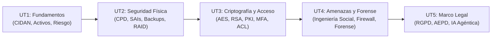

# 🛡️ Seguridad y Alta Disponibilidad (SAD)

Módulo Completo (5 Unidades)
Prácticas + Legislación

Bienvenido al módulo de **Seguridad y Alta Disponibilidad (SAD)** de 2º de ASIR. Este módulo te enseñará cómo proteger los sistemas de información frente a fallos mecánicos, ataques informáticos y desastres físicos, garantizando además el cumplimiento estricto de las leyes de privacidad vigentes.

---

## 🗺️ Mapa de Aprendizaje del Módulo

Sigue el orden recomendado de las unidades para construir tu conocimiento paso a paso:

---

## 📚 Unidades Temáticas de Estudio

-   

        
:material-shield-check:

        

            
Unidad 1

            
Fundamentos de Seguridad

        

    

    

        Aprende el modelo mental de la seguridad: modelo <strong>CIDAN</strong>, la ecuación del riesgo ($P \times I$), seguridad física vs lógica y activa vs pasiva.
    

    

        Teoría Base
        <a class="course-btn" href="01-fundamentos-seguridad.md">Estudiar Unidad :octicons-arrow-right-24:</a>
    

-   

        
:material-server:

        

            
Unidad 2

            
Seguridad Física, SAI y Backups

        

    

    

        Condiciones de un CPD, cálculo de potencia de un <strong>SAI (VA y W)</strong>, estrategias de copias de seguridad (regla 3-2-1) y tolerancia a fallos con <strong>RAID</strong>.
    

    

        Ejercicios de Cálculo
        <a class="course-btn" href="02-seguridad-fisica-sai-backup.md">Estudiar Unidad :octicons-arrow-right-24:</a>
    

-   

        
:material-key-chain:

        

            
Unidad 3

            
Control de Acceso y Criptografía

        

    

    

        Autenticación robusta (PAM, MFA, biometría), cifrado simétrico (AES), asimétrico (RSA), funciones Hash SHA-256, firma digital, PKI, cifrado de discos (LUKS) y TLS/SSH.
    

    

        Criptografía
        <a class="course-btn" href="03-control-acceso-criptografia.md">Estudiar Unidad :octicons-arrow-right-24:</a>
    

-   

        
:material-bug-outline:

        

            
Unidad 4

            
Amenazas, Vulnerabilidades y Forense

        

    

    

        Ingeniería social (phishing, vishing), malware y rootkits, métricas CVE/CVSS, protección perimetral (UFW, IDS/IPS, DMZ) y análisis forense con cadena de custodia.
    

    

        Seguridad Perimetral
        <a class="course-btn" href="04-amenazas-vulnerabilidades-forense.md">Estudiar Unidad :octicons-arrow-right-24:</a>
    

-   

        
:material-scale-balance:

        

            
Unidad 5

            
Marco Legal: RGPD y AEPD

        

    

    

        Normativa de privacidad en España y la UE (RGPD, LOPDGDD), derechos ARCO+POL, videovigilancia, control laboral, canales de denuncia e IA Agéntica según la AEPD.
    

    

        Marco Legal
        <a class="course-btn" href="05-marco-legal-rgpd-aepd.md">Estudiar Unidad :octicons-arrow-right-24:</a>
    

---

## 💡 Consejos para aprobar el módulo de SAD

1. **No memorices comandos sin entender el objetivo**: En seguridad, cada comando o herramienta responde a uno de los pilares del modelo **CIDAN** (Confidencialidad, Integridad, Disponibilidad, Autenticación, No repudio).
2. **Practica los ejercicios numéricos de la UT2**: El dimensionado de un SAI en Volt-Amperios ($VA$) y el cálculo de espacio útil y discos de tolerancia en matrices RAID (0, 1, 5, 6, 10) entran prácticamente siempre en los exámenes prácticos.
3. **Resuelve los Tests de Autoevaluación**: Al final de cada unidad tienes un bloque desplegable de autoevaluación. Intenta responder a la pregunta mentalmente antes de abrir el desplegable.
