# Seguridad y Alta Disponibilidad (SAD)

Bienvenido a la sección de apuntes del módulo **Seguridad y Alta Disponibilidad (SAD)** del 2º curso del CFGS en **Administración de Sistemas Informáticos en Red (ASIR)**.

---

## 🎯 Objetivos y Competencias del Módulo

El módulo SAD combina la seguridad ofensiva y defensiva de sistemas con el marco legal que rige la protección de la información:

1. **Fundamentos de Seguridad Informática**: Comprender el modelo **CIDAN** y la cadena Amenaza → Vulnerabilidad → Incidente → Impacto.
2. **Seguridad Física y Lógica**: CPDs, control de acceso, SAI, copias de seguridad (regla 3-2-1) y redundancia (RAID).
3. **Control de Acceso y Criptografía**: Autenticación multifactor (MFA), biometría, ACL, cifrado simétrico/asimétrico, funciones hash, firma digital y PKI.
4. **Amenazas, Vulnerabilidades y Gestión**: Ingeniería social (phishing, vishing, baiting), rootkits, CVE/CWE/CVSS y ciclo de gestión continua.
5. **Protección Perimetral**: Cortafuegos, IDS/IPS, DMZ, segmentación VLAN, NAC y VPN.
6. **Marco Legal y RGPD**: Ley Orgánica 3/2018 (LOPDGDD), Reglamento General de Protección de Datos (RGPD), derechos ARCO y el rol de la AEPD.
7. **Análisis Forense**: Cadena de custodia, fases de investigación y adquisición de evidencias.

---

## 🗺️ Mapa Conceptual de SAD

```mermaid
flowchart TD
    SAD["Seguridad y Alta Disponibilidad (SAD)"]

    SAD --> U1["UT1: Fundamentos de Seguridad Informática"]
    SAD --> U2["UT2: Seguridad Física, SAI y Copias de Seguridad"]
    SAD --> U3["UT3: Control de Acceso y Criptografía"]
    SAD --> U4["UT4: Amenazas, Vulnerabilidades y Análisis Forense"]
    SAD --> U5["UT5: Marco Legal — RGPD, LOPDGDD y AEPD"]

    U1 --> U1a["Modelo CIDAN\n(Confidencialidad, Integridad, Disponibilidad,\nAutenticación, No Repudio)"]
    U1 --> U1b["Activos, Amenazas, Vulnerabilidades\nRiesgo = Probabilidad × Impacto"]

    U2 --> U2a["SAI Offline / Interactivo / Online\n(Tipos, dimensionado en VA)"]
    U2 --> U2b["Copias: Completa, Incremental, Diferencial\nRegla 3-2-1 y RAID"]

    U3 --> U3a["MFA, Biometría (FAR/FRR)\nACL y Listas de Control de Acceso"]
    U3 --> U3b["Cifrado Simétrico (AES)\nCifrado Asimétrico (RSA)\nHash SHA-256, Firma Digital, PKI"]

    U4 --> U4a["Ingeniería Social: Phishing, Vishing,\nBaiting, Smishing, Pretexting"]
    U4 --> U4b["Rootkits (Userland, Kernel, Bootkit)\nCVE, CWE, CVSS y Gestión de Vulnerabilidades"]
    U4 --> U4c["Protección Perimetral:\nFirewall, IDS/IPS, DMZ, VLAN, VPN"]
    U4 --> U4d["Análisis Forense Digital\ny Cadena de Custodia"]

    U5 --> U5a["RGPD (UE 2016/679)\nLOPD-GDD (LO 3/2018)"]
    U5 --> U5b["Derechos ARCO+POL\ny Rol de la AEPD"]
```

---

## 📚 Unidades del Módulo

| Unidad | Título | Temas Clave |
| :--- | :--- | :--- |
| **01** | [Fundamentos de la Seguridad Informática](01-fundamentos-seguridad.md) | ¿Por qué y qué proteger, modelo CIDAN, activos/amenazas/vulnerabilidades/riesgo, seguridad física vs lógica, activa vs pasiva, buenas prácticas. |
| **02** | [Seguridad Física, SAI y Copias de Seguridad](02-seguridad-fisica-sai-backup.md) | CPD, tipos de SAI (offline/interactivo/online), cálculo de VA/autonomía, copias completa/incremental/diferencial, regla 3-2-1 y RAID. |
| **03** | [Control de Acceso, Criptografía y PKI](03-control-acceso-criptografia.md) | Control de acceso por capas, contraseñas robustas, biometría (FAR/FRR), ACL, cifrado simétrico (AES) y asimétrico (RSA), hash SHA-256, firma digital, PKI, TLS/HTTPS, SSH y VPN. |
| **04** | [Amenazas, Vulnerabilidades y Análisis Forense](04-amenazas-vulnerabilidades-forense.md) | Ingeniería social (phishing, vishing, baiting…), rootkits, CVE/CWE/CVSS, gestión de vulnerabilidades, protección perimetral (firewall/IDS/IPS/DMZ/VLAN) y análisis forense con cadena de custodia. |
| **05** | [Marco Legal: RGPD, LOPD y AEPD](05-marco-legal-rgpd-aepd.md) | RGPD (UE 2016/679), LOPDGDD (LO 3/2018), principios del tratamiento, derechos ARCO+POL, obligaciones del responsable, Evaluaciones de Impacto (EIPD) y sanciones de la AEPD. |

---

## 🛠️ Marco Normativo de Referencia

| Norma / Estándar | Ámbito | Descripción |
| :--- | :--- | :--- |
| **RGPD (UE 2016/679)** | Europeo | Reglamento de Protección de Datos de obligado cumplimiento en toda la UE. Vigente desde mayo 2018. |
| **LOPDGDD (LO 3/2018)** | España | Ley Orgánica española que adapta el RGPD y regula los derechos digitales. |
| **ENS (Real Decreto 311/2022)** | Administración Española | Esquema Nacional de Seguridad: marco de seguridad para la Administración Pública. |
| **ISO/IEC 27001** | Internacional | Norma para sistemas de gestión de la seguridad de la información (SGSI). |
| **CCN-CERT** | España | Centro Criptológico Nacional: guías y alertas de seguridad para las AAPP y el sector privado. |
