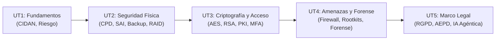

  <h1>🛡️ Seguridad y Alta Disponibilidad (SAD)</h1>
  
El módulo de <strong>SAD</strong> prepara al administrador para diseñar sistemas informáticos tolerantes a fallos, proteger la infraestructura frente a ciberataques y garantizar el cumplimiento estricto del marco normativo de protección de datos (RGPD / AEPD).

## 🗺️ Mapa de Contenidos

El temario oficial se estructura en 5 unidades didácticas organizadas de forma progresiva:

---

## 📚 Unidades Didácticas de SAD

<table class="syllabus-table">
  <thead>
    <tr>
      <th>Unidad</th>
      <th>Título del Tema</th>
      <th>Conceptos y Prácticas Principales</th>
      <th>Tipo de Evaluación</th>
      <th>Enlace</th>
    </tr>
  </thead>
  <tbody>
    <tr>
      <td><strong>UT1</strong></td>
      <td><strong>Fundamentos de Seguridad</strong></td>
      <td>Modelo mental CIDAN (Confidencialidad, Integridad, Disponibilidad, Autenticación, No repudio), fórmula del riesgo ($P \times I$), clasificación de activos, amenazas y vulnerabilidades, seguridad física vs lógica y activa vs pasiva.</td>
      <td>Teoría Base</td>
      <td><a class="module-link" href="01-fundamentos-seguridad.md">Abrir tema :octicons-arrow-right-16:</a></td>
    </tr>
    <tr>
      <td><strong>UT2</strong></td>
      <td><strong>Seguridad Física, SAI y Backups</strong></td>
      <td>Condiciones del CPD, tipos de SAI (Offline, Interactivo, Online de doble conversión), cálculo de potencia en Volt-Amperios ($VA$), estrategia de copias de seguridad 3-2-1 y tolerancia a fallos con matrices RAID (0, 1, 5, 6, 10).</td>
      <td>Problemas de Cálculo</td>
      <td><a class="module-link" href="02-seguridad-fisica-sai-backup.md">Abrir tema :octicons-arrow-right-16:</a></td>
    </tr>
    <tr>
      <td><strong>UT3</strong></td>
      <td><strong>Control de Acceso y Criptografía</strong></td>
      <td>Defensa en profundidad, autenticación MFA (4 factores), biometría y tasas FAR/FRR, cifrado simétrico (AES), asimétrico (RSA), funciones Hash SHA-256, firmas digitales, infraestructura PKI y cifrado de particiones con LUKS.</td>
      <td>Criptografía + Lab</td>
      <td><a class="module-link" href="03-control-acceso-criptografia.md">Abrir tema :octicons-arrow-right-16:</a></td>
    </tr>
    <tr>
      <td><strong>UT4</strong></td>
      <td><strong>Amenazas, Vulnerabilidades y Forense</strong></td>
      <td>Ingeniería social (10 técnicas), rootkits en kernel y bootkits, métricas CVE/CWE/CVSS, protección perimetral con cortafuegos UFW e IDS/IPS, zonas DMZ, las 9 fases del análisis forense y preservación de la cadena de custodia.</td>
      <td>Seguridad Perimetral</td>
      <td><a class="module-link" href="04-amenazas-vulnerabilidades-forense.md">Abrir tema :octicons-arrow-right-16:</a></td>
    </tr>
    <tr>
      <td><strong>UT5</strong></td>
      <td><strong>Marco Legal: RGPD y AEPD</strong></td>
      <td>Normativa europea y española (RGPD, LOPDGDD, ENS, Ley 2/2023), los 7 principios, derechos ARCO+POL, notificación de brechas en 72h, videovigilancia laboral, registro de jornada, canales de denuncia y directrices de IA Agéntica.</td>
      <td>Legislación + Test</td>
      <td><a class="module-link" href="05-marco-legal-rgpd-aepd.md">Abrir tema :octicons-arrow-right-16:</a></td>
    </tr>
  </tbody>
</table>

---

## 💡 Orientaciones para el Estudio de SAD

1. **Comprensión sobre memorización**: En cada tema, pregúntate qué letra del modelo **CIDAN** se está protegiendo.
2. **Ejercicios matemáticos clave**: En los exámenes prácticos suelen exigir el dimensionado de un SAI ($VA = \frac{W \times 1,25}{FP}$) y el cálculo de almacenamiento útil en matrices RAID 5 y 6.
3. **Autoevaluación al terminar cada tema**: Cada unidad incluye un test con preguntas reales de examen y respuestas desplegables.
